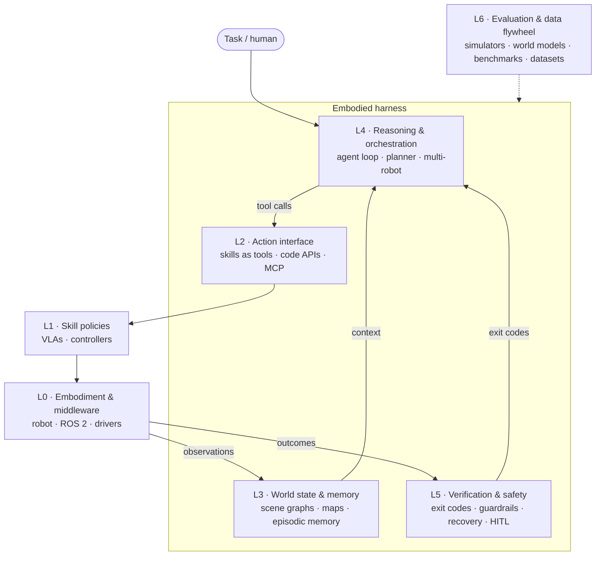

# Awesome Embodied Harness [](https://awesome.re)

<!-- BEGIN GENERATED: badges -->
   
<!-- END GENERATED: badges -->

> A curated, continuously updated survey of the **embodied harness** stack: everything around a foundation model that turns it into an agent acting in the physical world. A daily radar agent keeps it current.

Coding agents showed that the model is only half the system. Claude Code, Codex and their peers succeed or fail on their **harness**: the loop, the tools, context management, permissions, and tests used as exit codes. Robots are going through the same split. An **embodied harness** wraps an LLM, VLM, VLA or world model with:

- an **agent loop** that plans, calls tools, observes and replans;
- robot capabilities exposed as **tools**: skills, VLA policies, motion primitives, generated code;
- **world state as context**: scene graphs, maps, object and episodic memory;
- **exit codes**: success detection, failure diagnosis and recovery;
- a **safety envelope**: guardrails, permissions, human-in-the-loop;
- the **sim / eval / data flywheel** used to build and test all of the above.

This list covers every layer of that stack, not just the models. [SURVEY.md](SURVEY.md) has the taxonomy, a comparison of representative harnesses, and open problems.



**Legend:** 🟢 open (code, and weights for models) · 🟡 partial (e.g. weights or dataset only) · 🔵 API / product · ⚪ closed (paper, blog or demo only). Hover over a name to see the full paper title. The overview below shows the 10 newest entries of each category. Every category also has a full list page in [`categories/`](categories), grouped by year.

## Contents

<!-- BEGIN GENERATED: toc -->
- [Surveys & Position Papers](#survey) (99)
- [Embodied Harnesses](#harness) (240)
- [Open-Source Frameworks & Runtimes](#framework) (30)
- [Action Interfaces, Skills & Tool Protocols](#interface) (48)
- [World State, Memory & Spatial Context](#memory) (81)
- [Embodied Reasoning Models & Planners](#brain) (59)
- [VLA Models & Skill Policies](#policy) (109)
- [World Models](#world-model) (80)
- [Verification, Failure Detection & Recovery](#verification) (77)
- [Safety, Guardrails & Security](#safety) (73)
- [Multi-Robot & Fleet Orchestration](#multi-agent) (57)
- [Simulators & Environments](#sim) (61)
- [Benchmarks & Evaluation](#benchmark) (189)
- [Data, Teleoperation & Training Infrastructure](#data) (100)
<!-- END GENERATED: toc -->
- [Daily radar](#daily-radar) · [Recently added](#recently-added) · [Contributing](#contributing) · [Citation](#citation)

## Daily radar

Every day a scheduled agent scans arXiv, Hugging Face, GitHub, lab blogs and news. It checks each find against primary sources, adds qualifying systems to [`data/`](data), and writes a log to [`radar/log/`](radar/log). The procedure is in [radar/PLAYBOOK.md](radar/PLAYBOOK.md) and the watch list is in [radar/sources.yaml](radar/sources.yaml).

<!-- BEGIN GENERATED: radar -->
- [2026-11-14](radar/log/2026-11-14.md) — The harness, not the model, keeps doing the work: Reins drives a real dual-arm robot zero-shot in 88% of episodes, JustRUA lifts RoboDojo from 29.7 to 50.3 by stripping a harness down, and ACE-CaP-0 freezes agent-written code policies at 92.1% real-world success (12 added, 5 candidates)
- [2026-11-13](radar/log/2026-11-13.md) — NVIDIA's GR00T 2 makes the world-action model agent-callable: it predicts video and actions together, reports 40% zero-shot on 50 unseen tasks, and exposes a WAM API that a reasoning model drives through 97+ of 100 back-to-back assemblies (2 added, 1 candidates)
- [2026-11-12](radar/log/2026-11-12.md) — Agentic robotics gets a safety harness and evaluations get a sanity check: LEASH's RoboRisk finds high harm rates for six frontier models in closed loop, memory VLAs mistake pauses for progress, and plain demonstration retrieval reaches 91.7% on LIBERO (12 added)
- [2026-11-11](radar/log/2026-11-11.md) — Coding agents get an entrance exam and a safety review: Embodied First Exam spans 1,156 tasks on 47 robots, ArmedAgent shows prompt injection crossing into physical action, and text memory alone lifts direct MLLM control from 46.7% to 81.7% (12 added, 6 candidates)
- [2026-11-10](radar/log/2026-11-10.md) — Agentic manipulation overtakes trained policies: Apple's AMP1 harness reaches 85.6% zero-shot on RoboLab-120 versus 49.2% for a leading VLA, computer-use agents win embodied competitions, and a 28K-rollout study finds the agentic bottleneck is interpreting feedback (12 added, 2 candidates)
- [2026-11-09](radar/log/2026-11-09.md) — Monday maintenance: LeRobot 0.7 adds interactive rollout and a remote policy server, MuJoCo 4.0 ships, three promised releases land (OmniEcho, DexArena, DexSuite), and the link check catches five dead links and three retitled papers (13 updated)
- [2026-11-08](radar/log/2026-11-08.md) — Weekend queue clear-out: nine verified items promoted, led by proactive human correction (PHIL), audited imagined rewards (TIF) and generalization-separating evaluation (MESA) (9 added)
<!-- END GENERATED: radar -->

## Recently added

<!-- BEGIN GENERATED: recent -->
Added in the 30 days up to 2026-11-14:

- ⚪ [**Reins (robot arms)**](https://arxiv.org/abs/2611.16632 "Reins: Frontier Multimodal Models Driving Real Robot Arms on Long-Horizon Tasks, Zero-Shot") · 2026-11 — Harness in which an off-the-shelf frontier model drives a dual-arm robot through 3D perception tools and atomic actions that report contact and grip, chaining conditioned actions in one call while a narrator instance watches the cameras; 88% of real episodes on five tasks with GPT-6.1 Sol (first-party). _Note: Code promised upon publication. Not the driving-planning REINS skipped on 2026-11-11._ _(added 2026-11-14 to [Embodied Harnesses](#harness))_
- 🟢 [**JustRUA**](https://arxiv.org/abs/2611.16009 "JustRUA: A Controlled Study of GPT-6 Robot-Use Agents") · 2026-11 — Controlled study of robot-use agents that separates harness, action interface, experience reuse and scene geometry; a lean harness keeping full episode history and stopping motions early, plus geometry from predicted depth, lifts RoboDojo simulation score from 29.7 to 50.3 with no learned policy (first-party). [code](https://github.com/ZefanW/JustRUA) · [project](https://zefanw.github.io/JustRUA/) _(added 2026-11-14 to [Embodied Harnesses](#harness))_
- ⚪ [**ACE-CaP-0**](https://arxiv.org/abs/2611.16872 "ACE-CaP-0: Real-World Code-as-Policies in the Era of Experience") · 2026-11 — Agentic recipe in which a coding agent refines real-world code policies using robot demonstrations on request and simulation on demand, then freezes them; the frozen programs reach 92.1% success (221/240 trials) on eight manipulation tasks with no human or agent in the loop (first-party). _(added 2026-11-14 to [Embodied Harnesses](#harness))_
- ⚪ [**H2E**](https://arxiv.org/abs/2611.16246 "What Can a VLA Learn from the Agent That Calls It? Task-Level Experience Distillation for Embodied Navigation") · 2026-11 — Distills successful LLM-planner agent sessions, rather than the planner, into the VLA it calls, relabeling every motion under the original instruction and masking detours, so the VLA navigates alone; raises an 8B VLA from 35.0% to 44.9% on REVERIE-CE val-unseen (first-party). _(added 2026-11-14 to [Embodied Harnesses](#harness))_
- ⚪ [**XInfer**](https://arxiv.org/abs/2611.14969 "Scaling VLA Serving Under Robotic Execution Constraints") · 2026-11 — Production VLA fleet-serving system from X Square Robot that coordinates heterogeneous VLA computation with the response deadlines of robot execution, reaching 1.26 to 3.75 times the effective robot capacity of prior serving systems on production-derived workloads (first-party). _Note: The repository named in the paper (X-Square-Robot/xinfer) did not resolve on 2026-11-14._ _(added 2026-11-14 to [Open-Source Frameworks & Runtimes](#framework))_
- ⚪ [**HeMeR**](https://arxiv.org/abs/2611.16487 "HeMeR: Heterogeneous Memory Reconciliation for Embodied Agents via Structured KV Reuse") · 2026-11 — Inference framework that tracks declarative, procedural and working memory across an embodied agent's decisions and recomputes only the KV-cache states whose memory content changed; 83.20% real-world task success with per-step time cut from 2.94 to 1.87 s versus MemRL (first-party). _Note: NeurIPS 2026 oral._ _(added 2026-11-14 to [World State, Memory & Spatial Context](#memory))_
- ⚪ [**CGEM**](https://arxiv.org/abs/2611.16386 "Remember What Changes the Odds: Critic-Gated Event Memory for Long-Horizon Manipulation") · 2026-11 — Event memory for long-horizon manipulation that stores only events a critic estimates changed the probability of eventual success, as progress or failure records; 88.0% success in a ten-subtask diagnostic environment where a 36-step window and kinematic event memory both score 0% (first-party). _(added 2026-11-14 to [World State, Memory & Spatial Context](#memory))_
- ⚪ [**HDH**](https://arxiv.org/abs/2611.14834 "Learning Low-Latency Action Verification for Frozen Vision-Language-Action Models") · 2026-11 — Trains a compact action verifier from a frozen VLA's own deployment rollouts to score each candidate action chunk for task success, then executes the best-scoring candidate; 82.3% average on four LIBERO-10 tasks and +22.6 points on three real tasks (first-party). _(added 2026-11-14 to [Verification, Failure Detection & Recovery](#verification))_
- ⚪ [**Runtime Safety on a Full-Size Humanoid**](https://arxiv.org/abs/2611.15928 "Runtime Safety and Emergency Stops on a Full-Size Humanoid: Deployment Lessons and a Case for Graduated Force Authority") · 2026-11 — Deployment report on the separate safety layer of an open-source Unitree H1-2 autonomy stack: e-stops remove balance control so the robot falls, and manipulation limits trip during walking; argues for granting robots force authority in stages with an explicitly responsible party. _(added 2026-11-14 to [Safety, Guardrails & Security](#safety))_
- 🟢 [**NSDL**](https://arxiv.org/abs/2611.16671 "NSDL: Neuro-Symbolic Division of Labor for Multi-Robot Task Planning") · 2026-11 — Heterogeneous multi-robot planner in which a small VLM writes a plan sketch of unmet goals and robot assignments and a deterministic solver, called as a tool, expands it into a joint plan; 97.0% out-of-distribution accuracy on VIKI-L2 with a 7B model, plus the new LOCUS-Bench (first-party). [code](https://github.com/Xincheng-Tan/NSDL) _(added 2026-11-14 to [Multi-Robot & Fleet Orchestration](#multi-agent))_
- 🟢 [**Alloy**](https://arxiv.org/abs/2611.16312 "Alloy: A Multi-Material Physics Engine for Robot Learning") · 2026-11 — Open-source physics engine on Newton, MuJoCo Warp and Warp in which rigid robots, cloth, cables, liquids, granular and soft bodies share one GPU-parallel scene; built to be driven by coding agents, with in-package docs, errors that name their fix, and the engine exposed as MCP tools. [code](https://github.com/argonrobotics-ai/alloy) _(added 2026-11-14 to [Simulators & Environments](#sim))_
- 🟢 [**Robo-SWE**](https://arxiv.org/abs/2611.16116 "Robo-SWE: An Executable Issue-Resolution Dataset Mined from Robot Software Repositories") · 2026-11 — 236 executable issue-resolution tasks from merged pull requests in 28 robotics repositories (ROS 2, simulators, algorithm libraries, robot-learning frameworks), each with a container recipe and fail-then-pass tests; coding agents resolve 43.9% to 56.5% (first-party). [data](https://huggingface.co/datasets/vharatian/Robo-SWE) _(added 2026-11-14 to [Benchmarks & Evaluation](#benchmark))_
- 🟢 [**NEO-VLA**](https://arxiv.org/abs/2611.06918 "From Pixels to Actions--Towards Native Vision-Language-Action Policies") · 2026-11 · LMMs-Lab — Encoder-free VLA: lightweight patch convolutions feed pixels into a backbone where vision evolves jointly with language, and a flow-matching action expert draws on visual features from several depths; reports that native architectures outperform encoder-based ones on LIBERO and RoboTwin 2.0 (first-party). [code](https://github.com/EvolvingLMMs-Lab/NEO/tree/main/VLAKit) · [project](https://weichenfan.github.io/NEO-VLA-Page/) · [weights](https://huggingface.co/weepiess2383/NEO-VLA) · [data](https://huggingface.co/datasets/weepiess2383/NEO-VLA-Action-Pretrain) _(added 2026-11-13 to [VLA Models & Skill Policies](#policy))_
- 🟡 [**GR00T 2**](https://research.nvidia.com/labs/gear/gr00t-2/assets/gr00t2_whitepaper.pdf "GR00T 2: Scaling Robot Foundation Models for Generalization, Dexterity, and Adaptation") · 2026-11 · NVIDIA — NVIDIA's world-action model family that predicts future video and robot actions together across grippers, dexterous hands and humanoids; reports 40% zero-shot success on 50 unseen tasks, 95% after five demonstrations each, and a WAM API through which a reasoning model directs it (first-party). _Note: Announced at CoRL 2026 (2026-11-09) alongside Isaac Lab 3.0. The project page lists code as available in December 2026; weights were not public on 2026-11-13._ [project](https://research.nvidia.com/labs/gear/gr00t-2/) · [data](https://huggingface.co/datasets/nvidia/PhysicalAI-Human-1M-100K) _(added 2026-11-13 to [World Models](#world-model))_
- 🟢 [**From Egocentric Human Video to Robot Manipulation**](https://arxiv.org/abs/2611.13610 "From Egocentric Human Video to Robot Manipulation in the Era of Embodied Intelligence") · 2026-11 — Survey of learning robot manipulation from egocentric human video, organized into explicit embodiment transfer, action and task supervision, representation pretraining, and latent action and dynamics modeling. [project](https://mikewu597.github.io/Ego2Robot_Learning/) _(added 2026-11-12 to [Surveys & Position Papers](#survey))_
- ⚪ [**RoboACE**](https://arxiv.org/abs/2611.13034 "RoboACE: Adversarial Co-Evolution for Robot Self-Improvement") · 2026-11 — Jointly evolves a curriculum harness that proposes informative challenges from capability evidence and an execution harness that answers with reusable revisions, both around frozen foundation models; reaches 74.0% on LIBERO-PRO, 15 points above its initial deployment (first-party). _(added 2026-11-12 to [Embodied Harnesses](#harness))_
- ⚪ [**Curies Jarvis**](https://arxiv.org/abs/2611.13251 "Curie's Jarvis: Autonomous Robotic Chemistry Experiments from Printed Protocols") · 2026-11 — Robot arm that runs bench chemistry set up for people: reads steps from a photo of a printed protocol, finds unmarked containers and tells identical ones apart by reading labels in four views, and relocates targets before every step; 9 of 10 protocol runs on a Franka (first-party). _(added 2026-11-12 to [Embodied Harnesses](#harness))_
- 🟢 [**Is Your Robots Memory Just a Clock?**](https://arxiv.org/abs/2611.14488 "Is Your Robot's Memory Just a Clock? Temporal Shortcuts in Memory-Augmented VLA Policies") · 2026-11 — Shows memory VLAs that sample frames by time treat a brief pause or wrist fidget as work done (phantom progress), cutting RoboMME counting success from 47 to 16 of 50, and traces the failure to a temporal shortcut learned from steadily paced demonstrations. [code](https://github.com/bennidict23/memory-clock) _(added 2026-11-12 to [World State, Memory & Spatial Context](#memory))_
- ⚪ [**VICTR**](https://arxiv.org/abs/2611.08698 "VICTR: Value-Informed In-Context Learning for Vision-Language-Action Models") · 2026-11 — In-context VLA adaptation that retrieves demonstration chunks by estimated task progress from an in-context value function rather than visual similarity, feeding them to a post-trained pi0.5; raises unseen real-world success from 6.2% to 23.8% (first-party). _Note: Promoted from the queue._ [project](https://ai4ce.github.io/VICTR/) _(added 2026-11-12 to [VLA Models & Skill Policies](#policy))_
- ⚪ [**DASH**](https://arxiv.org/abs/2611.11854 "Decoupled Asynchronous System for Humanoids (DASH): Latency-Agnostic Scaling of Vision-Language-Action Models for Humanoid Manipulation") · 2026-11 — Splits a humanoid VLA into a slow vision-language System 2 and a fast flow-matching System 1 running concurrently, with staleness-aware training and chunk aggregation, holding a 20 Hz control rate from 0.8B to 8B backbones (first-party). _Note: Promoted from the queue._ _(added 2026-11-12 to [VLA Models & Skill Policies](#policy))_
- 🟢 [**LEASH (RoboRisk)**](https://arxiv.org/abs/2611.14115 "LEASH: Stay Safe in Agentic Robotics") · 2026-11 — RoboRisk benchmark of 92 simulated and 13 physical closed-loop tasks spanning refusal, plan repair, execution-time hazards, injection and sequential memory, on which six frontier models show high harm rates, plus LEASH, a lease-enforced safety harness that gates tasks, actions and commitments. [code](https://github.com/zhuqinfeng1999/LEASH) · [project](https://zhuqinfeng1999.github.io/LEASH/) _(added 2026-11-12 to [Safety, Guardrails & Security](#safety))_
- ⚪ [**BioMARS 2.0**](https://arxiv.org/abs/2611.12139 "BioMARS 2.0: a robotic biologist for formulating and adapting biological experiments") · 2026-11 — Human-in-the-loop multi-agent robotic system linking literature-grounded protocol generation, phenotype-driven adaptation of culture conditions in robotic organoid culture, and evidence-based selection of interventions for wet-lab testing. _Note: Promoted from the queue._ _(added 2026-11-12 to [Multi-Robot & Fleet Orchestration](#multi-agent))_
- ⚪ [**HolidayFactory 1.0**](https://arxiv.org/abs/2611.11789 "HolidayFactory 1.0: Simulating, Generating, and Evaluating Industrial Robot Tasks") · 2026-11 — Framework for industrial robot work where scene state persists across repeated jobs: extended hydroelastic contact simulation on Newton, generation of workplaces and scenario variants, and job-level metrics and rubrics. _Note: Promoted from the queue._ _(added 2026-11-12 to [Simulators & Environments](#sim))_
- ⚪ [**How Much of Your VLA Is kNN**](https://arxiv.org/abs/2611.13160) · 2026-11 — Retrieving nearby demonstrations and replaying their action chunks reaches 91.7% on LIBERO without training and degrades least under LIBERO-Plus; across nine VLAs, fine-tuning mostly improves the backbone as a retrieval key, and a Local Action Consistency metric tracks this. _Note: CoRL 2026 workshop. The repository named in the abstract (sereact/lerobot_knn) did not resolve on 2026-11-12._ _(added 2026-11-12 to [Benchmarks & Evaluation](#benchmark))_
- ⚪ [**Stochastic Challenges**](https://arxiv.org/abs/2611.12804 "Benchmarking Real-World Robotic Manipulation through Stochastic Challenges") · 2026-11 — Real-world benchmarking paradigm in which reproducible scenes are sampled from a shared random distribution, so different robots in different labs can be compared by success rate over hidden-test-like task samples. _Note: CoRL 2026. Promoted from the queue._ _(added 2026-11-12 to [Benchmarks & Evaluation](#benchmark))_
- ⚪ [**ToolDex**](https://arxiv.org/abs/2611.09036 "ToolDex: An Ego-Exo Human Demonstration Dataset for Creative Physical Tool Use") · 2026-11 — Large egocentric-exocentric dataset of humans selecting, adapting and repurposing objects as tools, recorded with eight external cameras and annotated for hands, tools and targets, with benchmarks for tool-use reasoning, 3D/4D reconstruction and policy learning. _Note: Promoted from the queue._ [project](https://tooluse-dataset.github.io/) _(added 2026-11-12 to [Data, Teleoperation & Training Infrastructure](#data))_
- ⚪ [**ReSkill**](https://arxiv.org/abs/2611.10510 "ReSkill: Selective Self-Improvement for Robot Manipulation") · 2026-11 — Coding agent builds an object-centric task graph from a skill library, localizes failures from node-level records and revises only failing stages or skills after paired full-task comparisons, yielding a policy that runs without the agent; 62 of 80 real trials (first-party). _(added 2026-11-11 to [Embodied Harnesses](#harness))_
- 🟢 [**WICL (RoboScript)**](https://arxiv.org/abs/2611.12885 "World In-Context Learning for Agentic Robot Manipulation") · 2026-11 — A frozen model starts from one demonstration, rehearses the task in simulation and writes the feedback into a task memory rather than its weights, then deploys that memory on new scenes; reports 83.4% across RoboTwin 2.0 with one demonstration per task (first-party). _Note: Not the same system as the 2024 RoboScript code-generation framework._ [code](https://github.com/ArcheOne-AI/RoboScript) · [project](https://ArcheOne-AI.github.io/RoboScript) _(added 2026-11-11 to [Embodied Harnesses](#harness))_
- ⚪ [**Flip Anything**](https://arxiv.org/abs/2611.11941 "Flip Anything with Agentic Robotics Self-Learning") · 2026-11 — A coding agent develops bimanual object-flipping strategies through iterative learning in physics simulation across object geometries, progressing from handovers to toppling, pushing and thin-object recovery; success rises from 24.7% to 95.0% and the graph-based code runs on real robots (first-party). _Note: CoRL 2026 late-breaking._ [project](https://berkeleyautomation.github.io/flipanything/) _(added 2026-11-11 to [Embodied Harnesses](#harness))_
- ⚪ [**SimplEvo**](https://arxiv.org/abs/2611.11509 "Review the Episodes, Refine the Lessons: Simple Memory Evolution for Embodied Agents") · 2026-11 — Tests how far an MLLM improves under direct control with only self-written text memories, a task memory from one demonstration and a working memory refined after each training episode; lifts GPT-6 Astra on EBench from 46.7% to 81.7% and tops RoboDojo (first-party). _(added 2026-11-11 to [World State, Memory & Spatial Context](#memory))_
- ⚪ [**Streaming Failure Forecasting**](https://arxiv.org/abs/2611.11688 "Streaming Failure Forecasting: VLA Failure Monitors That Keep Learning After Deployment") · 2026-11 — VLA failure monitor that keeps learning after deployment from each episode's success label by refitting only its last linear layer, ranking failures better than a frozen monitor across unannounced task and policy switches on 434 real SO-101 runs. [project](https://sff-research.org) _(added 2026-11-11 to [Verification, Failure Detection & Recovery](#verification))_
- 🟢 [**WeightSmith**](https://arxiv.org/abs/2611.11894 "Distilling Instructions into Weights: Closed-Form Edits Fix a Robot Policy's Misreading") · 2026-11 — Closed-form instruction distillation copies the per-layer effect of an explicit rewording into a VLA's language-model MLP weights without gradients or data, fixing a pi0.5 policy that bound "in the bowl" to the wrong object (27 to 106 successes of 128) (first-party). [code](https://github.com/adeeb10abbas/weightsmith) · [project](https://ali-adeeb.com/weightsmith/) _(added 2026-11-11 to [Verification, Failure Detection & Recovery](#verification))_
- ⚪ [**MIND**](https://arxiv.org/abs/2611.10400 "Detecting and Explaining Robot Policy Failures from Sparse Internal Features") · 2026-11 — Sparse-autoencoder features of a visuomotor policy's activations, grounded in robot state and steering effects, are tracked during execution to detect failures and describe them by the features driving the change. _(added 2026-11-11 to [Verification, Failure Detection & Recovery](#verification))_
- ⚪ [**ArmedAgent**](https://arxiv.org/abs/2611.11438 "When Coding Agents Get Arms: Safety Risks Across the Digital-Physical Boundary") · 2026-11 — Benchmark of 36 tasks in five scenarios for coding agents that control a robot arm zero-shot, covering robustness, malicious use and indirect prompt injection from web pages or email reaching the physical world; finds substantial risks under widely used agent frameworks. _(added 2026-11-11 to [Safety, Guardrails & Security](#safety))_
- ⚪ [**Who Taught the Robot That?**](https://arxiv.org/abs/2611.10280 "Who Taught the Robot That? Removing One User's Corrections from a Robot Policy That Learns Online") · 2026-11 — Shows that whether a robot learning online from several users can forget one user's corrections depends on how people corrected it, and that retraining on an ordered log of remaining sessions recovers the never-corrected robot for takeover-style corrections. _Note: HumanRLI workshop, CoRL 2026._ _(added 2026-11-11 to [Safety, Guardrails & Security](#safety))_
- ⚪ [**Embodied First Exam**](https://arxiv.org/abs/2611.12177) · 2026-11 — Agent-native evaluation of coding agents controlling robots, with 1,156 tasks in 35 suites on 47 robots; agents choose direct control, code or training a policy, under a realistic no-reset setting, a real-time variant or a privileged upper-bound setting. _(added 2026-11-11 to [Benchmarks & Evaluation](#benchmark))_
- 🟢 [**HARP-Bench**](https://arxiv.org/abs/2611.11123 "HARP-Bench: Benchmarking Robot Manipulation Around Active Humans") · 2026-11 — Manipulation benchmark that treats human activity as part of the task, with cueing, contribution, interruption and co-presence conditions, paired human-free variants and a demonstration-generation pipeline; evaluates VLA, imitation and heuristic policies. _Note: CoRL 2026._ [code](https://github.com/UMass-Embodied-AGI/harp) _(added 2026-11-11 to [Benchmarks & Evaluation](#benchmark))_
- ⚪ [**GeoMind**](https://arxiv.org/abs/2611.12175 "GeoMind: A Benchmark for Spatial Understanding in Robotic Manipulation") · 2026-11 — Tabletop benchmark of 54 task variants for spatial reasoning and spatial memory in evolving scenes, with an automated pipeline for verified task instances; agents struggle to track identities after spatial changes. _Note: The repository named in the abstract did not resolve on 2026-11-11._ _(added 2026-11-11 to [Benchmarks & Evaluation](#benchmark))_
- 🟢 [**AMP1 (Agentic Manipulation Policies)**](https://arxiv.org/abs/2611.09892 "On Agentic Manipulation Policies") · 2026-11 · Apple — Reference harness in which a generalist model commands a manipulator directly with no built-in grasp or place skills, unchanged across single-arm, bimanual and mobile setups; reports 85.6% zero-shot on RoboLab-120 versus 49.2% for a leading VLA, and 104 of 108 real trials (first-party). [code](https://github.com/apple-aiml-research/ml-amp) · [project](https://apple-aiml-research.github.io/ml-amp/) _(added 2026-11-10 to [Embodied Harnesses](#harness))_
- 🟢 [**Computer-Use Agents Are Embodied Generalists**](https://arxiv.org/abs/2611.09847) · 2026-11 — Recasts embodied tasks as software: an app renders the agent's view of a physical environment and exposes controls, so one unmodified computer-use agent acts through screenshots, keyboard and mouse; it placed in four ECCV workshop competitions (first-party). [code](https://github.com/Pranjal2041/cua-embodied) · [project](https://pranjal2041.github.io/cua-embodied) _(added 2026-11-10 to [Embodied Harnesses](#harness))_
- ⚪ [**A2-MEAS**](https://arxiv.org/abs/2611.09124 "Toward the Era of Agentic Embodied Intelligence") · 2026-11 — Embodied multi-agent framework using code as a scaling interface: learned correction codes combining language, spatial evidence, history and action proposals are distilled into policy weights in training and steer a frozen policy at deployment; reports 0.6411 Q-score on the BEHAVIOR 2026 public tasks (first-party). _(added 2026-11-10 to [Embodied Harnesses](#harness))_
- ⚪ [**VLA Handover**](https://arxiv.org/abs/2611.08987 "VLA Handover: Failure-Prediction-Based Switching from On-Robot to Server VLA Models") · 2026-11 — Runs a small on-robot VLA and hands control to a large server VLA only when failure is predicted, minimizing server requests under a required success probability without retraining either model; 49-77% fewer requests than server-only control on LIBERO (first-party). _(added 2026-11-10 to [Embodied Harnesses](#harness))_
- ⚪ [**HiMEM**](https://arxiv.org/abs/2611.09355 "HiMEM: Hippocampus-Inspired Memory Consolidation, Pruning, and Composition for Vision-Language-Action Models in 3D Scenes") · 2026-11 — VLA memory that consolidates episodic experiences into compact semantic memories, prunes redundant episodes and composes multiple memories for new scenarios; raises pi0 from 91.88% to 98.20% on LIBERO (first-party). _(added 2026-11-10 to [World State, Memory & Spatial Context](#memory))_
- 🟢 [**Meituan-Robotics-0**](https://arxiv.org/abs/2611.08577 "Meituan-Robotics-0: A Vision-Language-Action Foundation Model for Desktop Manipulation") · 2026-11 · Meituan — Desktop-manipulation VLA trained on 147M vision-language samples and 15,060 hours of robot data across 12 embodiments, with Rollback correction data for CFG-DAgger and an event-driven agent that tracks task events and replans; 93.6% on RoboTwin 2.0 (first-party). [code](https://github.com/Meituan-Robotics/Meituan-Robotics-0) · [project](https://meituan-robotics.github.io/Meituan-Robotics-0/) _(added 2026-11-10 to [VLA Models & Skill Policies](#policy))_
- ⚪ [**PRISM**](https://arxiv.org/abs/2611.08917 "PRISM: Primitive Routing via In-context Skill Mixing for Retentive VLA Adaptation") · 2026-11 — Stores each VLA skill family as a parameter-level low-rank primitive, exploiting the observation that per-skill LoRA updates occupy a distinguishable subspace, and routes among primitives along a trajectory so new tasks reuse skills without forgetting old ones. _Note: NeurIPS 2026._ _(added 2026-11-10 to [VLA Models & Skill Policies](#policy))_
- ⚪ [**Can LLMs Debug Robots by Editing Their Weights?**](https://arxiv.org/abs/2611.09376) · 2026-11 — GPT-6 Astra reads a pi0.5 policy's weights and, with budgeted simulator feedback and no gradients or new demonstrations, edits 65 token-embedding rows to repair instruction grounding, raising held-out paraphrase success from 86.3% to 92.0% (first-party). _(added 2026-11-10 to [Verification, Failure Detection & Recovery](#verification))_
- ⚪ [**Localizing and Editing VLA Goal Representation**](https://arxiv.org/abs/2611.08895 "Localizing and Editing the Goal Representation of a Vision-Language-Action Model") · 2026-11 — Finds OpenVLA ignores prohibitions such as "do not put the bowl on the stove", executing the forbidden task in 79% of negated LIBERO-Goal rollouts, and locates where the goal is represented with patching, probes and steering for runtime monitoring. _(added 2026-11-10 to [Safety, Guardrails & Security](#safety))_
- ⚪ [**Controlled Study of Agentic Robotics**](https://arxiv.org/abs/2611.09030 "A Controlled Study of Models, Skills, Feedback, and Curriculum in Agentic Robotics") · 2026-11 — Controlled study of the coding-agent self-learning loop across nine manipulation tasks, 631 configurations and 28K agent rollouts, varying model, skill priors, feedback and curriculum; finds the bottleneck is turning feedback into the right policy update rather than access to information. _(added 2026-11-10 to [Benchmarks & Evaluation](#benchmark))_
- ⚪ [**HomeLoop**](https://arxiv.org/abs/2611.08914 "HomeLoop: A Simulation Framework and Benchmark for Robot-IoT Coordination in Everyday Domestic Assistance and Safety") · 2026-11 — Isaac Sim framework and 20-task benchmark combining robots, IoT devices, wearables, simulated residents, faulty sensors and evolving hazards, scored by temporal-logic runtime monitors; the best of six VLMs scores 61.9% and models tend to over-intervene (first-party). _(added 2026-11-10 to [Benchmarks & Evaluation](#benchmark))_
- ⚪ [**Seeing What Matters**](https://arxiv.org/abs/2611.09794 "Seeing What Matters: Benchmarking Task-Conditioned Actionable Spatial Belief for Manipulation") · 2026-11 — Benchmark of 860 cases testing whether a view-selection policy acquires the specific observations a manipulation command needs, with a belief-state reference pipeline at about 99% while seven VLMs reach 26-43% (first-party). _(added 2026-11-10 to [Benchmarks & Evaluation](#benchmark))_
- ⚪ [**Embodied RAG++**](https://arxiv.org/abs/2611.07517 "Embodied RAG++: Retrieval-Augmented Generation From What Exists to What Works in Embodied Scenes") · 2026-11 — Spatially grounded retrieval that links dynamic scene graphs to product manuals to assign robots to objects by capability, availability, reach and connectors, with the E2W-Bench benchmark; reaches 0.90-1.00 pair accuracy versus at most 0.55 for baselines (first-party). _Note: Promoted from the queue._ _(added 2026-11-08 to [World State, Memory & Spatial Context](#memory))_
- ⚪ [**Asynchronous Robot Policies (ARP)**](https://arxiv.org/abs/2611.05155 "Asynchronous Robot Policies") · 2026-11 — Decouples semantic reasoning from action generation: a VLM updates a semantic memory at low frequency while a lightweight vision-action expert, trained on staleness and delay, generates actions at high frequency from that memory. _Note: Promoted from the queue._ [project](https://arp.insait.ai) _(added 2026-11-08 to [VLA Models & Skill Policies](#policy))_
- ⚪ [**PHIL**](https://arxiv.org/abs/2611.05667 "Correct Robots Before They Make Mistakes: Proactive Human-in-the-Loop Intervention via Preference Learning") · 2026-11 — Operators preview a policy's predicted motion in XR and intervene before undesirable actions; rejected predictions paired with corrections drive preference-based post-training, raising X-VLA from 57.8% to 76.9% with five corrections versus HG-DAgger (first-party). _Note: Promoted from the queue._ [project](https://intuitive-robots.github.io/PHIL-page/) _(added 2026-11-08 to [VLA Models & Skill Policies](#policy))_
- ⚪ [**Trusting Imagined Futures**](https://arxiv.org/abs/2611.04873 "Trusting Imagined Futures: Auditing Imagined Rewards for VLA Post-Training") · 2026-11 — Audits world-model-predicted rewards against execution feedback before accepting imagined candidates as VLA post-training supervision, accepting a candidate only if its predicted advantage clears a margin and its audit risk passes a threshold. _Note: Promoted from the queue._ _(added 2026-11-08 to [Verification, Failure Detection & Recovery](#verification))_
- ⚪ [**Route-Guided CBF-QP Repair**](https://arxiv.org/abs/2611.01713 "Route-Guided CBF-QP Repair for Safe Vision-Language-Action Models") · 2026-11 — Post-hoc safety module that uses a VLA's predicted action chunk to detect blocked trajectories and adds entry-exit-rejoin route guidance as a soft term in a CBF-QP filter whose safety constraint stays hard, improving collision avoidance and task success on SafeLIBERO. _Note: Promoted from the queue._ _(added 2026-11-08 to [Safety, Guardrails & Security](#safety))_
- ⚪ [**VagueBench**](https://arxiv.org/abs/2611.03765 "VagueBench: Benchmarking the Robustness of Embodied Agents on Ambient Context Illusions") · 2026-11 — AI2-THOR benchmark of 1,303 semantically equivalent instruction pairs that strip non-essential context (entities, procedures, constraints, prior knowledge), testing whether embodied agents still execute correctly under minimal instructions. _Note: Promoted from the queue._ _(added 2026-11-08 to [Benchmarks & Evaluation](#benchmark))_
- 🟢 [**MESA**](https://arxiv.org/abs/2611.05567 "MESA: An Evaluation Framework for Compositional, Semantic, and Spatial Generalization in Robotics") · 2026-11 — Evaluation framework with five suites separating in-distribution performance from spatial, object-instance, object-category and subtask-composition generalization, plus a bimanual BiMESA; the best of seven baselines reaches 52% on MESA (first-party). _Note: CoRL 2026. Promoted from the queue._ [code](https://github.com/pairlab/mesa-env) · [project](https://pairlab.github.io/MESA) _(added 2026-11-08 to [Benchmarks & Evaluation](#benchmark))_
- 🟡 [**Open-HumanWAM**](https://arxiv.org/abs/2611.06817 "Open-HumanWAM: An Open Recipe for Scaling Human and Robot Experience for Embodied Foundation Models") · 2026-11 — Open recipe for scaling egocentric human pretraining to 50,000 hours with a curated hand-motion-annotated corpus, a log-linear scaling law from data hours to robot success, and world-action models pretrained on human and mixed human-robot data. _Note: The full 50K-hour corpus and public evaluation commands are listed as coming soon (checked 2026-11-08). Promoted from the queue._ [code](https://github.com/DAGroup-PKU/HumanNet/tree/Open-HumanWAM) · [project](https://dagroup-pku.github.io/open-humanwam/) · [weights](https://huggingface.co/collections/DAGroup-PKU/open-humanwam) _(added 2026-11-08 to [Data, Teleoperation & Training Infrastructure](#data))_
- ⚪ [**Teleoperation to Long-Horizon Dexterity**](https://arxiv.org/abs/2610.40828 "From Teleoperation to Long-Horizon Dexterity: Evaluating Visuomotor Skills and Offline Proxies for Dexterous Manipulation") · 2026-10 — Evaluates 281 imitation-learning policies from seven families in about 1,700 real five-finger RJ45 grasp-and-insert trials, finding observation and action representations dominate optimizer choices and only five of 67 offline metrics track real success. _Note: CoRL 2026 workshop. Promoted from the queue._ _(added 2026-11-08 to [Benchmarks & Evaluation](#benchmark))_
- 🟢 [**Dexterous Robotic Hands in the Foundation-Model Era**](https://arxiv.org/abs/2611.06724 "Dexterous Robotic Hands in the Foundation-Model Era: A Full-Stack Survey of Hardware, Data, Cross-Embodiment Transfer, Learning, and Evaluation") · 2026-11 — Survey of dexterous hands from January 2024 to November 2026 across five layers (hardware, data, cross-embodiment transfer, learning and foundation models, evaluation), with human hand-object understanding and tactile sensing as cross-cutting views. _(added 2026-11-07 to [Surveys & Position Papers](#survey))_
- ⚪ [**HITCH**](https://arxiv.org/abs/2611.08039 "HITCH: Teaching a Vision-Language Model to Operate a Humanoid through a Whole-Body Harness") · 2026-11 — Whole-body humanoid harness where perception returns the 3D point a VLM selects in its image and execution turns pelvis, torso, hand, walking and gaze commands into motion via a learned tracker; a VLM fine-tuned on teacher trajectories through it completes 51% of SIMPLE episodes and carries a box on a real G1. [project](https://hitch.axell.top/) _(added 2026-11-07 to [Embodied Harnesses](#harness))_
- 🟢 [**PyRUA-REAL**](https://arxiv.org/abs/2611.06768 "PyRUA-REAL: Robot Exploration and Adaptive Learning through RSI in the Real World") · 2026-11 — Coding agents improve real-robot skills through exploration and code refinement, keeping interaction experience as persistent memory and reusable executable skills that can later run without an online agent; reports 91.1% over eight real tasks and 84.4% on 42 RoboDojo tasks (first-party). [code](https://github.com/DAGroup-PKU/PyRUA-Lean/tree/REAL) · [project](https://dagroup-pku.github.io/PyRUA-Lean/real/) _(added 2026-11-07 to [Embodied Harnesses](#harness))_
- ⚪ [**Compounding Physical RSI**](https://arxiv.org/abs/2611.06654 "Compounding Physical RSI: Turning Execution Failure into Inherited Capability") · 2026-11 — Self-evolving policy loop that traces failed rollouts to the stage where progress breaks, refines the policy with behavior-regularized offline RL on curated stage-relevant experience, and gates each generation with a retention check; reports first place on the RoboDojo-Sim leaderboard (first-party). _(added 2026-11-07 to [Embodied Harnesses](#harness))_
- ⚪ [**EviSeek**](https://arxiv.org/abs/2611.06434 "EviSeek: An Evidence-Centric Agentic Framework for Embodied Active Information Seeking") · 2026-11 — Training-free agent for active embodied question answering that turns each question into explicit evidence demands, links viewpoint changes and interactions to the evidence they should reveal and keeps only relevant evidence; +7.1 points with Qwen3-VL-32B on ESI-Bench (first-party). _(added 2026-11-07 to [Embodied Reasoning Models & Planners](#brain))_
- ⚪ [**OopsieRecover**](https://arxiv.org/abs/2611.08462 "OopsieRecover: Learning Transferable VLA Corrections from Semantic Interventions") · 2026-11 — Infers the intent behind a handful of corrective demonstrations by abduction and encodes it as dense spatial representations and conditional costs that steer a VLA away from undesirable actions, generalizing corrections to new objects and scenes. [project](https://robin-lab.cs.utexas.edu/oopsierecover) _(added 2026-11-07 to [VLA Models & Skill Policies](#policy))_
- 🟢 [**Interactive World Simulation with Cosmos**](https://arxiv.org/abs/2611.06627 "Interactive World Simulation with Cosmos for Physical AI") · 2026-11 · NVIDIA — NVIDIA framework adapting Cosmos world foundation models to real-time interactive simulation that streams observations in response to actions and scene controls, either predicting action consequences or rendering state from an external simulator, across navigation, manipulation and multi-view driving. [code](https://github.com/NVIDIA/cosmos) · [project](https://research.nvidia.com/labs/cosmos-lab/cosmos-simulation) · [weights](https://huggingface.co/collections/nvidia/cosmos3-examples) _(added 2026-11-07 to [World Models](#world-model))_
- ⚪ [**VLA-Tug**](https://arxiv.org/abs/2611.08425 "Failure Prediction and Classification in Vision-Language-Action Models Via Calibrated Latent Probing") · 2026-11 — Lightweight probe over a VLA backbone's latent layers for early, calibrated failure detection with bounded missed-detection and false-alarm rates; supervising on pre-failure segments raises early detection by up to 30% at matched false positives (first-party). [project](https://vla-tug.github.io) _(added 2026-11-07 to [Verification, Failure Detection & Recovery](#verification))_
- ⚪ [**Learning the Task or the Verifier?**](https://arxiv.org/abs/2611.08318 "Learning the Task or Learning the Verifier? Rethinking Criteria Exposure in Embodied Self-Improvement") · 2026-11 — Shows that exposing a benchmark's success checks to a self-improving coding agent inflates scores that vanish when the checks change slightly within the same instructions and yields skills that transfer poorly; proposes instruction-faithful criteria. [project](https://dagroup-pku.github.io/PyRUA-Lean/RSIJudge) _(added 2026-11-07 to [Benchmarks & Evaluation](#benchmark))_
- ⚪ [**RoboARCade**](https://arxiv.org/abs/2611.08209 "RoboARCade: Benchmarking Agentic Robot Control") · 2026-11 — Long-horizon MuJoCo manipulation benchmark across three embodiments for frontier agents acting directly as robot policies, with swappable interfaces; GPT-6 Astra scores 49.8%, agents falsely claim success on 24-39% of subtasks, and self-revised prompts raise scores (first-party). [project](https://roboarcade.org) _(added 2026-11-07 to [Benchmarks & Evaluation](#benchmark))_
- ⚪ [**VABAR**](https://arxiv.org/abs/2611.06881 "VABAR: A Variational Automation Benchmark for Agentic Robotics") · 2026-11 — Open simulation benchmark on the Newton physics engine for agentic robotics in variational automation: six industrial, medical and infrastructure task classes with standardized variations, difficulty tiers and 33 skills with programmatic reference solutions. _(added 2026-11-07 to [Benchmarks & Evaluation](#benchmark))_
- ⚪ [**RoboCasa-Mem**](https://arxiv.org/abs/2611.06475 "Robocasa-Mem: Benchmarking Environment and Process Memory in Long-Horizon Mobile Manipulation") · 2026-11 — Nine mobile manipulation tasks that need environment memory (locations, attributes, relations) or process memory (progress, scheduling), scored by behavior-conditioned evaluation that checks consistency with the robot's own history; 1,800 demonstrations and a hierarchical memory baseline. _(added 2026-11-07 to [Benchmarks & Evaluation](#benchmark))_
- 🟢 [**Embodied AI for Scientific Discovery**](https://arxiv.org/abs/2611.04371 "Embodied AI for Scientific Discovery: From Physical Action to Scientific Evidence") · 2026-11 — Review treating robot learning and AI for science as one problem with latent specimen, apparatus and measurement state, organized by operational, epistemic and evidential closure of the experiment loop. _(added 2026-11-05 to [Surveys & Position Papers](#survey))_
- ⚪ [**DiMuRe**](https://arxiv.org/abs/2611.04226 "DiMuRe: Diagnosis-Guided Multilevel Recovery for Robotic Task Execution") · 2026-11 — Recovery layer for robot-use agents that uses phase-specific evidence and method preconditions to choose program reuse, predefined recovery skills (including bounded VLA grasping) or MLLM-written corrective code, verifying each attempt; introduces LIBERO-Disturb for mid-execution disturbances. _(added 2026-11-05 to [Embodied Harnesses](#harness))_
- ⚪ [**FEIJOA**](https://arxiv.org/abs/2611.04080 "FEIJOA: Task-Driven Grounding and Execution for Mobile Manipulation") · 2026-11 — Language-model agent that grounds an instruction at test time by iteratively querying a grounding tool over a posed RGB-D scan, inside an embodiment-aware harness that checks skill preconditions, samples reachable base poses and verifies effects; 35/50 real Spot trials (first-party). [project](https://williamshen-nz.github.io/feijoa/) _(added 2026-11-05 to [Embodied Harnesses](#harness))_
- ⚪ [**ARPG (LLMs as MDP Designers)**](https://arxiv.org/abs/2611.04974 "LLMs as MDP Designers: A Dependency-Aware Agentic Framework for Automated Robot Policy Generation") · 2026-11 — Uses LLM agents as designers of RL pipelines rather than runtime controllers: sequential, dependency-aware MDP formulation with local verification, then modular simulator implementation, so generated code yields learnable policies in Isaac Sim. _Note: NeurIPS 2026._ _(added 2026-11-05 to [Embodied Harnesses](#harness))_
- 🟢 [**HeLM**](https://arxiv.org/abs/2611.02660 "HeLM: Hierarchical Explicit Language Memory for Non-Markovian Manipulation") · 2026-11 — Hierarchical VLA framework that keeps task-relevant history as explicit language through factorized event detection and event-triggered memory updates, evaluated on 10 real non-Markovian tasks with 56 variants including inter-episode memory. _Note: Promoted from the queue._ [code](https://github.com/kimspacehuni/HeLM) · [project](https://kimspacehuni.github.io/HeLM/) _(added 2026-11-05 to [World State, Memory & Spatial Context](#memory))_
- ⚪ [**Say the Same, Act Differently**](https://arxiv.org/abs/2611.04166 "Say the Same, Act Differently: Diagnosing and Steering Text-Action Divergence in Reasoning VLAs") · 2026-11 — Shows visual perturbations along a text-neutral action subspace change a reasoning VLA's physical action while its rationale stays word-for-word identical, inducing collisions in 52.6% of driving scenes, so readable rationales cannot certify safe actions. _Note: NeurIPS 2026._ _(added 2026-11-05 to [Safety, Guardrails & Security](#safety))_
- 🟢 [**RoboScope Kit**](https://arxiv.org/abs/2611.03850 "RoboScope Kit: Unified Interfaces for Fast and Scalable Embodied-AI Evaluation") · 2026-11 — Wraps each model once as a Policy and each benchmark once as an adapter around its own evaluator, scheduling simulator workers and policy replicas as separate pools; evaluates LIBERO-Long 4.45x faster than the official StarVLA evaluator with equivalent success (first-party). [code](https://github.com/MINT-SJTU/RoboScope-Kit) · [project](https://roboscope.pages.dev/) _(added 2026-11-05 to [Benchmarks & Evaluation](#benchmark))_
- 🟢 [**DexArena**](https://arxiv.org/abs/2611.02629 "DexArena: A Unified Benchmark for Long-Horizon Dexterous Manipulation") · 2026-11 — Benchmark of 10 long-horizon and 30 stage-level bimanual dexterous tasks across household and industrial scenes, each long-horizon task composed of explicitly defined, physically grounded stages. _Note: Code, demonstrations and baseline checkpoints released (checked 2026-11-09). Promoted from the queue._ [code](https://github.com/SIPAIR-Elastic/DexArena) · [project](https://sipair-elastic.github.io/DexArena-website/) · [data](https://huggingface.co/datasets/SIPAIR/DexArena) _(added 2026-11-05 to [Benchmarks & Evaluation](#benchmark))_
- ⚪ [**Answering Without Arriving**](https://arxiv.org/abs/2611.01958 "Answering Without Arriving: An Evidence Audit for Embodied Question Answering") · 2026-11 — Multi-room EQA benchmark of 200 episodes and 800 questions with an evaluation ladder that holds questions fixed while varying the evidence given to the answerer, separating correct answers from evidence actually observed. _Note: Promoted from the queue._ _(added 2026-11-05 to [Benchmarks & Evaluation](#benchmark))_
- 🟢 [**PyRUA-DataFarm**](https://arxiv.org/abs/2611.05320 "PyRUA-DataFarm: LLM Agent as a Cost-Efficient Teleoperator for Real-Ready Robot Data") · 2026-11 — A coding agent rebuilds a requested task in simulation from one calibration episode (scene, expert controller, success judge), and a video model renders photoreal multi-view episodes; policies trained only on this data match teleoperation-trained ones on five real tasks (first-party). [code](https://github.com/DAGroup-PKU/PyRUA-Lean/tree/DataFarm) · [project](https://dagroup-pku.github.io/PyRUA-Lean/DataFarm) _(added 2026-11-05 to [Data, Teleoperation & Training Infrastructure](#data))_
- ⚪ [**SPARK**](https://arxiv.org/abs/2611.00344 "SPARK: Self-Correcting Embodied Memory via Physical Re-Observation") · 2026-10 — Corrective multi-episode embodied RAG: a semantic critic flags doubtful regions of the knowledge base, a planner schedules targeted revisits and a selective merge adds, removes or replaces entries from the new observations. _Note: Promoted from the queue._ _(added 2026-11-05 to [World State, Memory & Spatial Context](#memory))_
- 🟢 [**CIMI (Contact Imitation Interface)**](https://arxiv.org/abs/2610.41028 "Contact Imitation Interface: Transferring Dexterous Skills by Showing How Contact Unfolds") · 2026-10 — Contact-grounded demonstration and learning interfaces for transferring human dexterity to robot hands: shared contact geometry and fingertip views with contact-first retargeting, plus a hierarchical contact-surface planner and controller. _Note: Promoted from the queue._ [code](https://github.com/ariszxxu/CIMI) · [project](https://nus-lins-lab.github.io/CIMIWeb/) _(added 2026-11-05 to [Data, Teleoperation & Training Infrastructure](#data))_
- 🟢 [**uni-robot-agent**](https://arxiv.org/abs/2611.01560 "Democratizing Robot-Use Agents: A Unified Harness with Open Models") · 2026-11 — Unified harness for robot-use agents built on open-weight models and designed for further training; out-of-the-box Qwen3.8-Flash-Next scores 31.39 on RoboDojo without privileged inputs, above a published GPT-6 Astra result, and is tested on 19 real tasks (first-party). [code](https://github.com/Open-RUA/uni-robot-agent) · [project](https://openrua.ai/uni-robot-agent) _(added 2026-11-04 to [Embodied Harnesses](#harness))_
- ⚪ [**TAMPAgent**](https://arxiv.org/abs/2611.03584 "TAMPAgent: Agentic Belief-Space Planning for Mobile Manipulation") · 2026-11 — LVLM agent that writes partial task plans of parameterized observation and execution actions, completes them with classical search and binds geometric parameters through a tool API, interleaving observation and manipulation under partial observability. _Note: Project page linked from the abstract returned 404 on 2026-11-09._ _(added 2026-11-04 to [Embodied Harnesses](#harness))_
- ⚪ [**Serving Agentic Robot Fleets**](https://arxiv.org/abs/2611.01404 "Serving Agentic Robot Fleets: Workload Characterization, KV-Cache Thrashing, and Admission Control") · 2026-11 — Characterizes fleets of agentic robots (VLM brain, tool harness, VLA policy) on LIBERO-PRO traces: brain contexts reach 215k tokens and KV-cache thrashing collapses throughput as robots grow, which a simple active-episode admission cap restores. _(added 2026-11-04 to [Open-Source Frameworks & Runtimes](#framework))_
- ⚪ [**Do Embodied VLMs Use Their Scene-Graph Memory?**](https://arxiv.org/abs/2611.02056 "Do Embodied VLMs Actually Use Their Scene-Graph Memory?") · 2026-11 — Diagnostic graph-swap test that gives each embodied-QA episode another episode's scene graph and counts changed answers, showing whether memory delivered as text or through a graph encoder is actually relied on. _(added 2026-11-04 to [World State, Memory & Spatial Context](#memory))_
- 🟢 [**D&A (Describe & Assess)**](https://arxiv.org/abs/2611.03622 "D&A: Decoupling Description and Assessment Enables VLMs as Zero-Shot Robotic Reward Models") · 2026-11 — Zero-shot VLM progress estimation that first describes what happened in a robot video and then assesses progress separately, countering the confirmation bias that makes frontier models hallucinate progress in failed executions. [code](https://github.com/memmelma/dna) · [project](https://weirdlabuw.github.io/dna) _(added 2026-11-04 to [Verification, Failure Detection & Recovery](#verification))_
- ⚪ [**When Delay Meets Drift**](https://arxiv.org/abs/2611.02101 "When Delay Meets Drift: Physical Safety of Robot Foundation Models Is a Cross-Layer Problem") · 2026-11 — Treats physical safety as cross-layer variation across environment, model, compute and execution; in 4,000 paired pi0.5 LIBERO episodes a 400 ms delay adds 3.5 points of violations at the training viewpoint but 37 points under a 60-degree camera shift (first-party). _(added 2026-11-04 to [Safety, Guardrails & Security](#safety))_
- ⚪ [**Late Autumn**](https://arxiv.org/abs/2611.02391 "Late Autumn: LLM Agents Specialize a General Multi-Robot Planner for One Warehouse") · 2026-11 — LLM coding agents run autonomous research campaigns that specialize a general lifelong multi-robot planner to one warehouse, raising throughput 22-60% on unseen seeds through reviewable commit chains, while some patches multiply planner compute by over 100x (first-party). _(added 2026-11-04 to [Multi-Robot & Fleet Orchestration](#multi-agent))_
- ⚪ [**RoboColosseum**](https://arxiv.org/abs/2611.02497 "RoboColosseum: Evaluating Physical Intelligence at Scale In-The-Wild") · 2026-11 — Distributed evaluation network with unified policy serving and standardized protocols across locally operated robots; 5,699 blinded pairwise trials at 124 sites compare five VLAs and three frontier agents on four embodiments, finding weak cross-embodiment ranking agreement. _Note: Distinct from RoboColiseum (Agent2Act, 2610.27865). Project site robocolosseum.ai required a login on 2026-11-04._ _(added 2026-11-04 to [Benchmarks & Evaluation](#benchmark))_
- 🟢 [**Auriga**](https://arxiv.org/abs/2611.01112 "Auriga Technical Report: A Task-Agnostic Agent Harness for Zero-Shot Embodied Manipulation") · 2026-10 — Task-agnostic harness in which the model decides over an explicit task belief and acts by tool calls or synthesized Python, with calibrated 3D measurement, trajectory previews before motion and tolerance checks that stop the robot on divergence; reports first place on RoboDojo at 57.7% (first-party). [code](https://github.com/lose4578/Auriga) · [project](https://auriga.stelledge.com/) _(added 2026-11-04 to [Embodied Harnesses](#harness))_
- ⚪ [**WorldSketch**](https://arxiv.org/abs/2611.00513 "WorldSketch: Sketching World Models for Zero-Shot Mobile Manipulation") · 2026-10 — Instead of generating actions, a VLM agent queries perception tools to build and visually validate a minimal kinematic world model of the task, which a geometric planner optimizes over and execution feedback revises; reports 91% zero-shot on RoboCasa and 97% on LIBERO-PRO (first-party). _(added 2026-11-04 to [Embodied Harnesses](#harness))_
- ⚪ [**LIFE (Learning to Live)**](https://arxiv.org/abs/2611.00180 "Learning to Live: A Step Toward Lifelong Embodied Intelligence") · 2026-10 — Lifelong framework where streaming gates (RoboBeats) decide when observations warrant a response or memory write, a Plastic Memory keeps source evidence so new indexes can be added later, and Explore-Distill-Mount turns solved problems into reusable tools; replayed on 24 hours of real robot video. _(added 2026-11-04 to [World State, Memory & Spatial Context](#memory))_
- ⚪ [**CalVLA**](https://arxiv.org/abs/2611.00394 "CalVLA: Shaping Native Confidence in Vision-Language-Action Policies with Outcome Supervision") · 2026-10 — LoRA adaptation of OpenVLA-7B that shapes native action-token confidence with a margin-ranking loss over successful and failed rollouts, so the policy's own probabilities signal likely failure without an auxiliary detector. _Note: SPAIS workshop, CoRL 2026._ _(added 2026-11-04 to [Verification, Failure Detection & Recovery](#verification))_
- 🟢 [**When the Past Shapes Action**](https://arxiv.org/abs/2610.41688 "When the Past Shapes Action: Understanding Embodied Memory") · 2026-10 — Survey of embodied memory organized by six requirements (world-state persistence, task progress, belief maintenance, experiential learning and more) and eight architectural categories from recurrent states to spatial and experience-based memory. _(added 2026-11-03 to [Surveys & Position Papers](#survey))_
- 🟢 [**RoboArchitect**](https://arxiv.org/abs/2610.42141 "RoboArchitect: Automating the Design of Robotic Agents with Persistent Memory") · 2026-10 — A coding model watches rollouts of a frozen robot policy, diagnoses failures and iteratively rewrites the harness around it, including its own persistent memory; reports average success on unseen scenes rising from 9.7% to 43.3% without weight updates (first-party). [code](https://github.com/roboarchitect-ai/RoboArchitect) · [project](https://roboarchitect-ai.github.io/) _(added 2026-11-03 to [Embodied Harnesses](#harness))_
- ⚪ [**TinyAstral**](https://arxiv.org/abs/2610.41216 "TinyAstral: Transferring Self-Evolving Harnesses to Tiny Generalist Manipulation Agents") · 2026-10 — Evolves a frozen teacher's harness through statistically gated edits proposed by frontier agents, then distills a 4B student into the same harness; on RoboTwin the teacher rises from 33.4% to 63.6% and the student reaches 62.8% (first-party). [project](https://garfield-kh.github.io/TinyAstral/) _(added 2026-11-03 to [Embodied Harnesses](#harness))_
- 🟢 [**CaPtain**](https://arxiv.org/abs/2610.40799 "CaPtain: A Pipeline for Post-Training Code-as-Policy Robot Agents") · 2026-10 — Open SFT-then-multi-turn-RL pipeline that turns a small open VLM into a code-as-policy agent inside a harness of low-level perception, geometry and guarded-motion primitives, crediting each request with a privileged-state physical critic; Qwen3.5-4B goes from 0% to 55.4% held-out (first-party). [code](https://github.com/waltstephen/CaPtain) · [project](https://waltstephen.github.io/captain/) · [weights](https://huggingface.co/YijiaFan/CaPtain-4B) _(added 2026-11-03 to [Embodied Harnesses](#harness))_
- ⚪ [**REA**](https://arxiv.org/abs/2610.42053 "REA: A Routed Embodied Agent Runtime for Asynchronous Brain-Cerebellum Control") · 2026-10 — Runtime pairing a deliberative model, an embodied router and fast reactive policies under the rule that no running policy waits on the brain: route memory of measured policy success, a boundary-triggered judge gate and a shared-budget escalation ladder; 95.9% over 3,000 LIBERO-Pro episodes (first-party). [project](https://mikeeeeeeeeeeeeee.github.io/REA/) _(added 2026-11-03 to [Embodied Harnesses](#harness))_
- ⚪ [**LEXP**](https://arxiv.org/abs/2610.41320 "Learning from Physical Experience:Context-Space Adaptation for Robotic Manipulation") · 2026-10 — Harness that adapts a frozen GPT-6 Astra manipulation policy in context: task-level planning plus an experience module that extracts lessons with applicability conditions from execution evidence and feeds them back; 23/36 real-world trials versus 2/36 for vanilla Astra (first-party). _(added 2026-11-03 to [Embodied Harnesses](#harness))_
- ⚪ [**META-Robot**](https://arxiv.org/abs/2610.41868 "META-Robot: Self-Cognition and Capability Scaling in Agentic Robots") · 2026-10 — Robot coding agent whose action-level predicates make execution outcomes explicit for LLM reasoning, so it can recognize its own limitations, extend its evaluation criteria and expand its skills, with proprioceptive feedback grounding the assessment. _(added 2026-11-03 to [Embodied Harnesses](#harness))_
- ⚪ [**BioAgent**](https://arxiv.org/abs/2610.41383 "BioAgent: Self-Directed Skill Acquisition and Capability Growth for Long-Horizon Laboratory Protocols") · 2026-10 — Lab-robot agent that matches protocol requirements to validated skills, fills gaps with tools or human teaching, and gates execution with precondition, outcome and experimental-state checks; 66% and 58% full-task success on 20- and 31-step dual-arm protocols (first-party). _(added 2026-11-03 to [Embodied Harnesses](#harness))_
- ⚪ [**SketchMate**](https://arxiv.org/abs/2610.41844 "SketchMate: Agentic Geometric Reasoning for Zero-Shot Precision Insertion") · 2026-10 — VLM agent builds a reusable geometric sketch of an insertion task (primitives and mate frames) by measuring multi-view depth with tools, stores it in a sketch memory for later placements, and corrects it by close-range inspection; inserts 88% of simulated parts (first-party). _(added 2026-11-03 to [Embodied Harnesses](#harness))_
- ⚪ [**VLA start suppression**](https://arxiv.org/abs/2610.41609 "VLA Policies Do Not Know When Not to Act: Unintended Task Execution and Start Suppression") · 2026-10 — Shows six VLA checkpoints start moving in every LIBERO-Goal episode even with an empty instruction, and often complete an unrequested task, using a paired protocol with empty, neutral, nonsense, infeasible and wrong-task instructions. _Note: The code repository named in the abstract (zebehn/vla-start-suppression) did not resolve on 2026-11-03._ _(added 2026-11-03 to [Safety, Guardrails & Security](#safety))_
- 🟢 [**SimuGuard**](https://arxiv.org/abs/2610.41857 "When the Simulator Fails, Not the Policy: Auditing Contact Artifacts in Simulated Robot Benchmarks") · 2026-10 — Auditing plugin for LIBERO, RoboTwin, RoboCasa and RoboDojo that flags objects accelerating at contacts beyond what the robot or gravity explain, replays episodes bit for bit and reruns them with one parameter changed, tracing failed episodes to simulator collision artifacts. [code](https://github.com/ALEXander22568/simuguard) _(added 2026-11-03 to [Benchmarks & Evaluation](#benchmark))_
- 🟢 [**MolmoSpaces-CommonSense**](https://arxiv.org/abs/2610.41377 "MolmoSpaces-CommonSense: Evaluating Commonsense in Robotic Manipulation Policies") · 2026-10 · Allen Institute for AI — Benchmark built on a taxonomy of reasoning processes from developmental cognitive science, testing occlusion, containment, support, semantically correct grasp points, spatial affordances and hidden objects in cluttered manipulation scenes. [code](https://github.com/allenai/molmospaces) _(added 2026-11-03 to [Benchmarks & Evaluation](#benchmark))_
- ⚪ [**What Should a Navigator Remember?**](https://arxiv.org/abs/2610.38318 "What Should a Navigator Remember? Spatiotemporal Memory for Zero-Shot Vision-Language Navigation") · 2026-10 — Studies what an 8B zero-shot VLN system should retain: instruction progress, pose-anchored compressed observation history and accumulated geometry, used by a reasoner that picks waypoints or requests more views for a geometric controller. _Note: Promoted from the queue._ _(added 2026-11-01 to [World State, Memory & Spatial Context](#memory))_
- ⚪ [**AtomTree**](https://arxiv.org/abs/2610.38744 "AtomTree: A Hierarchical Framework for State-Aware Embodied Instruction Following with LLMs") · 2026-10 — LLM planner that incrementally grows a tree of subgoals and actions, deciding at each step from the current symbolic state whether to decompose further or emit a grounded action, with a memory of past outcomes and local recovery when actions stall. _Note: IROS 2026. Promoted from the queue._ [project](https://zhaihaotian.github.io/atomtree-website/) _(added 2026-11-01 to [Embodied Reasoning Models & Planners](#brain))_
- 🟢 [**DexSuite**](https://arxiv.org/abs/2610.37799 "DexSuite: An All-in-One Framework for Dexterous Manipulation Across Arms, Hands, and Tasks") · 2026-10 — Genesis-based simulation framework covering dexterous manipulation end to end: 30 tasks, 10 arms and 12 end-effectors combined into 100+ single-arm robots, integrated teleoperation, simulated tactile sensing, a 16-pair benchmark and 4,700 demonstration episodes. _Note: Code released and linked from the project page, with documentation and a PyPI package (checked 2026-11-09). Promoted from the queue._ [code](https://github.com/anashoussaini/Dexsuite) · [project](https://dexsuiteorg.github.io) · [docs](https://dexsuite.readthedocs.io/) _(added 2026-11-01 to [Simulators & Environments](#sim))_
- ⚪ [**EgoContact**](https://arxiv.org/abs/2610.39167 "EgoContact: Evaluating Physical Intelligence with Egocentric Video") · 2026-10 — Egocentric benchmark of 22.5K manually verified interaction events, each with a pre-contact frame, semantic intent and pixel-precise contact locations, for testing whether learned manipulation priors predict where to make contact. _Note: Promoted from the queue._ [project](https://egocontact.github.io) _(added 2026-11-01 to [Benchmarks & Evaluation](#benchmark))_
- 🟢 [**BURGER**](https://arxiv.org/abs/2610.40532 "BURGER: Benchmarking and Understanding Robotic Generalization via Embodied Drawing") · 2026-10 — Language-conditioned robot drawing benchmark with a prompt-driven trajectory pipeline in simulation and the real world; 28,200 simulated demonstrations over 282 tasks for studying how VLAs scale in grounding and multimodal behavior. _Note: Promoted from the queue._ [code](https://github.com/Qxjyqzw/BURGER) · [project](https://siyingzhao.github.io/BURGER/) · [data](https://huggingface.co/datasets/Zhaosying66/BURGER) _(added 2026-11-01 to [Benchmarks & Evaluation](#benchmark))_
- ⚪ [**Robotic Data Inoculation**](https://arxiv.org/abs/2610.39054) · 2026-10 — Shared-control data collection in which a residual policy perturbs a human operator's teleoperation commands so demonstrations cover recovery from off-nominal states, instead of waiting for the policy to fail as in DAgger-style correction. _Note: Promoted from the queue._ _(added 2026-11-01 to [Data, Teleoperation & Training Infrastructure](#data))_
- 🟢 [**Video Generation Meets Agent Harness**](https://arxiv.org/abs/2610.40191 "Video Generation Meets Agent Harness: Agentic Video Generation, Agentic World Modeling and Recursive Self-Improvement") · 2026-10 — Report on harnesses around video models (runtimes that build context, expose tools, keep state, route feedback and manage budgets) covering agentic video generation, agentic world modeling with engines or agent-written programs, and recursive self-improvement. [code](https://github.com/agentic-videogen/awesome-agentic-videogen) · [project](https://agentic-videogen.github.io/) _(added 2026-10-31 to [Surveys & Position Papers](#survey))_
- 🟢 [**RSI in Physical AI: Mechanisms, Evidence, Evaluation**](https://arxiv.org/abs/2610.38266 "Recursive Self-Improvement in Physical AI: Mechanisms, Evidence, and Evaluation") · 2026-10 — Survey distinguishing learner updates from improvers that revise data acquisition, feedback or learning procedures, comparing policy learning, imagined experience, memory and skill accumulation and executable harnesses, and when gains accumulate in deployment. [code](https://github.com/nkd-lkz/physical-ai-rsi-survey) _(added 2026-10-31 to [Surveys & Position Papers](#survey))_
- ⚪ [**EvoLife (Ask to Evolve)**](https://arxiv.org/abs/2610.39446 "Ask to Evolve: A Unified Harness for Lifelong Embodied Navigation with Hybrid Action Space and Persistent Memory") · 2026-10 — Navigation harness that lets a multimodal agent choose among waypoint, discrete, pixel and object-directed moves, ask for help when stuck, and bind observations and dialogue to places in persistent memory; evaluated on eight benchmarks across four navigation families. _(added 2026-10-31 to [Embodied Harnesses](#harness))_
- ⚪ [**ELEVATE**](https://arxiv.org/abs/2610.38388 "ELEVATE: Agentic Controller Acquisition from Task Failure for Quadrupedal Manipulation") · 2026-10 — When task-program refinement keeps failing for lack of a physical capability, a coding agent formulates and refines an RL problem to train the missing whole-body controller and adds it to the library; acquired skills transfer to a real quadrupedal manipulator (first-party). [project](https://agentic-quad-elevate.github.io/public/) _(added 2026-10-31 to [Embodied Harnesses](#harness))_
- ⚪ [**ProLoop**](https://arxiv.org/abs/2610.39319 "ProLoop: Progress-Aware Closed-Loop Framework via Structured State Relations for Long-Horizon Robotic Task Planning") · 2026-10 — LLM planning loop with a learned state-relation monitor that compares desired and execution states to mark each subgoal as ongoing, deviated or completed, and adapts execution from that explicit progress; tested on ALFWorld and a real robot. _(added 2026-10-31 to [Embodied Harnesses](#harness))_
- ⚪ [**METATRON**](https://arxiv.org/abs/2610.38027 "METATRON: A Promptable Whole-Body Execution Layer for Humanoids") · 2026-10 · NVIDIA — Frozen generative humanoid base policy driven by prompts (timed body-part targets, velocities, style cues), plus a skill layer of ordinary code that coding agents refine; one checkpoint supports walking, recovery, teleoperated pickup and sitting on a Unitree G1. [project](https://research.nvidia.com/labs/par/projects/metatron/) _(added 2026-10-31 to [Action Interfaces, Skills & Tool Protocols](#interface))_
- ⚪ [**EmbodiExp**](https://arxiv.org/abs/2610.39180 "EmbodiExp: Compositional Experience Transfer for Embodied Agents") · 2026-10 — Stores outcome-grounded subgoal experiences (subgoal, applicability conditions, adaptable policy, verifiable outcome) and composes them online, so verified outcomes enable later experiences and failed trajectories still contribute verified local successes. _(added 2026-10-31 to [World State, Memory & Spatial Context](#memory))_
- ⚪ [**LOGIV**](https://arxiv.org/abs/2610.40016 "LOGIV: Graph-Verified Execution with Causal Local Repair for Long-Horizon Robot Tasks") · 2026-10 — Compiles a validated plan into a task graph of condition-support and resource-ordering edges, checks them physically during execution above existing VLA or world-action policies, and traces dependencies to repair only what a disturbance invalidated. _(added 2026-10-31 to [Verification, Failure Detection & Recovery](#verification))_
- 🟢 [**Gym-Anything for Robotics**](https://arxiv.org/abs/2610.40565 "Gym-Anything for Robotics: Scaling physical simulations with digital agents") · 2026-10 — Coding agents create robotics simulations chosen to cover economically valuable physical work, checked by an adversarial creation-audit loop; the resulting RoboWorld suite (25 simulations) stumps frontier models, which average 0.06 reward on its test tasks (first-party). [code](https://github.com/gym-anything/robotics) · [project](https://gym-anything.github.io/robotics) _(added 2026-10-31 to [Simulators & Environments](#sim))_
- ⚪ [**RFW-A**](https://arxiv.org/abs/2610.40333 "RFW-A: Agentic Procedural Generation of 400K Articulated Assets over 500 Categories") · 2026-10 — Agents build reusable category-level construction programs for articulated objects that procedural execution then reuses across many samples, producing 400K articulated assets over 500 categories without repeating costly per-asset reasoning. [project](https://brain-labbb.github.io/RFW_A_web/) _(added 2026-10-31 to [Simulators & Environments](#sim))_
- ⚪ [**ReSTEP (REMORA)**](https://arxiv.org/abs/2610.39125 "Tracking Task Progress Through Errors and Recovery:A Benchmark and Recurrent Distributional Model") · 2026-10 — Open dataset of 3,156 real manipulation episodes with stage labels and frame-level error annotations for training and benchmarking progress monitors through mistakes and recovery, plus REMORA, a recurrent distributional online progress estimator. _Note: Paper states the dataset is open-sourced; no link was verifiable on 2026-10-31._ _(added 2026-10-31 to [Benchmarks & Evaluation](#benchmark))_
- 🟢 [**RoboSeed**](https://arxiv.org/abs/2610.40026 "RoboSeed: Multidimensional Evaluation of Vision-Language-Action and World-Action Models: Capability, Resource Affordability, and Research Evidence") · 2026-10 — Evaluation framework profiling VLA and world-action models on capability, training and deployment affordability, locally verified research value and reproduction evidence, normalized to 0-100 with budget-specific preference settings. [code](https://github.com/PrimitiveX/RoboSeed) _(added 2026-10-31 to [Benchmarks & Evaluation](#benchmark))_
- 🟢 [**Networked Humanoid Intelligence**](https://arxiv.org/abs/2610.34740 "Networked Humanoid Intelligence: Communication, Coordination, Collaboration, and Social Interaction") · 2026-10 — Survey of humanoids as connected fleets, organized by communication, coordination, collaboration and social interaction, separating results on physical humanoids from simulation and other platforms. _Note: Promoted from the queue._ _(added 2026-10-30 to [Surveys & Position Papers](#survey))_
- 🟡 [**The Trinity**](https://arxiv.org/abs/2610.36077 "The Trinity:Capability-Driven Recursive Self-Improvement for Multimodal Agents") · 2026-10 — Recursive self-improvement framework with Creator, Explorer and Evolver roles that reorganizes tasks into a capability tree, builds simplified verifiable simulated worlds per capability (Real2Sim2Real), evolves reusable harness modules and routes tasks to compatible harness configurations. _Note: Code released 2026-10-30 (pipeline, Creator-Explorer training, harness routing); the simulation environments, trained harnesses and router are not yet released._ [code](https://github.com/InfRec-Cardinal/The-Trinity) · [project](https://trinity-rsi.github.io/) _(added 2026-10-30 to [Embodied Harnesses](#harness))_
- ⚪ [**Retrieve to Act (R2A)**](https://arxiv.org/abs/2610.37215 "Retrieve to Act: Motion Primitive Graph Retrieval for Robust VLA Execution") · 2026-10 — Test-time framework that structures a VLA's successful training demonstrations into a spatiotemporal motion-primitive graph and retrieves kinematic priors through a GNN to keep execution robust under out-of-distribution visual shifts. _Note: Promoted from the queue._ [project](https://retrieve2act.github.io/r2a/) _(added 2026-10-30 to [World State, Memory & Spatial Context](#memory))_
- ⚪ [**ARC (Adaptive Residual Correction)**](https://arxiv.org/abs/2610.37547 "When, Where, and What to Correct: Human-Guided Adaptive Residual Correction for Robot Policies") · 2026-10 — Post-training module that learns an RL residual on top of a frozen imitation policy, using sparse human corrections to decide when the residual activates and where in action space it explores. _Note: Promoted from the queue._ _(added 2026-10-30 to [VLA Models & Skill Policies](#policy))_
- ⚪ [**Rollback**](https://arxiv.org/abs/2610.36068 "Rollback: Experience Backtracking in World Models for Policy Improvement") · 2026-10 — Uses an action-conditioned world model as a counterfactual engine: it rewinds to critical decision points, branches into alternative actions and contrasts outcomes to produce action-level supervision for policy improvement. _Note: Promoted from the queue._ [project](https://rollback-wm.github.io/) _(added 2026-10-30 to [World Models](#world-model))_
- ⚪ [**Which Hand Was Late?**](https://arxiv.org/abs/2610.37533 "Which Hand Was Late? Diagnosis for Robot Failure Recovery in Bimanual Tool Use") · 2026-10 — Measures which sensing channels let a failure diagnoser identify bimanual tool-use failures, such as tool slip, mistimed hands and compound causes, on a simulated task with causes read from recorded traces. _Note: Promoted from the queue._ _(added 2026-10-30 to [Verification, Failure Detection & Recovery](#verification))_
- ⚪ [**Program-level adversarial self-play**](https://arxiv.org/abs/2610.36143 "Program-Level Adversarial Co-Adaptive Self-Play for Robotic Security") · 2026-10 — Coding agents generate robot attacks and defenses as programs from tested opponent code and mission feedback, without fine-tuning; humanoid and driving case studies show local recoveries but not sustained robustness. _Note: Promoted from the queue._ _(added 2026-10-30 to [Safety, Guardrails & Security](#safety))_
- ⚪ [**Labference**](https://arxiv.org/abs/2610.35252 "Labference: Benchmarking the Reasoning-Action Connection in Robotic Laboratories") · 2026-10 — Benchmark for robotic laboratories that evaluates how observed physical outcomes, such as a failed placement, should change subsequent choices and how those choices become lab actions, rather than scoring planning or manipulation in isolation. _Note: Promoted from the queue._ _(added 2026-10-30 to [Benchmarks & Evaluation](#benchmark))_
- 🟢 [**Learning Dexterous Manipulation survey**](https://arxiv.org/abs/2610.33486 "Learning Dexterous Manipulation: Hands, Simulators, Training, and Evaluation") · 2026-10 — Survey of 113 learning-based dexterous manipulation methods covering hands, simulators, training recipes and evaluation, which cross-checks each paper's stated reward against its released code. _Note: Promoted from the queue._ _(added 2026-10-29 to [Surveys & Position Papers](#survey))_
- ⚪ [**RoboAuto**](https://arxiv.org/abs/2610.36533 "RoboAuto: Autonomous Robot Program Search through Multi-Level Physical Understanding") · 2026-10 — Code-as-policy program search that organizes physical understanding at object, scene and interaction levels: a knowledge base of skills and affordances, scene grounding of action-critical quantities, and staged plans that run self-designed experiments to test hypotheses. _Note: Project page says code is coming soon._ [project](https://roboauto-ai.github.io/) _(added 2026-10-29 to [Embodied Harnesses](#harness))_
- ⚪ [**MOTIO**](https://arxiv.org/abs/2610.33446 "MOTIO: Agentic Skill Engineering for Reality-Grounded Humanoid Loco-Manipulation") · 2026-10 — Agentic skill-engineering system that turns human-action videos, metric 3D assets, motion references and existing robot skills into executable Unitree G1 loco-manipulation programs, refined through physics execution, multi-frame feedback and human approval. _Note: Promoted from the queue._ [project](https://iiiiqiiii.github.io/motio/) _(added 2026-10-29 to [Embodied Harnesses](#harness))_
- ⚪ [**RetroNav**](https://arxiv.org/abs/2610.35172 "RetroNav: Scene-Grounded Retrospection and Retry for Self-Evolving Lifelong Navigation") · 2026-10 — Training-free lifelong navigation that links scene knowledge with past navigation experience; after each attempt an evaluator decides whether to retry and a retrospection agent revisits history to correct mistakes. _Note: The repository named in the abstract (3dv-casia/RetroNav) did not resolve on 2026-10-29. Promoted from the queue._ _(added 2026-10-29 to [World State, Memory & Spatial Context](#memory))_
- ⚪ [**OmniBrain-0**](https://arxiv.org/abs/2610.36013 "OmniBrain-0: A Unified Agentic Model for Embodied Intelligence") · 2026-10 — Lightweight unified decision model for manipulation and navigation that tracks progress and recovers from failures, built by distilling strong agents' interaction experience into domain experts and consolidating them, with a rubric-guided self-improvement data flywheel. _Note: Repository says code release is coming soon._ [code](https://github.com/luo-yc17/OmniBrain-0) · [project](https://public-bots.github.io/OmniBrain-0/) _(added 2026-10-29 to [Embodied Reasoning Models & Planners](#brain))_
- ⚪ [**Black-box policy sensor repair**](https://arxiv.org/abs/2610.36852 "When Black-Box Robot Policies Fail: Online Sensor Diagnosis and Repair with a Transparent Surrogate") · 2026-10 — External monitor around a frozen locomotion policy: a structured surrogate separating periodic gait from sensor-dependent corrections diagnoses and repairs corrupted inputs, raising simulated Go2 walking success from 259/640 to 382/640 online (first-party). _Note: SPAIS workshop, CoRL 2026._ _(added 2026-10-29 to [Verification, Failure Detection & Recovery](#verification))_
- 🟢 [**RoboJev**](https://arxiv.org/abs/2610.33718 "RoboJev: An Open Vision-Language Judge for Robot Success Detection") · 2026-10 — Open-weight 27B VLM judge that reads an instruction and video frames and outputs calibrated success probabilities in one forward pass; reports 0.993 AUROC in-domain and 0.890 on episodes from unseen labs and robots (first-party). _Note: Promoted from the queue._ [project](https://robo-jev.com) · [weights](https://huggingface.co/josefchen/RoboJev-27B) _(added 2026-10-29 to [Verification, Failure Detection & Recovery](#verification))_
- ⚪ [**VLA-Stem**](https://arxiv.org/abs/2610.37378 "VLA-Stem: A Lightweight Safety Mechanism for Vision-Language-Action Models via Reinforcement Learning") · 2026-10 — RL-trained module that turns a frozen VLA's action chunks into motion references and adapts execution to spatial constraints and dynamic obstacles; reports 52.8% collision-free success versus 23.7% for the strongest safety baseline in simulation (first-party). _(added 2026-10-29 to [Safety, Guardrails & Security](#safety))_
- ⚪ [**SceneAgent**](https://arxiv.org/abs/2610.34745 "SceneAgent: An Agentic Pipeline from 3D and 4D Captures to Simulation Environments") · 2026-10 — Agentic pipeline that turns 3DGS, photogrammetry, LiDAR and 4D captures into simulation environments, coordinating segmentation, physical parameters, articulation and deformables through simulator-based inspection and repair, and generating object variants and scripted demos. _Note: Promoted from the queue._ _(added 2026-10-29 to [Simulators & Environments](#sim))_
- 🟢 [**OSMA-Bench**](https://arxiv.org/abs/2610.34674 "Benchmarking Obstacle-Conditioned Safety in Household Robot Navigation") · 2026-10 — Spatially matched household scenarios that differ only in obstacle type, with a Semantic Sensitivity Index testing whether clearance, speed and smoothness follow obstacle caution ordering; VLM-based and VLA navigation policies do not adapt consistently. [code](https://github.com/OSMA-Bench/OSMA-Bench) · [project](https://osma-bench.github.io/) _(added 2026-10-29 to [Benchmarks & Evaluation](#benchmark))_
- 🟢 [**SO-101 Bench**](https://arxiv.org/abs/2610.36420 "SO-101 Bench: Accessible Spatial Manipulation") · 2026-10 — Isaac Lab digital twin of a low-cost SO-101 arm for language-conditioned spatial manipulation, whose policy ranking matched the real arm; an LLM agent that writes code and delegates grasping to a learned policy scores 83.2% versus about 61% for the best learned policies (first-party). [code](https://github.com/5hadytru/so101_bench) · [project](https://so101-bench.github.io/) _(added 2026-10-29 to [Benchmarks & Evaluation](#benchmark))_
- ⚪ [**WorldFailBench**](https://arxiv.org/abs/2610.33565 "WorldFailBench: Do World Models Understand Policy Failures?") · 2026-10 — Tests whether world models used as policy evaluators reproduce how and at which stages policies fail, and when small scene changes flip success to failure, rather than only matching task outcomes. _Note: Promoted from the queue._ _(added 2026-10-29 to [Benchmarks & Evaluation](#benchmark))_
- 🟢 [**VISTA**](https://arxiv.org/abs/2610.35051 "VISTA: Active Exploration for Self-Improvement in Embodied Agents") · 2026-10 — Meta-agent that improves an embodied harness by active exploration rather than post-hoc reflection: it keeps a harness graph recording the lineage of proposed harnesses and tests each revision through new embodied interaction. [code](https://github.com/AgenticEI/VISTA) · [project](https://agenticei.github.io/VISTA-page/) _(added 2026-10-28 to [Embodied Harnesses](#harness))_
- 🟡 [**RoboDoctor**](https://arxiv.org/abs/2610.35604 "RoboDoctor: Training-Free Recursive Self-Improvement for Robot Policies") · 2026-10 — Training-free framework that revises how a harness splits control between a generalist policy and an agent, when the agent intervenes and which physical methods it uses, keeping linked experience records of each decision, method, outcome and reuse condition. _Note: Preview repository._ [code](https://github.com/THUSI-Lab/RoboDoctor-Preview) · [project](https://robodoctor-rsi.github.io/) _(added 2026-10-28 to [Embodied Harnesses](#harness))_
- ⚪ [**RoboDuo**](https://arxiv.org/abs/2610.34108 "RoboDuo: Attempt, Check and Atomic Recovery through Code for Vision-Language-Action Models") · 2026-10 — A coding agent writes a program that lets a frozen full-task VLA attempt the task, checks completion, and on failure hands the remaining steps to an atomic-skill VLA; the agent only chooses which VLA executes and never emits actions. _(added 2026-10-28 to [Embodied Harnesses](#harness))_
- ⚪ [**ThinkLocoManip**](https://arxiv.org/abs/2610.34370 "ThinkLocoManip: A Whole-Body Control Agentic Harness for Legged Loco-Manipulation") · 2026-10 — Interleaved reason-act harness for legged loco-manipulation that orchestrates perception, navigation, manipulation and locomotion tools, treating locomotion as an explicit tool domain for long-horizon tasks in large environments. _(added 2026-10-28 to [Embodied Harnesses](#harness))_
- ⚪ [**ReSight**](https://arxiv.org/abs/2610.33487 "ReSight: Task-Driven Self-Improving Memory for Embodied Agents") · 2026-10 — Embodied memory that stores keyframes and spatiotemporal links separately from derived fields, so a coding agent can write programs and acquire models to add new memory operations (Explore-Distill-Mount) that an online execution agent then calls as tools. _(added 2026-10-28 to [World State, Memory & Spatial Context](#memory))_
- ⚪ [**Execution Logs Sway VLM Judges**](https://arxiv.org/abs/2610.34151 "Execution Logs Sway VLM Judges of Robot Progress") · 2026-10 — Shows one false log line beside robot video flips correct VLM-judge verdicts toward progress 10-35 points more often than a neutral line across Gemini, Qwen and GPT judges; a one-line warning that logs may be wrong removes most of the effect. _Note: SPAIS workshop, CoRL 2026._ _(added 2026-10-28 to [Safety, Guardrails & Security](#safety))_
- ⚪ [**EAST**](https://arxiv.org/abs/2610.34358 "EAST: Embodied AI Safety Testing via Systematic Fault Injection in Digital Twins") · 2026-10 — Digital-twin framework that turns literature-grounded hazards into fault-injection tests over perception, instructions, environment, actions and timing, verifies each fault was realized, and scores safety violations separately from task success. _(added 2026-10-28 to [Safety, Guardrails & Security](#safety))_
- 🟢 [**EBench Astra report**](https://arxiv.org/abs/2610.35832 "Profiling a Frontier Agent with EBench: From Direct Control to Harness with Policy") · 2026-10 · Shanghai AI Laboratory — Evaluates GPT-6 Astra on the EBench mobile-manipulation benchmark under the same observations as post-trained policies, comparing direct waypoint control with a harness that can also call a VLA or world action model. [code](https://github.com/InternRobotics/EBench) · [project](https://internrobotics.github.io/EBench-Astra-Tech-Report/) _(added 2026-10-28 to [Benchmarks & Evaluation](#benchmark))_
- ⚪ [**LLM4Robot-Bench**](https://arxiv.org/abs/2610.34527 "LLM4Robot-Bench: How Far Can GPT-6 Astra Go in Robotic Manipulation? A Hierarchical, Paired Sim-Real Benchmark") · 2026-10 — 16 household contact-rich tasks at three cumulative levels (contact selection, force regulation, contact reconfiguration) in matched sim and real setups; zero-shot GPT-6 Astra falls from 80% real success at level 1 to 0% at level 3 (first-party). _Note: Renamed from PhysLadder in arXiv v3 (Nov 2026); results unchanged._ _(added 2026-10-28 to [Benchmarks & Evaluation](#benchmark))_
- 🟢 [**RobotAgentBench**](https://arxiv.org/abs/2610.34649 "RobotAgentBench: Towards Open-world Robot Autonomy") · 2026-10 — Benchmark for robot agents in 50 open-world household layouts built with an agent-assisted real-to-sim pipeline, covering atomic, short- and long-horizon tasks and open-ended scenarios with multi-level evaluation. [code](https://github.com/AetherLabsAI/RobotAgentBench) · [project](https://aetherlabsai.github.io/RobotAgentBench/) · [data](https://huggingface.co/datasets/AetherLabs-AI/RobotAgentBench-TrainingData) _(added 2026-10-28 to [Benchmarks & Evaluation](#benchmark))_
- 🟢 [**EmbodiedLab**](https://arxiv.org/abs/2610.35385 "EmbodiedLab: Benchmarking Embodied Agents That Act to Know") · 2026-10 — Benchmark where a robot must act to know: 30 quantitative science experiments in five disciplines on 14 apparatus platforms, with system parameters resampled per instance so results cannot be memorized but can be scored exactly. [code](https://github.com/HexaFuture/EmbodiedLab) · [project](https://hexafuture.ai/benchmarks/embodiedlab/) _(added 2026-10-28 to [Benchmarks & Evaluation](#benchmark))_
- 🟢 [**RoboHarness (control panel)**](https://arxiv.org/abs/2610.14018 "RoboHarness: A Simple Harness Outperforms VLA and World Action Models") · 2026-09 — Gives coding agents a visual-geometric control panel for invoking embodied tasks directly; with it, Qwen3.8-Flash-Next driven through Claude Code outperforms state-of-the-art VLA models on BEHAVIOR Challenge 2025 tasks (first-party). _Note: Not the same system as the two earlier entries named RoboHarness (2026-03, 2026-07). Seen late via the Hugging Face feed._ [code](https://github.com/BinceQu/RoboHarness) · [project](https://bincequ.github.io/RoboHarness/) _(added 2026-10-28 to [Embodied Harnesses](#harness))_
- ⚪ [**FORCA**](https://arxiv.org/abs/2610.31841 "FORCA: A Force-Aware Coding Agent for Contact-Rich Robot Manipulation") · 2026-10 — Coding agent that writes Python contact-probing and force-responsive control programs from images and wrist force/torque readings, and between runs inspects force records with visual outcomes to diagnose failures and revise its control logic; five real-robot tasks. [project](https://tanoom.github.io/forca/) _(added 2026-10-27 to [Embodied Harnesses](#harness))_
- 🟢 [**Natural-Language to Nav2**](https://arxiv.org/abs/2610.32633 "Natural-Language to Nav2: Operational Policies for Costmap-Based Navigation") · 2026-10 — A local LLM turns operator instructions into JSON policies (destinations, spatial, temporal and event constraints) that pass deterministic acceptance checks and are projected into ROS 2 Nav2 costmaps without changing its planner or controller. [code](https://github.com/a56239637-dot/Natural-Language-to-Nav2-Operational-Policies-for-Costmap-Based-Navigation) · [project](https://a56239637-dot.github.io/Natural-Language-to-Nav2-Project-Page/) _(added 2026-10-27 to [Action Interfaces, Skills & Tool Protocols](#interface))_
- ⚪ [**LogLook**](https://arxiv.org/abs/2610.32348 "LogLook: Execution-Grounded Memory for Frontier-Model Robot Planners") · 2026-10 — Memory for frontier-VLM robot planners that keeps an execution log and earlier notes while the model chooses which frames and demonstration segments to inspect; matches note-only memory with 43% fewer tokens and solves 93.5% of RoboMME with direct control (first-party). _(added 2026-10-27 to [World State, Memory & Spatial Context](#memory))_
- 🟢 [**RynnUnify**](https://arxiv.org/abs/2610.32965 "RynnUnify: Towards Unified Embodied Brain") · 2026-10 · Alibaba DAMO Academy — 16B unified embodied model with interleaved video-language reasoning for spatial reasoning, physical prediction and long-horizon visual planning, plus an RL-trained agentic extension that consults video predictions and a world-action extension for robot control. [code](https://github.com/alibaba-damo-academy/RynnUnify) · [project](https://alibaba-damo-academy.github.io/RynnUnify.github.io/) · [weights](https://huggingface.co/Alibaba-DAMO-Academy/RynnUnify-Base) _(added 2026-10-27 to [Embodied Reasoning Models & Planners](#brain))_
- ⚪ [**Backtrack**](https://arxiv.org/abs/2610.32941 "If at First You Don't Succeed, Backtrack: Lightweight Recovery for Frozen VLAs") · 2026-10 — A small failure-prediction head reads a frozen VLA's internal representations; when predicted failure is high, a controller pauses, retraces recent arm motion and lets the unchanged policy retry, cutting LIBERO-Long failure rates by 19-48% across three VLAs (first-party). _(added 2026-10-27 to [Verification, Failure Detection & Recovery](#verification))_
- ⚪ [**Do VLAs Know They Will Fail?**](https://arxiv.org/abs/2610.32208 "Do VLAs Know They Will Fail? Interpretable Success and Failure Patterns in Physical AI Systems") · 2026-10 — Shows sparse-autoencoder features of OpenVLA activations predict task failure before the robot reaches an unrecoverable state, localizes features tied to stages of success or failure, and describes the resulting behavior patterns with a VLM. _Note: Science of Physical AI Safety workshop, CoRL 2026 (non-archival)._ _(added 2026-10-27 to [Verification, Failure Detection & Recovery](#verification))_
- ⚪ [**Not an Accident**](https://arxiv.org/abs/2610.31923 "Not an Accident: Exploiting Safety Filter Inadequacy in Humanoid Robots") · 2026-10 — Shows that collision-avoidance safety filters on humanoids hold only when their task- and environment-specific parameters are configured correctly, and that attackers can trigger the resulting failures through ordinary user interactions. _(added 2026-10-27 to [Safety, Guardrails & Security](#safety))_
- ⚪ [**UAV-SwarmAgent**](https://arxiv.org/abs/2610.32559 "UAV-SwarmAgent: Scalable Multi-UAV Reconnaissance and Task Allocation via Code Generation and Vision-Language Reasoning") · 2026-10 — Hierarchical system in which a ground-station agent turns a one-sentence mission into per-UAV routes by writing code and grounding targets with a VLM, and onboard worker agents verify incidents; 95.7% of 255 simulated missions located the incident (first-party). _(added 2026-10-27 to [Multi-Robot & Fleet Orchestration](#multi-agent))_
- ⚪ [**WorldMirror**](https://arxiv.org/abs/2610.31834 "WorldMirror: Agentic Real-to-Sim Generation of Interactive Worlds from In-the-Wild Robot Demonstrations") · 2026-10 — Real-to-sim as iterative refinement of an executable world program: a coding agent decomposes a demonstration scene, orchestrates image and 3D generation tools and corrects reconstruction errors from verification feedback until trajectories replay consistently. _(added 2026-10-27 to [Simulators & Environments](#sim))_
- 🟢 [**SceneBloom**](https://arxiv.org/abs/2610.32978 "SceneBloom: Agentic Indoor Environment Generation with Realistic and Diverse Layouts for Embodied Learning") · 2026-10 — Agentic indoor scene generation that samples furniture layouts with diffusion priors within functional zones, then compiles them into physically valid 3D scenes through relation contracts, geometric fitting and pose correction. [code](https://github.com/Tinaliu0123/scenebloom) _(added 2026-10-27 to [Simulators & Environments](#sim))_
- ⚪ [**LOOM (NimCritic)**](https://arxiv.org/abs/2610.32776 "Predictive Long-Horizon Progress Modeling with Action-Aware Quantification") · 2026-10 — Action-aware progress specification that splits long-horizon trajectories into object-level subtasks with weighted action credits, an 800+ hour training set, the LOOM benchmark of 19,618 human-calibrated frames, and the NimCritic predictive progress critic. _(added 2026-10-27 to [Benchmarks & Evaluation](#benchmark))_
- 🟡 [**Flora**](https://arxiv.org/abs/2610.31779 "FLORA: An Open Model Suite for Scaling Robotics Data Engines") · 2026-10 · NVIDIA — NVIDIA data-engine model suite used for GR00T training that produces outcome rewards, process rewards and timestamped captions for robot data; reports labeling 200,000 hours per day and costs far below frontier APIs (first-party). _Note: Weights and inference code under an NVIDIA research license; no training code._ [code](https://github.com/NVIDIA/Flora) · [project](https://research.nvidia.com/labs/gear/flora/) · [weights](https://huggingface.co/collections/nvidia/flora) _(added 2026-10-27 to [Data, Teleoperation & Training Infrastructure](#data))_
- 🟢 [**Physical AI monograph**](https://arxiv.org/abs/2610.27045 "Physical AI: Concepts, Techniques, and Challenges") · 2026-10 — 388-page monograph that defines physical AI, separates it from embodied AI, cyber-physical systems and digital twins, and reviews perception, simulation, world models, embodied foundation models, control, multi-agent coordination and deployment. _Note: Promoted from the queue._ _(added 2026-10-25 to [Surveys & Position Papers](#survey))_
- ⚪ [**TEAR**](https://arxiv.org/abs/2610.30819 "TEAR: Task-Evidence Authority Routing for Robotic Manipulation") · 2026-10 — Edge-deployable arbitrator that shifts control authority between human teleoperation and local autonomy from network and task evidence; reports success close to pure teleoperation with teleoperation on 19.8-27.4% of control steps (first-party). _Note: Promoted from the queue._ _(added 2026-10-25 to [Embodied Harnesses](#harness))_
- ⚪ [**Multi-Tool Selection for Robotic Systems**](https://arxiv.org/abs/2610.31013 "Multi-Tool Selection for Robotic Systems: Comparing Semantic Retrieval and LLM") · 2026-10 — Frames robot tool routing as choosing the smallest complete set of executable capabilities for a natural-language request and compares three retrieval methods with a 120B LLM on 164 annotated prompts, finding a quality-latency trade-off. _Note: Promoted from the queue._ _(added 2026-10-25 to [Action Interfaces, Skills & Tool Protocols](#interface))_
- 🟢 [**GameScaling**](https://arxiv.org/abs/2610.28698 "Scaling in Games: Continued Pre-Training For Embodied Agents In Diverse Virtual Worlds") · 2026-10 — Controlled study of continued pre-training for game-playing embodied agents across 120 configurations (0.8B-27B models, 50-1,600 hours, single- to multi-world data), fitting a scaling law over data volume, diversity and model size. _Note: Promoted from the queue._ [code](https://github.com/THUSI-Lab/GameScaling) · [project](https://gamescaling.github.io) · [weights](https://huggingface.co/THUSI-Lab/GameScaling) _(added 2026-10-25 to [Embodied Reasoning Models & Planners](#brain))_
- ⚪ [**TIDE**](https://arxiv.org/abs/2610.29264 "Training in Deployment: Human-in-the-loop Online Post-Training for Robot Manipulation") · 2026-10 — Human-in-the-loop online post-training that updates a robot foundation policy during deployment from human interventions and its own rollouts through provenance-conditioned supervised learning, with no critic or reward model; each session finishes in under an hour (first-party). _Note: Promoted from the queue._ [project](https://logosroboticsgroup.github.io/TIDE/) _(added 2026-10-25 to [VLA Models & Skill Policies](#policy))_
- ⚪ [**DRILL**](https://arxiv.org/abs/2610.30814 "DRILL: Training World Models to Improve Policies, Not Predict Pixels") · 2026-10 — Bilevel framework that trains a video world model to maximize a VLA's return after an inner GRPO update on imagined rollouts rather than to minimize pixel error; reports gains over WMPO and RLVR-World across five manipulation simulators (first-party). _Note: NeurIPS 2026. Promoted from the queue._ _(added 2026-10-25 to [World Models](#world-model))_
- 🟡 [**Echo**](https://arxiv.org/abs/2610.31569 "Echo: Coupled Action and Task Status Signal Denoising for Vision Language Action Models") · 2026-10 — Adds stop and failure signals as two extra dimensions of each action chunk in a single VLA, learned from success, failure and recovery trajectories without frame-level progress labels and denoised faster than actions so they can guide them. _Note: Simulation code (pi0.5, LIBERO-Recovery) released. Promoted from the queue._ [code](https://github.com/lyfeng001/Echo-Sim) · [project](https://lyfeng001.github.io/Echo/) _(added 2026-10-25 to [Verification, Failure Detection & Recovery](#verification))_
- ⚪ [**SimPT**](https://arxiv.org/abs/2610.29161 "SimPT: An Automated Simulation Framework for Intervention-Based VLA Post-Training") · 2026-10 — Automates intervention-based VLA post-training in simulation: an agent-compiled progress graph keeps snapshots and times interventions, a CuRobo expert generates corrective trajectories, and four post-training methods are compared on RoboTwin tasks. _Note: Promoted from the queue._ _(added 2026-10-25 to [Simulators & Environments](#sim))_
- 🟢 [**FastHarness**](https://arxiv.org/abs/2610.31427 "FastHarness: Experience-Driven Review Scheduling for Vision-Language-Action Policies") · 2026-10 — Execution harness that schedules GPT-6 Astra review of a frozen pi0.5 policy: stage memory and reviewed outcomes let a fast path review less as experience accumulates, while a recovery path concentrates supervision on errors; reviewer tokens fall 57.2% on average (first-party). [code](https://github.com/FastHarness/fast-harness) _(added 2026-10-24 to [Embodied Harnesses](#harness))_
- ⚪ [**CARE**](https://arxiv.org/abs/2610.30587 "Know When to Escalate: Critic-Guided Adaptive Execution for Cloud-Local Embodied Agents") · 2026-10 — Cloud-local embodied agent in which a lightweight critic monitors a fast local executor and escalates control to a stronger cloud model only when execution becomes unreliable, rather than fixing roles or routing each request statelessly. _(added 2026-10-24 to [Embodied Harnesses](#harness))_
- ⚪ [**HiSTEVE 1.0**](https://arxiv.org/abs/2610.31162 "HiSTEVE 1.0: Harnessing Human-Interface VLA Agents for Open-World Games") · 2026-10 — Hierarchical Minecraft agent pairing a native-interface VLA with a capability-aware harness: structured progress memory, a VLM planner that selects subtasks within the VLA's abilities, and a policy-coupled completion detector. _(added 2026-10-24 to [Embodied Harnesses](#harness))_
- ⚪ [**LocoManiLab**](https://arxiv.org/abs/2610.30876 "LocoManiLab: A Unified Testbed for Data, Policies, Controllers, and Deployment in Humanoid Loco-Manipulation") · 2026-10 — Humanoid loco-manipulation testbed covering data collection and generation, policy training, evaluation and deployment: 234 tasks in five household scene types, 51.5 hours of simulated teleoperation, and comparisons of 12 policies and 5 controllers. _(added 2026-10-24 to [Open-Source Frameworks & Runtimes](#framework))_
- 🟢 [**Externalise the Memory**](https://arxiv.org/abs/2610.30478 "Externalise the Memory: A Pre-Registered Study of Where an Embodied Agent's Experience Should Live") · 2026-10 — Pre-registered comparison of distilling a memory-augmented VLM teacher into LoRA policy weights versus re-attaching its retrieval buffer at inference; distillation gave no significant gain while external retrieval added 34 points on a reach task (first-party). _Note: CL4FMAgents workshop, NeurIPS 2026 (non-archival)._ [code](https://github.com/TPEmist/AionGenos) _(added 2026-10-24 to [World State, Memory & Spatial Context](#memory))_
- ⚪ [**CausGround**](https://arxiv.org/abs/2610.29702 "CausGround: Causal Interaction Grounding for Adaptive Embodied Planning") · 2026-10 — Non-parametric framework that distills interaction experience into action preconditions and effects over a factorized world state, then grounds them in current observations for backward and forward reasoning during MLLM planning. _Note: Project page says code is coming soon. Promoted from the queue._ [project](https://causground.github.io) _(added 2026-10-24 to [Embodied Reasoning Models & Planners](#brain))_
- 🟡 [**λ₀ (HumanVerse)**](https://arxiv.org/abs/2610.18950 "$λ_0$: Scaling Open-World Egocentric Human Data for Humanoid Loco-Manipulation") · 2026-10 — Humanoid whole-body loco-manipulation foundation model mid-trained on HumanVerse, 500 hours of egocentric human video with body and hand motion, aligned to the robot through a human-to-humanoid pipeline; transfers to Unitree G1. _Note: Training code, a Stage II checkpoint, a Stage III example and G1 robot data collection are released (checked 2026-11-02); the full HumanVerse dataset is not (only a 20-clip viewer)._ [code](https://github.com/LambdaHumanoid/openlambda) · [project](https://lambdahumanoid.github.io/) · [weights](https://huggingface.co/lambda-humanoid/lambda0-midtrain-100k) _(added 2026-10-24 to [VLA Models & Skill Policies](#policy))_
- ⚪ [**Progress Probes (P²)**](https://arxiv.org/abs/2610.31613 "Progress Probes $P^2$: Lightweight Runtime Monitoring for Vision-Language-Action Models") · 2026-10 — Runtime monitor that trains linear probes on a VLA's own activations to estimate task progress from demonstrations and flags executions that deviate from expected progress, instead of supervising with an external VLM. _(added 2026-10-24 to [Verification, Failure Detection & Recovery](#verification))_
- 🟢 [**SceneRig**](https://arxiv.org/abs/2610.28585 "SceneRig: An Agentic System for Simulation-Ready 3D Scene Reconstruction from Single Images") · 2026-10 — Agent that reconstructs a single image into an editable, simulation-ready scene with geometric, visual and physical tools, then runs edit-and-validate loops in a physics simulator until the scene is stable. _Note: CoRL 2026 Agentic Robotics Workshop. Promoted from the queue._ [code](https://github.com/Red-Fairy/SceneRig) · [project](https://red-fairy.github.io/SceneRig/) _(added 2026-10-24 to [Simulators & Environments](#sim))_
- ⚪ [**Alpha (fault injection)**](https://arxiv.org/abs/2610.30197 "Alpha: Systematic Fault Injection and Robustness Evaluation for LLM-Driven Embodied Manipulation") · 2026-10 — Injects calibrated perception, actuation, kinematic and planner-output faults into LLM-driven simulated manipulation and pairs the LLM agent with a scripted oracle under identical seeds to separate physical vulnerabilities from planner sensitivity. _Note: The code repository named in the abstract no longer resolved on 2026-11-09._ _(added 2026-10-24 to [Benchmarks & Evaluation](#benchmark))_
- ⚪ [**Dual Exam**](https://arxiv.org/abs/2610.31066 "Dual Exam: Controlled Evaluation of Multimodal Agents and World Models") · 2026-10 — Evaluates agents under fixed environment responses and world models under fixed action interventions across physical, digital, social and scientific domains (1,088 agent items, 400 world-model cases), plus a pilot coupling the two. _(added 2026-10-24 to [Benchmarks & Evaluation](#benchmark))_
- 🟢 [**RoboJudge**](https://arxiv.org/abs/2610.27782 "RoboJudge: Multimodal Language Models as Judges for Embodied Video Generation") · 2026-10 — Benchmark of 800 human-annotated embodied videos for MLLM judges of physical adherence and instruction alignment, a 12K-video training set and a fine-tuned 9B judge. _Note: Promoted from the queue._ [code](https://github.com/Sphere-AI-Lab/RoboJudge) · [project](https://spherelab.ai/RoboJudge) · [weights](https://huggingface.co/HuggingFriends/RoboJudge-9B) · [data](https://huggingface.co/datasets/HuggingFriends/RoboJudge-Bench) _(added 2026-10-24 to [Benchmarks & Evaluation](#benchmark))_
- 🟢 [**Multimodal Embodied Agents (PAPAV)**](https://arxiv.org/abs/2610.30108 "Multimodal Embodied Agents: A Unified Capability-centric Perspective from Computer-Use to Robot-Use") · 2026-10 — Survey framing computer-use and robot-use agents by five functions (perceive, anticipate, plan, act, verify) and asking what changes in the physical world; finds that most of 64 benchmarks evaluate acting, with few assessing anticipation or verification. [code](https://github.com/showlab/Awesome-Multimodal-Embodied-Agent) · [project](https://showlab.github.io/Awesome-Multimodal-Embodied-Agent/) _(added 2026-10-23 to [Surveys & Position Papers](#survey))_
- 🟢 [**Toward Recursive Self-Improvement in Physical AI**](https://arxiv.org/abs/2610.29677) · 2026-10 — 93-page position survey placing recursive self-improvement in robot learning: traces paths from improving robot capabilities to improving the processes that produce them, and states when physical gains can carry forward safely and affordably. [code](https://github.com/Physical2RSI/Awesome-Physical2RSI) · [project](https://physical2rsi.github.io/) _(added 2026-10-23 to [Surveys & Position Papers](#survey))_
- ⚪ [**SERA**](https://arxiv.org/abs/2610.29560 "From VLM Planners to Robotic Agents: Self-Evolving Harnesses for History-Dependent Manipulation") · 2026-10 — Self-Evolving Robotic Agent: a VLM planner runs inside an editable harness that keeps task context from observations and execution feedback over a fixed VLA executor, and environment rollouts propose and evaluate revisions to the harness itself. _(added 2026-10-23 to [Embodied Harnesses](#harness))_
- 🟢 [**TARSphere**](https://arxiv.org/abs/2610.30043 "TARSphere: A Robot-Oriented Full-Stack Framework for Long-Horizon Embodied Agents in Evolving Physical and Social Environments") · 2026-10 — Full stack for long-horizon embodied agents: simulator infrastructure with embodied NPCs and an event-driven FSM for task state, a harness letting a frozen MLLM act through multi-level skills with hierarchical memory, and a 360-episode benchmark. _Note: Real-robot support is still listed as TODO in the README._ [code](https://github.com/xuyicheng-zju/TARSphere) · [project](https://xuyicheng-zju.github.io/TARSphere/) _(added 2026-10-23 to [Open-Source Frameworks & Runtimes](#framework))_
- ⚪ [**PAL (Plan First, Act Later)**](https://arxiv.org/abs/2610.29329 "Plan First, Act Later: Streaming Reasoning for Executable Memory in Robot Control") · 2026-10 — Hierarchical memory in which a VLM turns streaming observations into a short-term visual buffer, semantic-event memory and an executable subtask list ahead of time, then hands the current subtask to a VLA, moving reasoning out of execution time. _Note: The repository linked from the project page did not resolve on 2026-10-23._ [project](https://qinghangliu.github.io/pal-webpage/) _(added 2026-10-23 to [World State, Memory & Spatial Context](#memory))_
- ⚪ [**GPT-as-Tactile-Policy**](https://arxiv.org/abs/2610.28457 "GPT-6-Astra Understands Touch and Outperform Vision--Tactile--Language--Action Models") · 2026-10 — Summarizes expert demonstrations into task guidance and tactile references so GPT-6 Astra can assess contact and correct actions from tactile feedback without robot-specific training; reports 93.8% mean success on five UniVTAC tasks (first-party). _Note: Project page says code is coming soon. Promoted from the queue._ [project](https://gpt-as-tactile-policy.github.io/) _(added 2026-10-23 to [Embodied Reasoning Models & Planners](#brain))_
- ⚪ [**ACE-Brain-0.6**](https://arxiv.org/abs/2610.27040 "ACE-Brain-0.6: Scaling Spatial Grounding for Physical Foundation Models") · 2026-10 — Successor to ACE-Brain-0.5 focused on spatial grounding: Qwen3.5-9B fine-tuned on about 1.5M verifiable grounding samples built from robot recordings and other visual data; reports a higher average than GPT-6 Astra on seven grounding benchmarks (first-party). _Note: Promoted from the queue._ _(added 2026-10-23 to [Embodied Reasoning Models & Planners](#brain))_
- 🟢 [**AW-0 (Agentic World Action Models)**](https://arxiv.org/abs/2610.30136 "Agentic World Action Models") · 2026-10 — Mixture-of-transformers world action model that jointly generates code, future video and robot actions: a code expert writes parameterized skill routines that structure prediction and are kept as reusable programs for agentic execution. [code](https://github.com/ZhuoyangLiu2005/agentic-wam) · [project](https://agentic-wam.github.io/) · [weights](https://huggingface.co/miniFranka/agentic-wam-pretrain-yamego3k-soup-e1) _(added 2026-10-23 to [World Models](#world-model))_
- 🟢 [**Post-hoc VLA epistemic uncertainty**](https://arxiv.org/abs/2610.29730 "Post-hoc Epistemic Uncertainty for Vision-Language-Action Policies") · 2026-10 — Kernel-variance heads fitted on a single VLA's embeddings estimate epistemic uncertainty without gradient updates; on SmolVLA/LIBERO-10 they match two-policy ensembles for predicting success, choosing demonstrations and deferring to a stronger supervisor. [code](https://github.com/post-hoc-vla-uncertainty/post-hoc-vla-uncertainty) _(added 2026-10-23 to [Verification, Failure Detection & Recovery](#verification))_
- ⚪ [**PACT-VLA**](https://arxiv.org/abs/2610.28019 "PACT-VLA: Speculative Action-Chunk Verification with Pre-Commit Observations") · 2026-10 — Training-free asynchronous VLA inference that uses inference delay as decision time: candidate chunks from the start observation are scored against a later pre-commit observation by the frozen policy's own flow residual (FlowRes). _Note: Promoted from the queue._ _(added 2026-10-23 to [Verification, Failure Detection & Recovery](#verification))_
- 🟢 [**LLM-LIBERO**](https://arxiv.org/abs/2610.30051 "From Reasoning to Action: Benchmarking Frontier AI Models on LIBERO-10 Robot Manipulation Tasks") · 2026-10 — Closed-loop tool-call framework in which frontier models set end-effector poses and gripper commands on LIBERO-10; six models at three reasoning-effort levels over 1,800 episodes, with GPT-6 Astra highest at 44% (first-party). [code](https://github.com/IRVLUTD/LLM_LIBERO) · [project](https://irvlutd.github.io/LLM-LIBERO/) _(added 2026-10-23 to [Benchmarks & Evaluation](#benchmark))_
- 🟢 [**HATCH**](https://arxiv.org/abs/2610.27485 "HATCH: Hardware-Attested Task Chains for Verifiable Manipulation") · 2026-10 — A physically replicable robot "escape room": chained tasks across five skill categories where the sensor confirming one task unlocks the next, scored by instrumentation, randomized by a run-day seed and submitted as attested self-runs. _Note: IROS 2026 Workshop on Open Robotics Software. Promoted from the queue._ [code](https://github.com/shizacharania/hatch-benchmark) _(added 2026-10-23 to [Benchmarks & Evaluation](#benchmark))_
- ⚪ [**AgenticRoboRL**](https://arxiv.org/abs/2610.28589 "AgenticRoboRL: Bringing Coding-Agent Post-Training to Agentic Robotics") · 2026-10 — Post-trains the planner of an agentic robot system with SFT plus multi-turn RL, using harness-specific adapters for VLA-skill and control-code harnesses; reports a 9B planner rising from 18.1% to 71.0% on LIBERO-PRO without external memory (first-party). _Note: Framework and planner checkpoints announced, not yet released._ _(added 2026-10-22 to [Embodied Harnesses](#harness))_
- 🟢 [**Tactile-ETA**](https://arxiv.org/abs/2610.27613 "Embodied Task Agents Can Perform Fine Manipulation through Tactile In-Context Learning") · 2026-10 — Adds tactile experience to an embodied task agent through in-context demonstrations that pair each robot movement with camera views and selected tactile frames; the agent acts through general robot tools without parameter updates. [code](https://github.com/No-518/Tactile-ETA) · [project](https://no-518.github.io/tactile-eta/) _(added 2026-10-22 to [Embodied Harnesses](#harness))_
- ⚪ [**FIT-MAC**](https://arxiv.org/abs/2610.28109 "FIT-MAC: A Closed-Loop Multi-Agent Framework for Robust Vision-Language-Action Models") · 2026-10 — Inference-time control layer around a VLA: planner, grounder, verifier and correction agents separate target-binding errors from local execution failures and route bounded recoveries, leaving the VLA as the default action generator. _(added 2026-10-22 to [Embodied Harnesses](#harness))_
- ⚪ [**Industrial ReMEmbR**](https://arxiv.org/abs/2610.28624 "Industrial ReMEmbR: Scaling Spatiotemporal Memory to Robot Fleets") · 2026-10 — Extends NVIDIA ReMEmbR to warehouse fleets: robots encode clips on-device into retrieval embeddings and cached vision tokens, people are masked for privacy, and a Nemotron agent queries memories by content, position and time, decoding descriptions only on demand. _(added 2026-10-22 to [World State, Memory & Spatial Context](#memory))_
- ⚪ [**EventSync**](https://arxiv.org/abs/2610.27917 "EventSync: Event-Driven Memory Updates for History-Dependent Manipulation") · 2026-10 — VLM-plus-VLA hierarchy where a lightweight event monitor confirms subgoal completion from vision and end-effector trajectories before the task memory is updated and the planner is re-invoked; reports 64.5% on RoboMME (first-party). _(added 2026-10-22 to [World State, Memory & Spatial Context](#memory))_
- ⚪ [**ERR-VLM (Replan for Error Recovery)**](https://arxiv.org/abs/2610.27003 "Replan for Error Recovery: Training Embodied VLMs through Verifiable Interaction with Action-Grouped Turn-GSPO") · 2026-10 — Builds ERR-Env and ERR-Bench, which give feedback on task progress and execution errors from nominal, intermediate and error states, and trains a 2B embodied VLM with turn-level online RL to replan after failures. _(added 2026-10-22 to [Embodied Reasoning Models & Planners](#brain))_
- ⚪ [**Refuses When Asked, Complies When Acting**](https://arxiv.org/abs/2610.27350 "Refuses When Asked, Complies When Acting: A Runtime Safety Check for Robot Control Loops") · 2026-10 — Shows GPT-6 Astra driving an SO-101 arm through the Inspect Robots harness attempted all 15 commonly-known-hazardous instructions; a pre-motion check asking the model whether it would carry out the instruction flagged all 15 and none of 15 controls (first-party). _Note: SPAIS workshop at CoRL 2026. The code repository named in the abstract did not resolve on 2026-10-22._ _(added 2026-10-22 to [Safety, Guardrails & Security](#safety))_
- ⚪ [**CAPSafe**](https://arxiv.org/abs/2610.28381 "CAPSafe: A Benchmark for Contextual Action and Plan Safety Reasoning in Embodied Agents") · 2026-10 — Tests LLM embodied agents on action-level safety (is this action safe in context) and plan-level safety for hazardous household tasks with co-occurring, severity-annotated hazards; nine models recognize hazards far better than they plan safely. _(added 2026-10-22 to [Safety, Guardrails & Security](#safety))_
- ⚪ [**RoboColiseum (Agent2Act)**](https://arxiv.org/abs/2610.27865 "Frontier LLMs Enter the World of Robotics: A Cross-Model Evaluation on RoboColiseum") · 2026-10 — Compares GPT-6 Astra, GPT-6.1 Sol, Claude Opus 5.5 and Gemini 4 Argon through one control harness (Agent2Act) on instruction following, spatial reasoning, manipulation and robustness tracks, and reports that harness design changes task success. _(added 2026-10-22 to [Benchmarks & Evaluation](#benchmark))_
- 🟢 [**Embodied Playground**](https://arxiv.org/abs/2610.27039 "Embodied Playground: A Long-Horizon Agentic Robotics Benchmark for Physical, Strategic, and Spatial Reasoning") · 2026-10 — 410 task environments (manipulation, sequential puzzles, multi-stage household tasks) for foundation-model agents, with a shared protocol for tool access, resource budgets, repeated trials and independent checks of goal completion, rule compliance and physical validity. [code](https://github.com/Winniechen2002/Embodied-Playground) · [project](https://winniechen2002.github.io/Agent-bench-website/) _(added 2026-10-22 to [Benchmarks & Evaluation](#benchmark))_
- ⚪ [**JARVIS**](https://arxiv.org/abs/2610.27618 "JARVIS: From Visual Manuals to Autonomous Robotic Assembly") · 2026-10 — Benchmark of 236,679 LEGO assembly tasks driven by visual manuals alone, with a 50-task interactive suite and structure-aware scoring; its JARVIS-agentic baseline composes robot primitives into programs and verifies them with execution feedback. _(added 2026-10-22 to [Benchmarks & Evaluation](#benchmark))_
- ⚪ [**GPT-6 as a Beginning (LIBERO-GeoMotion)**](https://arxiv.org/abs/2610.28259 "Large Multimodal Models for Direct Robot Control: GPT-6 as a Beginning") · 2026-10 — Evaluates GPT-6 Astra in a lightweight agent loop on depth use, in-context learning, tactile feedback and five manipulation benchmarks, and adds LIBERO-GeoMotion, geometry-constrained tasks exposing gaps in precision and consequence-aware planning. _(added 2026-10-22 to [Benchmarks & Evaluation](#benchmark))_
- ⚪ [**BetaMem**](https://arxiv.org/abs/2610.26554 "BetaMem: Learning to Remember a Changing World for Embodied Agents") · 2026-10 — Traceable long-term memory for embodied agents across six linked layers (working, spatial, entity, episodic, experiential, procedural) with a write contract learned by SFT and RL that rewards complete, accurate memory operations verified against the original observations. _(added 2026-10-21 to [World State, Memory & Spatial Context](#memory))_
- 🟡 [**VLDA**](https://arxiv.org/abs/2610.25874 "Vision-Language-Delta-Action: Learning Compact Deltas as Actionable Transition Interfaces for Robotic Manipulation") · 2026-10 — Reformulates future prediction in VLAs as compact, actionable transition deltas instead of full future states, using them as the interface between semantic understanding and action generation. _Note: Code provided as a cookbook in the LoongForge framework._ [code](https://github.com/baidu-baige/LoongForge/tree/master/cookbook/loongforge-vlda) _(added 2026-10-21 to [VLA Models & Skill Policies](#policy))_
- ⚪ [**ScaleNav**](https://arxiv.org/abs/2610.25690 "ScaleNav: Scalable Internet Video Pretraining for Language-Conditioned Local Navigation") · 2026-10 — World-action framework that learns goal-directed visual dynamics from internet egocentric videos and uses them to support robot action generation for language-conditioned local navigation. _(added 2026-10-21 to [VLA Models & Skill Policies](#policy))_
- ⚪ [**Stateful Harness (State World Models)**](https://arxiv.org/abs/2610.26811 "State World Models: Execute the Rules, Generate the Pixels") · 2026-10 — Separates world evolution from rendering: a stateful harness maintains an evolving world state under specified rules, renders each event with a frozen video model, and uses the generated clip to update state, so interactions follow persistent rules even when state is off-screen. _(added 2026-10-21 to [World Models](#world-model))_
- 🟢 [**Ropedia W0**](https://arxiv.org/abs/2610.26855 "Ropedia W0: Scaling Loco-Manipulation World Models across Embodiments with Human Experience") · 2026-10 — Egocentric loco-manipulation world foundation model across humans and robots, trained on Xp-Data (10k hours of human and 3k hours of robot egocentric data) with a unified kinematic representation of camera poses and projected skeletons. [code](https://github.com/Ropedia/ropedia-w0) · [project](https://ropedia.github.io/ropedia-w0/) _(added 2026-10-21 to [World Models](#world-model))_
- ⚪ [**VQ-WM**](https://arxiv.org/abs/2610.25600 "Vector-Quantized World Model: Latent Feedback Motion Planning for Robot Manipulation") · 2026-10 — Latent feedback motion planning that searches for shortest paths over vector-quantized latent states with a discrete transition model, then reaches each latent subgoal with continuous visual feedback control, to curb compounding errors over long horizons. _(added 2026-10-21 to [World Models](#world-model))_
- ⚪ [**CoopUQ**](https://arxiv.org/abs/2610.26852 "CoopUQ: Robust Multi-Robot Social Navigation via Uncertainty-Aware Cooperative Forecasting") · 2026-10 — Multi-robot social navigation that shares uncertainty-aware cooperative occupancy forecasts among robots and uses them for robust RL decision making under occlusion and out-of-distribution scenarios. _Note: CoRL 2026._ [project](https://coopuq.github.io/) _(added 2026-10-21 to [Multi-Robot & Fleet Orchestration](#multi-agent))_
- ⚪ [**PhysRSI-eval**](https://arxiv.org/abs/2610.26848 "Where is Physical RSI capability from? An Observational Scaling Law of LLM-as-policy") · 2026-10 — Measures physical recursive self-improvement of VLM agents on 18 manipulation tasks under a fixed interaction budget with five axes (first-attempt performance, efficiency, success, budget, improvement from failure), and proposes a 'physical barrel' hypothesis on what limits improvement. _(added 2026-10-21 to [Benchmarks & Evaluation](#benchmark))_
- ⚪ [**HandsOn**](https://arxiv.org/abs/2610.26765 "HandsOn: A Large-Scale Simulation Benchmark for Generalizable Dexterous Manipulation") · 2026-10 — Composable cross-embodiment dexterous manipulation platform with five arms, six hands and about 200 rigid, articulated and deformable assets, pairing 18,000 human demonstrations with 66 verified tasks split into demonstration-based and transfer suites. _(added 2026-10-21 to [Benchmarks & Evaluation](#benchmark))_
- 🟢 [**ForagerSim**](https://arxiv.org/abs/2610.26395 "ForagerSim: Evaluating Embodied Map-Based Reasoning in Large-Scale Dynamic Worlds") · 2026-10 — Benchmark of large-scale dynamic worlds that require agents to build and use map-like representations, rather than hand-engineered metric mapping, for map-based navigation and reasoning. [code](https://github.com/MrTomzor/foragersim) _(added 2026-10-21 to [Benchmarks & Evaluation](#benchmark))_
- ⚪ [**PVBench**](https://arxiv.org/abs/2610.26711 "PVBench: Quantifying Physical Plausibility in Video Generation with Object-Level Physical Measurements") · 2026-10 — Benchmark measuring physical plausibility of generated videos across 46 dimensions in seven domains (geometry, kinematics, dynamics, conservation and more) with object-level physical measurements instead of VLM judgments. _(added 2026-10-21 to [Benchmarks & Evaluation](#benchmark))_
- ⚪ [**EmbodiedWorld-200K**](https://arxiv.org/abs/2610.25959 "EmbodiedWorld-200K: Toward Embodied World Agents via Embodied-Planning Dataset and Interactive World Models") · 2026-10 — Large open-world embodied navigation-planning dataset for training agents that understand diverse 3D environments, paired with interactive world models for closed-loop evaluation. _Note: NeurIPS 2026._ _(added 2026-10-21 to [Data, Teleoperation & Training Infrastructure](#data))_
- ⚪ [**VLA memory survey**](https://arxiv.org/abs/2610.23319 "From Sliding Windows to Self-evolving Lifelong Memory: A Dual-perspective Survey of Memory Paradigms for Long-Horizon Robotics VLA Models") · 2026-10 — Survey of VLA memory mechanisms organized by memory scope and persistence into five paradigms plus an emerging self-evolving lifelong-memory frontier, comparing representative systems on characteristics, complexity and cost. _(added 2026-10-20 to [Surveys & Position Papers](#survey))_
- ⚪ [**Model-to-Policy formulation**](https://arxiv.org/abs/2610.23053 "Unifying Embodied Foundation Models via a Model-to-Policy Formulation") · 2026-10 — Architecture-agnostic probabilistic formulation that describes VLAs and world-action models as conditional output distributions plus action-realization kernels inducing robot policies, and connects pretraining and post-training within it. _(added 2026-10-20 to [Surveys & Position Papers](#survey))_
- 🟢 [**HexaShell**](https://arxiv.org/abs/2610.23479 "HexaShell: A Universal Harness for Robot Coding Agents in Simulation and the Real World") · 2026-10 — Thin, task-agnostic harness of 14 basic motion, perception and state tools that a robot coding agent calls in one Python cell per turn, shared across four simulated benchmarks and real robots via small adapters, testing how far general tools go versus task-tuned code. _Note: arXiv v3 (Nov 2026) retitled the paper from "A Thin Harness for Exploring the Limits of VLM Agents as Robot Coding Agents" and broadened it to multiple simulators and real robots._ [code](https://github.com/HexaFuture/HexaShell) _(added 2026-10-20 to [Embodied Harnesses](#harness))_
- ⚪ [**LAW**](https://arxiv.org/abs/2610.23334 "LAW: Unifying Language, Action, and World Modeling for Agentic Physical Intelligence") · 2026-10 — Closed-loop VLM-WAM agent: a hybrid-expert VLM plans remaining subtasks, scores and fuses actions proposed by a world-action model, and asynchronously checks execution status for subtask transitions, unified through semantic subtask progress. _(added 2026-10-20 to [Embodied Harnesses](#harness))_
- 🟢 [**SimpleVLN**](https://arxiv.org/abs/2610.23203 "SimpleVLN: Towards Simple and Frontier Vision-Language Navigation") · 2026-10 — Architecture-preserving recipe for turning a native multimodal LLM into a VLN agent through formulation (single-turn inputs with fixed-budget global-local memory), data construction and optimization choices rather than task-specific modules. [code](https://github.com/simplevln/SimpleVLN) · [project](https://simplevln.github.io/) _(added 2026-10-20 to [Embodied Reasoning Models & Planners](#brain))_
- 🟢 [**NestedVLA**](https://arxiv.org/abs/2610.23271 "NestedVLA: Learning to Consolidate and Generate Skills for Vision-Language-Action Models") · 2026-10 — Consolidates independently learned skills post hoc by generating task-adaptive action-expert parameters with a nested hypernetwork that composes with a frozen VLA backbone, avoiding multi-task interference and merging conflicts. _Note: NeurIPS 2026._ [code](https://github.com/WanyuGroup/NeurIPS2026-NestedVLA) _(added 2026-10-20 to [VLA Models & Skill Policies](#policy))_
- ⚪ [**VLA task-redirection attacks**](https://arxiv.org/abs/2610.23566 "Enhancing Visual Task-Redirection Attacks on Vision-Language-Action Models via Closed-Loop Optimization") · 2026-10 — Shows that visual perturbations optimized against fixed targets fail once the attacked trajectory diverges, and optimizes them in closed loop so a VLA is steered to complete an attacker-specified task. _(added 2026-10-20 to [Safety, Guardrails & Security](#safety))_
- ⚪ [**InstAgent**](https://arxiv.org/abs/2610.23098 "InstAgent: A Recursively Self-Improving Agent Operating System for Heterogeneous Robot Collaboration") · 2026-10 — Agent operating system for heterogeneous robot teams that organizes behaviours as agentic behavior trees modelling capability assignment and inter-robot dependencies, keeps spatio-temporal context memory for handoffs, and turns execution-time corrections into reusable experience. _(added 2026-10-20 to [Multi-Robot & Fleet Orchestration](#multi-agent))_
- ⚪ [**CoEvolve**](https://arxiv.org/abs/2610.23288 "CoEvolve: Self-Evolving Code Policies from Skills to Strategies for Humanoid Robots") · 2026-10 — Represents multi-humanoid team coordination as executable code over fixed motor skills and evolves it with verifier-guided revision when physical execution deviates from the intended behaviour. _(added 2026-10-20 to [Multi-Robot & Fleet Orchestration](#multi-agent))_
- 🟢 [**VLA-Fabric**](https://arxiv.org/abs/2610.23018 "VLA-Fabric: Learning Interaction for Composable Multi-Arm VLA Agents") · 2026-10 — Runs one complete VLA per arm, preserving local perception and action ownership, and coordinates them through learned interaction during action generation rather than a centralized joint policy. [code](https://github.com/NEBULIS-Lab/VLA-Fabric) · [project](https://nebulis-lab.com/VLA-Fabric/) _(added 2026-10-20 to [Multi-Robot & Fleet Orchestration](#multi-agent))_
- ⚪ [**Has GPT-6-Astra Achieved Embodied Intelligence?**](https://arxiv.org/abs/2610.22471) · 2026-10 · SenseNova — SenseNova report evaluating GPT-6-Astra as a standalone embodied policy across 12 benchmarks (tabletop, humanoid, mobile, dexterous) under a unified protocol with in-context demonstrations and longer step budgets, and discussing what this implies for specialized models. [project](https://sensenova.ai/has-gpt-6-astra-achieved-embodied-intelligence) _(added 2026-10-20 to [Benchmarks & Evaluation](#benchmark))_
- ⚪ [**IMEP**](https://arxiv.org/abs/2610.23372 "Beyond Success Rate: Interventional Evaluation of Memory in Vision-Language-Action Systems") · 2026-10 — Interventional Memory Evaluation Protocol for VLA systems: compares target-fact substitutions with fact-preserving replacements at the retrieval interface to test whether memory, rather than extra computation, actually drives outcomes. _(added 2026-10-20 to [Benchmarks & Evaluation](#benchmark))_
- 🟢 [**CarryOn**](https://arxiv.org/abs/2610.21453 "CarryOn: A Dual-Loop Harness for Personalized and Reliable Robot Assistance") · 2026-10 — Dual-loop harness around a frozen VLA: a planning loop keeps persistent user-level and scene-level context to ground subtask decomposition in preferences, and an execution loop provides explainable safety checks and recovery from physical failures. _Note: Code released 2026-10-25 with the LIBERO-Perturbation, LIBERO-Safety, LIBERO-Recovery and RoboLab experiments; real-robot experiments are not included._ [code](https://github.com/JIA-Lab-research/CarryOn) · [project](https://vincent2311.github.io/Projects/CarryOn/) _(added 2026-10-17 to [Embodied Harnesses](#harness))_
- ⚪ [**PAM**](https://arxiv.org/abs/2610.21211 "An Agentic Framework for Proactive Robots with Procedural Assistance Memory") · 2026-10 — Proactive assistance framework where a VLM task predictor reads a Procedural Assistance Memory, a finite-state structure learned from recurring user routines, to decide when to help and with what, and a VLA executes the predicted task. _Note: CoRL 2026._ [project](https://davian-robotics.github.io/PAM/) _(added 2026-10-17 to [Embodied Harnesses](#harness))_
- ⚪ [**Robota-Embed**](https://arxiv.org/abs/2610.19495 "Robota-Embed: Unified VLA Embeddings for Robot In-Context Learning and Evolution") · 2026-10 — VLA embedding model jointly encoding task, execution stage and future continuation, trained with predictive retrieval on 1.7M anchors, so retrieved historical continuations can serve as context for in-context robot learning; adds Robota-Embed-Bench. [project](https://robota-ai.github.io/robota-embed/) _(added 2026-10-17 to [World State, Memory & Spatial Context](#memory))_
- ⚪ [**Value of Intervention (dual-system scheduling)**](https://arxiv.org/abs/2610.21160 "When to Ask for Help: A Decision-Theoretic Account and Measurement Standard for Slow-Module Scheduling in Dual-System Vision-Language-Action Models") · 2026-10 — Formalizes when a dual-system VLA should invoke its slow module as a calibrated decision on the Value of Intervention, unifying fixed-ratio, fixed-budget and history-gated schedules and proposing a measurement standard separating schedule quality from module quality. _(added 2026-10-17 to [VLA Models & Skill Policies](#policy))_
- ⚪ [**REKI**](https://arxiv.org/abs/2610.22178 "REKI: Registering Knowledge in VLAs") · 2026-10 — 2.4B VLA (VLM plus flow-matching action expert) pretrained only on public robot, egocentric human and vision-language data, with a few persistent register tokens in the action expert that give cheap memory of the recent past. _(added 2026-10-17 to [VLA Models & Skill Policies](#policy))_
- ⚪ [**VLRLA**](https://arxiv.org/abs/2610.19517 "VLRLA: Deployment-Time Adaptation of Vision-Language-Action Models through In-Context Reinforcement Learning") · 2026-10 — Adds an in-context reinforcement learning module to existing VLAs that learns from histories of observations, actions, rewards and terminations, so the policy improves during deployment with frozen parameters. _(added 2026-10-17 to [VLA Models & Skill Policies](#policy))_
- ⚪ [**VeriVLA**](https://arxiv.org/abs/2610.21985 "VeriVLA: Adaptive Test-Time Verification for Flow-Based VLAs with Latent World Models") · 2026-10 — Training-free trigger uses within-chunk temporal variation and cross-sample variance of two flow-VLA samples to detect critical states, where a JEPA latent world model ranks candidate action chunks by predicted outcomes before execution. _(added 2026-10-17 to [Verification, Failure Detection & Recovery](#verification))_
- ⚪ [**PAV**](https://arxiv.org/abs/2610.21434 "Policy-Aligned Predictive Verification for Adaptive VLA Action-Chunk Execution") · 2026-10 — Decides how much of a VLA action chunk to execute by predicting the consequences of candidate prefixes in the VLA's own task-conditioned representation space and checking compatibility with successful continuation. _(added 2026-10-17 to [Verification, Failure Detection & Recovery](#verification))_
- 🟡 [**WEDGE**](https://arxiv.org/abs/2610.19420 "From Failures to Learnable Worlds: Policy-Conditioned Environment Generation for Navigation Agents") · 2026-10 — Weakness-guided environment generation: an LLM proposes executable weakness features by contrasting a pretrained navigation agent's successful and failed rollouts, validates them, and generates training environments targeting the strongest ones each round. _Note: Repository releases the weakness-discovery loop and episode corpora._ [code](https://github.com/zhangyuejoslin/WEDGE) · [project](https://zhangyuejoslin.github.io/WEDGE/) _(added 2026-10-17 to [Simulators & Environments](#sim))_
- ⚪ [**LIBERO-PeRM**](https://arxiv.org/abs/2610.22372 "LIBERO-PeRM: Benchmarking Personalized Robotic Manipulation") · 2026-10 — Benchmark separating task completion from preference satisfaction in household manipulation, studying zero-shot preference following, learning from demonstrations, sample efficiency, generalization and preference composition. _Note: NeurIPS 2026._ [project](https://libero-perm.github.io/) _(added 2026-10-17 to [Benchmarks & Evaluation](#benchmark))_
- ⚪ [**SIMPLER-IN**](https://arxiv.org/abs/2610.21251 "Do VLAs Really Follow Instructions? Diagnosing How-Level Instruction Following in Vision-Language-Action Models") · 2026-10 — Shows how-level instructions (how to do a task, not what) do not help current VLAs and can lower success, tests segment-level enriched instructions in training, and introduces the SIMPLER-IN benchmark whose success requires following such conditions. _(added 2026-10-17 to [Benchmarks & Evaluation](#benchmark))_
- 🟢 [**HM3D-M3**](https://arxiv.org/abs/2610.20121 "HM3D-M3: A Benchmark for Multi-Agent, Multi-Modal, Multi-Object Goal Navigation") · 2026-10 — Teams of agents start apart in a photorealistic scene and search for an unordered set of object goals given as categories, instance images or descriptions; 1,000 validation episodes over 3,926 goals. [code](https://github.com/NJU-R-L-Group-Embodied-Lab/hm3d-m3-code) · [project](https://robo-lavira.github.io/hm3d-m3/) · [data](https://huggingface.co/datasets/skyhyding/HM3D-M3) _(added 2026-10-17 to [Benchmarks & Evaluation](#benchmark))_
- ⚪ [**Towards Agentic Robots**](https://arxiv.org/abs/2610.20442 "Towards Agentic Robots: Model, Data, Environment, and Harness") · 2026-10 — Survey of agentic robots, systems where foundation-model agents orchestrate data collection, model training, task planning and execution and correct their own errors, organized by model, data, environment and harness, tracing the path from robot policies to agentic systems. _(added 2026-10-16 to [Surveys & Position Papers](#survey))_
- ⚪ [**AdaRSI**](https://arxiv.org/abs/2610.20474 "AdaRSI: On-Demand Recursive Self-Improvement for Embodied Agents") · 2026-10 — On-demand recursive self-improvement: a coding agent first improves skills and harness, then attributes persistent failures by retrying failing sub-steps from saved states, and fine-tunes the VLA executor only on sub-steps that stay unreliable, with self-collected demonstrations. _(added 2026-10-16 to [Embodied Harnesses](#harness))_
- ⚪ [**Cracking Mobile Manipulation**](https://arxiv.org/abs/2610.19600 "Cracking Mobile Manipulation: From Failure Diagnosis to Agentic Robot System") · 2026-10 — Diagnoses why a subtask VLA at 80% on atomic skills drops to 19% in long-horizon mobile manipulation (planning, navigation and base positioning, local manipulation) and adds failure-guided agentic interventions around the fixed VLA. _(added 2026-10-16 to [Embodied Harnesses](#harness))_
- ⚪ [**ABot-ER**](https://arxiv.org/abs/2610.18355 "ABot-ER: Unified Embodied Reasoning through Agentic Data-Model Co-Evolution") · 2026-10 — Unified embodied reasoning model covering perception (spatial, scene, temporal reasoning), planning (long-horizon action organization) and execution (point grounding, affordance), trained with an agentic data-model self-evolution engine that adapts data to model weaknesses. _(added 2026-10-16 to [Embodied Reasoning Models & Planners](#brain))_
- ⚪ [**ACRO**](https://arxiv.org/abs/2610.19677 "ACRO: Actor-Critic Rollout Orchestration") · 2026-10 — Orchestration layer for a fixed VLA: a critic learned from rollouts estimates success prospects to decide when to intervene and where to re-enter, trajectory retraction returns the robot to that point, and the same VLA resumes; evaluated with GR00T N1.7 and pi0.5. _(added 2026-10-16 to [Verification, Failure Detection & Recovery](#verification))_
- ⚪ [**RoboFQE**](https://arxiv.org/abs/2610.18699 "RoboFQE: Rollout-Free Evaluation of Visual Robot Policies from Offline Trajectories") · 2026-10 — Estimates a visual robot policy's expected return from offline trajectories with fitted Q-evaluation on a pretrained visual representation, without rollouts in the real world, a simulator or a learned world model. _(added 2026-10-16 to [Verification, Failure Detection & Recovery](#verification))_
- ⚪ [**CoSMO**](https://arxiv.org/abs/2610.18321 "CoSMO: Conformal Semantic Mapping for Open-World Safe Robot Navigation") · 2026-10 — Builds VLM-based semantic maps with conformal prediction that adapts to an expanding, non-stationary label set, so category-dependent safety clearances keep coverage guarantees during open-world navigation. _Note: CoRL 2026._ _(added 2026-10-16 to [Safety, Guardrails & Security](#safety))_
- ⚪ [**Observe, Share, or Predict?**](https://arxiv.org/abs/2610.16895 "Observe, Share, or Predict? Disentangling Partner Information in Embodied Multi-Agent Collaboration") · 2026-10 — Under strictly individual perception on PARTNR, disentangles how observing a partner's state, sharing object knowledge and predicting the partner's next action affect decentralized zero-shot LLM planners, without exchanging plans or intentions. _(added 2026-10-16 to [Multi-Robot & Fleet Orchestration](#multi-agent))_
- ⚪ [**WorldOracle**](https://arxiv.org/abs/2610.18826 "WorldOracle: Benchmarking Action-Conditioned World Models against Real-World Executions") · 2026-10 — Benchmarks action-conditioned world models against paired real-world executions from the same observation and actions, scoring physical state correctness, interaction alignment, key-area fidelity and multi-view coherence. _(added 2026-10-16 to [Benchmarks & Evaluation](#benchmark))_
- ⚪ [**VLA-GAUGE**](https://arxiv.org/abs/2610.16567 "VLA-GAUGE: Systematically Evaluating Generalization and Robustness in Vision-Language-Action Models") · 2026-10 — Diagnostic framework for VLAs with paired in- and out-of-distribution tasks across six capability suites, single-factor sensitivity and combinatorial perturbation screening, linked to targeted refinement. _(added 2026-10-16 to [Benchmarks & Evaluation](#benchmark))_
- ⚪ [**LIBERO-Industry**](https://arxiv.org/abs/2610.16782 "LIBERO-Industry: Benchmarking Robotic Manipulation under Industrial Process Constraints") · 2026-10 — Extends LIBERO with industrial process constraints such as product variants, moving material flows, finite execution windows and tight tolerances, to evaluate generalist policies for high-mix, low-volume manufacturing. _(added 2026-10-16 to [Benchmarks & Evaluation](#benchmark))_
- ⚪ [**MultINav-Bench**](https://arxiv.org/abs/2610.17089 "Interactive Navigation Beyond Reachability: Benchmark and Agentic Framework") · 2026-10 — 3K-episode ObjectGoal benchmark in MolmoSpaces where reaching the goal can require opening doors or containers, with interaction-necessity annotations, plus an agentic framework for interactive navigation. _(added 2026-10-16 to [Benchmarks & Evaluation](#benchmark))_
- ⚪ [**Physical RSI (L0-L5)**](https://arxiv.org/abs/2610.18842 "Who Improves the Robot? Toward Physical Recursive Self-Improvement") · 2026-10 — Position and study of Physical Recursive Self-Improvement with an L0-L5 framework separating capability-level from meta-level updates and within-task from cross-task gains, reserving L5 for independently verified recursive gain; analyses existing harness-based methods. _(added 2026-10-15 to [Surveys & Position Papers](#survey))_
- 🟢 [**Frontier VLM as memory policy**](https://arxiv.org/abs/2610.17350 "Can a Frontier VLM Serve as a Robot Policy for Memory-Dependent Manipulation?") · 2026-10 — Uses a frozen GPT-6 Astra directly as the robot policy on RoboMME, keeping the whole episode in context and emitting every end-effector waypoint and gripper command with no task-specific training; reports 92.1% on 800 test episodes (first-party). [code](https://github.com/jackbjed/embodied-astra-robomme) · [project](https://embodied-astra.github.io) _(added 2026-10-15 to [Embodied Harnesses](#harness))_
- ⚪ [**SEAR**](https://arxiv.org/abs/2610.18792 "SEAR: Self-Evolving Agentic Robotics") · 2026-10 — Framework and benchmark for self-evolving agents that improve robots in three modes (code-as-policy, agent-as-policy, auto-research fine-tuning a VLA), with controls that separate genuine learning from more attempts and tests transfer to new tasks, a new simulator and a real robot. _(added 2026-10-15 to [Embodied Harnesses](#harness))_
- ⚪ [**EmbodiedEvo**](https://arxiv.org/abs/2610.18867 "EmbodiedEvo: Self-Evolving Coding Agent For Physical Intelligence") · 2026-10 — Treats code as both policy and workspace: a SWE-style coding agent inspects robot state, revises and executes code and chooses next steps from feedback rather than following a fixed plan-execute-verify workflow, and improves itself across physical tasks. _(added 2026-10-15 to [Embodied Harnesses](#harness))_
- ⚪ [**ChunkAct**](https://arxiv.org/abs/2610.18874 "ChunkAct: Action Chunking for Agentic Robotics") · 2026-10 — Brings action chunking to LLM-agent robot control: once a sub-goal is chosen, a single call launches a chunk of primitives prescribed by memory instead of re-reasoning over full history for every primitive, cutting cost per episode. _(added 2026-10-15 to [Embodied Harnesses](#harness))_
- ⚪ [**D-World**](https://arxiv.org/abs/2610.17114 "D-World: An Explicit World-Language-Action Model with Recursive Self-Improvement under Dual Control") · 2026-10 — Explicit world-language-action model on a sense-plan-act split: a perception agent writes the scene as an executable digital twin in code, a planning agent searches actions in simulation, and twin parameters are revised from measurements, accepted only if replay matches. _(added 2026-10-15 to [Embodied Harnesses](#harness))_
- 🟢 [**GreenWAM**](https://arxiv.org/abs/2610.18774 "GreenWAM: A World Foundation Model for Robotics") · 2026-10 · Sber Robotics Center — Robot world foundation model trained jointly in visual, action-conditioned and world-action modes over a shared anatomical action space covering 20 robot families, so one model serves as both world model and policy across bodies. [code](https://github.com/greenvla/GreenWAM) · [project](https://greenvla.github.io/GreenWAM) · [weights](https://huggingface.co/SberRoboticsCenter/GreenWAM) _(added 2026-10-15 to [World Models](#world-model))_
- ⚪ [**ForkCast**](https://arxiv.org/abs/2610.18650 "ForkCast: Predictive Recovery for Vision-Language-Action Policies via Counterfactual Futures") · 2026-10 — Predictive recovery around a frozen VLA: at each decision point a candidate-conditioned world model imagines committing the nominal chunk, re-observing from a new viewpoint, or replanning the arm, and the best counterfactual future decides whether and how to intervene. _(added 2026-10-15 to [Verification, Failure Detection & Recovery](#verification))_
- 🟢 [**Code2Worlds-2**](https://arxiv.org/abs/2610.17651 "Code2Worlds-2: Physically Plausible Agent Harness for Embodied World Simulation") · 2026-10 — Extends LLM-coded 4D world generation into physics-engine-loadable embodied simulation, adding collision geometry, mass, friction, inertia and joint structure so generated worlds resolve contact physically. [code](https://github.com/AIGeeksGroup/Code2Worlds-2) · [project](https://aigeeksgroup.github.io/Code2Worlds-2) _(added 2026-10-15 to [Simulators & Environments](#sim))_
- ⚪ [**SCOPER**](https://arxiv.org/abs/2610.17657 "Towards a Systematic Study of Embodied System 2 over Full Task Execution Cycles") · 2026-10 — Suite for studying an embodied System 2 over full execution cycles: 870 tasks with high-level goals, ongoing observations, a shared rule-based System 1 and controlled execution failures, testing observation-grounded planning, execution checking and recovery. _(added 2026-10-15 to [Benchmarks & Evaluation](#benchmark))_
- 🟢 [**EmbodiedSkillBench**](https://arxiv.org/abs/2610.16238 "Embodied Skill Bench: Benchmarking How Well Agents with Embodied Skills Perform on Physical Tasks") · 2026-10 — Packages 250 action, perception and experience skills (from 1,052 resources) with explicit embodiment assumptions, and benchmarks agents in a closed loop under native control, skill-only and mixed modes, recording success, tokens and time. [code](https://github.com/HanZhi306/EmbodiedSkill-Bench) _(added 2026-10-15 to [Benchmarks & Evaluation](#benchmark))_
- ⚪ [**LADDER**](https://arxiv.org/abs/2610.18053 "LADDER: A Long-Horizon Robot Manipulation Benchmark") · 2026-10 — Long-horizon manipulation benchmark scaling from 1 to 10 subgoals in the same environment across three suites (145 tasks, two embodiments), comparing text-subgoal orchestration of learned policies with tool-selection orchestration (CaP-X and others). [project](https://ladder.insait.ai) _(added 2026-10-15 to [Benchmarks & Evaluation](#benchmark))_
<!-- END GENERATED: recent -->

<!-- BEGIN GENERATED: list -->
<a id="survey"></a>
## Surveys & Position Papers

> Surveys, position papers and essays that frame embodied agents and their harnesses.  
> Layer: meta · 99 entries · **[full list →](categories/survey.md)**

- 🟢 [**From Egocentric Human Video to Robot Manipulation**](https://arxiv.org/abs/2611.13610 "From Egocentric Human Video to Robot Manipulation in the Era of Embodied Intelligence") · 2026-11 — Survey of learning robot manipulation from egocentric human video, organized into explicit embodiment transfer, action and task supervision, representation pretraining, and latent action and dynamics modeling. [project](https://mikewu597.github.io/Ego2Robot_Learning/)
- 🟢 [**Embodied AI for Scientific Discovery**](https://arxiv.org/abs/2611.04371 "Embodied AI for Scientific Discovery: From Physical Action to Scientific Evidence") · 2026-11 — Review treating robot learning and AI for science as one problem with latent specimen, apparatus and measurement state, organized by operational, epistemic and evidential closure of the experiment loop.
- 🟢 [**Dexterous Robotic Hands in the Foundation-Model Era**](https://arxiv.org/abs/2611.06724 "Dexterous Robotic Hands in the Foundation-Model Era: A Full-Stack Survey of Hardware, Data, Cross-Embodiment Transfer, Learning, and Evaluation") · 2026-11 — Survey of dexterous hands from January 2024 to November 2026 across five layers (hardware, data, cross-embodiment transfer, learning and foundation models, evaluation), with human hand-object understanding and tactile sensing as cross-cutting views.
- 🟢 [**When the Past Shapes Action**](https://arxiv.org/abs/2610.41688 "When the Past Shapes Action: Understanding Embodied Memory") · 2026-10 — Survey of embodied memory organized by six requirements (world-state persistence, task progress, belief maintenance, experiential learning and more) and eight architectural categories from recurrent states to spatial and experience-based memory.
- ⚪ [**VLA memory survey**](https://arxiv.org/abs/2610.23319 "From Sliding Windows to Self-evolving Lifelong Memory: A Dual-perspective Survey of Memory Paradigms for Long-Horizon Robotics VLA Models") · 2026-10 — Survey of VLA memory mechanisms organized by memory scope and persistence into five paradigms plus an emerging self-evolving lifelong-memory frontier, comparing representative systems on characteristics, complexity and cost.
- 🟢 [**Video Generation Meets Agent Harness**](https://arxiv.org/abs/2610.40191 "Video Generation Meets Agent Harness: Agentic Video Generation, Agentic World Modeling and Recursive Self-Improvement") · 2026-10 — Report on harnesses around video models (runtimes that build context, expose tools, keep state, route feedback and manage budgets) covering agentic video generation, agentic world modeling with engines or agent-written programs, and recursive self-improvement. [code](https://github.com/agentic-videogen/awesome-agentic-videogen) · [project](https://agentic-videogen.github.io/)
- ⚪ [**Towards Agentic Robots**](https://arxiv.org/abs/2610.20442 "Towards Agentic Robots: Model, Data, Environment, and Harness") · 2026-10 — Survey of agentic robots, systems where foundation-model agents orchestrate data collection, model training, task planning and execution and correct their own errors, organized by model, data, environment and harness, tracing the path from robot policies to agentic systems.
- 🟢 [**Toward Recursive Self-Improvement in Physical AI**](https://arxiv.org/abs/2610.29677) · 2026-10 — 93-page position survey placing recursive self-improvement in robot learning: traces paths from improving robot capabilities to improving the processes that produce them, and states when physical gains can carry forward safely and affordably. [code](https://github.com/Physical2RSI/Awesome-Physical2RSI) · [project](https://physical2rsi.github.io/)
- 🟢 [**RSI in Physical AI: Mechanisms, Evidence, Evaluation**](https://arxiv.org/abs/2610.38266 "Recursive Self-Improvement in Physical AI: Mechanisms, Evidence, and Evaluation") · 2026-10 — Survey distinguishing learner updates from improvers that revise data acquisition, feedback or learning procedures, comparing policy learning, imagined experience, memory and skill accumulation and executable harnesses, and when gains accumulate in deployment. [code](https://github.com/nkd-lkz/physical-ai-rsi-survey)
- ⚪ [**Physical RSI (L0-L5)**](https://arxiv.org/abs/2610.18842 "Who Improves the Robot? Toward Physical Recursive Self-Improvement") · 2026-10 — Position and study of Physical Recursive Self-Improvement with an L0-L5 framework separating capability-level from meta-level updates and within-task from cross-task gains, reserving L5 for independently verified recursive gain; analyses existing harness-based methods.

<sub>[+ 89 more in the full list](categories/survey.md) · [↑ back to contents](#contents)</sub>

<a id="harness"></a>
## Embodied Harnesses

> Systems where an LLM/VLM-driven agent loop orchestrates robot capabilities (skills, VLAs, motion primitives, generated code) and closes the loop on feedback.  
> Layer: L4 · 240 entries · **[full list →](categories/harness.md)**

- 🟢 [**WICL (RoboScript)**](https://arxiv.org/abs/2611.12885 "World In-Context Learning for Agentic Robot Manipulation") · 2026-11 — A frozen model starts from one demonstration, rehearses the task in simulation and writes the feedback into a task memory rather than its weights, then deploys that memory on new scenes; reports 83.4% across RoboTwin 2.0 with one demonstration per task (first-party). _Note: Not the same system as the 2024 RoboScript code-generation framework._ [code](https://github.com/ArcheOne-AI/RoboScript) · [project](https://ArcheOne-AI.github.io/RoboScript)
- ⚪ [**VLA Handover**](https://arxiv.org/abs/2611.08987 "VLA Handover: Failure-Prediction-Based Switching from On-Robot to Server VLA Models") · 2026-11 — Runs a small on-robot VLA and hands control to a large server VLA only when failure is predicted, minimizing server requests under a required success probability without retraining either model; 49-77% fewer requests than server-only control on LIBERO (first-party).
- 🟢 [**uni-robot-agent**](https://arxiv.org/abs/2611.01560 "Democratizing Robot-Use Agents: A Unified Harness with Open Models") · 2026-11 — Unified harness for robot-use agents built on open-weight models and designed for further training; out-of-the-box Qwen3.8-Flash-Next scores 31.39 on RoboDojo without privileged inputs, above a published GPT-6 Astra result, and is tested on 19 real tasks (first-party). [code](https://github.com/Open-RUA/uni-robot-agent) · [project](https://openrua.ai/uni-robot-agent)
- ⚪ [**TAMPAgent**](https://arxiv.org/abs/2611.03584 "TAMPAgent: Agentic Belief-Space Planning for Mobile Manipulation") · 2026-11 — LVLM agent that writes partial task plans of parameterized observation and execution actions, completes them with classical search and binds geometric parameters through a tool API, interleaving observation and manipulation under partial observability. _Note: Project page linked from the abstract returned 404 on 2026-11-09._
- ⚪ [**RoboACE**](https://arxiv.org/abs/2611.13034 "RoboACE: Adversarial Co-Evolution for Robot Self-Improvement") · 2026-11 — Jointly evolves a curriculum harness that proposes informative challenges from capability evidence and an execution harness that answers with reusable revisions, both around frozen foundation models; reaches 74.0% on LIBERO-PRO, 15 points above its initial deployment (first-party).
- ⚪ [**ReSkill**](https://arxiv.org/abs/2611.10510 "ReSkill: Selective Self-Improvement for Robot Manipulation") · 2026-11 — Coding agent builds an object-centric task graph from a skill library, localizes failures from node-level records and revises only failing stages or skills after paired full-task comparisons, yielding a policy that runs without the agent; 62 of 80 real trials (first-party).
- ⚪ [**Reins (robot arms)**](https://arxiv.org/abs/2611.16632 "Reins: Frontier Multimodal Models Driving Real Robot Arms on Long-Horizon Tasks, Zero-Shot") · 2026-11 — Harness in which an off-the-shelf frontier model drives a dual-arm robot through 3D perception tools and atomic actions that report contact and grip, chaining conditioned actions in one call while a narrator instance watches the cameras; 88% of real episodes on five tasks with GPT-6.1 Sol (first-party). _Note: Code promised upon publication. Not the driving-planning REINS skipped on 2026-11-11._
- 🟢 [**PyRUA-REAL**](https://arxiv.org/abs/2611.06768 "PyRUA-REAL: Robot Exploration and Adaptive Learning through RSI in the Real World") · 2026-11 — Coding agents improve real-robot skills through exploration and code refinement, keeping interaction experience as persistent memory and reusable executable skills that can later run without an online agent; reports 91.1% over eight real tasks and 84.4% on 42 RoboDojo tasks (first-party). [code](https://github.com/DAGroup-PKU/PyRUA-Lean/tree/REAL) · [project](https://dagroup-pku.github.io/PyRUA-Lean/real/)
- 🟢 [**JustRUA**](https://arxiv.org/abs/2611.16009 "JustRUA: A Controlled Study of GPT-6 Robot-Use Agents") · 2026-11 — Controlled study of robot-use agents that separates harness, action interface, experience reuse and scene geometry; a lean harness keeping full episode history and stopping motions early, plus geometry from predicted depth, lifts RoboDojo simulation score from 29.7 to 50.3 with no learned policy (first-party). [code](https://github.com/ZefanW/JustRUA) · [project](https://zefanw.github.io/JustRUA/)
- ⚪ [**HITCH**](https://arxiv.org/abs/2611.08039 "HITCH: Teaching a Vision-Language Model to Operate a Humanoid through a Whole-Body Harness") · 2026-11 — Whole-body humanoid harness where perception returns the 3D point a VLM selects in its image and execution turns pelvis, torso, hand, walking and gaze commands into motion via a learned tracker; a VLM fine-tuned on teacher trajectories through it completes 51% of SIMPLE episodes and carries a box on a real G1. [project](https://hitch.axell.top/)

<sub>[+ 230 more in the full list](categories/harness.md) · [↑ back to contents](#contents)</sub>

<a id="framework"></a>
## Open-Source Frameworks & Runtimes

> Robot-agent frameworks, runtimes and SDKs you can install and run today.  
> Layer: L0-L4 · 30 entries · **[full list →](categories/framework.md)**

- ⚪ [**XInfer**](https://arxiv.org/abs/2611.14969 "Scaling VLA Serving Under Robotic Execution Constraints") · 2026-11 — Production VLA fleet-serving system from X Square Robot that coordinates heterogeneous VLA computation with the response deadlines of robot execution, reaching 1.26 to 3.75 times the effective robot capacity of prior serving systems on production-derived workloads (first-party). _Note: The repository named in the paper (X-Square-Robot/xinfer) did not resolve on 2026-11-14._
- ⚪ [**Serving Agentic Robot Fleets**](https://arxiv.org/abs/2611.01404 "Serving Agentic Robot Fleets: Workload Characterization, KV-Cache Thrashing, and Admission Control") · 2026-11 — Characterizes fleets of agentic robots (VLM brain, tool harness, VLA policy) on LIBERO-PRO traces: brain contexts reach 215k tokens and KV-cache thrashing collapses throughput as robots grow, which a simple active-episode admission cap restores.
- 🟢 [**TARSphere**](https://arxiv.org/abs/2610.30043 "TARSphere: A Robot-Oriented Full-Stack Framework for Long-Horizon Embodied Agents in Evolving Physical and Social Environments") · 2026-10 — Full stack for long-horizon embodied agents: simulator infrastructure with embodied NPCs and an event-driven FSM for task state, a harness letting a frozen MLLM act through multi-level skills with hierarchical memory, and a 360-episode benchmark. _Note: Real-robot support is still listed as TODO in the README._ [code](https://github.com/xuyicheng-zju/TARSphere) · [project](https://xuyicheng-zju.github.io/TARSphere/)
- ⚪ [**LocoManiLab**](https://arxiv.org/abs/2610.30876 "LocoManiLab: A Unified Testbed for Data, Policies, Controllers, and Deployment in Humanoid Loco-Manipulation") · 2026-10 — Humanoid loco-manipulation testbed covering data collection and generation, policy training, evaluation and deployment: 234 tasks in five household scene types, 51.5 hours of simulated teleoperation, and comparisons of 12 policies and 5 controllers.
- 🟢 [**quackd**](https://github.com/rokbenko/quackd) · 2026-08 — CLI that registers heterogeneous robots through capability manifests and lets an LLM (hosted or local) choose one declared skill at a time in a camera-feedback loop, under a contract on allowed skills, step budgets and human approval; supports multi-robot 'flocks'. _Note: Very early single-developer project; README reports only one real robot (SO-101 arm) tested, other bodies simulated or mocked._
- ⚪ [**ABot-AgentOS**](https://arxiv.org/abs/2607.10350 "ABot-AgentOS: A General Robotic Agent OS with Lifelong Multi-modal Memory") · 2026-07 — Robotic agent operating system above low-level controllers providing scene-conditioned planning, context-isolated skill execution, multi-stage verification, a persistent multimodal graph memory and edge-cloud collaboration; introduces EmbodiedWorldBench. _Note: arXiv metadata lists a GitHub repo and project page under amap-cvlab; neither could be verified from this sandbox._
- 🟢 [**HoloAgent-0**](https://arxiv.org/abs/2606.23565 "HoloAgent-0: A Unified Embodied Agent Framework with 3D Spatial Memory") · 2026-06 · Horizon Robotics — Embodied agent framework whose AgentOS turns instructions into executable skill graphs, schedules robot resources, monitors execution and triggers clarification or replanning, coordinating heterogeneous robot models around a 3D spatial memory. [code](https://github.com/HorizonRobotics/HoloAgent) · [project](https://horizonrobotics.github.io/robot_lab/holoagent)
- 🟢 [**PhyAgentOS**](https://arxiv.org/abs/2607.16636 "PhyAgentOS: A Self-Evolving Operating System for Embodied Agents with Decoupled Cognitive Planning and Physical Execution") · 2026-03 · Sun Yat-sen University (HCP Lab); Peng Cheng Laboratory; X-Era Lab — Agent runtime that routes planner tool calls through one versioned gateway to Dora-based robot and simulator endpoints, captures before/after evidence, and lets a task-level verifier accept, fail or trigger bounded replanning; verified episodes become reusable skills. _Note: Code public from 2026-03; technical report posted 2026-07._ [code](https://github.com/PhyAgentOS/PhyAgentOS-core) · [project](https://phy-agent-os.net/)
- 🟢 [**Strands Robots**](https://huggingface.co/blog/amazon/strands-lerobot-hub-to-hardware) · 2025-11 · Strands Labs (Strands Agents) — Gives a Strands agent a Robot() tool backed by MuJoCo/Newton/Isaac simulation or real hardware; the agent invokes policies (e.g., GR00T, LeRobot ACT/pi0/SmolVLA) that return action chunks, with the same natural-language control in sim and on robots. [code](https://github.com/strands-labs/robots) · [docs](https://strandsagents.com/)
- 🟢 [**bob_llm**](https://github.com/bob-ros2/bob_llm) · 2025-11 — ROS 2 node that runs an agentic loop against any OpenAI-compatible LLM endpoint, keeping conversation state, loading Python tools dynamically, supporting Agent Skills (SKILL.md) discovery and execution, and streaming reasoning tokens to topics.

<sub>[+ 20 more in the full list](categories/framework.md) · [↑ back to contents](#contents)</sub>

<a id="interface"></a>
## Action Interfaces, Skills & Tool Protocols

> How robot capabilities are exposed to models: skills as tools, code-as-action APIs, MCP servers, semantic action spaces, keypoint and affordance constraints.  
> Layer: L2 · 48 entries · **[full list →](categories/interface.md)**

- 🟢 [**Natural-Language to Nav2**](https://arxiv.org/abs/2610.32633 "Natural-Language to Nav2: Operational Policies for Costmap-Based Navigation") · 2026-10 — A local LLM turns operator instructions into JSON policies (destinations, spatial, temporal and event constraints) that pass deterministic acceptance checks and are projected into ROS 2 Nav2 costmaps without changing its planner or controller. [code](https://github.com/a56239637-dot/Natural-Language-to-Nav2-Operational-Policies-for-Costmap-Based-Navigation) · [project](https://a56239637-dot.github.io/Natural-Language-to-Nav2-Project-Page/)
- ⚪ [**Multi-Tool Selection for Robotic Systems**](https://arxiv.org/abs/2610.31013 "Multi-Tool Selection for Robotic Systems: Comparing Semantic Retrieval and LLM") · 2026-10 — Frames robot tool routing as choosing the smallest complete set of executable capabilities for a natural-language request and compares three retrieval methods with a 120B LLM on 164 annotated prompts, finding a quality-latency trade-off. _Note: Promoted from the queue._
- ⚪ [**METATRON**](https://arxiv.org/abs/2610.38027 "METATRON: A Promptable Whole-Body Execution Layer for Humanoids") · 2026-10 · NVIDIA — Frozen generative humanoid base policy driven by prompts (timed body-part targets, velocities, style cues), plus a skill layer of ordinary code that coding agents refine; one checkpoint supports walking, recovery, teleoperated pickup and sitting on a Unitree G1. [project](https://research.nvidia.com/labs/par/projects/metatron/)
- ⚪ [**iAm.md**](https://arxiv.org/abs/2610.10962 "iAm.md: Robot Skill Self-Assessment through Agentic Introspection for Unknown Open-Vocabulary Domains") · 2026-10 — Markdown standard and generation framework in which a robot describes its own capabilities so an agent can check, before generating behaviour code, whether the robot and environment actually support a requested operation, reducing grounding failures. _Note: AIRO 2026 workshop._ [project](https://yurimachine.github.io/iAm.md/)
- 🟡 [**EASG**](https://arxiv.org/abs/2610.12832 "VLMs are Native Action Models: Unleashing the Manipulation Capabilities of VLMs with Explicit Action-Space Grounding") · 2026-10 · Zhejiang University; Shanghai AI Lab; Tsinghua — Turns a pretrained VLM into a continuous-action manipulation policy through explicit action-space grounding instead of learned action tokens or experts, keeping it end-to-end trainable while exposing its spatial and reasoning abilities. _Note: Repository releases the zero-shot simulation pipeline; robot-trajectory fine-tuning is still listed as TODO (checked 2026-10-18)._ [code](https://github.com/General-Robo/EASG) · [project](https://general-robo.github.io/EASG/)
- ⚪ [**MCP Navigation Representation Layer**](https://arxiv.org/abs/2609.27340 "Spatial and Semantic Reasoning for LLM-Driven Robot Navigation via MCP") · 2026-09 — Non-invasive layer that turns ROS navigation data into LLM-usable context exposed as MCP tools: occupancy grids become metric, pose-aware map images for goal reasoning, and waypoint-level semantic annotations record observations with robot poses. _Note: First-party simulation results (over 97% map coverage; spatial and semantic goal selection)._
- 🟢 [**Isaac ROS 5.0 agent skills**](https://blogs.nvidia.com/blog/isaac-ros-5-0-agentic-open-source-robotics/) · 2026-09 · NVIDIA — Isaac ROS 5.0 adds skills in the open Agent Skills format so coding assistants can run Isaac ROS workflows, e.g. Mission Control skills that bring up the fleet stack, change maps or fleets and submit and verify missions; more Isaac skills sit in NVIDIA's skills catalog. _Note: Developer-facing: the skills target coding assistants that build and operate Isaac ROS systems rather than a runtime robot action space. The docs also cover Mission Control and Mission Dispatch MCP servers, and the blog announces a standalone agent-ready pick-and-place skill._ [code](https://github.com/NVIDIA/skills) · [docs](https://nvidia-isaac-ros.github.io/v/release-5.0/releases/index.html)
- ⚪ [**APPL**](https://arxiv.org/abs/2609.35690 "Agent Priors-guided Policy Learning") · 2026-09 — Uses each skill policy's structural prior (what a behaviour depends on, such as gripper pose relative to an object) both to shape training and, stated in language, as the interface a composing agent reads to decide where the skill applies; a construction agent segments demonstrations into skills.
- ⚪ [**RobotStudio MCP (RAPID program generation)**](https://arxiv.org/abs/2608.21417 "Retrieval-grounded robot program generation and simulation-based correction via Model Context Protocol") · 2026-08 — Generates ABB RAPID programs from language with dual-stream RAG over documentation and production templates, and uses an MCP server into ABB RobotStudio to upload code, run simulations and return diagnostics for iterative correction of a pick-and-place cell. _Note: Accepted at CIE53 (2026). The previously linked repository (zhou-zhichao/robotstudio-mcp) no longer resolves (checked 2026-10-12), so the code link was removed._
- ⚪ [**Pointing-VLA**](https://arxiv.org/abs/2608.23138 "Pointing-VLA: Typed Spatial Grounding Interfaces for Vision-Language-Action Manipulation") · 2026-08 — Replaces text-serialized coordinates with typed hidden-state readout heads (points, object-functional grounding heatmaps, visual trajectories) on Embodied-R1 plus an explicit PICK/PLACE execution contract; also used as spatial guidance for a pi0.5 policy. _Note: First-party results on Bridge/WidowX and a physical pick-and-place setup._

<sub>[+ 38 more in the full list](categories/interface.md) · [↑ back to contents](#contents)</sub>

<a id="memory"></a>
## World State, Memory & Spatial Context

> Scene graphs, semantic maps, spatial and episodic memory; the harness's context window onto the world.  
> Layer: L3 · 81 entries · **[full list →](categories/memory.md)**

- ⚪ [**SimplEvo**](https://arxiv.org/abs/2611.11509 "Review the Episodes, Refine the Lessons: Simple Memory Evolution for Embodied Agents") · 2026-11 — Tests how far an MLLM improves under direct control with only self-written text memories, a task memory from one demonstration and a working memory refined after each training episode; lifts GPT-6 Astra on EBench from 46.7% to 81.7% and tops RoboDojo (first-party).
- 🟢 [**Is Your Robots Memory Just a Clock?**](https://arxiv.org/abs/2611.14488 "Is Your Robot's Memory Just a Clock? Temporal Shortcuts in Memory-Augmented VLA Policies") · 2026-11 — Shows memory VLAs that sample frames by time treat a brief pause or wrist fidget as work done (phantom progress), cutting RoboMME counting success from 47 to 16 of 50, and traces the failure to a temporal shortcut learned from steadily paced demonstrations. [code](https://github.com/bennidict23/memory-clock)
- ⚪ [**HiMEM**](https://arxiv.org/abs/2611.09355 "HiMEM: Hippocampus-Inspired Memory Consolidation, Pruning, and Composition for Vision-Language-Action Models in 3D Scenes") · 2026-11 — VLA memory that consolidates episodic experiences into compact semantic memories, prunes redundant episodes and composes multiple memories for new scenarios; raises pi0 from 91.88% to 98.20% on LIBERO (first-party).
- ⚪ [**HeMeR**](https://arxiv.org/abs/2611.16487 "HeMeR: Heterogeneous Memory Reconciliation for Embodied Agents via Structured KV Reuse") · 2026-11 — Inference framework that tracks declarative, procedural and working memory across an embodied agent's decisions and recomputes only the KV-cache states whose memory content changed; 83.20% real-world task success with per-step time cut from 2.94 to 1.87 s versus MemRL (first-party). _Note: NeurIPS 2026 oral._
- 🟢 [**HeLM**](https://arxiv.org/abs/2611.02660 "HeLM: Hierarchical Explicit Language Memory for Non-Markovian Manipulation") · 2026-11 — Hierarchical VLA framework that keeps task-relevant history as explicit language through factorized event detection and event-triggered memory updates, evaluated on 10 real non-Markovian tasks with 56 variants including inter-episode memory. _Note: Promoted from the queue._ [code](https://github.com/kimspacehuni/HeLM) · [project](https://kimspacehuni.github.io/HeLM/)
- ⚪ [**Embodied RAG++**](https://arxiv.org/abs/2611.07517 "Embodied RAG++: Retrieval-Augmented Generation From What Exists to What Works in Embodied Scenes") · 2026-11 — Spatially grounded retrieval that links dynamic scene graphs to product manuals to assign robots to objects by capability, availability, reach and connectors, with the E2W-Bench benchmark; reaches 0.90-1.00 pair accuracy versus at most 0.55 for baselines (first-party). _Note: Promoted from the queue._
- ⚪ [**Do Embodied VLMs Use Their Scene-Graph Memory?**](https://arxiv.org/abs/2611.02056 "Do Embodied VLMs Actually Use Their Scene-Graph Memory?") · 2026-11 — Diagnostic graph-swap test that gives each embodied-QA episode another episode's scene graph and counts changed answers, showing whether memory delivered as text or through a graph encoder is actually relied on.
- ⚪ [**CGEM**](https://arxiv.org/abs/2611.16386 "Remember What Changes the Odds: Critic-Gated Event Memory for Long-Horizon Manipulation") · 2026-11 — Event memory for long-horizon manipulation that stores only events a critic estimates changed the probability of eventual success, as progress or failure records; 88.0% success in a ten-subtask diagnostic environment where a 36-step window and kinematic event memory both score 0% (first-party).
- ⚪ [**What Should a Navigator Remember?**](https://arxiv.org/abs/2610.38318 "What Should a Navigator Remember? Spatiotemporal Memory for Zero-Shot Vision-Language Navigation") · 2026-10 — Studies what an 8B zero-shot VLN system should retain: instruction progress, pose-anchored compressed observation history and accumulated geometry, used by a reasoner that picks waypoints or requests more views for a geometric controller. _Note: Promoted from the queue._
- ⚪ [**SPARK**](https://arxiv.org/abs/2611.00344 "SPARK: Self-Correcting Embodied Memory via Physical Re-Observation") · 2026-10 — Corrective multi-episode embodied RAG: a semantic critic flags doubtful regions of the knowledge base, a planner schedules targeted revisits and a selective merge adds, removes or replaces entries from the new observations. _Note: Promoted from the queue._

<sub>[+ 71 more in the full list](categories/memory.md) · [↑ back to contents](#contents)</sub>

<a id="brain"></a>
## Embodied Reasoning Models & Planners

> "System 2" models trained or adapted for embodied reasoning, spatial grounding, pointing and task planning.  
> Layer: L4 · 59 entries · **[full list →](categories/brain.md)**

- ⚪ [**EviSeek**](https://arxiv.org/abs/2611.06434 "EviSeek: An Evidence-Centric Agentic Framework for Embodied Active Information Seeking") · 2026-11 — Training-free agent for active embodied question answering that turns each question into explicit evidence demands, links viewpoint changes and interactions to the evidence they should reveal and keeps only relevant evidence; +7.1 points with Qwen3-VL-32B on ESI-Bench (first-party).
- 🟢 [**SimpleVLN**](https://arxiv.org/abs/2610.23203 "SimpleVLN: Towards Simple and Frontier Vision-Language Navigation") · 2026-10 — Architecture-preserving recipe for turning a native multimodal LLM into a VLN agent through formulation (single-turn inputs with fixed-budget global-local memory), data construction and optimization choices rather than task-specific modules. [code](https://github.com/simplevln/SimpleVLN) · [project](https://simplevln.github.io/)
- 🟢 [**RynnUnify**](https://arxiv.org/abs/2610.32965 "RynnUnify: Towards Unified Embodied Brain") · 2026-10 · Alibaba DAMO Academy — 16B unified embodied model with interleaved video-language reasoning for spatial reasoning, physical prediction and long-horizon visual planning, plus an RL-trained agentic extension that consults video predictions and a world-action extension for robot control. [code](https://github.com/alibaba-damo-academy/RynnUnify) · [project](https://alibaba-damo-academy.github.io/RynnUnify.github.io/) · [weights](https://huggingface.co/Alibaba-DAMO-Academy/RynnUnify-Base)
- ⚪ [**OmniBrain-0**](https://arxiv.org/abs/2610.36013 "OmniBrain-0: A Unified Agentic Model for Embodied Intelligence") · 2026-10 — Lightweight unified decision model for manipulation and navigation that tracks progress and recovers from failures, built by distilling strong agents' interaction experience into domain experts and consolidating them, with a rubric-guided self-improvement data flywheel. _Note: Repository says code release is coming soon._ [code](https://github.com/luo-yc17/OmniBrain-0) · [project](https://public-bots.github.io/OmniBrain-0/)
- ⚪ [**GPT-as-Tactile-Policy**](https://arxiv.org/abs/2610.28457 "GPT-6-Astra Understands Touch and Outperform Vision--Tactile--Language--Action Models") · 2026-10 — Summarizes expert demonstrations into task guidance and tactile references so GPT-6 Astra can assess contact and correct actions from tactile feedback without robot-specific training; reports 93.8% mean success on five UniVTAC tasks (first-party). _Note: Project page says code is coming soon. Promoted from the queue._ [project](https://gpt-as-tactile-policy.github.io/)
- 🟢 [**GameScaling**](https://arxiv.org/abs/2610.28698 "Scaling in Games: Continued Pre-Training For Embodied Agents In Diverse Virtual Worlds") · 2026-10 — Controlled study of continued pre-training for game-playing embodied agents across 120 configurations (0.8B-27B models, 50-1,600 hours, single- to multi-world data), fitting a scaling law over data volume, diversity and model size. _Note: Promoted from the queue._ [code](https://github.com/THUSI-Lab/GameScaling) · [project](https://gamescaling.github.io) · [weights](https://huggingface.co/THUSI-Lab/GameScaling)
- ⚪ [**ERR-VLM (Replan for Error Recovery)**](https://arxiv.org/abs/2610.27003 "Replan for Error Recovery: Training Embodied VLMs through Verifiable Interaction with Action-Grouped Turn-GSPO") · 2026-10 — Builds ERR-Env and ERR-Bench, which give feedback on task progress and execution errors from nominal, intermediate and error states, and trains a 2B embodied VLM with turn-level online RL to replan after failures.
- ⚪ [**CausGround**](https://arxiv.org/abs/2610.29702 "CausGround: Causal Interaction Grounding for Adaptive Embodied Planning") · 2026-10 — Non-parametric framework that distills interaction experience into action preconditions and effects over a factorized world state, then grounds them in current observations for backward and forward reasoning during MLLM planning. _Note: Project page says code is coming soon. Promoted from the queue._ [project](https://causground.github.io)
- ⚪ [**AtomTree**](https://arxiv.org/abs/2610.38744 "AtomTree: A Hierarchical Framework for State-Aware Embodied Instruction Following with LLMs") · 2026-10 — LLM planner that incrementally grows a tree of subgoals and actions, deciding at each step from the current symbolic state whether to decompose further or emit a grounded action, with a memory of past outcomes and local recovery when actions stall. _Note: IROS 2026. Promoted from the queue._ [project](https://zhaihaotian.github.io/atomtree-website/)
- ⚪ [**ACE-Brain-0.6**](https://arxiv.org/abs/2610.27040 "ACE-Brain-0.6: Scaling Spatial Grounding for Physical Foundation Models") · 2026-10 — Successor to ACE-Brain-0.5 focused on spatial grounding: Qwen3.5-9B fine-tuned on about 1.5M verifiable grounding samples built from robot recordings and other visual data; reports a higher average than GPT-6 Astra on seven grounding benchmarks (first-party). _Note: Promoted from the queue._

<sub>[+ 49 more in the full list](categories/brain.md) · [↑ back to contents](#contents)</sub>

<a id="policy"></a>
## VLA Models & Skill Policies

> "System 1" vision-language-action models and skill policies a harness calls, including hierarchical and dual-system designs.  
> Layer: L1 · 109 entries · **[full list →](categories/policy.md)**

- ⚪ [**VICTR**](https://arxiv.org/abs/2611.08698 "VICTR: Value-Informed In-Context Learning for Vision-Language-Action Models") · 2026-11 — In-context VLA adaptation that retrieves demonstration chunks by estimated task progress from an in-context value function rather than visual similarity, feeding them to a post-trained pi0.5; raises unseen real-world success from 6.2% to 23.8% (first-party). _Note: Promoted from the queue._ [project](https://ai4ce.github.io/VICTR/)
- ⚪ [**PRISM**](https://arxiv.org/abs/2611.08917 "PRISM: Primitive Routing via In-context Skill Mixing for Retentive VLA Adaptation") · 2026-11 — Stores each VLA skill family as a parameter-level low-rank primitive, exploiting the observation that per-skill LoRA updates occupy a distinguishable subspace, and routes among primitives along a trajectory so new tasks reuse skills without forgetting old ones. _Note: NeurIPS 2026._
- ⚪ [**PHIL**](https://arxiv.org/abs/2611.05667 "Correct Robots Before They Make Mistakes: Proactive Human-in-the-Loop Intervention via Preference Learning") · 2026-11 — Operators preview a policy's predicted motion in XR and intervene before undesirable actions; rejected predictions paired with corrections drive preference-based post-training, raising X-VLA from 57.8% to 76.9% with five corrections versus HG-DAgger (first-party). _Note: Promoted from the queue._ [project](https://intuitive-robots.github.io/PHIL-page/)
- ⚪ [**OopsieRecover**](https://arxiv.org/abs/2611.08462 "OopsieRecover: Learning Transferable VLA Corrections from Semantic Interventions") · 2026-11 — Infers the intent behind a handful of corrective demonstrations by abduction and encodes it as dense spatial representations and conditional costs that steer a VLA away from undesirable actions, generalizing corrections to new objects and scenes. [project](https://robin-lab.cs.utexas.edu/oopsierecover)
- 🟢 [**NEO-VLA**](https://arxiv.org/abs/2611.06918 "From Pixels to Actions--Towards Native Vision-Language-Action Policies") · 2026-11 · LMMs-Lab — Encoder-free VLA: lightweight patch convolutions feed pixels into a backbone where vision evolves jointly with language, and a flow-matching action expert draws on visual features from several depths; reports that native architectures outperform encoder-based ones on LIBERO and RoboTwin 2.0 (first-party). [code](https://github.com/EvolvingLMMs-Lab/NEO/tree/main/VLAKit) · [project](https://weichenfan.github.io/NEO-VLA-Page/) · [weights](https://huggingface.co/weepiess2383/NEO-VLA) · [data](https://huggingface.co/datasets/weepiess2383/NEO-VLA-Action-Pretrain)
- 🟢 [**Meituan-Robotics-0**](https://arxiv.org/abs/2611.08577 "Meituan-Robotics-0: A Vision-Language-Action Foundation Model for Desktop Manipulation") · 2026-11 · Meituan — Desktop-manipulation VLA trained on 147M vision-language samples and 15,060 hours of robot data across 12 embodiments, with Rollback correction data for CFG-DAgger and an event-driven agent that tracks task events and replans; 93.6% on RoboTwin 2.0 (first-party). [code](https://github.com/Meituan-Robotics/Meituan-Robotics-0) · [project](https://meituan-robotics.github.io/Meituan-Robotics-0/)
- ⚪ [**DASH**](https://arxiv.org/abs/2611.11854 "Decoupled Asynchronous System for Humanoids (DASH): Latency-Agnostic Scaling of Vision-Language-Action Models for Humanoid Manipulation") · 2026-11 — Splits a humanoid VLA into a slow vision-language System 2 and a fast flow-matching System 1 running concurrently, with staleness-aware training and chunk aggregation, holding a 20 Hz control rate from 0.8B to 8B backbones (first-party). _Note: Promoted from the queue._
- ⚪ [**Asynchronous Robot Policies (ARP)**](https://arxiv.org/abs/2611.05155 "Asynchronous Robot Policies") · 2026-11 — Decouples semantic reasoning from action generation: a VLM updates a semantic memory at low frequency while a lightweight vision-action expert, trained on staleness and delay, generates actions at high frequency from that memory. _Note: Promoted from the queue._ [project](https://arp.insait.ai)
- 🟡 [**λ₀ (HumanVerse)**](https://arxiv.org/abs/2610.18950 "$λ_0$: Scaling Open-World Egocentric Human Data for Humanoid Loco-Manipulation") · 2026-10 — Humanoid whole-body loco-manipulation foundation model mid-trained on HumanVerse, 500 hours of egocentric human video with body and hand motion, aligned to the robot through a human-to-humanoid pipeline; transfers to Unitree G1. _Note: Training code, a Stage II checkpoint, a Stage III example and G1 robot data collection are released (checked 2026-11-02); the full HumanVerse dataset is not (only a 20-clip viewer)._ [code](https://github.com/LambdaHumanoid/openlambda) · [project](https://lambdahumanoid.github.io/) · [weights](https://huggingface.co/lambda-humanoid/lambda0-midtrain-100k)
- ⚪ [**VLRLA**](https://arxiv.org/abs/2610.19517 "VLRLA: Deployment-Time Adaptation of Vision-Language-Action Models through In-Context Reinforcement Learning") · 2026-10 — Adds an in-context reinforcement learning module to existing VLAs that learns from histories of observations, actions, rewards and terminations, so the policy improves during deployment with frozen parameters.

<sub>[+ 99 more in the full list](categories/policy.md) · [↑ back to contents](#contents)</sub>

<a id="world-model"></a>
## World Models

> Learned world models and simulators used for planning, policy evaluation and data generation.  
> Layer: L6 · 80 entries · **[full list →](categories/world-model.md)**

- 🟢 [**Interactive World Simulation with Cosmos**](https://arxiv.org/abs/2611.06627 "Interactive World Simulation with Cosmos for Physical AI") · 2026-11 · NVIDIA — NVIDIA framework adapting Cosmos world foundation models to real-time interactive simulation that streams observations in response to actions and scene controls, either predicting action consequences or rendering state from an external simulator, across navigation, manipulation and multi-view driving. [code](https://github.com/NVIDIA/cosmos) · [project](https://research.nvidia.com/labs/cosmos-lab/cosmos-simulation) · [weights](https://huggingface.co/collections/nvidia/cosmos3-examples)
- 🟡 [**GR00T 2**](https://research.nvidia.com/labs/gear/gr00t-2/assets/gr00t2_whitepaper.pdf "GR00T 2: Scaling Robot Foundation Models for Generalization, Dexterity, and Adaptation") · 2026-11 · NVIDIA — NVIDIA's world-action model family that predicts future video and robot actions together across grippers, dexterous hands and humanoids; reports 40% zero-shot success on 50 unseen tasks, 95% after five demonstrations each, and a WAM API through which a reasoning model directs it (first-party). _Note: Announced at CoRL 2026 (2026-11-09) alongside Isaac Lab 3.0. The project page lists code as available in December 2026; weights were not public on 2026-11-13._ [project](https://research.nvidia.com/labs/gear/gr00t-2/) · [data](https://huggingface.co/datasets/nvidia/PhysicalAI-Human-1M-100K)
- ⚪ [**VQ-WM**](https://arxiv.org/abs/2610.25600 "Vector-Quantized World Model: Latent Feedback Motion Planning for Robot Manipulation") · 2026-10 — Latent feedback motion planning that searches for shortest paths over vector-quantized latent states with a discrete transition model, then reaches each latent subgoal with continuous visual feedback control, to curb compounding errors over long horizons.
- ⚪ [**Stateful Harness (State World Models)**](https://arxiv.org/abs/2610.26811 "State World Models: Execute the Rules, Generate the Pixels") · 2026-10 — Separates world evolution from rendering: a stateful harness maintains an evolving world state under specified rules, renders each event with a frozen video model, and uses the generated clip to update state, so interactions follow persistent rules even when state is off-screen.
- ⚪ [**Spatial Memory Intelligence**](https://arxiv.org/abs/2610.02521 "Spatial Memory Intelligence: Endowing World Models with Understanding-Driven Long-Term Memory") · 2026-10 — Uses a multimodal understanding model to manage long-range spatial memory in long-video world models through four operations: spatial clustering, within-cluster sparsification, action-aware retrieval and reliability-aware filtering. _Note: Repository lists training and evaluation code as coming soon (checked 2026-10-06)._ [project](https://spatial-memory-intelligence.github.io/)
- 🟢 [**Ropedia W0**](https://arxiv.org/abs/2610.26855 "Ropedia W0: Scaling Loco-Manipulation World Models across Embodiments with Human Experience") · 2026-10 — Egocentric loco-manipulation world foundation model across humans and robots, trained on Xp-Data (10k hours of human and 3k hours of robot egocentric data) with a unified kinematic representation of camera poses and projected skeletons. [code](https://github.com/Ropedia/ropedia-w0) · [project](https://ropedia.github.io/ropedia-w0/)
- ⚪ [**Rollback**](https://arxiv.org/abs/2610.36068 "Rollback: Experience Backtracking in World Models for Policy Improvement") · 2026-10 — Uses an action-conditioned world model as a counterfactual engine: it rewinds to critical decision points, branches into alternative actions and contrasts outcomes to produce action-level supervision for policy improvement. _Note: Promoted from the queue._ [project](https://rollback-wm.github.io/)
- ⚪ [**RIWANav**](https://arxiv.org/abs/2610.08640 "RIWANav: Recursive World-Action Models with Self-Improvement for Urban Navigation") · 2026-10 — Post-training loop that co-adapts an action-conditioned world model and a navigation policy: the world model scores policy actions by imagined outcomes for GRPO, and the improved policy builds a grounded self-curriculum to refresh the world model.
- 🟢 [**GreenWAM**](https://arxiv.org/abs/2610.18774 "GreenWAM: A World Foundation Model for Robotics") · 2026-10 · Sber Robotics Center — Robot world foundation model trained jointly in visual, action-conditioned and world-action modes over a shared anatomical action space covering 20 robot families, so one model serves as both world model and policy across bodies. [code](https://github.com/greenvla/GreenWAM) · [project](https://greenvla.github.io/GreenWAM) · [weights](https://huggingface.co/SberRoboticsCenter/GreenWAM)
- ⚪ [**DRILL**](https://arxiv.org/abs/2610.30814 "DRILL: Training World Models to Improve Policies, Not Predict Pixels") · 2026-10 — Bilevel framework that trains a video world model to maximize a VLA's return after an inner GRPO update on imagined rollouts rather than to minimize pixel error; reports gains over WMPO and RLVR-World across five manipulation simulators (first-party). _Note: NeurIPS 2026. Promoted from the queue._

<sub>[+ 70 more in the full list](categories/world-model.md) · [↑ back to contents](#contents)</sub>

<a id="verification"></a>
## Verification, Failure Detection & Recovery

> "Exit codes" for robots: success detection, failure reasoning, self-reflection, recovery and knowing when to ask for help.  
> Layer: L5 · 77 entries · **[full list →](categories/verification.md)**

- 🟢 [**WeightSmith**](https://arxiv.org/abs/2611.11894 "Distilling Instructions into Weights: Closed-Form Edits Fix a Robot Policy's Misreading") · 2026-11 — Closed-form instruction distillation copies the per-layer effect of an explicit rewording into a VLA's language-model MLP weights without gradients or data, fixing a pi0.5 policy that bound "in the bowl" to the wrong object (27 to 106 successes of 128) (first-party). [code](https://github.com/adeeb10abbas/weightsmith) · [project](https://ali-adeeb.com/weightsmith/)
- ⚪ [**VLA-Tug**](https://arxiv.org/abs/2611.08425 "Failure Prediction and Classification in Vision-Language-Action Models Via Calibrated Latent Probing") · 2026-11 — Lightweight probe over a VLA backbone's latent layers for early, calibrated failure detection with bounded missed-detection and false-alarm rates; supervising on pre-failure segments raises early detection by up to 30% at matched false positives (first-party). [project](https://vla-tug.github.io)
- ⚪ [**Trusting Imagined Futures**](https://arxiv.org/abs/2611.04873 "Trusting Imagined Futures: Auditing Imagined Rewards for VLA Post-Training") · 2026-11 — Audits world-model-predicted rewards against execution feedback before accepting imagined candidates as VLA post-training supervision, accepting a candidate only if its predicted advantage clears a margin and its audit risk passes a threshold. _Note: Promoted from the queue._
- ⚪ [**Streaming Failure Forecasting**](https://arxiv.org/abs/2611.11688 "Streaming Failure Forecasting: VLA Failure Monitors That Keep Learning After Deployment") · 2026-11 — VLA failure monitor that keeps learning after deployment from each episode's success label by refitting only its last linear layer, ranking failures better than a frozen monitor across unannounced task and policy switches on 434 real SO-101 runs. [project](https://sff-research.org)
- ⚪ [**MIND**](https://arxiv.org/abs/2611.10400 "Detecting and Explaining Robot Policy Failures from Sparse Internal Features") · 2026-11 — Sparse-autoencoder features of a visuomotor policy's activations, grounded in robot state and steering effects, are tracked during execution to detect failures and describe them by the features driving the change.
- ⚪ [**HDH**](https://arxiv.org/abs/2611.14834 "Learning Low-Latency Action Verification for Frozen Vision-Language-Action Models") · 2026-11 — Trains a compact action verifier from a frozen VLA's own deployment rollouts to score each candidate action chunk for task success, then executes the best-scoring candidate; 82.3% average on four LIBERO-10 tasks and +22.6 points on three real tasks (first-party).
- 🟢 [**D&A (Describe & Assess)**](https://arxiv.org/abs/2611.03622 "D&A: Decoupling Description and Assessment Enables VLMs as Zero-Shot Robotic Reward Models") · 2026-11 — Zero-shot VLM progress estimation that first describes what happened in a robot video and then assesses progress separately, countering the confirmation bias that makes frontier models hallucinate progress in failed executions. [code](https://github.com/memmelma/dna) · [project](https://weirdlabuw.github.io/dna)
- ⚪ [**Can LLMs Debug Robots by Editing Their Weights?**](https://arxiv.org/abs/2611.09376) · 2026-11 — GPT-6 Astra reads a pi0.5 policy's weights and, with budgeted simulator feedback and no gradients or new demonstrations, edits 65 token-embedding rows to repair instruction grounding, raising held-out paraphrase success from 86.3% to 92.0% (first-party).
- ⚪ [**Which Hand Was Late?**](https://arxiv.org/abs/2610.37533 "Which Hand Was Late? Diagnosis for Robot Failure Recovery in Bimanual Tool Use") · 2026-10 — Measures which sensing channels let a failure diagnoser identify bimanual tool-use failures, such as tool slip, mistimed hands and compound causes, on a simulated task with causes read from recorded traces. _Note: Promoted from the queue._
- ⚪ [**VeriVLA**](https://arxiv.org/abs/2610.21985 "VeriVLA: Adaptive Test-Time Verification for Flow-Based VLAs with Latent World Models") · 2026-10 — Training-free trigger uses within-chunk temporal variation and cross-sample variance of two flow-VLA samples to detect critical states, where a JEPA latent world model ranks candidate action chunks by predicted outcomes before execution.

<sub>[+ 67 more in the full list](categories/verification.md) · [↑ back to contents](#contents)</sub>

<a id="safety"></a>
## Safety, Guardrails & Security

> Guardrails, permissions, constitutions, red-teaming and security of model-driven robots.  
> Layer: L5 · 73 entries · **[full list →](categories/safety.md)**

- ⚪ [**Who Taught the Robot That?**](https://arxiv.org/abs/2611.10280 "Who Taught the Robot That? Removing One User's Corrections from a Robot Policy That Learns Online") · 2026-11 — Shows that whether a robot learning online from several users can forget one user's corrections depends on how people corrected it, and that retraining on an ordered log of remaining sessions recovers the never-corrected robot for takeover-style corrections. _Note: HumanRLI workshop, CoRL 2026._
- ⚪ [**When Delay Meets Drift**](https://arxiv.org/abs/2611.02101 "When Delay Meets Drift: Physical Safety of Robot Foundation Models Is a Cross-Layer Problem") · 2026-11 — Treats physical safety as cross-layer variation across environment, model, compute and execution; in 4,000 paired pi0.5 LIBERO episodes a 400 ms delay adds 3.5 points of violations at the training viewpoint but 37 points under a 60-degree camera shift (first-party).
- ⚪ [**Say the Same, Act Differently**](https://arxiv.org/abs/2611.04166 "Say the Same, Act Differently: Diagnosing and Steering Text-Action Divergence in Reasoning VLAs") · 2026-11 — Shows visual perturbations along a text-neutral action subspace change a reasoning VLA's physical action while its rationale stays word-for-word identical, inducing collisions in 52.6% of driving scenes, so readable rationales cannot certify safe actions. _Note: NeurIPS 2026._
- ⚪ [**Runtime Safety on a Full-Size Humanoid**](https://arxiv.org/abs/2611.15928 "Runtime Safety and Emergency Stops on a Full-Size Humanoid: Deployment Lessons and a Case for Graduated Force Authority") · 2026-11 — Deployment report on the separate safety layer of an open-source Unitree H1-2 autonomy stack: e-stops remove balance control so the robot falls, and manipulation limits trip during walking; argues for granting robots force authority in stages with an explicitly responsible party.
- ⚪ [**Route-Guided CBF-QP Repair**](https://arxiv.org/abs/2611.01713 "Route-Guided CBF-QP Repair for Safe Vision-Language-Action Models") · 2026-11 — Post-hoc safety module that uses a VLA's predicted action chunk to detect blocked trajectories and adds entry-exit-rejoin route guidance as a soft term in a CBF-QP filter whose safety constraint stays hard, improving collision avoidance and task success on SafeLIBERO. _Note: Promoted from the queue._
- ⚪ [**Localizing and Editing VLA Goal Representation**](https://arxiv.org/abs/2611.08895 "Localizing and Editing the Goal Representation of a Vision-Language-Action Model") · 2026-11 — Finds OpenVLA ignores prohibitions such as "do not put the bowl on the stove", executing the forbidden task in 79% of negated LIBERO-Goal rollouts, and locates where the goal is represented with patching, probes and steering for runtime monitoring.
- 🟢 [**LEASH (RoboRisk)**](https://arxiv.org/abs/2611.14115 "LEASH: Stay Safe in Agentic Robotics") · 2026-11 — RoboRisk benchmark of 92 simulated and 13 physical closed-loop tasks spanning refusal, plan repair, execution-time hazards, injection and sequential memory, on which six frontier models show high harm rates, plus LEASH, a lease-enforced safety harness that gates tasks, actions and commitments. [code](https://github.com/zhuqinfeng1999/LEASH) · [project](https://zhuqinfeng1999.github.io/LEASH/)
- ⚪ [**ArmedAgent**](https://arxiv.org/abs/2611.11438 "When Coding Agents Get Arms: Safety Risks Across the Digital-Physical Boundary") · 2026-11 — Benchmark of 36 tasks in five scenarios for coding agents that control a robot arm zero-shot, covering robustness, malicious use and indirect prompt injection from web pages or email reaching the physical world; finds substantial risks under widely used agent frameworks.
- ⚪ [**WBAG**](https://arxiv.org/abs/2610.01083 "WBAG: A Whole-Body and Attached-Geometry Safety Framework for Vision-Language-Action Manipulation") · 2026-10 — Inference-time VLA safety layer that models the whole arm plus grasp-dependent attached-object geometry as a changing safe set and turns it into differentiable CBF constraints that minimally modify the VLA's operational-space action; evaluated on SafeLIBERO.
- ⚪ [**VLA-Stem**](https://arxiv.org/abs/2610.37378 "VLA-Stem: A Lightweight Safety Mechanism for Vision-Language-Action Models via Reinforcement Learning") · 2026-10 — RL-trained module that turns a frozen VLA's action chunks into motion references and adapts execution to spatial constraints and dynamic obstacles; reports 52.8% collision-free success versus 23.7% for the strongest safety baseline in simulation (first-party).

<sub>[+ 63 more in the full list](categories/safety.md) · [↑ back to contents](#contents)</sub>

<a id="multi-agent"></a>
## Multi-Robot & Fleet Orchestration

> Coordinating multiple robots, fleets and human-robot teams with language-model agents.  
> Layer: L4 · 57 entries · **[full list →](categories/multi-agent.md)**

- 🟢 [**NSDL**](https://arxiv.org/abs/2611.16671 "NSDL: Neuro-Symbolic Division of Labor for Multi-Robot Task Planning") · 2026-11 — Heterogeneous multi-robot planner in which a small VLM writes a plan sketch of unmet goals and robot assignments and a deterministic solver, called as a tool, expands it into a joint plan; 97.0% out-of-distribution accuracy on VIKI-L2 with a 7B model, plus the new LOCUS-Bench (first-party). [code](https://github.com/Xincheng-Tan/NSDL)
- ⚪ [**Late Autumn**](https://arxiv.org/abs/2611.02391 "Late Autumn: LLM Agents Specialize a General Multi-Robot Planner for One Warehouse") · 2026-11 — LLM coding agents run autonomous research campaigns that specialize a general lifelong multi-robot planner to one warehouse, raising throughput 22-60% on unseen seeds through reviewable commit chains, while some patches multiply planner compute by over 100x (first-party).
- ⚪ [**BioMARS 2.0**](https://arxiv.org/abs/2611.12139 "BioMARS 2.0: a robotic biologist for formulating and adapting biological experiments") · 2026-11 — Human-in-the-loop multi-agent robotic system linking literature-grounded protocol generation, phenotype-driven adaptation of culture conditions in robotic organoid culture, and evidence-based selection of interventions for wet-lab testing. _Note: Promoted from the queue._
- 🟢 [**VLA-Fabric**](https://arxiv.org/abs/2610.23018 "VLA-Fabric: Learning Interaction for Composable Multi-Arm VLA Agents") · 2026-10 — Runs one complete VLA per arm, preserving local perception and action ownership, and coordinates them through learned interaction during action generation rather than a centralized joint policy. [code](https://github.com/NEBULIS-Lab/VLA-Fabric) · [project](https://nebulis-lab.com/VLA-Fabric/)
- ⚪ [**UAV-SwarmAgent**](https://arxiv.org/abs/2610.32559 "UAV-SwarmAgent: Scalable Multi-UAV Reconnaissance and Task Allocation via Code Generation and Vision-Language Reasoning") · 2026-10 — Hierarchical system in which a ground-station agent turns a one-sentence mission into per-UAV routes by writing code and grounding targets with a VLM, and onboard worker agents verify incidents; 95.7% of 255 simulated missions located the incident (first-party).
- ⚪ [**Observe, Share, or Predict?**](https://arxiv.org/abs/2610.16895 "Observe, Share, or Predict? Disentangling Partner Information in Embodied Multi-Agent Collaboration") · 2026-10 — Under strictly individual perception on PARTNR, disentangles how observing a partner's state, sharing object knowledge and predicting the partner's next action affect decentralized zero-shot LLM planners, without exchanging plans or intentions.
- ⚪ [**MRPilot**](https://arxiv.org/abs/2610.07477 "MRPilot: Supervising and Intervening LLM-Based Multi-Robot Teams through Mixed Reality") · 2026-10 — Mixed-reality interface for supervising LLM-directed heterogeneous robot teams: plans and execution states are shown as structured commitments across situated and overview views, supporting forming, reviewing, following and repairing; evaluated in a 20-participant VR study.
- ⚪ [**InstAgent**](https://arxiv.org/abs/2610.23098 "InstAgent: A Recursively Self-Improving Agent Operating System for Heterogeneous Robot Collaboration") · 2026-10 — Agent operating system for heterogeneous robot teams that organizes behaviours as agentic behavior trees modelling capability assignment and inter-robot dependencies, keeps spatio-temporal context memory for handoffs, and turns execution-time corrections into reusable experience.
- ⚪ [**DuoMind**](https://arxiv.org/abs/2610.02161 "DuoMind: Enabling Distributed Multi-Robot Coordination with Semantic Communication") · 2026-10 — Distributed hierarchical multi-robot framework: each robot pairs a VLM orchestrator, which reasons over its observations and peer messages, with a VLA executor, and robots coordinate through semantic messages; introduces the RoboPoly long-horizon coordination benchmark.
- ⚪ [**CoopUQ**](https://arxiv.org/abs/2610.26852 "CoopUQ: Robust Multi-Robot Social Navigation via Uncertainty-Aware Cooperative Forecasting") · 2026-10 — Multi-robot social navigation that shares uncertainty-aware cooperative occupancy forecasts among robots and uses them for robust RL decision making under occlusion and out-of-distribution scenarios. _Note: CoRL 2026._ [project](https://coopuq.github.io/)

<sub>[+ 47 more in the full list](categories/multi-agent.md) · [↑ back to contents](#contents)</sub>

<a id="sim"></a>
## Simulators & Environments

> Physics simulators, rendering stacks and environment platforms for building and testing harnesses.  
> Layer: L6 · 61 entries · **[full list →](categories/sim.md)**

- ⚪ [**HolidayFactory 1.0**](https://arxiv.org/abs/2611.11789 "HolidayFactory 1.0: Simulating, Generating, and Evaluating Industrial Robot Tasks") · 2026-11 — Framework for industrial robot work where scene state persists across repeated jobs: extended hydroelastic contact simulation on Newton, generation of workplaces and scenario variants, and job-level metrics and rubrics. _Note: Promoted from the queue._
- 🟢 [**Alloy**](https://arxiv.org/abs/2611.16312 "Alloy: A Multi-Material Physics Engine for Robot Learning") · 2026-11 — Open-source physics engine on Newton, MuJoCo Warp and Warp in which rigid robots, cloth, cables, liquids, granular and soft bodies share one GPU-parallel scene; built to be driven by coding agents, with in-package docs, errors that name their fix, and the engine exposed as MCP tools. [code](https://github.com/argonrobotics-ai/alloy)
- ⚪ [**WorldMirror**](https://arxiv.org/abs/2610.31834 "WorldMirror: Agentic Real-to-Sim Generation of Interactive Worlds from In-the-Wild Robot Demonstrations") · 2026-10 — Real-to-sim as iterative refinement of an executable world program: a coding agent decomposes a demonstration scene, orchestrates image and 3D generation tools and corrects reconstruction errors from verification feedback until trajectories replay consistently.
- 🟡 [**WEDGE**](https://arxiv.org/abs/2610.19420 "From Failures to Learnable Worlds: Policy-Conditioned Environment Generation for Navigation Agents") · 2026-10 — Weakness-guided environment generation: an LLM proposes executable weakness features by contrasting a pretrained navigation agent's successful and failed rollouts, validates them, and generates training environments targeting the strongest ones each round. _Note: Repository releases the weakness-discovery loop and episode corpora._ [code](https://github.com/zhangyuejoslin/WEDGE) · [project](https://zhangyuejoslin.github.io/WEDGE/)
- ⚪ [**USDCraft**](https://arxiv.org/abs/2610.11322 "USDCraft: Geometrically Grounded Programmatic Modeling of Articulated 3D Assets for Simulation") · 2026-10 — A pretrained LLM writes and revises executable programs that build simulation-ready articulated assets from partial or corrupted meshes, guided by a metric textual analysis of the source geometry; no task-specific training. [project](https://xingyoujun.github.io/usdcraft)
- ⚪ [**Splat2Act**](https://arxiv.org/abs/2610.13945 "Splat2Act: From Captured Scenes to Personalized VLA Manipulation") · 2026-10 — Automated real-to-sim-to-real pipeline that personalizes a pretrained VLA (pi0.5) to a user's building-scale space from a phone scan and object images, building a 3D Gaussian Splatting digital twin to generate adaptation data. [project](https://splat2act.github.io)
- ⚪ [**SMART**](https://arxiv.org/abs/2610.07652 "SMART: Zero-Shot Sim-to-Real Articulated Object Manipulation via Large-Scale Synthetic Pretraining") · 2026-10 — Large-scale synthesis of articulated-object manipulation demonstrations on an articulation-aware simulation platform (SMART-Sim) with part-level semantics and agentic task generation, used to pretrain policies that transfer zero-shot to real robots.
- ⚪ [**SimPT**](https://arxiv.org/abs/2610.29161 "SimPT: An Automated Simulation Framework for Intervention-Based VLA Post-Training") · 2026-10 — Automates intervention-based VLA post-training in simulation: an agent-compiled progress graph keeps snapshots and times interventions, a CuRobo expert generates corrective trajectories, and four post-training methods are compared on RoboTwin tasks. _Note: Promoted from the queue._
- 🟢 [**SceneRig**](https://arxiv.org/abs/2610.28585 "SceneRig: An Agentic System for Simulation-Ready 3D Scene Reconstruction from Single Images") · 2026-10 — Agent that reconstructs a single image into an editable, simulation-ready scene with geometric, visual and physical tools, then runs edit-and-validate loops in a physics simulator until the scene is stable. _Note: CoRL 2026 Agentic Robotics Workshop. Promoted from the queue._ [code](https://github.com/Red-Fairy/SceneRig) · [project](https://red-fairy.github.io/SceneRig/)
- 🟢 [**SceneBloom**](https://arxiv.org/abs/2610.32978 "SceneBloom: Agentic Indoor Environment Generation with Realistic and Diverse Layouts for Embodied Learning") · 2026-10 — Agentic indoor scene generation that samples furniture layouts with diffusion priors within functional zones, then compiles them into physically valid 3D scenes through relation contracts, geometric fitting and pose correction. [code](https://github.com/Tinaliu0123/scenebloom)

<sub>[+ 51 more in the full list](categories/sim.md) · [↑ back to contents](#contents)</sub>

<a id="benchmark"></a>
## Benchmarks & Evaluation

> Benchmarks, evaluation suites and leaderboards for embodied agents, reasoning models and VLAs.  
> Layer: L6 · 189 entries · **[full list →](categories/benchmark.md)**

- ⚪ [**VagueBench**](https://arxiv.org/abs/2611.03765 "VagueBench: Benchmarking the Robustness of Embodied Agents on Ambient Context Illusions") · 2026-11 — AI2-THOR benchmark of 1,303 semantically equivalent instruction pairs that strip non-essential context (entities, procedures, constraints, prior knowledge), testing whether embodied agents still execute correctly under minimal instructions. _Note: Promoted from the queue._
- ⚪ [**VABAR**](https://arxiv.org/abs/2611.06881 "VABAR: A Variational Automation Benchmark for Agentic Robotics") · 2026-11 — Open simulation benchmark on the Newton physics engine for agentic robotics in variational automation: six industrial, medical and infrastructure task classes with standardized variations, difficulty tiers and 33 skills with programmatic reference solutions.
- ⚪ [**Stochastic Challenges**](https://arxiv.org/abs/2611.12804 "Benchmarking Real-World Robotic Manipulation through Stochastic Challenges") · 2026-11 — Real-world benchmarking paradigm in which reproducible scenes are sampled from a shared random distribution, so different robots in different labs can be compared by success rate over hidden-test-like task samples. _Note: CoRL 2026. Promoted from the queue._
- ⚪ [**Seeing What Matters**](https://arxiv.org/abs/2611.09794 "Seeing What Matters: Benchmarking Task-Conditioned Actionable Spatial Belief for Manipulation") · 2026-11 — Benchmark of 860 cases testing whether a view-selection policy acquires the specific observations a manipulation command needs, with a belief-state reference pipeline at about 99% while seven VLMs reach 26-43% (first-party).
- 🟢 [**RoboScope Kit**](https://arxiv.org/abs/2611.03850 "RoboScope Kit: Unified Interfaces for Fast and Scalable Embodied-AI Evaluation") · 2026-11 — Wraps each model once as a Policy and each benchmark once as an adapter around its own evaluator, scheduling simulator workers and policy replicas as separate pools; evaluates LIBERO-Long 4.45x faster than the official StarVLA evaluator with equivalent success (first-party). [code](https://github.com/MINT-SJTU/RoboScope-Kit) · [project](https://roboscope.pages.dev/)
- ⚪ [**RoboColosseum**](https://arxiv.org/abs/2611.02497 "RoboColosseum: Evaluating Physical Intelligence at Scale In-The-Wild") · 2026-11 — Distributed evaluation network with unified policy serving and standardized protocols across locally operated robots; 5,699 blinded pairwise trials at 124 sites compare five VLAs and three frontier agents on four embodiments, finding weak cross-embodiment ranking agreement. _Note: Distinct from RoboColiseum (Agent2Act, 2610.27865). Project site robocolosseum.ai required a login on 2026-11-04._
- ⚪ [**RoboCasa-Mem**](https://arxiv.org/abs/2611.06475 "Robocasa-Mem: Benchmarking Environment and Process Memory in Long-Horizon Mobile Manipulation") · 2026-11 — Nine mobile manipulation tasks that need environment memory (locations, attributes, relations) or process memory (progress, scheduling), scored by behavior-conditioned evaluation that checks consistency with the robot's own history; 1,800 demonstrations and a hierarchical memory baseline.
- ⚪ [**RoboARCade**](https://arxiv.org/abs/2611.08209 "RoboARCade: Benchmarking Agentic Robot Control") · 2026-11 — Long-horizon MuJoCo manipulation benchmark across three embodiments for frontier agents acting directly as robot policies, with swappable interfaces; GPT-6 Astra scores 49.8%, agents falsely claim success on 24-39% of subtasks, and self-revised prompts raise scores (first-party). [project](https://roboarcade.org)
- 🟢 [**Robo-SWE**](https://arxiv.org/abs/2611.16116 "Robo-SWE: An Executable Issue-Resolution Dataset Mined from Robot Software Repositories") · 2026-11 — 236 executable issue-resolution tasks from merged pull requests in 28 robotics repositories (ROS 2, simulators, algorithm libraries, robot-learning frameworks), each with a container recipe and fail-then-pass tests; coding agents resolve 43.9% to 56.5% (first-party). [data](https://huggingface.co/datasets/vharatian/Robo-SWE)
- 🟢 [**MESA**](https://arxiv.org/abs/2611.05567 "MESA: An Evaluation Framework for Compositional, Semantic, and Spatial Generalization in Robotics") · 2026-11 — Evaluation framework with five suites separating in-distribution performance from spatial, object-instance, object-category and subtask-composition generalization, plus a bimanual BiMESA; the best of seven baselines reaches 52% on MESA (first-party). _Note: CoRL 2026. Promoted from the queue._ [code](https://github.com/pairlab/mesa-env) · [project](https://pairlab.github.io/MESA)

<sub>[+ 179 more in the full list](categories/benchmark.md) · [↑ back to contents](#contents)</sub>

<a id="data"></a>
## Data, Teleoperation & Training Infrastructure

> Datasets, data-collection and teleoperation systems, and training frameworks.  
> Layer: L6 · 100 entries · **[full list →](categories/data.md)**

- ⚪ [**ToolDex**](https://arxiv.org/abs/2611.09036 "ToolDex: An Ego-Exo Human Demonstration Dataset for Creative Physical Tool Use") · 2026-11 — Large egocentric-exocentric dataset of humans selecting, adapting and repurposing objects as tools, recorded with eight external cameras and annotated for hands, tools and targets, with benchmarks for tool-use reasoning, 3D/4D reconstruction and policy learning. _Note: Promoted from the queue._ [project](https://tooluse-dataset.github.io/)
- 🟢 [**PyRUA-DataFarm**](https://arxiv.org/abs/2611.05320 "PyRUA-DataFarm: LLM Agent as a Cost-Efficient Teleoperator for Real-Ready Robot Data") · 2026-11 — A coding agent rebuilds a requested task in simulation from one calibration episode (scene, expert controller, success judge), and a video model renders photoreal multi-view episodes; policies trained only on this data match teleoperation-trained ones on five real tasks (first-party). [code](https://github.com/DAGroup-PKU/PyRUA-Lean/tree/DataFarm) · [project](https://dagroup-pku.github.io/PyRUA-Lean/DataFarm)
- 🟡 [**Open-HumanWAM**](https://arxiv.org/abs/2611.06817 "Open-HumanWAM: An Open Recipe for Scaling Human and Robot Experience for Embodied Foundation Models") · 2026-11 — Open recipe for scaling egocentric human pretraining to 50,000 hours with a curated hand-motion-annotated corpus, a log-linear scaling law from data hours to robot success, and world-action models pretrained on human and mixed human-robot data. _Note: The full 50K-hour corpus and public evaluation commands are listed as coming soon (checked 2026-11-08). Promoted from the queue._ [code](https://github.com/DAGroup-PKU/HumanNet/tree/Open-HumanWAM) · [project](https://dagroup-pku.github.io/open-humanwam/) · [weights](https://huggingface.co/collections/DAGroup-PKU/open-humanwam)
- ⚪ [**VOMMI**](https://arxiv.org/abs/2610.08220 "VOMMI: Collecting and Leveraging Portable Demonstrations for Mobile Manipulation") · 2026-10 — Portable, robot-free RGB demonstration collection for mobile manipulation: body and hand views are synchronized, trajectories refined offline with sparse geometric anchors, and local-motion tokens condition VLA post-training through a residual adapter.
- 🟢 [**TouchScale**](https://arxiv.org/abs/2610.10288 "TouchScale: 500 Hours of Human Vision and Touch for Visual-Tactile Learning") · 2026-10 — 500-hour dataset of contact-rich human interaction recorded with one unified wearable vision-and-touch setup across about 2K task descriptions, designed to study how visual-tactile learning scales. [code](https://github.com/phai-lab/touchscale) · [project](https://touch-scale.github.io/) · [data](https://huggingface.co/datasets/2077AIDataFoundation/TouchScale)
- ⚪ [**Robotic Data Inoculation**](https://arxiv.org/abs/2610.39054) · 2026-10 — Shared-control data collection in which a residual policy perturbs a human operator's teleoperation commands so demonstrations cover recovery from off-nominal states, instead of waiting for the policy to fail as in DAgger-style correction. _Note: Promoted from the queue._
- 🟡 [**Flora**](https://arxiv.org/abs/2610.31779 "FLORA: An Open Model Suite for Scaling Robotics Data Engines") · 2026-10 · NVIDIA — NVIDIA data-engine model suite used for GR00T training that produces outcome rewards, process rewards and timestamped captions for robot data; reports labeling 200,000 hours per day and costs far below frontier APIs (first-party). _Note: Weights and inference code under an NVIDIA research license; no training code._ [code](https://github.com/NVIDIA/Flora) · [project](https://research.nvidia.com/labs/gear/flora/) · [weights](https://huggingface.co/collections/nvidia/flora)
- ⚪ [**EmbodiedWorld-200K**](https://arxiv.org/abs/2610.25959 "EmbodiedWorld-200K: Toward Embodied World Agents via Embodied-Planning Dataset and Interactive World Models") · 2026-10 — Large open-world embodied navigation-planning dataset for training agents that understand diverse 3D environments, paired with interactive world models for closed-loop evaluation. _Note: NeurIPS 2026._
- 🟢 [**CIMI (Contact Imitation Interface)**](https://arxiv.org/abs/2610.41028 "Contact Imitation Interface: Transferring Dexterous Skills by Showing How Contact Unfolds") · 2026-10 — Contact-grounded demonstration and learning interfaces for transferring human dexterity to robot hands: shared contact geometry and fingertip views with contact-first retargeting, plus a hierarchical contact-surface planner and controller. _Note: Promoted from the queue._ [code](https://github.com/ariszxxu/CIMI) · [project](https://nus-lins-lab.github.io/CIMIWeb/)
- ⚪ [**SPOT**](https://arxiv.org/abs/2609.07933 "SPOT: Spatial Perception-Oriented Long-Horizon Humanoid Teleoperation") · 2026-09 · UMass Amherst / MIT — VR humanoid teleoperation that renders a stabilized robot-mounted fisheye stereo view on a virtual hemisphere, letting operators look around without moving the robot, for long-horizon loco-manipulation data collection.

<sub>[+ 90 more in the full list](categories/data.md) · [↑ back to contents](#contents)</sub>
<!-- END GENERATED: list -->

## Contributing

The lists in this README and in [`categories/`](categories), and the contents, radar and "recently added" sections, are generated from YAML. Edit `data/<category>.yaml`, never the generated Markdown, then run:

```bash
python3 scripts/awesome.py find "<name or url>"   # make sure it is not already listed
python3 scripts/awesome.py validate
python3 scripts/awesome.py build
```

See [CONTRIBUTING.md](CONTRIBUTING.md) for the entry schema and inclusion criteria. Pull requests and issues suggesting systems are welcome.

## Citation

```bibtex
@misc{awesome_embodied_harness_2026,
  title        = {Awesome Embodied Harness: A Living Survey of the Embodied Agent Harness Stack},
  author       = {{SourceMind Intelligence} and contributors},
  year         = {2026},
  howpublished = {\url{https://github.com/SourceMind-Intelligence/ai-radar/tree/main/awesome-embodied-harness}}
}
```

## License

[CC0 1.0](LICENSE). To the extent possible under law, the contributors have waived all copyright and related rights to this list.
