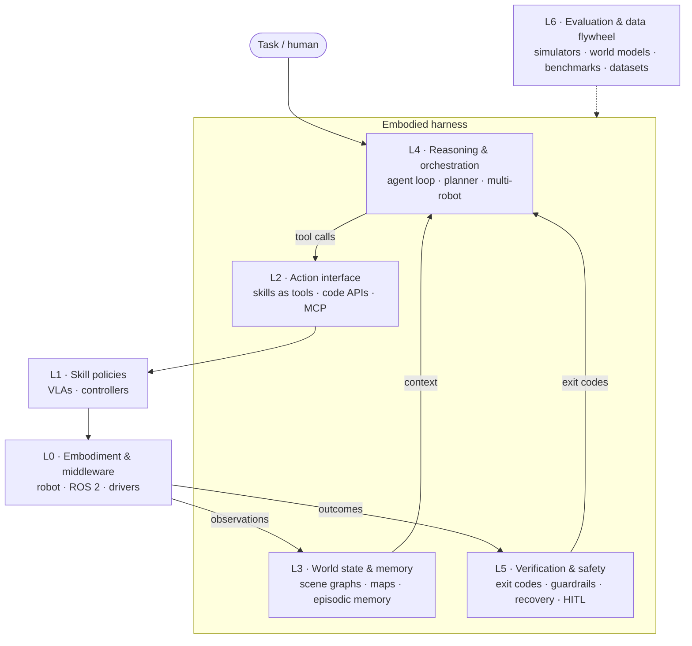

# Awesome Embodied Harness [](https://awesome.re)

<!-- BEGIN GENERATED: badges -->
   
<!-- END GENERATED: badges -->

> A curated, continuously updated survey of the **embodied harness** stack: everything around a foundation model that turns it into an agent acting in the physical world. A daily radar agent keeps it current.

Coding agents showed that the model is only half the system. Claude Code, Codex and their peers succeed or fail on their **harness**: the loop, the tools, context management, permissions, and tests used as exit codes. Robots are going through the same split. An **embodied harness** wraps an LLM, VLM, VLA or world model with:

- an **agent loop** that plans, calls tools, observes and replans;
- robot capabilities exposed as **tools**: skills, VLA policies, motion primitives, generated code;
- **world state as context**: scene graphs, maps, object and episodic memory;
- **exit codes**: success detection, failure diagnosis and recovery;
- a **safety envelope**: guardrails, permissions, human-in-the-loop;
- the **sim / eval / data flywheel** used to build and test all of the above.

This list covers every layer of that stack, not just the models. [SURVEY.md](SURVEY.md) has the taxonomy, a comparison of representative harnesses, and open problems.



**Legend:** 🟢 open (code, and weights for models) · 🟡 partial (e.g. weights or dataset only) · 🔵 API / product · ⚪ closed (paper, blog or demo only). Hover over a name to see the full paper title. The overview below shows the 10 newest entries of each category. Every category also has a full list page in [`categories/`](categories), grouped by year.

## Contents

<!-- BEGIN GENERATED: toc -->
- [Surveys & Position Papers](#survey) (103)
- [Embodied Harnesses](#harness) (279)
- [Open-Source Frameworks & Runtimes](#framework) (33)
- [Action Interfaces, Skills & Tool Protocols](#interface) (48)
- [World State, Memory & Spatial Context](#memory) (86)
- [Embodied Reasoning Models & Planners](#brain) (65)
- [VLA Models & Skill Policies](#policy) (116)
- [World Models](#world-model) (84)
- [Verification, Failure Detection & Recovery](#verification) (84)
- [Safety, Guardrails & Security](#safety) (83)
- [Multi-Robot & Fleet Orchestration](#multi-agent) (61)
- [Simulators & Environments](#sim) (64)
- [Benchmarks & Evaluation](#benchmark) (214)
- [Data, Teleoperation & Training Infrastructure](#data) (109)
<!-- END GENERATED: toc -->
- [Daily radar](#daily-radar) · [Recently added](#recently-added) · [Contributing](#contributing) · [Citation](#citation)

## Daily radar

Every day a scheduled agent scans arXiv, Hugging Face, GitHub, lab blogs and news. It checks each find against primary sources, adds qualifying systems to [`data/`](data), and writes a log to [`radar/log/`](radar/log). The procedure is in [radar/PLAYBOOK.md](radar/PLAYBOOK.md) and the watch list is in [radar/sources.yaml](radar/sources.yaml).

<!-- BEGIN GENERATED: radar -->
- [2026-11-28](radar/log/2026-11-28.md) — Queue day after a holiday-skipped Friday listing: twelve verified papers promoted, led by CALVIN-MAX showing a mid-task change keeps costing policies on the next instruction, Robo-MOPD consolidating specialist robot planners into one 9B generalist, and MotionServe sharing one GPU across 96 robots (12 added, 1 candidates)
- [2026-11-27](radar/log/2026-11-27.md) — Harness design gets its large-scale study: 470,000 rollouts across 8 benchmarks, 6 VLMs and 15 VLA/WAM checkpoints yield the X-Harness recipe (up to +42.8 points), while SOLVE reaches 74.5% on RoboDojo at about $1.7 an episode and SealedLoop shows in-loop judges accept many failures as gains (12 added, 13 candidates)
- [2026-11-26](radar/log/2026-11-26.md) — The agent-policy handoff becomes explicit: Boundary-Aware Policy Learning reaches 98.4% on randomized RoboTwin 2.0 by shaping where a policy can be handed control, skill envelopes lift frozen-VLA chains from 29.7% to 93.8%, and RESET turns one real demonstration into code skills that succeed in 80% of 280 trials on 4 robots (12 added, 12 candidates)
- [2026-11-25](radar/log/2026-11-25.md) — The harness becomes the object of study: Embo-Harness distills a recipe that reaches 83.3% on RoboLab-120, RUIBench shows the robot-use interface alone moves a frontier agent from 45% to 81%, and SayDo finds hazardous actions rise from 14% in chat to 47% under closed-loop control (12 added, 10 candidates)
- [2026-11-24](radar/log/2026-11-24.md) — Harnesses that rewrite themselves converge on one recipe: Embodied-Harness, NavRSI and EvoTER each improve a frozen model by revising guidance, tools and memory from their own execution evidence, and NavRSI reaches 85.64% on R2R-CE; TRIP lets the agent program its own interrupts, raising safety around people from 61.3% to 81.3% (12 added, 4 candidates)
- [2026-11-23](radar/log/2026-11-23.md) — Monday maintenance: XInfer releases its VLA fleet-serving code, NASA JPL's ROSA ships a security release fixing command injection and path traversal in its ROS tools, OpenMind archives the OM1 repository, and a full link check finds one dead project page in 2,921 links (5 updated, 1 candidates)
- [2026-11-22](radar/log/2026-11-22.md) — Weekend queue day: stopping safely mid-task, as SAFI shows VLAs that refuse a prohibited task from the start can still finish it when taking over midway, and teaches a hold-in-place fallback that cuts completion after takeover to 1.3% (5 added, 1 candidates)
<!-- END GENERATED: radar -->

## Recently added

<!-- BEGIN GENERATED: recent -->
Added in the 30 days up to 2026-11-28:

- ⚪ [**Calibrating World Action Models**](https://arxiv.org/abs/2611.30188 "Calibrating World Action Models: From Adaptive System 2 Takeover to Self-Evolution") · 2026-11 — Gives a frozen world-action model a calibrated success-probability token that triggers an agent (System 2) only when confidence drops, then distills those takeovers back into the WAM so it can run alone, with skill anchoring to avoid forgetting. _Note: Promoted from the queue._ _(added 2026-11-28 to [Embodied Harnesses](#harness))_
- ⚪ [**Atomic Policy**](https://arxiv.org/abs/2611.32813 "Atomic Policy: Composing Atomic Manipulation Skills with Agentic Reasoning") · 2026-11 — Composes learned manipulation skills through a VLM that estimates symbolic state, a PDDL planner, and an agentic harness that steers each skill by language or visual pointing and verifies outcomes to drive phase transitions and replanning, in simulation and on a real robot. _Note: Promoted from the queue._ [project](https://aaronzkd.github.io/atomic-policy/) _(added 2026-11-28 to [Embodied Harnesses](#harness))_
- ⚪ [**MotionServe**](https://arxiv.org/abs/2611.30083 "MotionServe: Efficient Multi-Robot Serving by Exploiting Robot Execution Slack") · 2026-11 — Shared-GPU serving for many LoRA-adapted VLA policies that schedules requests by each robot's execution slack from buffered action chunks; with 96 simulated robots on one H200 it cuts mean stall per episode by 43.4% for X-VLA and shrinks weight memory by 97.6% (first-party). _Note: Promoted from the queue._ _(added 2026-11-28 to [Open-Source Frameworks & Runtimes](#framework))_
- ⚪ [**Robo-MOPD**](https://arxiv.org/abs/2611.30997 "Generalizing Agentic Robotics via Multi-Teacher On-Policy Distillation") · 2026-11 — Consolidates domain-specialist robot planners into one tool-calling generalist via multi-teacher on-policy distillation, compared with weight merging, specialist SFT and multi-domain RL; a single 9B planner reaches 72.9% on LIBERO-PRO and 44.8% on RoboCasa365 (first-party). _Note: Promoted from the queue._ _(added 2026-11-28 to [Embodied Reasoning Models & Planners](#brain))_
- ⚪ [**Capability Contracts**](https://arxiv.org/abs/2611.27939 "What Must a Model Tell a Planner? Outcome Interfaces for Risk-Aware Planning After Robot Damage") · 2026-11 — Compares decision policies with outcome models as interfaces for damaged Go2 and H1 robots choosing routes; a capability contract predicting per-terrain success and time cuts declined missions from about 32% to 7-8% on Go2 at a calibrated 5% risk limit (first-party). _Note: Promoted from the queue._ _(added 2026-11-28 to [World Models](#world-model))_
- ⚪ [**Humanoid Switching Safety Filter**](https://arxiv.org/abs/2611.27845 "Humanoid robots for safety-critical electrical switching: A perception-informed runtime constraint filter") · 2026-11 — Runtime safety filter for VR teleoperation of a humanoid doing electrical switching, combining a head-camera scene model with a target-conditioned control barrier function QP that keeps the tool off adjacent switches; 9/9 safe completions in simulation versus 5/9 for raw teleoperation (first-party). _Note: Promoted from the queue._ _(added 2026-11-28 to [Safety, Guardrails & Security](#safety))_
- ⚪ [**MRBench**](https://arxiv.org/abs/2611.32803 "MRBench: Benchmarking Physical Necessity Reasoning in Heterogeneous Multi-Robot Manipulation") · 2026-11 — Benchmark of physical necessity reasoning, deciding which robots a manipulation task truly needs as capabilities change or objects replace robotic support, with the MRScissors baseline that searches for minimal feasible teams at 85.4% and 91.2% team-selection accuracy (first-party). _Note: Promoted from the queue._ [project](https://showlab.github.io/MRBench/) _(added 2026-11-28 to [Multi-Robot & Fleet Orchestration](#multi-agent))_
- ⚪ [**RoboPRO**](https://arxiv.org/abs/2611.26971 "RoboPRO: A Perturbation-Resilient and Obstacle-Aware Benchmark for Robotic Manipulation") · 2026-11 — 80 bimanual atomic and compositional tasks in four furnished scenes with 16,000 demonstrations and 5.6K instructions, varying distractor density and visual, linguistic and object perturbations, with two safety metrics for unsafe contact; clutter sharply cuts success and raises non-target collisions. _Note: Promoted from the queue._ [project](https://robopro-bench.github.io/RoboPRO/) _(added 2026-11-28 to [Benchmarks & Evaluation](#benchmark))_
- ⚪ [**AWAIT**](https://arxiv.org/abs/2611.29558 "Action Windows Are Inherently Temporal: A Benchmark for Time-Sensitive Robotic Manipulation") · 2026-11 — Simulation benchmark of time-sensitive tasks in which evolving physical processes open finite action windows that decision and execution time share; VLM agents struggle to recognize when a window opens, and successive decisions can exhaust a window even when each is shorter than it. _Note: Promoted from the queue._ [project](https://eyja42.github.io/await-site/) _(added 2026-11-28 to [Benchmarks & Evaluation](#benchmark))_
- ⚪ [**CALVIN-MAX**](https://arxiv.org/abs/2611.31868 "CALVIN-MAX: When Does a Mid-Execution Change Hurt a Robot Policy?") · 2026-11 — 7,828 cases on CALVIN instruction chains, each with one mid-execution change to objects, camera, robot or instruction, separating timing from the changed world; the cost outlasts the affected step, as a policy that still completes it is 5.0 to 16.8 points less likely to complete the next (first-party). _Note: Promoted from the queue._ [project](https://forall-labs.github.io/CALVIN-MAX/) _(added 2026-11-28 to [Benchmarks & Evaluation](#benchmark))_
- 🟢 [**WorldPhy**](https://arxiv.org/abs/2611.34130 "WorldPhy: Benchmarking Fine-Grained Physical Plausibility of World Models in Robotics") · 2026-11 — Robotics world-model benchmark scoring generated videos on six fine-grained physical dimensions plus instruction following, with a WorldPhyReward judge that aligns better with human ratings than general VLMs; 13 frontier world models struggle to keep physical plausibility consistent. _Note: Promoted from the queue._ [code](https://github.com/chuziyuan139/WorldPhy) _(added 2026-11-28 to [Benchmarks & Evaluation](#benchmark))_
- ⚪ [**Real2Worlds2Real**](https://arxiv.org/abs/2611.31098 "Real2Worlds2Real: Scaling Self-Improving Agentic Real2Sim2Real for Robot Manipulation") · 2026-11 — Self-improving agentic framework: tool-orchestration harness builds digital twins and diverse digital cousins from few observations, then coordinates data generation and policy learning, distilling validated procedures into reusable skills; reports successful real-world transfer that improves with world diversity. _Note: Promoted from the queue._ _(added 2026-11-28 to [Data, Teleoperation & Training Infrastructure](#data))_
- ⚪ [**Toward Agentic Robotics (X-Harness)**](https://arxiv.org/abs/2611.34778 "Toward Agentic Robotics: A Large-Scale Study of Harness Design for Robot-Use Agents") · 2026-11 — Harness-design study of over 470,000 rollouts across eight simulation benchmarks, six VLMs and 15 VLA/WAM checkpoints, showing harnesses must fit both the VLM and the policy; the X-Harness reference recipe composes the findings without weight updates, lifting base policies by up to 42.8 points (first-party). _(added 2026-11-27 to [Embodied Harnesses](#harness))_
- ⚪ [**SOLVE**](https://arxiv.org/abs/2611.34750 "SOLVE: Sparse, Ordered Keyposes Make LLM Agents Versatile and Efficient Robot Manipulator") · 2026-11 — Training-free agent policy in which a multimodal LLM writes a sparse ordered sequence of 6-DoF keyposes per call and a motion planner interpolates, with rules distilled from its own rollouts; 74.5% on RoboDojo and 84.5% on RoboLab at about $1.7 per episode, and 75 of 85 real zero-shot episodes (first-party). [project](https://serenos.github.io/solve-website) _(added 2026-11-27 to [Embodied Harnesses](#harness))_
- 🟡 [**RoboEvo²**](https://arxiv.org/abs/2611.34675 "RoboEvo$^2$: Recursive Robot Self-Improvement via Harness-Policy Co-Evolution") · 2026-11 — Recursive harness-policy co-evolution: policy failures steer a coding agent to search code, in-context and policy routes that become reusable skills, and verified trajectories train the policy with counterfactual preference distillation; LIBERO-PRO standalone success rises from 11.0% to 84.1% (first-party). _Note: The paper says models and code will be publicly released; the repository exists as of 2026-11-27._ [code](https://github.com/kaiknower/RoboEvo2) · [project](https://kaiknower.github.io/RoboEvo2/) _(added 2026-11-27 to [Embodied Harnesses](#harness))_
- 🟢 [**SEEK**](https://arxiv.org/abs/2611.33915 "SEEK: Self-Evolution through Execution Knowledge for Agentic Robot Manipulation") · 2026-11 — Retains execution knowledge across attempts as procedures the robot runs without a model request, revising them only where they fail; over ten attempts on 42 RoboDojo tasks success rises from 19.7% to 48.0%, and with GPT-6.2 Astra it reaches 80.1 versus 49.6 for direct control with 77.6% fewer requests (first-party). [code](https://github.com/ZeyangGuan/SEEK-Agentic-Robot-Manipulation) · [project](https://zeyangguan.github.io/SEEK-Agentic-Robot-Manipulation/) _(added 2026-11-27 to [Embodied Harnesses](#harness))_
- ⚪ [**Skeptic**](https://arxiv.org/abs/2611.33560 "Skeptic: Grounding Failure Diagnosis for Robot Skill Discovery") · 2026-11 — Stops skill-discovery agents from declaring tasks physically impossible by grounding failure diagnosis in images and proprioception and adding verified promotion to the skill library; false impossibility judgments fall from 19.5 to 8.5 per campaign and LIBERO-Pro held-out success rises 14.9 points (first-party). _(added 2026-11-27 to [Embodied Harnesses](#harness))_
- ⚪ [**RegHarness**](https://arxiv.org/abs/2611.33739 "RegHarness: Regulating What Code-as-Policy Agents Keep from Steps to Skills") · 2026-11 — Two-level harness for code-as-policy agents that commits each step only after verifier and auditor approval within a trial and has a coding agent revise skills, primitives and rules between runs; 87.8% (158/180) on paired LIBERO-PRO trials with a single low-cost model (first-party). _(added 2026-11-27 to [Embodied Harnesses](#harness))_
- ⚪ [**Cairn**](https://arxiv.org/abs/2611.34914 "Cairn: Object-Centric 3D Trajectory Priors for Steering Frozen VLAs") · 2026-11 — Steers a frozen VLA at test time along learned 3D trajectories of the held object, sampled from scene point clouds and fed back into the VLA's denoising, with no weight changes; across 1,941 held-out LIBERO scenes with displaced objects and obstacles, frozen pi0.5 rises from 24.5% to 95.1% (first-party). _(added 2026-11-27 to [VLA Models & Skill Policies](#policy))_
- ⚪ [**SealedLoop**](https://arxiv.org/abs/2611.33794 "Keep or Roll Back? Out-of-Loop Judges for Self-Improving VLA and End-to-End Embodied Policies") · 2026-11 — Adds a sealed judge outside the self-improvement loop, keeping a new policy only when a sequential test confirms the gain, and separates judge error from transfer gap; in LIBERO manipulation an in-loop success classifier accepted 65 of 196 failures in one generation (first-party). [project](https://zilin-huang.github.io/SealedLoop/) _(added 2026-11-27 to [Verification, Failure Detection & Recovery](#verification))_
- ⚪ [**WAtcher**](https://arxiv.org/abs/2611.34124 "WAtcher: Watching Ahead for Safe Robotic Manipulation with Efficient World-Action Models") · 2026-11 — Safety-aware world-action framework that previews each candidate action chunk in two denoising steps and screens it with a lightweight Safe-Guard module; cuts hazardous closed-loop trials from 27.0% to 10.8% without lowering task success, and scores 94.2% on a held-out safety benchmark (first-party). [project](https://zyshan0929.github.io/WAtcher) _(added 2026-11-27 to [Safety, Guardrails & Security](#safety))_
- ⚪ [**RoboARC**](https://arxiv.org/abs/2611.33390 "RoboARC: Physical Puzzles for Robotic Manipulation under Spatial Constraints") · 2026-11 — 90 MuJoCo manipulation puzzles in six spatial-constraint types with physics graders and verified solutions, in privileged and real-sensor single-attempt regimes; the best coding agent, GPT-6 Astra in Codex, solves 86% with privileged state but 43% from sensors, and four VLAs solve none (first-party). [project](https://roboarc.embodied-first-exam.ai) _(added 2026-11-27 to [Benchmarks & Evaluation](#benchmark))_
- ⚪ [**DTU-Bench**](https://arxiv.org/abs/2611.34538 "Dynamic Task Update Benchmark (DTU-Bench): Evaluating Runtime Task Adaptation in Robotic Manipulation") · 2026-11 — LIBERO benchmark of 40 task revisions across seven update types and three execution stages; 13 VLA configurations average 95.8% on the original tasks but only 1.6% when the instruction changes the target object mid-execution, often finishing the original task first (first-party). [project](https://dtu-bench.github.io/) _(added 2026-11-27 to [Benchmarks & Evaluation](#benchmark))_
- ⚪ [**FailPoint-X**](https://arxiv.org/abs/2611.33769 "FailPoint-X: A Policy-Matched, Failure-Anchored Benchmark for Offline VLA Post-Training from Human Takeovers") · 2026-11 — Benchmark for offline VLA post-training from human takeovers, with annotated failure intervals, restorable failure states and a shared evaluator from one pi0.5 checkpoint; cloning takeovers improves recovery by 29.4 points but costs 30.0 points from nominal starts (first-party). [project](https://lzrbit.github.io/FailPoint_X/) _(added 2026-11-27 to [Benchmarks & Evaluation](#benchmark))_
- ⚪ [**Boundary-Aware Policy Learning**](https://arxiv.org/abs/2611.32238 "Boundary-Aware Policy Learning for Agent-Orchestrated Robot Manipulation") · 2026-11 — Shapes and then expands the handoff boundary, the start states from which a visuomotor policy is reliable, so an orchestrating agent knows when to hand over; reaches 98.4% in randomized RoboTwin 2.0 scenes, over 26 points above the strongest baseline, with 41.3% lower API cost (first-party). _(added 2026-11-26 to [Embodied Harnesses](#harness))_
- ⚪ [**RESET**](https://arxiv.org/abs/2611.31894 "RESET: One Demonstration, One Verified World, Self-Improved Skills Across Embodiments") · 2026-11 — Rebuilds a contact-rich simulated world and a frozen success criterion from one real demonstration, verifies it by replay, lets a coding agent self-improve white-box skill code, and transfers it to new robots; 97% in simulation on unseen layouts and 80% of 280 real trials on 4 robots (first-party). _(added 2026-11-26 to [Embodied Harnesses](#harness))_
- ⚪ [**VLAs Execute, Code Recovers**](https://arxiv.org/abs/2611.32245 "VLAs Execute, Code Recovers: 3D Skill Envelopes Bridge the Compositional Gap in Agentic Manipulation") · 2026-11 — Measures the 3D volume each frozen VLA skill sweeps when it succeeds and exposes it as CHECK and FREE tools, so agent code clears residue before the next skill; with frozen pi0.5 on LIBERO-Goal, 3-4 step drawer chains rise from 29.7% to 93.8% (first-party). _(added 2026-11-26 to [Embodied Harnesses](#harness))_
- ⚪ [**EmboEagle**](https://arxiv.org/abs/2611.31173 "EmboEagle: An Efficient Agentic Embodied Framework for Long-horizon Robotic Manipulation") · 2026-11 — Closed-loop agentic framework combining subtask-conditioned world-action-model control, latent-space adaptive supervision and memory-guided geometric recovery with post-repair verification; 91.3% on RMBench and 90.6% on LIBERO-Mem, with 74.2% fewer VLM calls than chunkwise monitoring (first-party). _Note: Promoted from the queue._ _(added 2026-11-26 to [Embodied Harnesses](#harness))_
- ⚪ [**RoboHarness-RL**](https://arxiv.org/abs/2611.32016 "RoboHarness-RL: Agentic Reinforcement Learning for VLM-Based Robot Manipulation") · 2026-11 — Agentic RL for compact open VLMs that manipulate robots through tool calls: SFT on teacher demonstrations then multi-turn RL with outcome rewards; Qwen3.5-9B rises from 31.2% to 44.0% on RoboTwin 2.0 and 57.8% to 73.3% on LIBERO-Pro, with up to 4x fewer repeated calls (first-party). [project](https://aim-uofa.github.io/RoboHarness-RL/) _(added 2026-11-26 to [Embodied Reasoning Models & Planners](#brain))_
- ⚪ [**OmniAct**](https://arxiv.org/abs/2611.33158 "OmniAct: One Policy, One Million Embodiments") · 2026-11 — Cross-embodiment policy conditioned on each robot's kinematic graph in the scene, trained in simulation over one million procedurally generated robot embodiments; on task families where GPT-6 Astra was tested it reaches 64.7% versus 41.1%, and nearly doubles the next method on an unseen real robot (first-party). [project](https://omniact.github.io/) _(added 2026-11-26 to [VLA Models & Skill Policies](#policy))_
- ⚪ [**G0.7**](https://arxiv.org/abs/2611.31822 "G0.7: Scaling Up a Fast World Action Model with Long Context") · 2026-11 — Generalist world-action model built on Fast-WAM with up to five minutes of context and pretraining on robot teleoperation and human egocentric video; decodes actions directly in 60 ms per 16-step chunk, 7.6x faster than imagine-then-act, with 86.9% mean task progress on seven real tasks (first-party). _(added 2026-11-26 to [World Models](#world-model))_
- ⚪ [**Sparks of Weight-Space Programming**](https://arxiv.org/abs/2611.31715 "Sparks of Weight-Space Programming for Robot Foundation Models") · 2026-11 — A language-model agent reads a VLA's activations to recognize recurring stuck states and writes small parameter edits that trigger a corrective behavior, with no data or training; edits to about 0.0002% of pi0.5's parameters improve success on recurring failures in simulation (first-party). _(added 2026-11-26 to [Verification, Failure Detection & Recovery](#verification))_
- ⚪ [**EmbodiSafety**](https://arxiv.org/abs/2611.33054 "EmbodiSafety: Benchmarking Risk Understanding and Response in Embodied AI") · 2026-11 — Benchmark of 1,092 snapshot and 540 trajectory tasks over 844 scenes scoring six response modes, from execution and refusal to clarification, on mode choice, risk identification and handling; the best reference model, Claude Opus 5.5, reaches 56.1% and 61.5% complete decision accuracy (first-party). _Note: Also curates 40k safety-alignment examples._ [project](https://embodisafety.github.io/) _(added 2026-11-26 to [Safety, Guardrails & Security](#safety))_
- ⚪ [**DeCoNav-Act**](https://arxiv.org/abs/2611.32683 "DeCoNav-Act: Benchmarking Collective Physical Capability in Multi-Robot Mobile Manipulation") · 2026-11 — Benchmark of 350 homogeneous and 150 heterogeneous multi-robot mobile manipulation tasks testing whether each robot leaves the world usable for its teammate; even with GPT-6.1-sol the CoMoMa agent establishes the handoff condition in 26.5% of trials and succeeds in 4.1% (first-party). _(added 2026-11-26 to [Multi-Robot & Fleet Orchestration](#multi-agent))_
- 🟢 [**ICLWorld**](https://arxiv.org/abs/2611.32649 "ICLWorld: Benchmarking In-Context Learning of Agents from Digital to Physical Worlds") · 2026-11 — Online benchmark of 160 tasks with counter-intuitive rules taught by text or video across 30 computer-use and robot-use environments under one UI harness; Claude Opus 5.5 and GPT-6 Astra succeed on 82% and 76% of computer-use runs but only 27% and 26% of robot-use runs (first-party). [code](https://github.com/ICLWorld/ICLWorld) · [project](https://iclworld.github.io) · [data](https://huggingface.co/datasets/Aoraku/ICLWorld) _(added 2026-11-26 to [Benchmarks & Evaluation](#benchmark))_
- 🟢 [**RoboDojo-Mirror**](https://arxiv.org/abs/2611.33010 "Embodied AI Fails the Mirror Test: How a Simple Mirror Breaks Robot Policies") · 2026-11 — RoboDojo variant adding single, dual and tabletop mirrors with the same tasks and checkpoints; every mirror condition lowers success for VLAs, WAMs and agentic policies, by 10.8 to 56.7 points on average, and most failures happen without touching the mirror, pointing to phantom targeting (first-party). [code](https://github.com/iPPLab/robodojo-mirror) · [project](https://ipplab.github.io/robodojo-mirror) _(added 2026-11-26 to [Benchmarks & Evaluation](#benchmark))_
- 🟢 [**Embo-Harness**](https://arxiv.org/abs/2611.31201 "Embo-Harness: Towards Understanding Frontier-Model-as-Policy Harness") · 2026-11 — Systematic study of frontier-model-as-policy harnesses across prompting, planning, action execution and tool use, distilled into six findings and a recipe that favors the model's native visual reasoning over handcrafted skills; 83.3% on RoboLab-120 and 15 of 20 real zero-shot trials (first-party). [code](https://github.com/DravenALG/Embo-Harness) · [project](https://dravenalg.github.io/projects/Embo-Harness/) _(added 2026-11-25 to [Embodied Harnesses](#harness))_
- 🟢 [**ReWeave**](https://arxiv.org/abs/2611.31053 "ReWeave: Emergent Physical Task Topologies for Embodied Harness Optimization and Cross-Task Meta-Distillation") · 2026-11 — Jointly optimizes an embodied agent harness and an emergent physical task topology from interaction with frozen policies and perception, then meta-distills a shared harness across tasks; held-out RoboDojo success rises from 25.50% to 58.25% and LIBERO-PRO from 89.00% to 98.75% (first-party). [code](https://github.com/xuyicheng-zju/ReWeave) · [project](https://xuyicheng-zju.github.io/ReWeave/) _(added 2026-11-25 to [Embodied Harnesses](#harness))_
- ⚪ [**RoboHarness-Zero**](https://arxiv.org/abs/2611.30550 "Body and Soul: Decoupling Robotic Brain and Policy with RoboHarness-Zero") · 2026-11 — Prep-free harness: a VLM plans and monitors zero-shot while a frozen VLA does continuous control, rephrasing instructions or briefly running primitive code only when progress stalls; lifts Xiaomi-Robotics-1 from 57.5% to 70.5% while keeping 90.4% of its standalone successes (first-party). _(added 2026-11-25 to [Embodied Harnesses](#harness))_
- ⚪ [**Agent on Guard**](https://arxiv.org/abs/2611.30101 "Agent on Guard: Self-Improving Runtime Intervention for Robust Robotic Manipulation") · 2026-11 — Hierarchical framework in which an evolving planner decides when a programming agent should intervene on a frozen base policy and turns its recoveries into reusable collaboration skills; 50.57% success on RoboDojo-Sim, with 80.4% lower latency and 85.1% fewer tokens than a GPT-6 Astra agent (first-party). _(added 2026-11-25 to [Embodied Harnesses](#harness))_
- ⚪ [**RoboThink**](https://arxiv.org/abs/2611.30111 "RoboThink: Let the Agent Think, Let the Policy Act") · 2026-11 — Trains a policy to act on a watching reasoning agent's guidance mid-task, through an instruction channel and a motion-correction channel, so the agent fixes drifts that plain instructions cannot; on 50 RoboTwin 2.0 tasks under constant drift success rises from 0.12 to 0.74, and the agent is swappable (first-party). _Note: The repository linked from the project page (robo-think/RoboThink) did not resolve on 2026-11-25._ [project](https://robo-think.github.io/) _(added 2026-11-25 to [Embodied Harnesses](#harness))_
- ⚪ [**Contact Harness**](https://arxiv.org/abs/2611.29377 "Contact Harness: Enabling VLM Agents to Perform Contact-Rich Manipulation") · 2026-11 — Harness that guides a VLM agent with reusable, optimized skills to interpret force and tactile feedback by task phase, plus compliant force-regulated execution, with no fine-tuning or demonstrations; GPT-6 Astra fully inserts 15 connector types 90.7% of the time on real robots (first-party). _(added 2026-11-25 to [Embodied Harnesses](#harness))_
- ⚪ [**Innata-0**](https://arxiv.org/abs/2611.30254 "Innata-0: A Native Embodied World System with Model-Agent Co-Design") · 2026-11 — BAAI's embodied world system that co-designs a tri-tower mixture-of-transformers world-action model for understanding, prediction and action with an agent that handles memory, verification and recovery, aligning model training with agent execution through validated experience. [project](https://baai-eai.github.io/innata-0/) _(added 2026-11-25 to [Embodied Reasoning Models & Planners](#brain))_
- ⚪ [**SayDo**](https://arxiv.org/abs/2611.30957 "SayDo: Benchmarking the Safety of Frontier Models from Chat to Closed-Loop Robot Control") · 2026-11 — Eleven tasks pairing benign instructions with latent hazards, run in six settings from chat to closed-loop simulated arm control; across six VLMs and 11,480 episodes hazardous-action rates rise from 14% in chat to 47% in the simulator, so text safety evaluations do not predict robot behavior (first-party). _(added 2026-11-25 to [Safety, Guardrails & Security](#safety))_
- 🟢 [**RoboUniverse-10K**](https://arxiv.org/abs/2611.31002 "RoboUniverse-10K: Toward the Scaling Era of Agentic Robotics via Real-to-Sim Environments") · 2026-11 — 10,807 resettable, verifiable physics environments built from real-world videos by an automated real-to-sim pipeline, each in a Harbor-compatible harness that hides grading logic, plus RoboUniverse-35B-A3B, which lifts zero-shot success on RoboUniverse-Verified from 0.8% to 21.2% (first-party). [code](https://github.com/Einsia/RoboUniverse-10K) · [project](https://lab.einsia.ai/robo-universe/) · [weights](https://huggingface.co/Einsia/RoboUniverse-35B-A3B) _(added 2026-11-25 to [Simulators & Environments](#sim))_
- 🟢 [**RUIBench**](https://arxiv.org/abs/2611.31115 "RUIBench: What Makes a Good Robot-Use Interface?") · 2026-11 — Benchmark of 30 manipulation tasks plus RUIKit, which crosses six action abstractions with two interaction forms into 13 robot-use interfaces; changing only the interface moves a frontier agent from 45% to 81% success, and agents often declare success despite visible failures (first-party). [code](https://github.com/showlab/RUIBench) · [project](https://showlab.github.io/RUIBench/) _(added 2026-11-25 to [Benchmarks & Evaluation](#benchmark))_
- 🟢 [**WorldLeague**](https://arxiv.org/abs/2611.30989 "WorldLeague: Benchmarking Physical Agency") · 2026-11 — Compares VLMs, VLAs and WAMs on 60 simulated robot tasks for seeking evidence, rearranging and adapting, scored by progress toward each physical goal; Claude Fable 5.2 leads with 13 of 60 goals, and VLMs answering every final question right still score zero progress in 71.8% of those episodes (first-party). [code](https://github.com/xyangzhou/WorldLeague) · [project](https://xyangzhou.github.io/WorldLeague/) _(added 2026-11-25 to [Benchmarks & Evaluation](#benchmark))_
- ⚪ [**RoboLiveMem**](https://arxiv.org/abs/2611.30047 "RoboLiveMem: Is Robot Memory Solved When the World Does Not Wait?") · 2026-11 — Runs 29 robot-memory task families twice, with the world paused and running while the model thinks; across 16 models and 34,176 episodes, Claude and GPT models succeed in 97% of paused episodes but 50% with the world running, mostly because they act on stale frames (first-party). [project](https://robolivemem.github.io/) _(added 2026-11-25 to [Benchmarks & Evaluation](#benchmark))_
- ⚪ [**Embodied-Harness**](https://arxiv.org/abs/2611.27689 "Embodied-Harness: Towards Recursive Self-Improvement for Robotic Manipulation") · 2026-11 — Dual-agent harness in which an Actor controls the robot and a Reflector turns execution evidence into reusable operational guidance, with hierarchical memory and recursive harness self-improvement and no weight updates; 82.4% on RoboTwin 2.0, 76.7% on RoboSPA and 94.4% on RMBench (first-party). _(added 2026-11-24 to [Embodied Harnesses](#harness))_
- ⚪ [**NavRSI**](https://arxiv.org/abs/2611.27499 "NavRSI: Recursive Harness Self-Improvement for Vision-and-Language Navigation") · 2026-11 — Recursive self-improvement of a VLN harness around frozen LLMs: a designer agent rewrites tools, memory and roles from trajectories and privileged simulator diagnostics the navigator never sees, keeping only revisions that help; 85.64% on R2R-CE val-unseen with GPT-6-Astra from a single RGB camera (first-party). _(added 2026-11-24 to [Embodied Harnesses](#harness))_
- ⚪ [**EvoTER**](https://arxiv.org/abs/2611.27797 "EvoTER: Evolving Embodied Agents via Tool-Use Experience and Reflection") · 2026-11 — Explorer, Diagnoser and Validator roles evolve an embodied agent's tool-use skills (selection, parameters, postcondition checks, recovery) without weight updates, keeping revisions only if they raise complete-task success in fresh sessions; simulation success rises from 53.60% to 80.40% (first-party). [project](https://evoter-project.github.io/) _(added 2026-11-24 to [Embodied Harnesses](#harness))_
- ⚪ [**Tripwire (TRIP)**](https://arxiv.org/abs/2611.27182 "Tripwire: Robot Agents that Program Their Own Interrupts under Human Disturbance") · 2026-11 — Event-driven harness in which the agent writes a tripwire with each policy call, a small stateful program that runs beside the VLA or WAM, can query a compact VLM, and hands control back when it fires; on RoboHD it raises safety from 61.3% to 81.3% without losing task success (first-party). _(added 2026-11-24 to [Embodied Harnesses](#harness))_
- ⚪ [**MomentMem**](https://arxiv.org/abs/2611.26745 "MomentMem: Memorizing Key Moments for Robot Manipulation") · 2026-11 — Hierarchical visual moment memory in which a VLM memorizer selects keyframes and an executor acts on them, with the VMBench suite of memory-dependent manipulation tasks; 49.9% average success on VMBench, 31.7 points above the strongest baseline (first-party). _(added 2026-11-24 to [World State, Memory & Spatial Context](#memory))_
- ⚪ [**CoMP**](https://arxiv.org/abs/2611.26855 "Coherent Moment Propagation: Epistemic Uncertainty for Pre-trained Robot Policies") · 2026-11 — Epistemic uncertainty for pretrained flow-matching policies by propagating mean, variance and state-weight cross-covariance through the ODE solver, fixing the variance collapse of BayesDiff; applied to failure detection and demonstration selection on three manipulation benchmarks. [project](https://comp-uq.github.io/comp-uq/) _(added 2026-11-24 to [Verification, Failure Detection & Recovery](#verification))_
- ⚪ [**γ-Scape**](https://arxiv.org/abs/2611.27306 "$γ$-Scape: An Agent-Centric World for Mobile Embodied Intelligence") · 2026-11 — Agent-centric simulation and benchmark platform for mobile manipulation in which agents compose motion tools and learned skills in a persistent world, with BenchForge task grounding, an agentic demonstration-collection harness and trace-informed program revision. _(added 2026-11-24 to [Simulators & Environments](#sim))_
- ⚪ [**ROSWorld**](https://arxiv.org/abs/2611.27467 "ROSWORLD: When Digital Task Competence Meets Physical Execution") · 2026-11 — Couples a physically simulated robot workstation to a live OSWorld desktop so a robot must type and click through peripherals from camera views; frontier models that solve 31-39 of 40 desktop tasks complete at most 23 with a probe and 28 with dexterous hands (first-party). _(added 2026-11-24 to [Benchmarks & Evaluation](#benchmark))_
- ⚪ [**ManipScope**](https://arxiv.org/abs/2611.27305 "ManipScope: A Diagnostic Benchmark for Instruction Following and Generalization in Robotic Manipulation") · 2026-11 — Evaluation-only RoboTwin 2.0 benchmark of 48 held-out scenes with chained failure diagnostics; when the target is reassigned on identical states, ten policy checkpoints follow every instruction on 3.9% of states, below a 16% instruction-blind chooser, while a GPT-6 agent reaches 88% (first-party). _(added 2026-11-24 to [Benchmarks & Evaluation](#benchmark))_
- ⚪ [**RoboDyna**](https://arxiv.org/abs/2611.26969 "RoboDyna: A Benchmark for Evaluating Robotic Manipulation under Physically Grounded Dynamics") · 2026-11 — Dynamic-manipulation benchmark of 20 conceptual and 10 household tasks with 3,500 demonstrations and paired synchronous and asynchronous evaluation; all evaluated VLAs and a world-action model succeed below 20%, and inference latency flips 5-12% of episode outcomes (first-party). [project](https://robodyna.github.io/robodyna/) _(added 2026-11-24 to [Benchmarks & Evaluation](#benchmark))_
- 🟢 [**Mem-X**](https://arxiv.org/abs/2611.27166 "Mem-X: A Memory-Dependent Cross-Episode Benchmark for Vision-and-Language Navigation") · 2026-11 — Cross-episode VLN benchmark of 2,071 episodes in 710 sessions where later instructions refer to objects and routes from earlier episodes, testing recall, in-memory localization and off-memory relocalization, with the MemBridge memory baseline. [code](https://github.com/NJU-R-L-Group-Embodied-Lab/Mem-X) _(added 2026-11-24 to [Benchmarks & Evaluation](#benchmark))_
- ⚪ [**RoboCap-10k**](https://arxiv.org/abs/2611.26916 "RoboCap-10k: A Metrically Accurate Egocentric Dataset for Robot Learning") · 2026-11 — 10,000 hours of unscripted manipulation from paid work shifts in 11 countries, all captured on one six-camera, dual-IMU hat with online calibration, gravity-aligned 6-DoF head trajectories, centimeter-precise hand poses and task and sub-task captions. [project](https://robocap10k.com) _(added 2026-11-24 to [Data, Teleoperation & Training Infrastructure](#data))_
- ⚪ [**PGX**](https://arxiv.org/abs/2611.26596 "PGX: Physically Grounded Execution for Long-Horizon Humanoid Loco-Manipulation") · 2026-11 — Splits long-horizon humanoid loco-manipulation into a predicate-based state machine that gates phases and triggers recovery, VLA skills inside manipulation phases, and world-coordinate locking for spatial consistency, evaluated on three simulated tasks and a real Unitree G1. _Note: Promoted from the queue._ [project](https://kl-research.github.io/pgx) _(added 2026-11-22 to [Embodied Harnesses](#harness))_
- ⚪ [**LoongForge-Embodied**](https://arxiv.org/abs/2611.25460 "LoongForge-Embodied: A Unified Framework for Training Heterogeneous Embodied Models") · 2026-11 — PyTorch framework unifying training of heterogeneous VLA and world-action models behind a shared abstraction layer with FP8 communication, a data pipeline that synthesizes robot data from egocentric video, and concurrent simulator evaluation; 1.47x to 4.38x training throughput over open baselines (first-party). _Note: Promoted from the queue._ _(added 2026-11-22 to [Open-Source Frameworks & Runtimes](#framework))_
- ⚪ [**A2-VLA**](https://arxiv.org/abs/2611.25656 "A$^2$-VLA: Adapting Vision-Language-Action Policies to New Tools through Agentic Affordance Discovery") · 2026-11 — Tool adaptation in which an embodied agent treats affordances as hypotheses, testing them in scenes reconstructed in simulation and accumulating validated affordance-extraction skills that condition a pi0.5 backbone; +30.7 points over pi0.5 on three real tool-use tasks with unseen tools (first-party). _Note: Promoted from the queue._ _(added 2026-11-22 to [VLA Models & Skill Policies](#policy))_
- 🟢 [**SAFI**](https://arxiv.org/abs/2611.26239 "Teaching Vision-Language-Action Models to Stop Safely") · 2026-11 — Shows VLAs that refuse a prohibited task from the start can still finish it when taking over mid-execution, or drop held objects; State-Aware Fallback Imitation teaches a hold-in-place response at intermediate states, cutting prohibited success after takeover to 1.3% on LIBERO with no physical incidents (first-party). [code](https://github.com/franciscoliu/SAFI) · [project](https://franciscoliu.github.io/SAFI/) _(added 2026-11-22 to [Safety, Guardrails & Security](#safety))_
- ⚪ [**HumanCOIN**](https://arxiv.org/abs/2611.26434 "HumanCOIN: A 12,500-Hour Dataset for Human Intent in Egocentric Manipulation") · 2026-11 — 12,500-hour first-person manipulation dataset built around human intent in three tiers: gaze inferred from headband video (10,000 h), surface EMG of muscle load (2,000 h) and scalp EEG (500 h), with multi-view RGB-D, head and wrist pose and step-level annotations across 38 scene classes. _Note: Promoted from the queue._ [project](https://flagopen.github.io/HumanCOIN) _(added 2026-11-22 to [Data, Teleoperation & Training Infrastructure](#data))_
- ⚪ [**Reasoning on Call**](https://arxiv.org/abs/2611.26341 "Reasoning on Call: Efficient Agentic Robot Control for Long-Horizon Robot Manipulation") · 2026-11 — Coordinates a low-level policy with a high-level reasoning agent through an online task-state monitor that estimates subtask progress and triggers agent review only when execution or the plan needs repair; on RMBench, +24.0 points success with 65.3% fewer tokens than the strongest agent baseline (first-party). _(added 2026-11-21 to [Embodied Harnesses](#harness))_
- ⚪ [**UniCraft**](https://arxiv.org/abs/2611.26376 "Alignment Drives Reuse: Learning Generalizable Robot-Use Agents from Heterogeneous Experience") · 2026-11 — Aligns scene geometry conventions, sensing and control interfaces and task formats across benchmarks and robots so interaction feedback from 3 benchmarks and 6 embodiments refines one shared skill set and orchestration policy with no demonstrations or weight updates; frozen skills transfer to 4 new embodiments. _(added 2026-11-21 to [Embodied Harnesses](#harness))_
- ⚪ [**CoachSI**](https://arxiv.org/abs/2611.25529 "CoachSI: Self-Improvement of Robot Policies with a Language Coach") · 2026-11 — Self-improvement in which a frozen VLM watches the robot and names the next step in the policy's own atomic instructions, never outputting actions; hindsight-relabeled coached rollouts fine-tune the policy, raising unassisted long-horizon success in unseen scenes from 47.4% to 59.3% (first-party). [project](https://tlxhlll.github.io/CoachSI/) _(added 2026-11-21 to [Embodied Harnesses](#harness))_
- ⚪ [**JARVIS (circuit boards)**](https://arxiv.org/abs/2611.26503 "JARVIS: An Agent That Designs, Builds, and Tests Circuit Boards on Its Own") · 2026-11 — Embodied agent that closes the hardware design loop: it scans its workspace into an executable digital twin to rehearse robot motions and fabrication, drives a robot arm, PCB printer and pick-and-place machine, tests the board and revises the design; one first run took 2 h 39 min with no human help (first-party). _(added 2026-11-21 to [Embodied Harnesses](#harness))_
- ⚪ [**EmbodyAgent**](https://arxiv.org/abs/2611.26196 "EmbodyAgent: Post-Training Embodied VLM Agents via Distillation, SFT, and RL") · 2026-11 — Post-training stack turning an open 9B VLM into a code-writing robot-use agent through black-box teacher data synthesis, SFT and online RL with a runtime-error-penalized reward; held-out LIBERO-Spatial success rises from 0/100 to 14/100 after SFT and 84/100 after RL (first-party). _(added 2026-11-21 to [Embodied Reasoning Models & Planners](#brain))_
- ⚪ [**ACE-Brain-0.7**](https://arxiv.org/abs/2611.26519 "ACE-Brain-0.7: Learning Execution-Grounded Reasoning for Embodied Agents") · 2026-11 — 9B embodied VLM fine-tuned from Qwen3.5-9B on 3.7M execution-grounded question-answer pairs from egocentric video, robot episodes and simulation, combining spatial grounding, task understanding and progress estimation; averages 76.5 on six task-reasoning benchmarks (first-party). _(added 2026-11-21 to [Embodied Reasoning Models & Planners](#brain))_
- ⚪ [**Awaken-HI**](https://arxiv.org/abs/2611.26420 "Awaken-HI: Scaling Humanoid Intelligence with Whole-Body Human Experience") · 2026-11 — Humanoid loco-manipulation VLA pretrained on Awaken-Human, about 50,000 hours of egocentric stereo video with synchronized whole-body motion, jointly predicting human motion and retargeted robot actions; reaches 93.75% mean success across eight real tasks, ahead of GR00T N1.7 and pi0.5 (first-party). [project](https://engineai-robotics.github.io/Awaken-HI) _(added 2026-11-21 to [VLA Models & Skill Policies](#policy))_
- 🟡 [**AgentRoboCritic**](https://arxiv.org/abs/2611.26613 "AgentRoboCritic: Understanding the Capability of Frontier Agents on Direct Robot Control") · 2026-11 — Action-level study of frontier agents on direct robot control across 12 manipulation benchmarks: the agent states a local intent with each action and a critic judges outcome and failure mode; releases 12,844 annotated actions and a 30B critic whose failure-mode accuracy rises from 32.58% to 74.24% (first-party). [project](https://adu2021.github.io/blog/AgentRoboCritic/) _(added 2026-11-21 to [Verification, Failure Detection & Recovery](#verification))_
- ⚪ [**SimAudit**](https://arxiv.org/abs/2611.25179 "Phantom Success, Silent Failure: Auditing the Success Checkers of Simulated Manipulation Benchmarks") · 2026-11 — LLM pipeline auditing the hand-written success checkers of simulated benchmarks against task instructions, recreating disagreement scenarios and verifying them visually; finds 61 distinct defects across 49 tasks in RoboTwin 2.0, RoboCasa365 and RoboDojo, 40 phantom successes and 21 silent failures (first-party). _(added 2026-11-21 to [Benchmarks & Evaluation](#benchmark))_
- ⚪ [**PhyDEX**](https://arxiv.org/abs/2611.26565 "PhyDEX: A Benchmark for Physical Reasoning in Vision-Language-Action Models via Dynamic Extrinsic Dexterity") · 2026-11 — Throwing benchmark of 35K trajectories across nine tasks and 100 scenes in which a robot must infer mass, center of mass and friction to land objects beyond its workspace; GR00T N1.7, DynamicVLA and ForceVLA all succeed under 3%, and ground-truth physical properties roughly double success (first-party). _(added 2026-11-21 to [Benchmarks & Evaluation](#benchmark))_
- 🟢 [**Mind2Act World**](https://arxiv.org/abs/2611.26444 "Mind2Act World: A Diagnostic Benchmark for Embodied Mind, Physical Action, and Mind-Action Composition in Robotic Manipulation") · 2026-11 — Diagnostic benchmark of 30 manipulation tasks in 180 configurations split into Mind (history-based decisions), Act (precise, timely execution) and Mind2Act (both in closed loop), with a diagnosis harness; the strongest agent scores 52.7% on Mind and 39.0% on Act but 12.0% on Mind2Act (first-party). [code](https://github.com/Mind2Act/Mind2Act_World) · [project](https://mind2act-world.com/) _(added 2026-11-21 to [Benchmarks & Evaluation](#benchmark))_
- ⚪ [**AgenticTask**](https://arxiv.org/abs/2611.26046 "Agentic Scaling of Embodied Tasks in Simulation for Synthetic Data Collection and Policy Evaluation") · 2026-11 — Agent framework that expands simulated task collections: a generation agent builds validated task variations from interaction requirements and object bindings, and an execution agent selects skills and checks completion; on RoboCasa it saved 16,450 task instances at about 167 per hour (first-party). _Note: The dataset and project pages named in the paper did not resolve on 2026-11-21._ _(added 2026-11-21 to [Data, Teleoperation & Training Infrastructure](#data))_
- ⚪ [**RePlan-VLA**](https://arxiv.org/abs/2611.23843 "RePlan-VLA: Progress-Aware Replanning for Long-Horizon Vision-Language-Action Models") · 2026-11 — VLA-agnostic execution framework that keeps the VLA for short-horizon skills while monitoring robot motion to evaluate progress and revising the remaining plan from observed outcomes, with no VLA fine-tuning; 21.9 and 10.4 points above the next baseline on RoboCasa365 and CALVIN (first-party). _(added 2026-11-20 to [Embodied Harnesses](#harness))_
- 🟢 [**AeroRSI**](https://arxiv.org/abs/2611.24077 "AeroRSI: Recursive Self-Improvement for Aerial Vision-Language Navigation") · 2026-11 — Recursive self-improvement for UAV navigation policies that judge candidate repairs at their own failure states by flying on from them, then distill verified repairs each round; three rounds raise a 2B policy on TravelUAV from 46.4% to 67.5% and halve collisions (first-party). [code](https://github.com/starsholic/AeroRSI) · [project](https://starsholic.github.io/AeroRSI/) _(added 2026-11-20 to [Embodied Harnesses](#harness))_
- ⚪ [**SR-VLA**](https://arxiv.org/abs/2611.22356 "SR-VLA: Stall-Reduced VLA Execution via Predicted-Input Lookahead and Selective KV Cache Repair") · 2026-11 — Hides VLA inference stalls by predicting next-boundary observations and state, precomputing a speculative KV cache and action chunk, then accepting it or selectively repairing the cache once real inputs arrive; 2.67x and 1.27x query speedups over synchronous pi0.5 and OpenVLA-OFT on LIBERO (first-party). _Note: Promoted from the queue._ _(added 2026-11-20 to [Open-Source Frameworks & Runtimes](#framework))_
- ⚪ [**EvoNav**](https://arxiv.org/abs/2611.22321 "Beyond Episodic Recall: Experience-to-Knowledge Evolution for Lifelong Embodied Navigation") · 2026-11 — Two-timescale memory for lifelong object-goal navigation that consolidates observations, spatial relations and task feedback into sparse experience atoms online, then distills them into environment-specific structural knowledge to guide each new goal search. _Note: Promoted from the queue._ _(added 2026-11-20 to [World State, Memory & Spatial Context](#memory))_
- ⚪ [**GTI**](https://arxiv.org/abs/2611.23926 "GTI: Grounding Task Intent Throughout Long-Horizon VLA Manipulation") · 2026-11 — Keeps long-horizon task intent grounded by localizing the active subtask and phase, conditioning the VLA on phase-specific visual targets for contact and completion, and recovering via rollback and re-observation; GR00T on seen composite RoboCasa365 tasks rises from 14.6% to 31.8% in distribution (first-party). _(added 2026-11-20 to [VLA Models & Skill Policies](#policy))_
- ⚪ [**Doppel**](https://arxiv.org/abs/2611.24925 "Render the Robot, Generate the World: One Video World Model Across Embodiments") · 2026-11 — Embodiment-agnostic video world model conditioned on camera-aligned renderings of future body configurations plus action trajectories, trained on about 600 hours across eight robot and human embodiments; improves PSNR over action-only baselines by 1.00 dB on held-out trajectories (first-party). [project](https://doppelwm.github.io/) _(added 2026-11-20 to [World Models](#world-model))_
- ⚪ [**Grana**](https://arxiv.org/abs/2611.24926 "Grana: Compositional Reward Modeling for Long-Horizon Robot Manipulation") · 2026-11 — NVIDIA vision-language reward model that identifies unfinished subtasks from open-vocabulary descriptions and estimates their continuous progress, composing whole-task progress for long-horizon manipulation, trained on 200 tasks with dense targets converted from sparse subtask and quality annotations. [project](https://research.nvidia.com/labs/gear/grana/) _(added 2026-11-20 to [Verification, Failure Detection & Recovery](#verification))_
- ⚪ [**RECLAIM**](https://arxiv.org/abs/2611.24494 "RECLAIM: Robot-Vision-Informed Adversarial Patch Defense via Embodied Attention Feedback") · 2026-11 — Training-free defense that uses a frozen VLA's own attention response to local visual edits, with robot geometry, to localize and purify adversarial patches during closed-loop manipulation; raises LIBERO-Object success under attack from 0% to 70.0% at 548.9 ms per step (first-party). _(added 2026-11-20 to [Safety, Guardrails & Security](#safety))_
- ⚪ [**VLA Landmark Synonyms**](https://arxiv.org/abs/2611.24076 "Meaning Reaches Object Choice but Not Completion: Where Is a VLA Vulnerable to Landmark Synonyms?") · 2026-11 — Probes the released GR00T N1.7 on LIBERO-Spatial: unseen synonyms of a landmark word still steer it to the right bowl but complete 67.6% of episodes versus 100%, and token-pasting interventions locate where meaning is lost around the VLM-to-action connector. _Note: CoRL 2026 TAG workshop._ _(added 2026-11-20 to [Safety, Guardrails & Security](#safety))_
- 🟢 [**RoboBuilder**](https://arxiv.org/abs/2611.23855 "RoboBuilder: Agentic Robot Co-Design with Real-world Video Feedback in the Loop") · 2026-11 — Benchmark in which coding agents co-design robot hardware and programs from standard parts, and every simulated pass is built and tested on a physical course: across 135 physical robots only 66% of simulated passes hold, and videos of real failures let agents remove 72% of level-1 and level-2 failures (first-party). [code](https://github.com/ghadinehme/RoboBuilder) · [project](https://ghadinehme.com/robobuilder.github.io/) _(added 2026-11-20 to [Benchmarks & Evaluation](#benchmark))_
- ⚪ [**RoboDx**](https://arxiv.org/abs/2611.23816 "RoboDx: Repair and Diagnosis of Faults in Robot Software") · 2026-11 — Repair-task generator for simulated robot navigation software with injected faults and hidden driving verifiers; Claude Opus 5.5's repairs nearly all verify, yet on 50 two-fault tasks only 17 of 49 verified repairs remove both faults, and models name the cause from measurements on at most 38 of 94 tasks (first-party). _(added 2026-11-20 to [Benchmarks & Evaluation](#benchmark))_
- ⚪ [**FailureGen**](https://arxiv.org/abs/2611.22367 "FailureGen: Scalable Robot Failure Data Generation with World Models") · 2026-11 — Generates synthetic robot failure videos by fine-tuning an action-conditioned Cosmos world model and transferring failure motion from recorded failures into successful host contexts; a failure detector trained with the generated data detects 33 of 36 failure intervals versus 28 with real data alone (first-party). _Note: Promoted from the queue._ _(added 2026-11-20 to [Data, Teleoperation & Training Infrastructure](#data))_
- 🟢 [**When the World Is the Test Suite**](https://arxiv.org/abs/2611.22291 "When the World Is the Test Suite: Agentic Intelligence for the Physical World") · 2026-11 — 83-page survey of coding agents that write, test and repair programs for robots, labs and industrial controllers, organized around how agents write physical-world programs (policies, rewards, tasks, training worlds), how those programs are tested with costly and fallible evidence, and how agents learn from results. [code](https://github.com/PhysicalWorldAgent/Awesome-PhysicalWorldAgent) · [project](https://physicalworldagent.github.io) _(added 2026-11-19 to [Surveys & Position Papers](#survey))_
- ⚪ [**InteractVLA**](https://arxiv.org/abs/2611.22584 "InteractVLA: Turning VLAs into Interactive Tools for Agentic Robotic Manipulation") · 2026-11 — Turns flow-based VLAs into steerable, inspectable tools for VLM agents: test-time geometric guidance pushes the action expert toward an agent-chosen end-effector target, and generated action chunks with camera reprojections are shown back to the agent to diagnose errors and revise targets. _(added 2026-11-19 to [Embodied Harnesses](#harness))_
- ⚪ [**CRAFT**](https://arxiv.org/abs/2611.19952 "CRAFT: A Robot-Agent Harness with Scope-Aware Adaptation") · 2026-11 — Harness that learns where objects belong from human corrections without retraining skills, logging physical success separately from requirement satisfaction and using a scope ladder of memory, explicit rules and a learner; asks fewer questions than LLM agents with persistent memory in camera-grounded simulations. _Note: Promoted from the queue._ _(added 2026-11-19 to [Embodied Harnesses](#harness))_
- 🟢 [**Robotic World Model Audit**](https://arxiv.org/abs/2611.23118 "Auditing a Learned Simulator for Legged Robots: The Robotic World Model on ANYmal D") · 2026-11 — End-to-end audit of a published learned simulator for ANYmal D: one-step checks misjudge design choices (30% pruning keeps 90% of one-step skill but 39% at 2 s), and ensemble disagreement ranks rollout error well yet covers only 4.6% of outcomes at one sigma. [code](https://github.com/joyjeet-singh/rwm) _(added 2026-11-19 to [World Models](#world-model))_
- ⚪ [**Network-Exposed Configuration Attacks**](https://arxiv.org/abs/2611.22761 "Network-Exposed Configuration Attacks on LLM-Controlled Social Robots") · 2026-11 — Security study of the Reachy Mini Lite showing an unauthenticated network attacker can replace the cloud LLM's system prompt and personality through a management interface, changing physical behavior where prompt injection failed; a review finds missing authentication in 10 of 11 verifiable public applications. _(added 2026-11-19 to [Safety, Guardrails & Security](#safety))_
- ⚪ [**RoboTeam**](https://arxiv.org/abs/2611.22138 "RoboTeam: Benchmarking Vision-Based Multi-Agent Control of Many Robot Arms in Real Time") · 2026-11 — Simulated benchmark of 36 long jobs in which agents control 4 to 16 arms in real time from camera images alone; with an adaptive delegate-forking system, gpt-6.1-sol and opus-5.5 complete 28 and 27 tasks, but a typical task costs 3.5 hours and 218 million input tokens (first-party). _(added 2026-11-19 to [Multi-Robot & Fleet Orchestration](#multi-agent))_
- 🟢 [**Heave-Ho**](https://arxiv.org/abs/2611.22275 "Heave-Ho: Decentralized Long-Horizon Multi-Humanoid Collaboration") · 2026-11 — Decentralized multi-humanoid loco-manipulation: multi-agent post-training adapts a humanoid tracking model to physically coupled interaction, and a VLM planner with speech-based leader-follower coordination synchronizes robots without network messages; scales from two to ten robots, with the 12-task HH-Bench. [code](https://github.com/heaveho-humanoid/Heave-Ho) · [project](https://heaveho-humanoid.github.io/) _(added 2026-11-19 to [Multi-Robot & Fleet Orchestration](#multi-agent))_
- ⚪ [**PAIR**](https://arxiv.org/abs/2611.23070 "PAIR: Bringing Household Robots into the Smart Home") · 2026-11 — Matter-protocol smart-home simulation with 84 device assets whose control panels and APIs share state, plus a 40-task benchmark with 340 demonstrations; fine-tuned VLAs complete none of 120 episodes, and even with oracle plans and API access most failures stall at navigation, grasping or doors (first-party). _(added 2026-11-19 to [Simulators & Environments](#sim))_
- 🟢 [**Practice Is Not Free**](https://arxiv.org/abs/2611.19979 "Practice Is Not Free: Measuring the Embodied Cost of Reset-Free Robot Practice") · 2026-11 — Open low-cost SO-101 testbed in which two ACT policies reset each other while a ledger records time, joint travel and human interventions per attempt, framing cost-aware practice scheduling; a fixed retry limit saved no robot time in 51 minutes of hardware runs (first-party). _Note: Promoted from the queue._ [code](https://github.com/Vedant2604/so101-cost-aware-scheduler) _(added 2026-11-19 to [Benchmarks & Evaluation](#benchmark))_
- ⚪ [**HospitalBench**](https://arxiv.org/abs/2611.19274 "HospitalBench: Diagnosing Where and Why Embodied Agents Fail on Long Hospital Task Chains") · 2026-11 — Diagnostic Isaac Sim benchmark of ten hospital chores, each a causal chain of five sub-tasks that VLM agents tackle through skill-level tools, reading where a chain breaks, how agents react to failed calls and how their position estimates drift; first results cover 15 of 60 planned runs. _Note: Preliminary version; scenes, task chains and scripted robot are promised for release. Promoted from the queue._ _(added 2026-11-19 to [Benchmarks & Evaluation](#benchmark))_
- 🟢 [**HubEgo-100K**](https://arxiv.org/abs/2611.21938 "HubEgo-100K: In-the-Wild Egocentric Video of Skilled Work for Robot Learning") · 2026-11 — First release (v1.0) of an egocentric skilled-work dataset: 10,124 hours of 1080p video with 100 Hz IMU from 12,227 contributors in 15,548 environments, 83% in workplaces, as 72,754 annotated episodes in LeRobot and MCAP formats under CC BY 4.0. [data](https://huggingface.co/datasets/HubLabs/HubEgo-100K) _(added 2026-11-19 to [Data, Teleoperation & Training Infrastructure](#data))_
- ⚪ [**Ego2Sim2Humanoid**](https://arxiv.org/abs/2611.19196 "Ego2Sim2Humanoid: Agentic Real-to-Sim for Learning Loco-Manipulation VLAs without Robot Demonstrations") · 2026-11 — Converts egocentric-glasses recordings into physically verified humanoid training trajectories: an agentic real-to-sim stage rebuilds collision and visual assets and predicts contact bands, then grasp planning, stance optimization and whole-body motion generation adapt the motion for loco-manipulation VLA training. _Note: Promoted from the queue._ _(added 2026-11-19 to [Data, Teleoperation & Training Infrastructure](#data))_
- 🟢 [**Robotic Reward Models Survey**](https://arxiv.org/abs/2611.20741 "Robotic Reward Models in the Foundation-Model Era") · 2026-11 — Survey organizing 114 robotic reward models into outcome, absolute progress, relative, temporal value and hybrid families, plus RRM-Bench-1K, 1,117 real-robot execution videos with task-state labels on which 27 evaluators rank executions well but track progression more than task state. [project](https://ethanliang99.github.io/awesome-robot-reward-model) _(added 2026-11-18 to [Surveys & Position Papers](#survey))_
- 🟢 [**ForceHarness**](https://arxiv.org/abs/2611.21099 "ForceHarness: Turning Force into Action and Physics for Frozen Frontier Models") · 2026-11 — Harness that gives API-only frontier models force: self-terminating force primitives close the loop beneath the model, and a physics translation layer returns force traces as physical quantities with uncertainty; lifts GPT-6 Astra from 3.3% to 90.0% zero-shot on a real arm without a wrist sensor (first-party). _Note: Also introduces HiddenPhys, a seven-task MuJoCo benchmark with hidden physical variables._ [code](https://github.com/showlab/ForceHarness) · [project](https://showlab.github.io/ForceHarness/) _(added 2026-11-18 to [Embodied Harnesses](#harness))_
- ⚪ [**RoboCoEvo**](https://arxiv.org/abs/2611.19081 "RoboCoEvo: Expanding Robot Capabilities through Agent-Policy Co-Evolution") · 2026-11 — Failure-guided co-evolution in which an MLLM agent writes and refines code-as-policy failure-detection and recovery programs that generate corrective experience, post-training consolidates it into the VLA, and the VLA's new failure distribution guides the next revisions; tested on BEHAVIOR-1K, RoboCasa and RoboTwin. _(added 2026-11-18 to [Embodied Harnesses](#harness))_
- ⚪ [**Self-Calibrating Vision-Agent-Action**](https://arxiv.org/abs/2611.19198 "Self-Calibrating Vision-Agent-Action: Deploying Pick-and-Place to New Robot Cells without Demonstrations or Fine-Tuning") · 2026-11 — Agentic pick-and-place that measures its own command map, camera geometry and lens distortion from its motion and fingertips, then plans grasps from measured depth; across 18 simulated cells with gripper and frame changes it succeeds in 268/360 trials versus 76/360 for the best of eight released VLAs (first-party). _(added 2026-11-18 to [Embodied Harnesses](#harness))_
- ⚪ [**LeaP-VLN**](https://arxiv.org/abs/2611.20676 "Learning and Verifying Progress: Closed-Loop Agentic Planning with Progress-Enhanced Execution for Long-Horizon Vision-Language Navigation") · 2026-11 — Agentic VLN system running plan-execute-verify-recover cycles, in which an independent progress verifier confirms subtask completion before the agent advances and triggers recovery on route deviation, and the executor is co-trained on progress reasoning with a two-stage curriculum. _(added 2026-11-18 to [Embodied Harnesses](#harness))_
- ⚪ [**AgenticJevNav**](https://arxiv.org/abs/2611.19912 "AgenticJevNav: Agentic Object Search and Navigation via Event-Driven Verification") · 2026-11 — Agentic object-search architecture linking goal planning, evidence memory, event-triggered verification after failed or low-progress segments, and a bounded executor with an RGB reflex; 73.33% success over 60 simulated trials and 70.0% over 30 real quadruped trials (first-party). _(added 2026-11-18 to [Embodied Harnesses](#harness))_
- ⚪ [**ReuseMem**](https://arxiv.org/abs/2611.21115 "ReuseMem: One Memory, Multiple Goals in Robot Manipulation") · 2026-11 — Records goal-independent visual memory once and retrieves complementary evidence for each later manipulation request, with retrieval supervised by how well evidence supports expert-action prediction; improves joint goal completion by 24.5 points over uniform memory on four simulation tasks (first-party). _(added 2026-11-18 to [World State, Memory & Spatial Context](#memory))_
- ⚪ [**A Matrix with Steps**](https://arxiv.org/abs/2611.20230 "A Matrix with Steps: An Episodic and Procedural Memory Method for Tool-Using Agents and Robots") · 2026-11 — Production agent memory that records every run as an episode but learns only from outcomes confirmed by an external check, storing procedures in a delta-rule associative matrix plus ordered step records; a simulated robot that judged its own success solved 35% of tasks, 79% with external verification (first-party). _(added 2026-11-18 to [World State, Memory & Spatial Context](#memory))_
- ⚪ [**ScaleVLA**](https://arxiv.org/abs/2611.21607 "ScaleVLA: Scaling Vision-Language-Action Models to 552 Billion Parameters") · 2026-11 — Connects a 552B DeepSeek-V4.1-Flash backbone to a trainable action DiT and compares backbones from 2B to 552B under one recipe: 10 demonstrations beat a 2B model trained on 50, LIBERO-PRO reaches 45.1% versus at most 31.3%, at 216 ms median latency per chunk (first-party). [project](https://galaxygeneralrobotics.github.io/scalevla/) _(added 2026-11-18 to [VLA Models & Skill Policies](#policy))_
- ⚪ [**ReRead**](https://arxiv.org/abs/2611.20465 "ReRead: Wrong Predictions, Useful Representations - Correcting Frozen Robot Policies by Re-reading Their Own Representations") · 2026-11 — Corrector that re-reads a frozen policy's current and previous KV caches to predict an action residual, with no images and 4.17% added latency; on the 11 hardest RoboTwin 2.0 tasks it adds 23.45, 13.09 and 8.00 points to LingBot-VLA, pi0.5 and Fast-WAM (first-party). _(added 2026-11-18 to [VLA Models & Skill Policies](#policy))_
- ⚪ [**CAST**](https://arxiv.org/abs/2611.19047 "Certify, Then Select: Viability-Aware Runtime Steering of Frozen Diffusion Policies") · 2026-11 — Test-time steering for frozen diffusion policies that samples several action chunks, certifies each with a barrier condition, and executes the certified chunk a learned value ensemble ranks highest, with proofs that certified steps stay safe and close to the feasibility-conditioned policy. _(added 2026-11-18 to [Verification, Failure Detection & Recovery](#verification))_
- ⚪ [**SN-TRV**](https://arxiv.org/abs/2611.18702 "Robustness as a Transferable Skill: Cross-Task Adversarial Defense for Vision-Language-Action Policies") · 2026-11 — Transfers adversarial robustness learned on source manipulation tasks to independently specialized VLA policies by applying a norm-calibrated mean of source defense updates to the target visual encoder; raises physical PiPER success under printed adversarial patches from 20.3% to 45.8% (first-party). _(added 2026-11-18 to [Safety, Guardrails & Security](#safety))_
- 🟢 [**Envisioning Agentic Robotics**](https://arxiv.org/abs/2611.18359 "Envisioning Agentic Robotics: A New Era of Robotic Systems") · 2026-11 — Position paper arguing that a foundation model plus an embodied harness, an Embodied System 2, forms the decision core of agentic robotics; proposes an evaluation framework covering model capability and closed-loop system performance, and a roadmap toward sustained autonomy. [project](https://grid-robotics-official.github.io/agentic-robotics-roadmap) _(added 2026-11-17 to [Surveys & Position Papers](#survey))_
- 🟢 [**VLA Life-Cycle Survey**](https://arxiv.org/abs/2611.18372 "Vision-Language-Action Models: A Life-Cycle Survey of Design, Training and Deployment") · 2026-11 — Survey of 88 VLA works from December 2022 to October 2026 along seven axes from inputs and architecture to pretraining data, post-training and real-time execution, comparing 22 models on data, size, inference speed and hardware, and reviewing evidence that near-perfect benchmark scores break under small perturbations. _(added 2026-11-17 to [Surveys & Position Papers](#survey))_
- ⚪ [**ESI**](https://arxiv.org/abs/2611.18176 "ESI: An Embodied Self-Improvement Flywheel for LLM-VLA Agents") · 2026-11 — Automated flywheel that post-trains an LLM-VLA agent as one unit, refining the LLM's prompts, the shared skill interface and the VLA's weights from collaboration traces such as LLM corrections and handoffs; 62.03 mean score and 49.41% success on ten RoboDojo tasks (first-party). _Note: The repository named in the paper (Embodied-Self-Improvement/ESI) did not resolve on 2026-11-17._ _(added 2026-11-17 to [Embodied Harnesses](#harness))_
- ⚪ [**Objectives as Policies**](https://arxiv.org/abs/2611.18298 "Objectives as Policies: Vision-Language Model Cost Programs for Contact-Rich Manipulation") · 2026-11 — Connects a VLM to a sampling-based MPC through an editable objective program of stages, costs from a cost library and completion conditions; the VLM revises the program from MPC rollouts in a real-to-sim digital twin before real-world deployment on contact-rich tabletop tasks. [project](https://zihaolu001.github.io/oap-project/) _(added 2026-11-17 to [Embodied Harnesses](#harness))_
- ⚪ [**X-Nav**](https://arxiv.org/abs/2611.17598 "X-Nav Technical Report: Real-World Long-Horizon Indoor-to-Outdoor Navigation on a Humanoid Robot") · 2026-11 — AgiBot system that takes a bipedal humanoid through language-instructed missions from indoors to outdoors, combining a data engine with digital twins, the RGB-only MELIOR navigation model, and the X-Navarch agentic workflow that splits instructions into sub-tasks; completes a roughly 100 m office-to-store mission. _(added 2026-11-17 to [Embodied Harnesses](#harness))_
- ⚪ [**PEAR (robot-use RL)**](https://arxiv.org/abs/2611.18562 "Training Reasoning Models in Simulation to Natively Use Real Robots") · 2026-11 — Trains an open-weight 27B reasoning model to drive robots natively, emitting end-effector poses after a chain of thought with no harness, via robot-use RL in simulation without demonstrations; LIBERO rises from 1.6% to 74.4% and it succeeds in 60% of real dual-arm trials (first-party). _(added 2026-11-17 to [Embodied Reasoning Models & Planners](#brain))_
- ⚪ [**Hazard Risk Fields**](https://arxiv.org/abs/2611.17566 "Grounding Object-to-Object Hazard Reasoning into 3D Risk Fields for Task-Conditioned Safety") · 2026-11 — VLM safety tool that first decides whether a manipulation task must be refused, otherwise names preventable object-pair hazards, which are grounded in 3D as continuous risk fields that an obstacle-avoidance module uses to correct robot motions during execution, in simulation and the real world. [project](https://vlm-hazard-riskfield.github.io) _(added 2026-11-17 to [Safety, Guardrails & Security](#safety))_
- ⚪ [**Agentic-Teacher**](https://arxiv.org/abs/2611.17394 "Agentic-Teacher: An Agentic Data Engine for Failure-Driven VLA Post-Training") · 2026-11 — Coding-agent data engine that analyzes a VLA's failed rollouts, writes validated code policies that generate demonstrations from the states where it struggles, and curates them for post-training; pi0 rises from 79.4% to 87.8% on LIBERO-10 and from 80.4% to 90.6% on MetaWorld-10 (first-party). _(added 2026-11-17 to [Data, Teleoperation & Training Infrastructure](#data))_
- 🟢 [**AstroMemBench**](https://arxiv.org/abs/2611.16590 "AstroMemBench: A Benchmark for Memory Systems in Embodied Spacecraft Agents") · 2026-11 — Memory benchmark for spacecraft agents with 2,240 instances across nine planetary, on-orbit and deep-space tasks scored for completion, safety and resource use; memory systems beat a native agent but not RAG within a session, while Mem0 leads RAG by 12.25 points after a restart (first-party). _Note: Promoted from the queue._ [code](https://github.com/flyingView/AstroMemBench-v1) _(added 2026-11-15 to [World State, Memory & Spatial Context](#memory))_
- ⚪ [**Embodied-Corrector**](https://arxiv.org/abs/2611.15651 "Recover, Don't Just Continue: Learning from Feedback for Physical Failure Understanding and Correction") · 2026-11 — Trains an embodied brain to judge failures, localize their cause and plan recovery from perturbation-injected trajectories, with evaluation-first SFT and on-policy distillation; adds 6.1 points of task success over a frozen VLA and 13.9 points with fixed GPT-5.5 execution (first-party). _Note: Promoted from the queue._ _(added 2026-11-15 to [Verification, Failure Detection & Recovery](#verification))_
- ⚪ [**What Makes a VLA Reactive?**](https://arxiv.org/abs/2611.15491 "What Makes a VLA Reactive? A Study of Execution Strategies for Dynamic Manipulation") · 2026-11 — Study of pi0.5 on two dynamic simulation benchmarks and three real tasks varying prediction and execution horizons, synchronous versus asynchronous inference and chunk smoothing; about one second of prediction works best, and reactivity depends on the execution pipeline as much as on the policy. _Note: CoRL 2026 workshop. Promoted from the queue._ _(added 2026-11-15 to [Benchmarks & Evaluation](#benchmark))_
- 🟡 [**ManiLadder**](https://arxiv.org/abs/2611.16374 "ManiLadder: Benchmarking Robot Manipulation Through a Categorized and Multi-Difficulty Level Task Ladder") · 2026-11 — Simulation benchmark of 112 manipulation tasks in four calibrated difficulty levels with eight categories each, spanning rigid and deformable objects, single and dual arms, and grippers and dexterous hands; difficulty ordering is checked across policies, agentic learning systems and real-world runs. _Note: Project page live by 2026-11-16, with pi0.5 checkpoints and the dataset on Hugging Face; no code repository linked yet. Promoted from the queue._ [project](https://maniladder-benchmark.github.io/) · [weights](https://huggingface.co/Linslab/ManiLadder_PI05_Models) · [data](https://huggingface.co/datasets/Linslab/ManiLadder_Dataset) _(added 2026-11-15 to [Benchmarks & Evaluation](#benchmark))_
- 🟢 [**Ropedia Xperience 2**](https://arxiv.org/abs/2611.17060 "Ropedia Xperience 2: A Gold Standard for Scaling Physical AI Environments and Behaviors") · 2026-11 — Joint capture of environments and behaviors for physical AI: 1,589 metric-scale 3D scans and 4,230 egocentric recordings of 74 tasks (131 hours), with scenes converted to interactive simulation and human motion retargeted to whole-body robot trajectories. [code](https://github.com/Ropedia/Ropedia-Xperience-2) · [project](https://ropedia.com/xperience/2-research/) _(added 2026-11-15 to [Data, Teleoperation & Training Infrastructure](#data))_
- ⚪ [**Reins (robot arms)**](https://arxiv.org/abs/2611.16632 "Reins: Frontier Multimodal Models Driving Real Robot Arms on Long-Horizon Tasks, Zero-Shot") · 2026-11 — Harness in which an off-the-shelf frontier model drives a dual-arm robot through 3D perception tools and atomic actions that report contact and grip, chaining conditioned actions in one call while a narrator instance watches the cameras; 88% of real episodes on five tasks with GPT-6.1 Sol (first-party). _Note: Code promised upon publication. Not the driving-planning REINS skipped on 2026-11-11._ _(added 2026-11-14 to [Embodied Harnesses](#harness))_
- 🟢 [**JustRUA**](https://arxiv.org/abs/2611.16009 "JustRUA: A Controlled Study of GPT-6 Robot-Use Agents") · 2026-11 — Controlled study of robot-use agents that separates harness, action interface, experience reuse and scene geometry; a lean harness keeping full episode history and stopping motions early, plus geometry from predicted depth, lifts RoboDojo simulation score from 29.7 to 50.3 with no learned policy (first-party). [code](https://github.com/ZefanW/JustRUA) · [project](https://zefanw.github.io/JustRUA/) _(added 2026-11-14 to [Embodied Harnesses](#harness))_
- ⚪ [**ACE-CaP-0**](https://arxiv.org/abs/2611.16872 "ACE-CaP-0: Real-World Code-as-Policies in the Era of Experience") · 2026-11 — Agentic recipe in which a coding agent refines real-world code policies using robot demonstrations on request and simulation on demand, then freezes them; the frozen programs reach 92.1% success (221/240 trials) on eight manipulation tasks with no human or agent in the loop (first-party). _(added 2026-11-14 to [Embodied Harnesses](#harness))_
- ⚪ [**H2E**](https://arxiv.org/abs/2611.16246 "What Can a VLA Learn from the Agent That Calls It? Task-Level Experience Distillation for Embodied Navigation") · 2026-11 — Distills successful LLM-planner agent sessions, rather than the planner, into the VLA it calls, relabeling every motion under the original instruction and masking detours, so the VLA navigates alone; raises an 8B VLA from 35.0% to 44.9% on REVERIE-CE val-unseen (first-party). _(added 2026-11-14 to [Embodied Harnesses](#harness))_
- 🟢 [**XInfer**](https://arxiv.org/abs/2611.14969 "Scaling VLA Serving Under Robotic Execution Constraints") · 2026-11 — Production VLA fleet-serving system from X Square Robot that coordinates heterogeneous VLA computation with the response deadlines of robot execution, reaching 1.26 to 3.75 times the effective robot capacity of prior serving systems on production-derived workloads (first-party). _Note: Code released by 2026-11-23 (RTC chunking, single-robot and fleet serving)._ [code](https://github.com/X-Square-Robot/xinfer) _(added 2026-11-14 to [Open-Source Frameworks & Runtimes](#framework))_
- ⚪ [**HeMeR**](https://arxiv.org/abs/2611.16487 "HeMeR: Heterogeneous Memory Reconciliation for Embodied Agents via Structured KV Reuse") · 2026-11 — Inference framework that tracks declarative, procedural and working memory across an embodied agent's decisions and recomputes only the KV-cache states whose memory content changed; 83.20% real-world task success with per-step time cut from 2.94 to 1.87 s versus MemRL (first-party). _Note: NeurIPS 2026 oral._ _(added 2026-11-14 to [World State, Memory & Spatial Context](#memory))_
- ⚪ [**CGEM**](https://arxiv.org/abs/2611.16386 "Remember What Changes the Odds: Critic-Gated Event Memory for Long-Horizon Manipulation") · 2026-11 — Event memory for long-horizon manipulation that stores only events a critic estimates changed the probability of eventual success, as progress or failure records; 88.0% success in a ten-subtask diagnostic environment where a 36-step window and kinematic event memory both score 0% (first-party). _(added 2026-11-14 to [World State, Memory & Spatial Context](#memory))_
- ⚪ [**HDH**](https://arxiv.org/abs/2611.14834 "Learning Low-Latency Action Verification for Frozen Vision-Language-Action Models") · 2026-11 — Trains a compact action verifier from a frozen VLA's own deployment rollouts to score each candidate action chunk for task success, then executes the best-scoring candidate; 82.3% average on four LIBERO-10 tasks and +22.6 points on three real tasks (first-party). _(added 2026-11-14 to [Verification, Failure Detection & Recovery](#verification))_
- ⚪ [**Runtime Safety on a Full-Size Humanoid**](https://arxiv.org/abs/2611.15928 "Runtime Safety and Emergency Stops on a Full-Size Humanoid: Deployment Lessons and a Case for Graduated Force Authority") · 2026-11 — Deployment report on the separate safety layer of an open-source Unitree H1-2 autonomy stack: e-stops remove balance control so the robot falls, and manipulation limits trip during walking; argues for granting robots force authority in stages with an explicitly responsible party. _(added 2026-11-14 to [Safety, Guardrails & Security](#safety))_
- 🟢 [**NSDL**](https://arxiv.org/abs/2611.16671 "NSDL: Neuro-Symbolic Division of Labor for Multi-Robot Task Planning") · 2026-11 — Heterogeneous multi-robot planner in which a small VLM writes a plan sketch of unmet goals and robot assignments and a deterministic solver, called as a tool, expands it into a joint plan; 97.0% out-of-distribution accuracy on VIKI-L2 with a 7B model, plus the new LOCUS-Bench (first-party). [code](https://github.com/Xincheng-Tan/NSDL) _(added 2026-11-14 to [Multi-Robot & Fleet Orchestration](#multi-agent))_
- 🟢 [**Alloy**](https://arxiv.org/abs/2611.16312 "Alloy: A Multi-Material Physics Engine for Robot Learning") · 2026-11 — Open-source physics engine on Newton, MuJoCo Warp and Warp in which rigid robots, cloth, cables, liquids, granular and soft bodies share one GPU-parallel scene; built to be driven by coding agents, with in-package docs, errors that name their fix, and the engine exposed as MCP tools. [code](https://github.com/argonrobotics-ai/alloy) _(added 2026-11-14 to [Simulators & Environments](#sim))_
- 🟢 [**Robo-SWE**](https://arxiv.org/abs/2611.16116 "Robo-SWE: An Executable Issue-Resolution Dataset Mined from Robot Software Repositories") · 2026-11 — 236 executable issue-resolution tasks from merged pull requests in 28 robotics repositories (ROS 2, simulators, algorithm libraries, robot-learning frameworks), each with a container recipe and fail-then-pass tests; coding agents resolve 43.9% to 56.5% (first-party). [data](https://huggingface.co/datasets/vharatian/Robo-SWE) _(added 2026-11-14 to [Benchmarks & Evaluation](#benchmark))_
- 🟢 [**NEO-VLA**](https://arxiv.org/abs/2611.06918 "From Pixels to Actions--Towards Native Vision-Language-Action Policies") · 2026-11 · LMMs-Lab — Encoder-free VLA: lightweight patch convolutions feed pixels into a backbone where vision evolves jointly with language, and a flow-matching action expert draws on visual features from several depths; reports that native architectures outperform encoder-based ones on LIBERO and RoboTwin 2.0 (first-party). [code](https://github.com/EvolvingLMMs-Lab/NEO/tree/main/VLAKit) · [project](https://weichenfan.github.io/NEO-VLA-Page/) · [weights](https://huggingface.co/weepiess2383/NEO-VLA) · [data](https://huggingface.co/datasets/weepiess2383/NEO-VLA-Action-Pretrain) _(added 2026-11-13 to [VLA Models & Skill Policies](#policy))_
- 🟡 [**GR00T 2**](https://research.nvidia.com/labs/gear/gr00t-2/assets/gr00t2_whitepaper.pdf "GR00T 2: Scaling Robot Foundation Models for Generalization, Dexterity, and Adaptation") · 2026-11 · NVIDIA — NVIDIA's world-action model family that predicts future video and robot actions together across grippers, dexterous hands and humanoids; reports 40% zero-shot success on 50 unseen tasks, 95% after five demonstrations each, and a WAM API through which a reasoning model directs it (first-party). _Note: Announced at CoRL 2026 (2026-11-09) alongside Isaac Lab 3.0. The project page lists code as available in December 2026; weights were not public on 2026-11-13._ [project](https://research.nvidia.com/labs/gear/gr00t-2/) · [data](https://huggingface.co/datasets/nvidia/PhysicalAI-Human-1M-100K) _(added 2026-11-13 to [World Models](#world-model))_
- 🟢 [**From Egocentric Human Video to Robot Manipulation**](https://arxiv.org/abs/2611.13610 "From Egocentric Human Video to Robot Manipulation in the Era of Embodied Intelligence") · 2026-11 — Survey of learning robot manipulation from egocentric human video, organized into explicit embodiment transfer, action and task supervision, representation pretraining, and latent action and dynamics modeling. [project](https://mikewu597.github.io/Ego2Robot_Learning/) _(added 2026-11-12 to [Surveys & Position Papers](#survey))_
- ⚪ [**RoboACE**](https://arxiv.org/abs/2611.13034 "RoboACE: Adversarial Co-Evolution for Robot Self-Improvement") · 2026-11 — Jointly evolves a curriculum harness that proposes informative challenges from capability evidence and an execution harness that answers with reusable revisions, both around frozen foundation models; reaches 74.0% on LIBERO-PRO, 15 points above its initial deployment (first-party). _(added 2026-11-12 to [Embodied Harnesses](#harness))_
- ⚪ [**Curies Jarvis**](https://arxiv.org/abs/2611.13251 "Curie's Jarvis: Autonomous Robotic Chemistry Experiments from Printed Protocols") · 2026-11 — Robot arm that runs bench chemistry set up for people: reads steps from a photo of a printed protocol, finds unmarked containers and tells identical ones apart by reading labels in four views, and relocates targets before every step; 9 of 10 protocol runs on a Franka (first-party). _(added 2026-11-12 to [Embodied Harnesses](#harness))_
- 🟢 [**Is Your Robots Memory Just a Clock?**](https://arxiv.org/abs/2611.14488 "Is Your Robot's Memory Just a Clock? Temporal Shortcuts in Memory-Augmented VLA Policies") · 2026-11 — Shows memory VLAs that sample frames by time treat a brief pause or wrist fidget as work done (phantom progress), cutting RoboMME counting success from 47 to 16 of 50, and traces the failure to a temporal shortcut learned from steadily paced demonstrations. [code](https://github.com/bennidict23/memory-clock) _(added 2026-11-12 to [World State, Memory & Spatial Context](#memory))_
- ⚪ [**VICTR**](https://arxiv.org/abs/2611.08698 "VICTR: Value-Informed In-Context Learning for Vision-Language-Action Models") · 2026-11 — In-context VLA adaptation that retrieves demonstration chunks by estimated task progress from an in-context value function rather than visual similarity, feeding them to a post-trained pi0.5; raises unseen real-world success from 6.2% to 23.8% (first-party). _Note: Promoted from the queue._ [project](https://ai4ce.github.io/VICTR/) _(added 2026-11-12 to [VLA Models & Skill Policies](#policy))_
- ⚪ [**DASH**](https://arxiv.org/abs/2611.11854 "Decoupled Asynchronous System for Humanoids (DASH): Latency-Agnostic Scaling of Vision-Language-Action Models for Humanoid Manipulation") · 2026-11 — Splits a humanoid VLA into a slow vision-language System 2 and a fast flow-matching System 1 running concurrently, with staleness-aware training and chunk aggregation, holding a 20 Hz control rate from 0.8B to 8B backbones (first-party). _Note: Promoted from the queue._ _(added 2026-11-12 to [VLA Models & Skill Policies](#policy))_
- 🟢 [**LEASH (RoboRisk)**](https://arxiv.org/abs/2611.14115 "LEASH: Stay Safe in Agentic Robotics") · 2026-11 — RoboRisk benchmark of 92 simulated and 13 physical closed-loop tasks spanning refusal, plan repair, execution-time hazards, injection and sequential memory, on which six frontier models show high harm rates, plus LEASH, a lease-enforced safety harness that gates tasks, actions and commitments. [code](https://github.com/zhuqinfeng1999/LEASH) · [project](https://zhuqinfeng1999.github.io/LEASH/) _(added 2026-11-12 to [Safety, Guardrails & Security](#safety))_
- ⚪ [**BioMARS 2.0**](https://arxiv.org/abs/2611.12139 "BioMARS 2.0: a robotic biologist for formulating and adapting biological experiments") · 2026-11 — Human-in-the-loop multi-agent robotic system linking literature-grounded protocol generation, phenotype-driven adaptation of culture conditions in robotic organoid culture, and evidence-based selection of interventions for wet-lab testing. _Note: Promoted from the queue._ _(added 2026-11-12 to [Multi-Robot & Fleet Orchestration](#multi-agent))_
- ⚪ [**HolidayFactory 1.0**](https://arxiv.org/abs/2611.11789 "HolidayFactory 1.0: Simulating, Generating, and Evaluating Industrial Robot Tasks") · 2026-11 — Framework for industrial robot work where scene state persists across repeated jobs: extended hydroelastic contact simulation on Newton, generation of workplaces and scenario variants, and job-level metrics and rubrics. _Note: Promoted from the queue._ _(added 2026-11-12 to [Simulators & Environments](#sim))_
- 🟢 [**How Much of Your VLA Is kNN**](https://arxiv.org/abs/2611.13160) · 2026-11 — Retrieving nearby demonstrations and replaying their action chunks reaches 91.7% on LIBERO without training and degrades least under LIBERO-Plus; across nine VLAs, fine-tuning mostly improves the backbone as a retrieval key, and a Local Action Consistency metric tracks this. _Note: CoRL 2026 workshop. Code released by 2026-11-16 as a LeRobot policy plugin (--policy.type=knn)._ [code](https://github.com/sereact/lerobot_knn) · [project](https://sereact.github.io/lerobot_knn) _(added 2026-11-12 to [Benchmarks & Evaluation](#benchmark))_
- ⚪ [**Stochastic Challenges**](https://arxiv.org/abs/2611.12804 "Benchmarking Real-World Robotic Manipulation through Stochastic Challenges") · 2026-11 — Real-world benchmarking paradigm in which reproducible scenes are sampled from a shared random distribution, so different robots in different labs can be compared by success rate over hidden-test-like task samples. _Note: CoRL 2026. Promoted from the queue._ _(added 2026-11-12 to [Benchmarks & Evaluation](#benchmark))_
- ⚪ [**ToolDex**](https://arxiv.org/abs/2611.09036 "ToolDex: An Ego-Exo Human Demonstration Dataset for Creative Physical Tool Use") · 2026-11 — Large egocentric-exocentric dataset of humans selecting, adapting and repurposing objects as tools, recorded with eight external cameras and annotated for hands, tools and targets, with benchmarks for tool-use reasoning, 3D/4D reconstruction and policy learning. _Note: Promoted from the queue._ [project](https://tooluse-dataset.github.io/) _(added 2026-11-12 to [Data, Teleoperation & Training Infrastructure](#data))_
- ⚪ [**ReSkill**](https://arxiv.org/abs/2611.10510 "ReSkill: Selective Self-Improvement for Robot Manipulation") · 2026-11 — Coding agent builds an object-centric task graph from a skill library, localizes failures from node-level records and revises only failing stages or skills after paired full-task comparisons, yielding a policy that runs without the agent; 62 of 80 real trials (first-party). _(added 2026-11-11 to [Embodied Harnesses](#harness))_
- 🟢 [**WICL (RoboScript)**](https://arxiv.org/abs/2611.12885 "World In-Context Learning for Agentic Robot Manipulation") · 2026-11 — A frozen model starts from one demonstration, rehearses the task in simulation and writes the feedback into a task memory rather than its weights, then deploys that memory on new scenes; reports 83.4% across RoboTwin 2.0 with one demonstration per task (first-party). _Note: Not the same system as the 2024 RoboScript code-generation framework._ [code](https://github.com/ArcheOne-AI/RoboScript) · [project](https://ArcheOne-AI.github.io/RoboScript) _(added 2026-11-11 to [Embodied Harnesses](#harness))_
- ⚪ [**Flip Anything**](https://arxiv.org/abs/2611.11941 "Flip Anything with Agentic Robotics Self-Learning") · 2026-11 — A coding agent develops bimanual object-flipping strategies through iterative learning in physics simulation across object geometries, progressing from handovers to toppling, pushing and thin-object recovery; success rises from 24.7% to 95.0% and the graph-based code runs on real robots (first-party). _Note: CoRL 2026 late-breaking._ [project](https://berkeleyautomation.github.io/flipanything/) _(added 2026-11-11 to [Embodied Harnesses](#harness))_
- ⚪ [**SimplEvo**](https://arxiv.org/abs/2611.11509 "Review the Episodes, Refine the Lessons: Simple Memory Evolution for Embodied Agents") · 2026-11 — Tests how far an MLLM improves under direct control with only self-written text memories, a task memory from one demonstration and a working memory refined after each training episode; lifts GPT-6 Astra on EBench from 46.7% to 81.7% and tops RoboDojo (first-party). _(added 2026-11-11 to [World State, Memory & Spatial Context](#memory))_
- ⚪ [**Streaming Failure Forecasting**](https://arxiv.org/abs/2611.11688 "Streaming Failure Forecasting: VLA Failure Monitors That Keep Learning After Deployment") · 2026-11 — VLA failure monitor that keeps learning after deployment from each episode's success label by refitting only its last linear layer, ranking failures better than a frozen monitor across unannounced task and policy switches on 434 real SO-101 runs. [project](https://sff-research.org) _(added 2026-11-11 to [Verification, Failure Detection & Recovery](#verification))_
- 🟢 [**WeightSmith**](https://arxiv.org/abs/2611.11894 "Distilling Instructions into Weights: Closed-Form Edits Fix a Robot Policy's Misreading") · 2026-11 — Closed-form instruction distillation copies the per-layer effect of an explicit rewording into a VLA's language-model MLP weights without gradients or data, fixing a pi0.5 policy that bound "in the bowl" to the wrong object (27 to 106 successes of 128) (first-party). [code](https://github.com/adeeb10abbas/weightsmith) · [project](https://ali-adeeb.com/weightsmith/) _(added 2026-11-11 to [Verification, Failure Detection & Recovery](#verification))_
- ⚪ [**MIND**](https://arxiv.org/abs/2611.10400 "Detecting and Explaining Robot Policy Failures from Sparse Internal Features") · 2026-11 — Sparse-autoencoder features of a visuomotor policy's activations, grounded in robot state and steering effects, are tracked during execution to detect failures and describe them by the features driving the change. _(added 2026-11-11 to [Verification, Failure Detection & Recovery](#verification))_
- ⚪ [**ArmedAgent**](https://arxiv.org/abs/2611.11438 "When Coding Agents Get Arms: Safety Risks Across the Digital-Physical Boundary") · 2026-11 — Benchmark of 36 tasks in five scenarios for coding agents that control a robot arm zero-shot, covering robustness, malicious use and indirect prompt injection from web pages or email reaching the physical world; finds substantial risks under widely used agent frameworks. _(added 2026-11-11 to [Safety, Guardrails & Security](#safety))_
- ⚪ [**Who Taught the Robot That?**](https://arxiv.org/abs/2611.10280 "Who Taught the Robot That? Removing One User's Corrections from a Robot Policy That Learns Online") · 2026-11 — Shows that whether a robot learning online from several users can forget one user's corrections depends on how people corrected it, and that retraining on an ordered log of remaining sessions recovers the never-corrected robot for takeover-style corrections. _Note: HumanRLI workshop, CoRL 2026._ _(added 2026-11-11 to [Safety, Guardrails & Security](#safety))_
- ⚪ [**Embodied First Exam**](https://arxiv.org/abs/2611.12177) · 2026-11 — Agent-native evaluation of coding agents controlling robots, with 1,156 tasks in 35 suites on 47 robots; agents choose direct control, code or training a policy, under a realistic no-reset setting, a real-time variant or a privileged upper-bound setting. _(added 2026-11-11 to [Benchmarks & Evaluation](#benchmark))_
- 🟢 [**HARP-Bench**](https://arxiv.org/abs/2611.11123 "HARP-Bench: Benchmarking Robot Manipulation Around Active Humans") · 2026-11 — Manipulation benchmark that treats human activity as part of the task, with cueing, contribution, interruption and co-presence conditions, paired human-free variants and a demonstration-generation pipeline; evaluates VLA, imitation and heuristic policies. _Note: CoRL 2026._ [code](https://github.com/UMass-Embodied-AGI/harp) _(added 2026-11-11 to [Benchmarks & Evaluation](#benchmark))_
- ⚪ [**GeoMind**](https://arxiv.org/abs/2611.12175 "GeoMind: A Benchmark for Spatial Understanding in Robotic Manipulation") · 2026-11 — Tabletop benchmark of 54 task variants for spatial reasoning and spatial memory in evolving scenes, with an automated pipeline for verified task instances; agents struggle to track identities after spatial changes. _Note: The repository named in the abstract did not resolve on 2026-11-11._ _(added 2026-11-11 to [Benchmarks & Evaluation](#benchmark))_
- 🟢 [**AMP1 (Agentic Manipulation Policies)**](https://arxiv.org/abs/2611.09892 "On Agentic Manipulation Policies") · 2026-11 · Apple — Reference harness in which a generalist model commands a manipulator directly with no built-in grasp or place skills, unchanged across single-arm, bimanual and mobile setups; reports 85.6% zero-shot on RoboLab-120 versus 49.2% for a leading VLA, and 104 of 108 real trials (first-party). [code](https://github.com/apple-aiml-research/ml-amp) · [project](https://apple-aiml-research.github.io/ml-amp/) _(added 2026-11-10 to [Embodied Harnesses](#harness))_
- 🟢 [**Computer-Use Agents Are Embodied Generalists**](https://arxiv.org/abs/2611.09847) · 2026-11 — Recasts embodied tasks as software: an app renders the agent's view of a physical environment and exposes controls, so one unmodified computer-use agent acts through screenshots, keyboard and mouse; it placed in four ECCV workshop competitions (first-party). [code](https://github.com/Pranjal2041/cua-embodied) · [project](https://pranjal2041.github.io/cua-embodied) _(added 2026-11-10 to [Embodied Harnesses](#harness))_
- ⚪ [**A2-MEAS**](https://arxiv.org/abs/2611.09124 "Toward the Era of Agentic Embodied Intelligence") · 2026-11 — Embodied multi-agent framework using code as a scaling interface: learned correction codes combining language, spatial evidence, history and action proposals are distilled into policy weights in training and steer a frozen policy at deployment; reports 0.6411 Q-score on the BEHAVIOR 2026 public tasks (first-party). _(added 2026-11-10 to [Embodied Harnesses](#harness))_
- ⚪ [**VLA Handover**](https://arxiv.org/abs/2611.08987 "VLA Handover: Failure-Prediction-Based Switching from On-Robot to Server VLA Models") · 2026-11 — Runs a small on-robot VLA and hands control to a large server VLA only when failure is predicted, minimizing server requests under a required success probability without retraining either model; 49-77% fewer requests than server-only control on LIBERO (first-party). _(added 2026-11-10 to [Embodied Harnesses](#harness))_
- ⚪ [**HiMEM**](https://arxiv.org/abs/2611.09355 "HiMEM: Hippocampus-Inspired Memory Consolidation, Pruning, and Composition for Vision-Language-Action Models in 3D Scenes") · 2026-11 — VLA memory that consolidates episodic experiences into compact semantic memories, prunes redundant episodes and composes multiple memories for new scenarios; raises pi0 from 91.88% to 98.20% on LIBERO (first-party). _(added 2026-11-10 to [World State, Memory & Spatial Context](#memory))_
- 🟢 [**Meituan-Robotics-0**](https://arxiv.org/abs/2611.08577 "Meituan-Robotics-0: A Vision-Language-Action Foundation Model for Desktop Manipulation") · 2026-11 · Meituan — Desktop-manipulation VLA trained on 147M vision-language samples and 15,060 hours of robot data across 12 embodiments, with Rollback correction data for CFG-DAgger and an event-driven agent that tracks task events and replans; 93.6% on RoboTwin 2.0 (first-party). [code](https://github.com/Meituan-Robotics/Meituan-Robotics-0) · [project](https://meituan-robotics.github.io/Meituan-Robotics-0/) _(added 2026-11-10 to [VLA Models & Skill Policies](#policy))_
- ⚪ [**PRISM**](https://arxiv.org/abs/2611.08917 "PRISM: Primitive Routing via In-context Skill Mixing for Retentive VLA Adaptation") · 2026-11 — Stores each VLA skill family as a parameter-level low-rank primitive, exploiting the observation that per-skill LoRA updates occupy a distinguishable subspace, and routes among primitives along a trajectory so new tasks reuse skills without forgetting old ones. _Note: NeurIPS 2026._ _(added 2026-11-10 to [VLA Models & Skill Policies](#policy))_
- ⚪ [**Can LLMs Debug Robots by Editing Their Weights?**](https://arxiv.org/abs/2611.09376) · 2026-11 — GPT-6 Astra reads a pi0.5 policy's weights and, with budgeted simulator feedback and no gradients or new demonstrations, edits 65 token-embedding rows to repair instruction grounding, raising held-out paraphrase success from 86.3% to 92.0% (first-party). _(added 2026-11-10 to [Verification, Failure Detection & Recovery](#verification))_
- ⚪ [**Localizing and Editing VLA Goal Representation**](https://arxiv.org/abs/2611.08895 "Localizing and Editing the Goal Representation of a Vision-Language-Action Model") · 2026-11 — Finds OpenVLA ignores prohibitions such as "do not put the bowl on the stove", executing the forbidden task in 79% of negated LIBERO-Goal rollouts, and locates where the goal is represented with patching, probes and steering for runtime monitoring. _(added 2026-11-10 to [Safety, Guardrails & Security](#safety))_
- ⚪ [**Controlled Study of Agentic Robotics**](https://arxiv.org/abs/2611.09030 "A Controlled Study of Models, Skills, Feedback, and Curriculum in Agentic Robotics") · 2026-11 — Controlled study of the coding-agent self-learning loop across nine manipulation tasks, 631 configurations and 28K agent rollouts, varying model, skill priors, feedback and curriculum; finds the bottleneck is turning feedback into the right policy update rather than access to information. _(added 2026-11-10 to [Benchmarks & Evaluation](#benchmark))_
- ⚪ [**HomeLoop**](https://arxiv.org/abs/2611.08914 "HomeLoop: A Simulation Framework and Benchmark for Robot-IoT Coordination in Everyday Domestic Assistance and Safety") · 2026-11 — Isaac Sim framework and 20-task benchmark combining robots, IoT devices, wearables, simulated residents, faulty sensors and evolving hazards, scored by temporal-logic runtime monitors; the best of six VLMs scores 61.9% and models tend to over-intervene (first-party). _(added 2026-11-10 to [Benchmarks & Evaluation](#benchmark))_
- ⚪ [**Seeing What Execution Needs**](https://arxiv.org/abs/2611.09794 "Seeing What Execution Needs: Benchmarking Task-Conditioned Actionable Spatial Belief for Manipulation") · 2026-11 — Benchmark of 860 cases testing whether a view-selection policy acquires the specific observations a manipulation command needs, with a belief-state reference pipeline at about 99% while seven VLMs reach 26-43% (first-party). _(added 2026-11-10 to [Benchmarks & Evaluation](#benchmark))_
- ⚪ [**Embodied RAG++**](https://arxiv.org/abs/2611.07517 "Embodied RAG++: Retrieval-Augmented Generation From What Exists to What Works in Embodied Scenes") · 2026-11 — Spatially grounded retrieval that links dynamic scene graphs to product manuals to assign robots to objects by capability, availability, reach and connectors, with the E2W-Bench benchmark; reaches 0.90-1.00 pair accuracy versus at most 0.55 for baselines (first-party). _Note: Promoted from the queue._ _(added 2026-11-08 to [World State, Memory & Spatial Context](#memory))_
- ⚪ [**Asynchronous Robot Policies (ARP)**](https://arxiv.org/abs/2611.05155 "Asynchronous Robot Policies") · 2026-11 — Decouples semantic reasoning from action generation: a VLM updates a semantic memory at low frequency while a lightweight vision-action expert, trained on staleness and delay, generates actions at high frequency from that memory. _Note: Promoted from the queue._ [project](https://arp.insait.ai) _(added 2026-11-08 to [VLA Models & Skill Policies](#policy))_
- ⚪ [**PHIL**](https://arxiv.org/abs/2611.05667 "Correct Robots Before They Make Mistakes: Proactive Human-in-the-Loop Intervention via Preference Learning") · 2026-11 — Operators preview a policy's predicted motion in XR and intervene before undesirable actions; rejected predictions paired with corrections drive preference-based post-training, raising X-VLA from 57.8% to 76.9% with five corrections versus HG-DAgger (first-party). _Note: Promoted from the queue._ [project](https://intuitive-robots.github.io/PHIL-page/) _(added 2026-11-08 to [VLA Models & Skill Policies](#policy))_
- ⚪ [**Trusting Imagined Futures**](https://arxiv.org/abs/2611.04873 "Trusting Imagined Futures: Auditing Imagined Rewards for VLA Post-Training") · 2026-11 — Audits world-model-predicted rewards against execution feedback before accepting imagined candidates as VLA post-training supervision, accepting a candidate only if its predicted advantage clears a margin and its audit risk passes a threshold. _Note: Promoted from the queue._ _(added 2026-11-08 to [Verification, Failure Detection & Recovery](#verification))_
- ⚪ [**Route-Guided CBF-QP Repair**](https://arxiv.org/abs/2611.01713 "Route-Guided CBF-QP Repair for Safe Vision-Language-Action Models") · 2026-11 — Post-hoc safety module that uses a VLA's predicted action chunk to detect blocked trajectories and adds entry-exit-rejoin route guidance as a soft term in a CBF-QP filter whose safety constraint stays hard, improving collision avoidance and task success on SafeLIBERO. _Note: Promoted from the queue._ _(added 2026-11-08 to [Safety, Guardrails & Security](#safety))_
- ⚪ [**VagueBench**](https://arxiv.org/abs/2611.03765 "VagueBench: Benchmarking the Robustness of Embodied Agents on Ambient Context Illusions") · 2026-11 — AI2-THOR benchmark of 1,303 semantically equivalent instruction pairs that strip non-essential context (entities, procedures, constraints, prior knowledge), testing whether embodied agents still execute correctly under minimal instructions. _Note: Promoted from the queue._ _(added 2026-11-08 to [Benchmarks & Evaluation](#benchmark))_
- 🟢 [**MESA**](https://arxiv.org/abs/2611.05567 "MESA: An Evaluation Framework for Compositional, Semantic, and Spatial Generalization in Robotics") · 2026-11 — Evaluation framework with five suites separating in-distribution performance from spatial, object-instance, object-category and subtask-composition generalization, plus a bimanual BiMESA; the best of seven baselines reaches 52% on MESA (first-party). _Note: CoRL 2026. Promoted from the queue._ [code](https://github.com/pairlab/mesa-env) · [project](https://pairlab.github.io/MESA) _(added 2026-11-08 to [Benchmarks & Evaluation](#benchmark))_
- 🟡 [**Open-HumanWAM**](https://arxiv.org/abs/2611.06817 "Open-HumanWAM: An Open Recipe for Scaling Human and Robot Experience for Embodied Foundation Models") · 2026-11 — Open recipe for scaling egocentric human pretraining to 50,000 hours with a curated hand-motion-annotated corpus, a log-linear scaling law from data hours to robot success, and world-action models pretrained on human and mixed human-robot data. _Note: The 50K-hour corpus and RoboTwin 2.0 evaluation commands are public as of 2026-11-16; RoboDojo weights and evaluation commands are still listed as coming soon. Promoted from the queue._ [code](https://github.com/DAGroup-PKU/HumanNet/tree/Open-HumanWAM) · [project](https://dagroup-pku.github.io/open-humanwam/) · [weights](https://huggingface.co/collections/DAGroup-PKU/open-humanwam) · [data](https://huggingface.co/datasets/DAGroup-PKU/Open-HumanWAM-50K) _(added 2026-11-08 to [Data, Teleoperation & Training Infrastructure](#data))_
- ⚪ [**Teleoperation to Long-Horizon Dexterity**](https://arxiv.org/abs/2610.40828 "From Teleoperation to Long-Horizon Dexterity: Evaluating Visuomotor Skills and Offline Proxies for Dexterous Manipulation") · 2026-10 — Evaluates 281 imitation-learning policies from seven families in about 1,700 real five-finger RJ45 grasp-and-insert trials, finding observation and action representations dominate optimizer choices and only five of 67 offline metrics track real success. _Note: CoRL 2026 workshop. Promoted from the queue._ _(added 2026-11-08 to [Benchmarks & Evaluation](#benchmark))_
- 🟢 [**Dexterous Robotic Hands in the Foundation-Model Era**](https://arxiv.org/abs/2611.06724 "Dexterous Robotic Hands in the Foundation-Model Era: A Full-Stack Survey of Hardware, Data, Cross-Embodiment Transfer, Learning, and Evaluation") · 2026-11 — Survey of dexterous hands from January 2024 to November 2026 across five layers (hardware, data, cross-embodiment transfer, learning and foundation models, evaluation), with human hand-object understanding and tactile sensing as cross-cutting views. _(added 2026-11-07 to [Surveys & Position Papers](#survey))_
- ⚪ [**HITCH**](https://arxiv.org/abs/2611.08039 "HITCH: Teaching a Vision-Language Model to Operate a Humanoid through a Whole-Body Harness") · 2026-11 — Whole-body humanoid harness where perception returns the 3D point a VLM selects in its image and execution turns pelvis, torso, hand, walking and gaze commands into motion via a learned tracker; a VLM fine-tuned on teacher trajectories through it completes 51% of SIMPLE episodes and carries a box on a real G1. [project](https://hitch.axell.top/) _(added 2026-11-07 to [Embodied Harnesses](#harness))_
- 🟢 [**PyRUA-REAL**](https://arxiv.org/abs/2611.06768 "PyRUA-REAL: Robot Exploration and Adaptive Learning through RSI in the Real World") · 2026-11 — Coding agents improve real-robot skills through exploration and code refinement, keeping interaction experience as persistent memory and reusable executable skills that can later run without an online agent; reports 91.1% over eight real tasks and 84.4% on 42 RoboDojo tasks (first-party). [code](https://github.com/DAGroup-PKU/PyRUA-Lean/tree/REAL) · [project](https://dagroup-pku.github.io/PyRUA-Lean/real/) _(added 2026-11-07 to [Embodied Harnesses](#harness))_
- ⚪ [**Compounding Physical RSI**](https://arxiv.org/abs/2611.06654 "Compounding Physical RSI: Turning Execution Failure into Inherited Capability") · 2026-11 — Self-evolving policy loop that traces failed rollouts to the stage where progress breaks, refines the policy with behavior-regularized offline RL on curated stage-relevant experience, and gates each generation with a retention check; reports first place on the RoboDojo-Sim leaderboard (first-party). _(added 2026-11-07 to [Embodied Harnesses](#harness))_
- ⚪ [**EviSeek**](https://arxiv.org/abs/2611.06434 "EviSeek: An Evidence-Centric Agentic Framework for Embodied Active Information Seeking") · 2026-11 — Training-free agent for active embodied question answering that turns each question into explicit evidence demands, links viewpoint changes and interactions to the evidence they should reveal and keeps only relevant evidence; +7.1 points with Qwen3-VL-32B on ESI-Bench (first-party). _(added 2026-11-07 to [Embodied Reasoning Models & Planners](#brain))_
- ⚪ [**OopsieRecover**](https://arxiv.org/abs/2611.08462 "OopsieRecover: Learning Transferable VLA Corrections from Semantic Interventions") · 2026-11 — Infers the intent behind a handful of corrective demonstrations by abduction and encodes it as dense spatial representations and conditional costs that steer a VLA away from undesirable actions, generalizing corrections to new objects and scenes. [project](https://robin-lab.cs.utexas.edu/oopsierecover) _(added 2026-11-07 to [VLA Models & Skill Policies](#policy))_
- 🟢 [**Interactive World Simulation with Cosmos**](https://arxiv.org/abs/2611.06627 "Interactive World Simulation with Cosmos for Physical AI") · 2026-11 · NVIDIA — NVIDIA framework adapting Cosmos world foundation models to real-time interactive simulation that streams observations in response to actions and scene controls, either predicting action consequences or rendering state from an external simulator, across navigation, manipulation and multi-view driving. [code](https://github.com/NVIDIA/cosmos) · [project](https://research.nvidia.com/labs/cosmos-lab/cosmos-simulation) · [weights](https://huggingface.co/collections/nvidia/cosmos3-examples) _(added 2026-11-07 to [World Models](#world-model))_
- ⚪ [**VLA-Tug**](https://arxiv.org/abs/2611.08425 "Failure Prediction and Classification in Vision-Language-Action Models Via Calibrated Latent Probing") · 2026-11 — Lightweight probe over a VLA backbone's latent layers for early, calibrated failure detection with bounded missed-detection and false-alarm rates; supervising on pre-failure segments raises early detection by up to 30% at matched false positives (first-party). [project](https://vla-tug.github.io) _(added 2026-11-07 to [Verification, Failure Detection & Recovery](#verification))_
- ⚪ [**Learning the Task or the Verifier?**](https://arxiv.org/abs/2611.08318 "Learning the Task or Learning the Verifier? Rethinking Criteria Exposure in Embodied Self-Improvement") · 2026-11 — Shows that exposing a benchmark's success checks to a self-improving coding agent inflates scores that vanish when the checks change slightly within the same instructions and yields skills that transfer poorly; proposes instruction-faithful criteria. [project](https://dagroup-pku.github.io/PyRUA-Lean/RSIJudge) _(added 2026-11-07 to [Benchmarks & Evaluation](#benchmark))_
- ⚪ [**RoboARCade**](https://arxiv.org/abs/2611.08209 "RoboARCade: Benchmarking Agentic Robot Control") · 2026-11 — Long-horizon MuJoCo manipulation benchmark across three embodiments for frontier agents acting directly as robot policies, with swappable interfaces; GPT-6 Astra scores 49.8%, agents falsely claim success on 24-39% of subtasks, and self-revised prompts raise scores (first-party). [project](https://roboarcade.org) _(added 2026-11-07 to [Benchmarks & Evaluation](#benchmark))_
- ⚪ [**VABAR**](https://arxiv.org/abs/2611.06881 "VABAR: A Variational Automation Benchmark for Agentic Robotics") · 2026-11 — Open simulation benchmark on the Newton physics engine for agentic robotics in variational automation: six industrial, medical and infrastructure task classes with standardized variations, difficulty tiers and 33 skills with programmatic reference solutions. _(added 2026-11-07 to [Benchmarks & Evaluation](#benchmark))_
- ⚪ [**RoboCasa-Mem**](https://arxiv.org/abs/2611.06475 "Robocasa-Mem: Benchmarking Environment and Process Memory in Long-Horizon Mobile Manipulation") · 2026-11 — Nine mobile manipulation tasks that need environment memory (locations, attributes, relations) or process memory (progress, scheduling), scored by behavior-conditioned evaluation that checks consistency with the robot's own history; 1,800 demonstrations and a hierarchical memory baseline. _(added 2026-11-07 to [Benchmarks & Evaluation](#benchmark))_
- 🟢 [**Embodied AI for Scientific Discovery**](https://arxiv.org/abs/2611.04371 "Embodied AI for Scientific Discovery: From Physical Action to Scientific Evidence") · 2026-11 — Review treating robot learning and AI for science as one problem with latent specimen, apparatus and measurement state, organized by operational, epistemic and evidential closure of the experiment loop. _(added 2026-11-05 to [Surveys & Position Papers](#survey))_
- ⚪ [**DiMuRe**](https://arxiv.org/abs/2611.04226 "DiMuRe: Diagnosis-Guided Multilevel Recovery for Robotic Task Execution") · 2026-11 — Recovery layer for robot-use agents that uses phase-specific evidence and method preconditions to choose program reuse, predefined recovery skills (including bounded VLA grasping) or MLLM-written corrective code, verifying each attempt; introduces LIBERO-Disturb for mid-execution disturbances. _(added 2026-11-05 to [Embodied Harnesses](#harness))_
- ⚪ [**FEIJOA**](https://arxiv.org/abs/2611.04080 "FEIJOA: Task-Driven Grounding and Execution for Mobile Manipulation") · 2026-11 — Language-model agent that grounds an instruction at test time by iteratively querying a grounding tool over a posed RGB-D scan, inside an embodiment-aware harness that checks skill preconditions, samples reachable base poses and verifies effects; 35/50 real Spot trials (first-party). [project](https://williamshen-nz.github.io/feijoa/) _(added 2026-11-05 to [Embodied Harnesses](#harness))_
- ⚪ [**ARPG (LLMs as MDP Designers)**](https://arxiv.org/abs/2611.04974 "LLMs as MDP Designers: A Dependency-Aware Agentic Framework for Automated Robot Policy Generation") · 2026-11 — Uses LLM agents as designers of RL pipelines rather than runtime controllers: sequential, dependency-aware MDP formulation with local verification, then modular simulator implementation, so generated code yields learnable policies in Isaac Sim. _Note: NeurIPS 2026._ _(added 2026-11-05 to [Embodied Harnesses](#harness))_
- 🟢 [**HeLM**](https://arxiv.org/abs/2611.02660 "HeLM: Hierarchical Explicit Language Memory for Non-Markovian Manipulation") · 2026-11 — Hierarchical VLA framework that keeps task-relevant history as explicit language through factorized event detection and event-triggered memory updates, evaluated on 10 real non-Markovian tasks with 56 variants including inter-episode memory. _Note: Promoted from the queue._ [code](https://github.com/kimspacehuni/HeLM) · [project](https://kimspacehuni.github.io/HeLM/) _(added 2026-11-05 to [World State, Memory & Spatial Context](#memory))_
- ⚪ [**Say the Same, Act Differently**](https://arxiv.org/abs/2611.04166 "Say the Same, Act Differently: Diagnosing and Steering Text-Action Divergence in Reasoning VLAs") · 2026-11 — Shows visual perturbations along a text-neutral action subspace change a reasoning VLA's physical action while its rationale stays word-for-word identical, inducing collisions in 52.6% of driving scenes, so readable rationales cannot certify safe actions. _Note: NeurIPS 2026._ _(added 2026-11-05 to [Safety, Guardrails & Security](#safety))_
- 🟢 [**RoboScope Kit**](https://arxiv.org/abs/2611.03850 "RoboScope Kit: Unified Interfaces for Fast and Scalable Embodied-AI Evaluation") · 2026-11 — Wraps each model once as a Policy and each benchmark once as an adapter around its own evaluator, scheduling simulator workers and policy replicas as separate pools; evaluates LIBERO-Long 4.45x faster than the official StarVLA evaluator with equivalent success (first-party). [code](https://github.com/MINT-SJTU/RoboScope-Kit) · [project](https://roboscope.pages.dev/) _(added 2026-11-05 to [Benchmarks & Evaluation](#benchmark))_
- 🟢 [**DexArena**](https://arxiv.org/abs/2611.02629 "DexArena: A Unified Benchmark for Long-Horizon Dexterous Manipulation") · 2026-11 — Benchmark of 10 long-horizon and 30 stage-level bimanual dexterous tasks across household and industrial scenes, each long-horizon task composed of explicitly defined, physically grounded stages. _Note: Code, demonstrations and baseline checkpoints released (checked 2026-11-09). Promoted from the queue._ [code](https://github.com/SIPAIR-Elastic/DexArena) · [project](https://sipair-elastic.github.io/DexArena-website/) · [data](https://huggingface.co/datasets/SIPAIR/DexArena) _(added 2026-11-05 to [Benchmarks & Evaluation](#benchmark))_
- ⚪ [**Answering Without Arriving**](https://arxiv.org/abs/2611.01958 "Answering Without Arriving: An Evidence Audit for Embodied Question Answering") · 2026-11 — Multi-room EQA benchmark of 200 episodes and 800 questions with an evaluation ladder that holds questions fixed while varying the evidence given to the answerer, separating correct answers from evidence actually observed. _Note: Promoted from the queue._ _(added 2026-11-05 to [Benchmarks & Evaluation](#benchmark))_
- 🟢 [**PyRUA-DataFarm**](https://arxiv.org/abs/2611.05320 "PyRUA-DataFarm: LLM Agent as a Cost-Efficient Teleoperator for Real-Ready Robot Data") · 2026-11 — A coding agent rebuilds a requested task in simulation from one calibration episode (scene, expert controller, success judge), and a video model renders photoreal multi-view episodes; policies trained only on this data match teleoperation-trained ones on five real tasks (first-party). [code](https://github.com/DAGroup-PKU/PyRUA-Lean/tree/DataFarm) · [project](https://dagroup-pku.github.io/PyRUA-Lean/DataFarm) _(added 2026-11-05 to [Data, Teleoperation & Training Infrastructure](#data))_
- ⚪ [**SPARK**](https://arxiv.org/abs/2611.00344 "SPARK: Self-Correcting Embodied Memory via Physical Re-Observation") · 2026-10 — Corrective multi-episode embodied RAG: a semantic critic flags doubtful regions of the knowledge base, a planner schedules targeted revisits and a selective merge adds, removes or replaces entries from the new observations. _Note: Promoted from the queue._ _(added 2026-11-05 to [World State, Memory & Spatial Context](#memory))_
- 🟢 [**CIMI (Contact Imitation Interface)**](https://arxiv.org/abs/2610.41028 "Contact Imitation Interface: Transferring Dexterous Skills by Showing How Contact Unfolds") · 2026-10 — Contact-grounded demonstration and learning interfaces for transferring human dexterity to robot hands: shared contact geometry and fingertip views with contact-first retargeting, plus a hierarchical contact-surface planner and controller. _Note: Promoted from the queue._ [code](https://github.com/ariszxxu/CIMI) · [project](https://nus-lins-lab.github.io/CIMIWeb/) _(added 2026-11-05 to [Data, Teleoperation & Training Infrastructure](#data))_
- 🟢 [**uni-robot-agent**](https://arxiv.org/abs/2611.01560 "Democratizing Robot-Use Agents: A Unified Harness with Open Models") · 2026-11 — Unified harness for robot-use agents built on open-weight models and designed for further training; out-of-the-box Qwen3.8-Flash-Next scores 31.39 on RoboDojo without privileged inputs, above a published GPT-6 Astra result, and is tested on 19 real tasks (first-party). [code](https://github.com/Open-RUA/uni-robot-agent) · [project](https://openrua.ai/uni-robot-agent) _(added 2026-11-04 to [Embodied Harnesses](#harness))_
- ⚪ [**TAMPAgent**](https://arxiv.org/abs/2611.03584 "TAMPAgent: Agentic Belief-Space Planning for Mobile Manipulation") · 2026-11 — LVLM agent that writes partial task plans of parameterized observation and execution actions, completes them with classical search and binds geometric parameters through a tool API, interleaving observation and manipulation under partial observability. _Note: Project page linked from the abstract returned 404 on 2026-11-09._ _(added 2026-11-04 to [Embodied Harnesses](#harness))_
- ⚪ [**Serving Agentic Robot Fleets**](https://arxiv.org/abs/2611.01404 "Serving Agentic Robot Fleets: Workload Characterization, KV-Cache Thrashing, and Admission Control") · 2026-11 — Characterizes fleets of agentic robots (VLM brain, tool harness, VLA policy) on LIBERO-PRO traces: brain contexts reach 215k tokens and KV-cache thrashing collapses throughput as robots grow, which a simple active-episode admission cap restores. _(added 2026-11-04 to [Open-Source Frameworks & Runtimes](#framework))_
- ⚪ [**Do Embodied VLMs Use Their Scene-Graph Memory?**](https://arxiv.org/abs/2611.02056 "Do Embodied VLMs Actually Use Their Scene-Graph Memory?") · 2026-11 — Diagnostic graph-swap test that gives each embodied-QA episode another episode's scene graph and counts changed answers, showing whether memory delivered as text or through a graph encoder is actually relied on. _(added 2026-11-04 to [World State, Memory & Spatial Context](#memory))_
- 🟢 [**D&A (Describe & Assess)**](https://arxiv.org/abs/2611.03622 "D&A: Decoupling Description and Assessment Enables VLMs as Zero-Shot Robotic Reward Models") · 2026-11 — Zero-shot VLM progress estimation that first describes what happened in a robot video and then assesses progress separately, countering the confirmation bias that makes frontier models hallucinate progress in failed executions. [code](https://github.com/memmelma/dna) · [project](https://weirdlabuw.github.io/dna) _(added 2026-11-04 to [Verification, Failure Detection & Recovery](#verification))_
- ⚪ [**When Delay Meets Drift**](https://arxiv.org/abs/2611.02101 "When Delay Meets Drift: Physical Safety of Robot Foundation Models Is a Cross-Layer Problem") · 2026-11 — Treats physical safety as cross-layer variation across environment, model, compute and execution; in 4,000 paired pi0.5 LIBERO episodes a 400 ms delay adds 3.5 points of violations at the training viewpoint but 37 points under a 60-degree camera shift (first-party). _(added 2026-11-04 to [Safety, Guardrails & Security](#safety))_
- ⚪ [**Late Autumn**](https://arxiv.org/abs/2611.02391 "Late Autumn: LLM Agents Specialize a General Multi-Robot Planner for One Warehouse") · 2026-11 — LLM coding agents run autonomous research campaigns that specialize a general lifelong multi-robot planner to one warehouse, raising throughput 22-60% on unseen seeds through reviewable commit chains, while some patches multiply planner compute by over 100x (first-party). _(added 2026-11-04 to [Multi-Robot & Fleet Orchestration](#multi-agent))_
- ⚪ [**RoboColosseum**](https://arxiv.org/abs/2611.02497 "RoboColosseum: Evaluating Physical Intelligence at Scale In-The-Wild") · 2026-11 — Distributed evaluation network with unified policy serving and standardized protocols across locally operated robots; 5,699 blinded pairwise trials at 124 sites compare five VLAs and three frontier agents on four embodiments, finding weak cross-embodiment ranking agreement. _Note: Distinct from RoboColiseum (Agent2Act, 2610.27865). Project site robocolosseum.ai required a login on 2026-11-04._ _(added 2026-11-04 to [Benchmarks & Evaluation](#benchmark))_
- 🟢 [**Auriga**](https://arxiv.org/abs/2611.01112 "Auriga Technical Report: A Task-Agnostic Agent Harness for Zero-Shot Embodied Manipulation") · 2026-10 — Task-agnostic harness in which the model decides over an explicit task belief and acts by tool calls or synthesized Python, with calibrated 3D measurement, trajectory previews before motion and tolerance checks that stop the robot on divergence; reports first place on RoboDojo at 57.7% (first-party). [code](https://github.com/lose4578/Auriga) · [project](https://auriga.stelledge.com/) _(added 2026-11-04 to [Embodied Harnesses](#harness))_
- ⚪ [**WorldSketch**](https://arxiv.org/abs/2611.00513 "WorldSketch: Sketching World Models for Zero-Shot Mobile Manipulation") · 2026-10 — Instead of generating actions, a VLM agent queries perception tools to build and visually validate a minimal kinematic world model of the task, which a geometric planner optimizes over and execution feedback revises; reports 91% zero-shot on RoboCasa and 97% on LIBERO-PRO (first-party). _(added 2026-11-04 to [Embodied Harnesses](#harness))_
- ⚪ [**LIFE (Learning to Live)**](https://arxiv.org/abs/2611.00180 "Learning to Live: A Step Toward Lifelong Embodied Intelligence") · 2026-10 — Lifelong framework where streaming gates (RoboBeats) decide when observations warrant a response or memory write, a Plastic Memory keeps source evidence so new indexes can be added later, and Explore-Distill-Mount turns solved problems into reusable tools; replayed on 24 hours of real robot video. _(added 2026-11-04 to [World State, Memory & Spatial Context](#memory))_
- ⚪ [**CalVLA**](https://arxiv.org/abs/2611.00394 "CalVLA: Shaping Native Confidence in Vision-Language-Action Policies with Outcome Supervision") · 2026-10 — LoRA adaptation of OpenVLA-7B that shapes native action-token confidence with a margin-ranking loss over successful and failed rollouts, so the policy's own probabilities signal likely failure without an auxiliary detector. _Note: SPAIS workshop, CoRL 2026._ _(added 2026-11-04 to [Verification, Failure Detection & Recovery](#verification))_
- 🟢 [**When the Past Shapes Action**](https://arxiv.org/abs/2610.41688 "When the Past Shapes Action: Understanding Embodied Memory") · 2026-10 — Survey of embodied memory organized by six requirements (world-state persistence, task progress, belief maintenance, experiential learning and more) and eight architectural categories from recurrent states to spatial and experience-based memory. _(added 2026-11-03 to [Surveys & Position Papers](#survey))_
- 🟢 [**RoboArchitect**](https://arxiv.org/abs/2610.42141 "RoboArchitect: Automating the Design of Robotic Agents with Persistent Memory") · 2026-10 — A coding model watches rollouts of a frozen robot policy, diagnoses failures and iteratively rewrites the harness around it, including its own persistent memory; reports average success on unseen scenes rising from 9.7% to 43.3% without weight updates (first-party). [code](https://github.com/roboarchitect-ai/RoboArchitect) · [project](https://roboarchitect-ai.github.io/) _(added 2026-11-03 to [Embodied Harnesses](#harness))_
- ⚪ [**TinyAstral**](https://arxiv.org/abs/2610.41216 "TinyAstral: Transferring Self-Evolving Harnesses to Tiny Generalist Manipulation Agents") · 2026-10 — Evolves a frozen teacher's harness through statistically gated edits proposed by frontier agents, then distills a 4B student into the same harness; on RoboTwin the teacher rises from 33.4% to 63.6% and the student reaches 62.8% (first-party). [project](https://garfield-kh.github.io/TinyAstral/) _(added 2026-11-03 to [Embodied Harnesses](#harness))_
- 🟢 [**CaPtain**](https://arxiv.org/abs/2610.40799 "CaPtain: A Pipeline for Post-Training Code-as-Policy Robot Agents") · 2026-10 — Open SFT-then-multi-turn-RL pipeline that turns a small open VLM into a code-as-policy agent inside a harness of low-level perception, geometry and guarded-motion primitives, crediting each request with a privileged-state physical critic; Qwen3.5-4B goes from 0% to 55.4% held-out (first-party). [code](https://github.com/waltstephen/CaPtain) · [project](https://waltstephen.github.io/captain/) · [weights](https://huggingface.co/YijiaFan/CaPtain-4B) _(added 2026-11-03 to [Embodied Harnesses](#harness))_
- ⚪ [**REA**](https://arxiv.org/abs/2610.42053 "REA: A Routed Embodied Agent Runtime for Asynchronous Brain-Cerebellum Control") · 2026-10 — Runtime pairing a deliberative model, an embodied router and fast reactive policies under the rule that no running policy waits on the brain: route memory of measured policy success, a boundary-triggered judge gate and a shared-budget escalation ladder; 95.9% over 3,000 LIBERO-Pro episodes (first-party). [project](https://mikeeeeeeeeeeeeee.github.io/REA/) _(added 2026-11-03 to [Embodied Harnesses](#harness))_
- ⚪ [**LEXP**](https://arxiv.org/abs/2610.41320 "Learning from Physical Experience:Context-Space Adaptation for Robotic Manipulation") · 2026-10 — Harness that adapts a frozen GPT-6 Astra manipulation policy in context: task-level planning plus an experience module that extracts lessons with applicability conditions from execution evidence and feeds them back; 23/36 real-world trials versus 2/36 for vanilla Astra (first-party). _(added 2026-11-03 to [Embodied Harnesses](#harness))_
- ⚪ [**META-Robot**](https://arxiv.org/abs/2610.41868 "META-Robot: Self-Cognition and Capability Scaling in Agentic Robots") · 2026-10 — Robot coding agent whose action-level predicates make execution outcomes explicit for LLM reasoning, so it can recognize its own limitations, extend its evaluation criteria and expand its skills, with proprioceptive feedback grounding the assessment. _(added 2026-11-03 to [Embodied Harnesses](#harness))_
- ⚪ [**BioAgent**](https://arxiv.org/abs/2610.41383 "BioAgent: Self-Directed Skill Acquisition and Capability Growth for Long-Horizon Laboratory Protocols") · 2026-10 — Lab-robot agent that matches protocol requirements to validated skills, fills gaps with tools or human teaching, and gates execution with precondition, outcome and experimental-state checks; 66% and 58% full-task success on 20- and 31-step dual-arm protocols (first-party). _(added 2026-11-03 to [Embodied Harnesses](#harness))_
- ⚪ [**SketchMate**](https://arxiv.org/abs/2610.41844 "SketchMate: Agentic Geometric Reasoning for Zero-Shot Precision Insertion") · 2026-10 — VLM agent builds a reusable geometric sketch of an insertion task (primitives and mate frames) by measuring multi-view depth with tools, stores it in a sketch memory for later placements, and corrects it by close-range inspection; inserts 88% of simulated parts (first-party). _(added 2026-11-03 to [Embodied Harnesses](#harness))_
- 🟡 [**VLA start suppression**](https://arxiv.org/abs/2610.41609 "VLA Policies Do Not Know When Not to Act: Unintended Task Execution and Start Suppression") · 2026-10 — Shows six VLA checkpoints start moving in every LIBERO-Goal episode even with an empty instruction, and often complete an unrequested task, using a paired protocol with empty, neutral, nonsense, infeasible and wrong-task instructions. _Note: Repository live by 2026-11-16 with code and episode records for two of the paper's experiments (LIBERO-Goal and GR-1 humanoid); the rest are listed as coming soon._ [code](https://github.com/zebehn/vla-start-suppression) _(added 2026-11-03 to [Safety, Guardrails & Security](#safety))_
- 🟢 [**SimuGuard**](https://arxiv.org/abs/2610.41857 "When the Simulator Fails, Not the Policy: Auditing Contact Artifacts in Simulated Robot Benchmarks") · 2026-10 — Auditing plugin for LIBERO, RoboTwin, RoboCasa and RoboDojo that flags objects accelerating at contacts beyond what the robot or gravity explain, replays episodes bit for bit and reruns them with one parameter changed, tracing failed episodes to simulator collision artifacts. [code](https://github.com/ALEXander22568/simuguard) _(added 2026-11-03 to [Benchmarks & Evaluation](#benchmark))_
- 🟢 [**MolmoSpaces-CommonSense**](https://arxiv.org/abs/2610.41377 "MolmoSpaces-CommonSense: Evaluating Commonsense in Robotic Manipulation Policies") · 2026-10 · Allen Institute for AI — Benchmark built on a taxonomy of reasoning processes from developmental cognitive science, testing occlusion, containment, support, semantically correct grasp points, spatial affordances and hidden objects in cluttered manipulation scenes. [code](https://github.com/allenai/molmospaces) _(added 2026-11-03 to [Benchmarks & Evaluation](#benchmark))_
- ⚪ [**What Should a Navigator Remember?**](https://arxiv.org/abs/2610.38318 "What Should a Navigator Remember? Spatiotemporal Memory for Zero-Shot Vision-Language Navigation") · 2026-10 — Studies what an 8B zero-shot VLN system should retain: instruction progress, pose-anchored compressed observation history and accumulated geometry, used by a reasoner that picks waypoints or requests more views for a geometric controller. _Note: Promoted from the queue._ _(added 2026-11-01 to [World State, Memory & Spatial Context](#memory))_
- ⚪ [**AtomTree**](https://arxiv.org/abs/2610.38744 "AtomTree: A Hierarchical Framework for State-Aware Embodied Instruction Following with LLMs") · 2026-10 — LLM planner that incrementally grows a tree of subgoals and actions, deciding at each step from the current symbolic state whether to decompose further or emit a grounded action, with a memory of past outcomes and local recovery when actions stall. _Note: IROS 2026. Promoted from the queue._ [project](https://zhaihaotian.github.io/atomtree-website/) _(added 2026-11-01 to [Embodied Reasoning Models & Planners](#brain))_
- 🟢 [**DexSuite**](https://arxiv.org/abs/2610.37799 "DexSuite: An All-in-One Framework for Dexterous Manipulation Across Arms, Hands, and Tasks") · 2026-10 — Genesis-based simulation framework covering dexterous manipulation end to end: 30 tasks, 10 arms and 12 end-effectors combined into 100+ single-arm robots, integrated teleoperation, simulated tactile sensing, a 16-pair benchmark and 4,700 demonstration episodes. _Note: Code released and linked from the project page, with documentation and a PyPI package (checked 2026-11-09). Promoted from the queue._ [code](https://github.com/anashoussaini/Dexsuite) · [project](https://dexsuiteorg.github.io) · [docs](https://dexsuite.readthedocs.io/) _(added 2026-11-01 to [Simulators & Environments](#sim))_
- ⚪ [**EgoContact**](https://arxiv.org/abs/2610.39167 "EgoContact: Evaluating Physical Intelligence with Egocentric Video") · 2026-10 — Egocentric benchmark of 22.5K manually verified interaction events, each with a pre-contact frame, semantic intent and pixel-precise contact locations, for testing whether learned manipulation priors predict where to make contact. _Note: Promoted from the queue._ [project](https://egocontact.github.io) _(added 2026-11-01 to [Benchmarks & Evaluation](#benchmark))_
- 🟢 [**BURGER**](https://arxiv.org/abs/2610.40532 "BURGER: Benchmarking and Understanding Robotic Generalization via Embodied Drawing") · 2026-10 — Language-conditioned robot drawing benchmark with a prompt-driven trajectory pipeline in simulation and the real world; 28,200 simulated demonstrations over 282 tasks for studying how VLAs scale in grounding and multimodal behavior. _Note: Promoted from the queue._ [code](https://github.com/Qxjyqzw/BURGER) · [project](https://siyingzhao.github.io/BURGER/) · [data](https://huggingface.co/datasets/Zhaosying66/BURGER) _(added 2026-11-01 to [Benchmarks & Evaluation](#benchmark))_
- ⚪ [**Robotic Data Inoculation**](https://arxiv.org/abs/2610.39054) · 2026-10 — Shared-control data collection in which a residual policy perturbs a human operator's teleoperation commands so demonstrations cover recovery from off-nominal states, instead of waiting for the policy to fail as in DAgger-style correction. _Note: Promoted from the queue._ _(added 2026-11-01 to [Data, Teleoperation & Training Infrastructure](#data))_
- 🟢 [**Video Generation Meets Agent Harness**](https://arxiv.org/abs/2610.40191 "Video Generation Meets Agent Harness: Agentic Video Generation, Agentic World Modeling and Recursive Self-Improvement") · 2026-10 — Report on harnesses around video models (runtimes that build context, expose tools, keep state, route feedback and manage budgets) covering agentic video generation, agentic world modeling with engines or agent-written programs, and recursive self-improvement. [code](https://github.com/agentic-videogen/awesome-agentic-videogen) · [project](https://agentic-videogen.github.io/) _(added 2026-10-31 to [Surveys & Position Papers](#survey))_
- 🟢 [**RSI in Physical AI: Mechanisms, Evidence, Evaluation**](https://arxiv.org/abs/2610.38266 "Recursive Self-Improvement in Physical AI: Mechanisms, Evidence, and Evaluation") · 2026-10 — Survey distinguishing learner updates from improvers that revise data acquisition, feedback or learning procedures, comparing policy learning, imagined experience, memory and skill accumulation and executable harnesses, and when gains accumulate in deployment. [code](https://github.com/nkd-lkz/physical-ai-rsi-survey) _(added 2026-10-31 to [Surveys & Position Papers](#survey))_
- ⚪ [**EvoLife (Ask to Evolve)**](https://arxiv.org/abs/2610.39446 "Ask to Evolve: A Unified Harness for Lifelong Embodied Navigation with Hybrid Action Space and Persistent Memory") · 2026-10 — Navigation harness that lets a multimodal agent choose among waypoint, discrete, pixel and object-directed moves, ask for help when stuck, and bind observations and dialogue to places in persistent memory; evaluated on eight benchmarks across four navigation families. _(added 2026-10-31 to [Embodied Harnesses](#harness))_
- ⚪ [**ELEVATE**](https://arxiv.org/abs/2610.38388 "ELEVATE: Agentic Controller Acquisition from Task Failure for Quadrupedal Manipulation") · 2026-10 — When task-program refinement keeps failing for lack of a physical capability, a coding agent formulates and refines an RL problem to train the missing whole-body controller and adds it to the library; acquired skills transfer to a real quadrupedal manipulator (first-party). [project](https://agentic-quad-elevate.github.io/public/) _(added 2026-10-31 to [Embodied Harnesses](#harness))_
- ⚪ [**ProLoop**](https://arxiv.org/abs/2610.39319 "ProLoop: Progress-Aware Closed-Loop Framework via Structured State Relations for Long-Horizon Robotic Task Planning") · 2026-10 — LLM planning loop with a learned state-relation monitor that compares desired and execution states to mark each subgoal as ongoing, deviated or completed, and adapts execution from that explicit progress; tested on ALFWorld and a real robot. _(added 2026-10-31 to [Embodied Harnesses](#harness))_
- ⚪ [**METATRON**](https://arxiv.org/abs/2610.38027 "METATRON: A Promptable Whole-Body Execution Layer for Humanoids") · 2026-10 · NVIDIA — Frozen generative humanoid base policy driven by prompts (timed body-part targets, velocities, style cues), plus a skill layer of ordinary code that coding agents refine; one checkpoint supports walking, recovery, teleoperated pickup and sitting on a Unitree G1. [project](https://research.nvidia.com/labs/par/projects/metatron/) _(added 2026-10-31 to [Action Interfaces, Skills & Tool Protocols](#interface))_
- ⚪ [**EmbodiExp**](https://arxiv.org/abs/2610.39180 "EmbodiExp: Compositional Experience Transfer for Embodied Agents") · 2026-10 — Stores outcome-grounded subgoal experiences (subgoal, applicability conditions, adaptable policy, verifiable outcome) and composes them online, so verified outcomes enable later experiences and failed trajectories still contribute verified local successes. _(added 2026-10-31 to [World State, Memory & Spatial Context](#memory))_
- ⚪ [**LOGIV**](https://arxiv.org/abs/2610.40016 "LOGIV: Graph-Verified Execution with Causal Local Repair for Long-Horizon Robot Tasks") · 2026-10 — Compiles a validated plan into a task graph of condition-support and resource-ordering edges, checks them physically during execution above existing VLA or world-action policies, and traces dependencies to repair only what a disturbance invalidated. _(added 2026-10-31 to [Verification, Failure Detection & Recovery](#verification))_
- 🟢 [**Gym-Anything for Robotics**](https://arxiv.org/abs/2610.40565 "Gym-Anything for Robotics: Scaling physical simulations with digital agents") · 2026-10 — Coding agents create robotics simulations chosen to cover economically valuable physical work, checked by an adversarial creation-audit loop; the resulting RoboWorld suite (25 simulations) stumps frontier models, which average 0.06 reward on its test tasks (first-party). [code](https://github.com/gym-anything/robotics) · [project](https://gym-anything.github.io/robotics) _(added 2026-10-31 to [Simulators & Environments](#sim))_
- ⚪ [**RFW-A**](https://arxiv.org/abs/2610.40333 "RFW-A: Agentic Procedural Generation of 400K Articulated Assets over 500 Categories") · 2026-10 — Agents build reusable category-level construction programs for articulated objects that procedural execution then reuses across many samples, producing 400K articulated assets over 500 categories without repeating costly per-asset reasoning. [project](https://brain-labbb.github.io/RFW_A_web/) _(added 2026-10-31 to [Simulators & Environments](#sim))_
- ⚪ [**ReSTEP (REMORA)**](https://arxiv.org/abs/2610.39125 "Tracking Task Progress Through Errors and Recovery:A Benchmark and Recurrent Distributional Model") · 2026-10 — Open dataset of 3,156 real manipulation episodes with stage labels and frame-level error annotations for training and benchmarking progress monitors through mistakes and recovery, plus REMORA, a recurrent distributional online progress estimator. _Note: Paper states the dataset is open-sourced; no link was verifiable on 2026-10-31._ _(added 2026-10-31 to [Benchmarks & Evaluation](#benchmark))_
- 🟢 [**RoboSeed**](https://arxiv.org/abs/2610.40026 "RoboSeed: Multidimensional Evaluation of Vision-Language-Action and World-Action Models: Capability, Resource Affordability, and Research Evidence") · 2026-10 — Evaluation framework profiling VLA and world-action models on capability, training and deployment affordability, locally verified research value and reproduction evidence, normalized to 0-100 with budget-specific preference settings. [code](https://github.com/PrimitiveX/RoboSeed) _(added 2026-10-31 to [Benchmarks & Evaluation](#benchmark))_
- 🟢 [**Networked Humanoid Intelligence**](https://arxiv.org/abs/2610.34740 "Networked Humanoid Intelligence: Communication, Coordination, Collaboration, and Social Interaction") · 2026-10 — Survey of humanoids as connected fleets, organized by communication, coordination, collaboration and social interaction, separating results on physical humanoids from simulation and other platforms. _Note: Promoted from the queue._ _(added 2026-10-30 to [Surveys & Position Papers](#survey))_
- 🟡 [**The Trinity**](https://arxiv.org/abs/2610.36077 "The Trinity:Capability-Driven Recursive Self-Improvement for Multimodal Agents") · 2026-10 — Recursive self-improvement framework with Creator, Explorer and Evolver roles that reorganizes tasks into a capability tree, builds simplified verifiable simulated worlds per capability (Real2Sim2Real), evolves reusable harness modules and routes tasks to compatible harness configurations. _Note: Code released 2026-10-30 (pipeline, Creator-Explorer training, harness routing); the simulation environments, trained harnesses and router are not yet released._ [code](https://github.com/InfRec-Cardinal/The-Trinity) · [project](https://trinity-rsi.github.io/) _(added 2026-10-30 to [Embodied Harnesses](#harness))_
- ⚪ [**Retrieve to Act (R2A)**](https://arxiv.org/abs/2610.37215 "Retrieve to Act: Motion Primitive Graph Retrieval for Robust VLA Execution") · 2026-10 — Test-time framework that structures a VLA's successful training demonstrations into a spatiotemporal motion-primitive graph and retrieves kinematic priors through a GNN to keep execution robust under out-of-distribution visual shifts. _Note: Promoted from the queue._ [project](https://retrieve2act.github.io/r2a/) _(added 2026-10-30 to [World State, Memory & Spatial Context](#memory))_
- ⚪ [**ARC (Adaptive Residual Correction)**](https://arxiv.org/abs/2610.37547 "When, Where, and What to Correct: Human-Guided Adaptive Residual Correction for Robot Policies") · 2026-10 — Post-training module that learns an RL residual on top of a frozen imitation policy, using sparse human corrections to decide when the residual activates and where in action space it explores. _Note: Promoted from the queue._ _(added 2026-10-30 to [VLA Models & Skill Policies](#policy))_
- ⚪ [**Rollback**](https://arxiv.org/abs/2610.36068 "Rollback: Experience Backtracking in World Models for Policy Improvement") · 2026-10 — Uses an action-conditioned world model as a counterfactual engine: it rewinds to critical decision points, branches into alternative actions and contrasts outcomes to produce action-level supervision for policy improvement. _Note: Promoted from the queue._ [project](https://rollback-wm.github.io/) _(added 2026-10-30 to [World Models](#world-model))_
- ⚪ [**Which Hand Was Late?**](https://arxiv.org/abs/2610.37533 "Which Hand Was Late? Diagnosis for Robot Failure Recovery in Bimanual Tool Use") · 2026-10 — Measures which sensing channels let a failure diagnoser identify bimanual tool-use failures, such as tool slip, mistimed hands and compound causes, on a simulated task with causes read from recorded traces. _Note: Promoted from the queue._ _(added 2026-10-30 to [Verification, Failure Detection & Recovery](#verification))_
- ⚪ [**Program-level adversarial self-play**](https://arxiv.org/abs/2610.36143 "Program-Level Adversarial Co-Adaptive Self-Play for Robotic Security") · 2026-10 — Coding agents generate robot attacks and defenses as programs from tested opponent code and mission feedback, without fine-tuning; humanoid and driving case studies show local recoveries but not sustained robustness. _Note: Promoted from the queue._ _(added 2026-10-30 to [Safety, Guardrails & Security](#safety))_
- ⚪ [**Labference**](https://arxiv.org/abs/2610.35252 "Labference: Benchmarking the Reasoning-Action Connection in Robotic Laboratories") · 2026-10 — Benchmark for robotic laboratories that evaluates how observed physical outcomes, such as a failed placement, should change subsequent choices and how those choices become lab actions, rather than scoring planning or manipulation in isolation. _Note: Promoted from the queue._ _(added 2026-10-30 to [Benchmarks & Evaluation](#benchmark))_
- 🟢 [**Learning Dexterous Manipulation survey**](https://arxiv.org/abs/2610.33486 "Learning Dexterous Manipulation: Hands, Simulators, Training, and Evaluation") · 2026-10 — Survey of 113 learning-based dexterous manipulation methods covering hands, simulators, training recipes and evaluation, which cross-checks each paper's stated reward against its released code. _Note: Promoted from the queue._ _(added 2026-10-29 to [Surveys & Position Papers](#survey))_
- ⚪ [**RoboAuto**](https://arxiv.org/abs/2610.36533 "RoboAuto: Autonomous Robot Program Search through Multi-Level Physical Understanding") · 2026-10 — Code-as-policy program search that organizes physical understanding at object, scene and interaction levels: a knowledge base of skills and affordances, scene grounding of action-critical quantities, and staged plans that run self-designed experiments to test hypotheses. _Note: Project page says code is coming soon._ [project](https://roboauto-ai.github.io/) _(added 2026-10-29 to [Embodied Harnesses](#harness))_
- ⚪ [**MOTIO**](https://arxiv.org/abs/2610.33446 "MOTIO: Agentic Skill Engineering for Reality-Grounded Humanoid Loco-Manipulation") · 2026-10 — Agentic skill-engineering system that turns human-action videos, metric 3D assets, motion references and existing robot skills into executable Unitree G1 loco-manipulation programs, refined through physics execution, multi-frame feedback and human approval. _Note: Promoted from the queue._ [project](https://iiiiqiiii.github.io/motio/) _(added 2026-10-29 to [Embodied Harnesses](#harness))_
- ⚪ [**RetroNav**](https://arxiv.org/abs/2610.35172 "RetroNav: Scene-Grounded Retrospection and Retry for Self-Evolving Lifelong Navigation") · 2026-10 — Training-free lifelong navigation that links scene knowledge with past navigation experience; after each attempt an evaluator decides whether to retry and a retrospection agent revisits history to correct mistakes. _Note: The repository named in the abstract (3dv-casia/RetroNav) did not resolve on 2026-10-29. Promoted from the queue._ _(added 2026-10-29 to [World State, Memory & Spatial Context](#memory))_
- ⚪ [**OmniBrain-0**](https://arxiv.org/abs/2610.36013 "OmniBrain-0: A Unified Agentic Model for Embodied Intelligence") · 2026-10 — Lightweight unified decision model for manipulation and navigation that tracks progress and recovers from failures, built by distilling strong agents' interaction experience into domain experts and consolidating them, with a rubric-guided self-improvement data flywheel. _Note: Repository says code release is coming soon._ [code](https://github.com/luo-yc17/OmniBrain-0) · [project](https://public-bots.github.io/OmniBrain-0/) _(added 2026-10-29 to [Embodied Reasoning Models & Planners](#brain))_
- ⚪ [**Black-box policy sensor repair**](https://arxiv.org/abs/2610.36852 "When Black-Box Robot Policies Fail: Online Sensor Diagnosis and Repair with a Transparent Surrogate") · 2026-10 — External monitor around a frozen locomotion policy: a structured surrogate separating periodic gait from sensor-dependent corrections diagnoses and repairs corrupted inputs, raising simulated Go2 walking success from 259/640 to 382/640 online (first-party). _Note: SPAIS workshop, CoRL 2026._ _(added 2026-10-29 to [Verification, Failure Detection & Recovery](#verification))_
- 🟢 [**RoboJev**](https://arxiv.org/abs/2610.33718 "RoboJev: An Open Vision-Language Judge for Robot Success Detection") · 2026-10 — Open-weight 27B VLM judge that reads an instruction and video frames and outputs calibrated success probabilities in one forward pass; reports 0.993 AUROC in-domain and 0.890 on episodes from unseen labs and robots (first-party). _Note: Promoted from the queue._ [project](https://robo-jev.com) · [weights](https://huggingface.co/josefchen/RoboJev-27B) _(added 2026-10-29 to [Verification, Failure Detection & Recovery](#verification))_
- ⚪ [**VLA-Stem**](https://arxiv.org/abs/2610.37378 "VLA-Stem: A Lightweight Safety Mechanism for Vision-Language-Action Models via Reinforcement Learning") · 2026-10 — RL-trained module that turns a frozen VLA's action chunks into motion references and adapts execution to spatial constraints and dynamic obstacles; reports 52.8% collision-free success versus 23.7% for the strongest safety baseline in simulation (first-party). _(added 2026-10-29 to [Safety, Guardrails & Security](#safety))_
- ⚪ [**SceneAgent**](https://arxiv.org/abs/2610.34745 "SceneAgent: An Agentic Pipeline from 3D and 4D Captures to Simulation Environments") · 2026-10 — Agentic pipeline that turns 3DGS, photogrammetry, LiDAR and 4D captures into simulation environments, coordinating segmentation, physical parameters, articulation and deformables through simulator-based inspection and repair, and generating object variants and scripted demos. _Note: Promoted from the queue._ _(added 2026-10-29 to [Simulators & Environments](#sim))_
- 🟢 [**OSMA-Bench**](https://arxiv.org/abs/2610.34674 "Benchmarking Obstacle-Conditioned Safety in Household Robot Navigation") · 2026-10 — Spatially matched household scenarios that differ only in obstacle type, with a Semantic Sensitivity Index testing whether clearance, speed and smoothness follow obstacle caution ordering; VLM-based and VLA navigation policies do not adapt consistently. [code](https://github.com/OSMA-Bench/OSMA-Bench) · [project](https://osma-bench.github.io/) _(added 2026-10-29 to [Benchmarks & Evaluation](#benchmark))_
- 🟢 [**SO-101 Bench**](https://arxiv.org/abs/2610.36420 "SO-101 Bench: Accessible Spatial Manipulation") · 2026-10 — Isaac Lab digital twin of a low-cost SO-101 arm for language-conditioned spatial manipulation, whose policy ranking matched the real arm; an LLM agent that writes code and delegates grasping to a learned policy scores 83.2% versus about 61% for the best learned policies (first-party). [code](https://github.com/5hadytru/so101_bench) · [project](https://so101-bench.github.io/) _(added 2026-10-29 to [Benchmarks & Evaluation](#benchmark))_
- ⚪ [**WorldFailBench**](https://arxiv.org/abs/2610.33565 "WorldFailBench: Do World Models Understand Policy Failures?") · 2026-10 — Tests whether world models used as policy evaluators reproduce how and at which stages policies fail, and when small scene changes flip success to failure, rather than only matching task outcomes. _Note: Promoted from the queue._ _(added 2026-10-29 to [Benchmarks & Evaluation](#benchmark))_
<!-- END GENERATED: recent -->

<!-- BEGIN GENERATED: list -->
<a id="survey"></a>
## Surveys & Position Papers

> Surveys, position papers and essays that frame embodied agents and their harnesses.  
> Layer: meta · 103 entries · **[full list →](categories/survey.md)**

- 🟢 [**When the World Is the Test Suite**](https://arxiv.org/abs/2611.22291 "When the World Is the Test Suite: Agentic Intelligence for the Physical World") · 2026-11 — 83-page survey of coding agents that write, test and repair programs for robots, labs and industrial controllers, organized around how agents write physical-world programs (policies, rewards, tasks, training worlds), how those programs are tested with costly and fallible evidence, and how agents learn from results. [code](https://github.com/PhysicalWorldAgent/Awesome-PhysicalWorldAgent) · [project](https://physicalworldagent.github.io)
- 🟢 [**VLA Life-Cycle Survey**](https://arxiv.org/abs/2611.18372 "Vision-Language-Action Models: A Life-Cycle Survey of Design, Training and Deployment") · 2026-11 — Survey of 88 VLA works from December 2022 to October 2026 along seven axes from inputs and architecture to pretraining data, post-training and real-time execution, comparing 22 models on data, size, inference speed and hardware, and reviewing evidence that near-perfect benchmark scores break under small perturbations.
- 🟢 [**Robotic Reward Models Survey**](https://arxiv.org/abs/2611.20741 "Robotic Reward Models in the Foundation-Model Era") · 2026-11 — Survey organizing 114 robotic reward models into outcome, absolute progress, relative, temporal value and hybrid families, plus RRM-Bench-1K, 1,117 real-robot execution videos with task-state labels on which 27 evaluators rank executions well but track progression more than task state. [project](https://ethanliang99.github.io/awesome-robot-reward-model)
- 🟢 [**From Egocentric Human Video to Robot Manipulation**](https://arxiv.org/abs/2611.13610 "From Egocentric Human Video to Robot Manipulation in the Era of Embodied Intelligence") · 2026-11 — Survey of learning robot manipulation from egocentric human video, organized into explicit embodiment transfer, action and task supervision, representation pretraining, and latent action and dynamics modeling. [project](https://mikewu597.github.io/Ego2Robot_Learning/)
- 🟢 [**Envisioning Agentic Robotics**](https://arxiv.org/abs/2611.18359 "Envisioning Agentic Robotics: A New Era of Robotic Systems") · 2026-11 — Position paper arguing that a foundation model plus an embodied harness, an Embodied System 2, forms the decision core of agentic robotics; proposes an evaluation framework covering model capability and closed-loop system performance, and a roadmap toward sustained autonomy. [project](https://grid-robotics-official.github.io/agentic-robotics-roadmap)
- 🟢 [**Embodied AI for Scientific Discovery**](https://arxiv.org/abs/2611.04371 "Embodied AI for Scientific Discovery: From Physical Action to Scientific Evidence") · 2026-11 — Review treating robot learning and AI for science as one problem with latent specimen, apparatus and measurement state, organized by operational, epistemic and evidential closure of the experiment loop.
- 🟢 [**Dexterous Robotic Hands in the Foundation-Model Era**](https://arxiv.org/abs/2611.06724 "Dexterous Robotic Hands in the Foundation-Model Era: A Full-Stack Survey of Hardware, Data, Cross-Embodiment Transfer, Learning, and Evaluation") · 2026-11 — Survey of dexterous hands from January 2024 to November 2026 across five layers (hardware, data, cross-embodiment transfer, learning and foundation models, evaluation), with human hand-object understanding and tactile sensing as cross-cutting views.
- 🟢 [**When the Past Shapes Action**](https://arxiv.org/abs/2610.41688 "When the Past Shapes Action: Understanding Embodied Memory") · 2026-10 — Survey of embodied memory organized by six requirements (world-state persistence, task progress, belief maintenance, experiential learning and more) and eight architectural categories from recurrent states to spatial and experience-based memory.
- ⚪ [**VLA memory survey**](https://arxiv.org/abs/2610.23319 "From Sliding Windows to Self-evolving Lifelong Memory: A Dual-perspective Survey of Memory Paradigms for Long-Horizon Robotics VLA Models") · 2026-10 — Survey of VLA memory mechanisms organized by memory scope and persistence into five paradigms plus an emerging self-evolving lifelong-memory frontier, comparing representative systems on characteristics, complexity and cost.
- 🟢 [**Video Generation Meets Agent Harness**](https://arxiv.org/abs/2610.40191 "Video Generation Meets Agent Harness: Agentic Video Generation, Agentic World Modeling and Recursive Self-Improvement") · 2026-10 — Report on harnesses around video models (runtimes that build context, expose tools, keep state, route feedback and manage budgets) covering agentic video generation, agentic world modeling with engines or agent-written programs, and recursive self-improvement. [code](https://github.com/agentic-videogen/awesome-agentic-videogen) · [project](https://agentic-videogen.github.io/)

<sub>[+ 93 more in the full list](categories/survey.md) · [↑ back to contents](#contents)</sub>

<a id="harness"></a>
## Embodied Harnesses

> Systems where an LLM/VLM-driven agent loop orchestrates robot capabilities (skills, VLAs, motion primitives, generated code) and closes the loop on feedback.  
> Layer: L4 · 279 entries · **[full list →](categories/harness.md)**

- ⚪ [**X-Nav**](https://arxiv.org/abs/2611.17598 "X-Nav Technical Report: Real-World Long-Horizon Indoor-to-Outdoor Navigation on a Humanoid Robot") · 2026-11 — AgiBot system that takes a bipedal humanoid through language-instructed missions from indoors to outdoors, combining a data engine with digital twins, the RGB-only MELIOR navigation model, and the X-Navarch agentic workflow that splits instructions into sub-tasks; completes a roughly 100 m office-to-store mission.
- 🟢 [**WICL (RoboScript)**](https://arxiv.org/abs/2611.12885 "World In-Context Learning for Agentic Robot Manipulation") · 2026-11 — A frozen model starts from one demonstration, rehearses the task in simulation and writes the feedback into a task memory rather than its weights, then deploys that memory on new scenes; reports 83.4% across RoboTwin 2.0 with one demonstration per task (first-party). _Note: Not the same system as the 2024 RoboScript code-generation framework._ [code](https://github.com/ArcheOne-AI/RoboScript) · [project](https://ArcheOne-AI.github.io/RoboScript)
- ⚪ [**VLAs Execute, Code Recovers**](https://arxiv.org/abs/2611.32245 "VLAs Execute, Code Recovers: 3D Skill Envelopes Bridge the Compositional Gap in Agentic Manipulation") · 2026-11 — Measures the 3D volume each frozen VLA skill sweeps when it succeeds and exposes it as CHECK and FREE tools, so agent code clears residue before the next skill; with frozen pi0.5 on LIBERO-Goal, 3-4 step drawer chains rise from 29.7% to 93.8% (first-party).
- ⚪ [**VLA Handover**](https://arxiv.org/abs/2611.08987 "VLA Handover: Failure-Prediction-Based Switching from On-Robot to Server VLA Models") · 2026-11 — Runs a small on-robot VLA and hands control to a large server VLA only when failure is predicted, minimizing server requests under a required success probability without retraining either model; 49-77% fewer requests than server-only control on LIBERO (first-party).
- ⚪ [**UniCraft**](https://arxiv.org/abs/2611.26376 "Alignment Drives Reuse: Learning Generalizable Robot-Use Agents from Heterogeneous Experience") · 2026-11 — Aligns scene geometry conventions, sensing and control interfaces and task formats across benchmarks and robots so interaction feedback from 3 benchmarks and 6 embodiments refines one shared skill set and orchestration policy with no demonstrations or weight updates; frozen skills transfer to 4 new embodiments.
- 🟢 [**uni-robot-agent**](https://arxiv.org/abs/2611.01560 "Democratizing Robot-Use Agents: A Unified Harness with Open Models") · 2026-11 — Unified harness for robot-use agents built on open-weight models and designed for further training; out-of-the-box Qwen3.8-Flash-Next scores 31.39 on RoboDojo without privileged inputs, above a published GPT-6 Astra result, and is tested on 19 real tasks (first-party). [code](https://github.com/Open-RUA/uni-robot-agent) · [project](https://openrua.ai/uni-robot-agent)
- ⚪ [**Tripwire (TRIP)**](https://arxiv.org/abs/2611.27182 "Tripwire: Robot Agents that Program Their Own Interrupts under Human Disturbance") · 2026-11 — Event-driven harness in which the agent writes a tripwire with each policy call, a small stateful program that runs beside the VLA or WAM, can query a compact VLM, and hands control back when it fires; on RoboHD it raises safety from 61.3% to 81.3% without losing task success (first-party).
- ⚪ [**Toward Agentic Robotics (X-Harness)**](https://arxiv.org/abs/2611.34778 "Toward Agentic Robotics: A Large-Scale Study of Harness Design for Robot-Use Agents") · 2026-11 — Harness-design study of over 470,000 rollouts across eight simulation benchmarks, six VLMs and 15 VLA/WAM checkpoints, showing harnesses must fit both the VLM and the policy; the X-Harness reference recipe composes the findings without weight updates, lifting base policies by up to 42.8 points (first-party).
- ⚪ [**TAMPAgent**](https://arxiv.org/abs/2611.03584 "TAMPAgent: Agentic Belief-Space Planning for Mobile Manipulation") · 2026-11 — LVLM agent that writes partial task plans of parameterized observation and execution actions, completes them with classical search and binds geometric parameters through a tool API, interleaving observation and manipulation under partial observability. _Note: Project page linked from the abstract returned 404 on 2026-11-09._
- ⚪ [**SOLVE**](https://arxiv.org/abs/2611.34750 "SOLVE: Sparse, Ordered Keyposes Make LLM Agents Versatile and Efficient Robot Manipulator") · 2026-11 — Training-free agent policy in which a multimodal LLM writes a sparse ordered sequence of 6-DoF keyposes per call and a motion planner interpolates, with rules distilled from its own rollouts; 74.5% on RoboDojo and 84.5% on RoboLab at about $1.7 per episode, and 75 of 85 real zero-shot episodes (first-party). [project](https://serenos.github.io/solve-website)

<sub>[+ 269 more in the full list](categories/harness.md) · [↑ back to contents](#contents)</sub>

<a id="framework"></a>
## Open-Source Frameworks & Runtimes

> Robot-agent frameworks, runtimes and SDKs you can install and run today.  
> Layer: L0-L4 · 33 entries · **[full list →](categories/framework.md)**

- 🟢 [**XInfer**](https://arxiv.org/abs/2611.14969 "Scaling VLA Serving Under Robotic Execution Constraints") · 2026-11 — Production VLA fleet-serving system from X Square Robot that coordinates heterogeneous VLA computation with the response deadlines of robot execution, reaching 1.26 to 3.75 times the effective robot capacity of prior serving systems on production-derived workloads (first-party). _Note: Code released by 2026-11-23 (RTC chunking, single-robot and fleet serving)._ [code](https://github.com/X-Square-Robot/xinfer)
- ⚪ [**SR-VLA**](https://arxiv.org/abs/2611.22356 "SR-VLA: Stall-Reduced VLA Execution via Predicted-Input Lookahead and Selective KV Cache Repair") · 2026-11 — Hides VLA inference stalls by predicting next-boundary observations and state, precomputing a speculative KV cache and action chunk, then accepting it or selectively repairing the cache once real inputs arrive; 2.67x and 1.27x query speedups over synchronous pi0.5 and OpenVLA-OFT on LIBERO (first-party). _Note: Promoted from the queue._
- ⚪ [**Serving Agentic Robot Fleets**](https://arxiv.org/abs/2611.01404 "Serving Agentic Robot Fleets: Workload Characterization, KV-Cache Thrashing, and Admission Control") · 2026-11 — Characterizes fleets of agentic robots (VLM brain, tool harness, VLA policy) on LIBERO-PRO traces: brain contexts reach 215k tokens and KV-cache thrashing collapses throughput as robots grow, which a simple active-episode admission cap restores.
- ⚪ [**MotionServe**](https://arxiv.org/abs/2611.30083 "MotionServe: Efficient Multi-Robot Serving by Exploiting Robot Execution Slack") · 2026-11 — Shared-GPU serving for many LoRA-adapted VLA policies that schedules requests by each robot's execution slack from buffered action chunks; with 96 simulated robots on one H200 it cuts mean stall per episode by 43.4% for X-VLA and shrinks weight memory by 97.6% (first-party). _Note: Promoted from the queue._
- ⚪ [**LoongForge-Embodied**](https://arxiv.org/abs/2611.25460 "LoongForge-Embodied: A Unified Framework for Training Heterogeneous Embodied Models") · 2026-11 — PyTorch framework unifying training of heterogeneous VLA and world-action models behind a shared abstraction layer with FP8 communication, a data pipeline that synthesizes robot data from egocentric video, and concurrent simulator evaluation; 1.47x to 4.38x training throughput over open baselines (first-party). _Note: Promoted from the queue._
- 🟢 [**TARSphere**](https://arxiv.org/abs/2610.30043 "TARSphere: A Robot-Oriented Full-Stack Framework for Long-Horizon Embodied Agents in Evolving Physical and Social Environments") · 2026-10 — Full stack for long-horizon embodied agents: simulator infrastructure with embodied NPCs and an event-driven FSM for task state, a harness letting a frozen MLLM act through multi-level skills with hierarchical memory, and a 360-episode benchmark. _Note: Real-robot support is still listed as TODO in the README._ [code](https://github.com/xuyicheng-zju/TARSphere) · [project](https://xuyicheng-zju.github.io/TARSphere/)
- ⚪ [**LocoManiLab**](https://arxiv.org/abs/2610.30876 "LocoManiLab: A Unified Testbed for Data, Policies, Controllers, and Deployment in Humanoid Loco-Manipulation") · 2026-10 — Humanoid loco-manipulation testbed covering data collection and generation, policy training, evaluation and deployment: 234 tasks in five household scene types, 51.5 hours of simulated teleoperation, and comparisons of 12 policies and 5 controllers.
- 🟢 [**quackd**](https://github.com/rokbenko/quackd) · 2026-08 — CLI that registers heterogeneous robots through capability manifests and lets an LLM (hosted or local) choose one declared skill at a time in a camera-feedback loop, under a contract on allowed skills, step budgets and human approval; supports multi-robot 'flocks'. _Note: Very early single-developer project; README reports only one real robot (SO-101 arm) tested, other bodies simulated or mocked._
- ⚪ [**ABot-AgentOS**](https://arxiv.org/abs/2607.10350 "ABot-AgentOS: A General Robotic Agent OS with Lifelong Multi-modal Memory") · 2026-07 — Robotic agent operating system above low-level controllers providing scene-conditioned planning, context-isolated skill execution, multi-stage verification, a persistent multimodal graph memory and edge-cloud collaboration; introduces EmbodiedWorldBench. _Note: arXiv metadata lists a GitHub repo and project page under amap-cvlab; neither could be verified from this sandbox._
- 🟢 [**HoloAgent-0**](https://arxiv.org/abs/2606.23565 "HoloAgent-0: A Unified Embodied Agent Framework with 3D Spatial Memory") · 2026-06 · Horizon Robotics — Embodied agent framework whose AgentOS turns instructions into executable skill graphs, schedules robot resources, monitors execution and triggers clarification or replanning, coordinating heterogeneous robot models around a 3D spatial memory. [code](https://github.com/HorizonRobotics/HoloAgent) · [project](https://horizonrobotics.github.io/robot_lab/holoagent)

<sub>[+ 23 more in the full list](categories/framework.md) · [↑ back to contents](#contents)</sub>

<a id="interface"></a>
## Action Interfaces, Skills & Tool Protocols

> How robot capabilities are exposed to models: skills as tools, code-as-action APIs, MCP servers, semantic action spaces, keypoint and affordance constraints.  
> Layer: L2 · 48 entries · **[full list →](categories/interface.md)**

- 🟢 [**Natural-Language to Nav2**](https://arxiv.org/abs/2610.32633 "Natural-Language to Nav2: Operational Policies for Costmap-Based Navigation") · 2026-10 — A local LLM turns operator instructions into JSON policies (destinations, spatial, temporal and event constraints) that pass deterministic acceptance checks and are projected into ROS 2 Nav2 costmaps without changing its planner or controller. [code](https://github.com/a56239637-dot/Natural-Language-to-Nav2-Operational-Policies-for-Costmap-Based-Navigation) · [project](https://a56239637-dot.github.io/Natural-Language-to-Nav2-Project-Page/)
- ⚪ [**Multi-Tool Selection for Robotic Systems**](https://arxiv.org/abs/2610.31013 "Multi-Tool Selection for Robotic Systems: Comparing Semantic Retrieval and LLM") · 2026-10 — Frames robot tool routing as choosing the smallest complete set of executable capabilities for a natural-language request and compares three retrieval methods with a 120B LLM on 164 annotated prompts, finding a quality-latency trade-off. _Note: Promoted from the queue._
- ⚪ [**METATRON**](https://arxiv.org/abs/2610.38027 "METATRON: A Promptable Whole-Body Execution Layer for Humanoids") · 2026-10 · NVIDIA — Frozen generative humanoid base policy driven by prompts (timed body-part targets, velocities, style cues), plus a skill layer of ordinary code that coding agents refine; one checkpoint supports walking, recovery, teleoperated pickup and sitting on a Unitree G1. [project](https://research.nvidia.com/labs/par/projects/metatron/)
- ⚪ [**iAm.md**](https://arxiv.org/abs/2610.10962 "iAm.md: Robot Skill Self-Assessment through Agentic Introspection for Unknown Open-Vocabulary Domains") · 2026-10 — Markdown standard and generation framework in which a robot describes its own capabilities so an agent can check, before generating behaviour code, whether the robot and environment actually support a requested operation, reducing grounding failures. _Note: AIRO 2026 workshop._ [project](https://yurimachine.github.io/iAm.md/)
- 🟡 [**EASG**](https://arxiv.org/abs/2610.12832 "VLMs are Native Action Models: Unleashing the Manipulation Capabilities of VLMs with Explicit Action-Space Grounding") · 2026-10 · Zhejiang University; Shanghai AI Lab; Tsinghua — Turns a pretrained VLM into a continuous-action manipulation policy through explicit action-space grounding instead of learned action tokens or experts, keeping it end-to-end trainable while exposing its spatial and reasoning abilities. _Note: Repository releases the zero-shot simulation pipeline; robot-trajectory fine-tuning is still listed as TODO (checked 2026-10-18)._ [code](https://github.com/General-Robo/EASG) · [project](https://general-robo.github.io/EASG/)
- ⚪ [**MCP Navigation Representation Layer**](https://arxiv.org/abs/2609.27340 "Spatial and Semantic Reasoning for LLM-Driven Robot Navigation via MCP") · 2026-09 — Non-invasive layer that turns ROS navigation data into LLM-usable context exposed as MCP tools: occupancy grids become metric, pose-aware map images for goal reasoning, and waypoint-level semantic annotations record observations with robot poses. _Note: First-party simulation results (over 97% map coverage; spatial and semantic goal selection)._
- 🟢 [**Isaac ROS 5.0 agent skills**](https://blogs.nvidia.com/blog/isaac-ros-5-0-agentic-open-source-robotics/) · 2026-09 · NVIDIA — Isaac ROS 5.0 adds skills in the open Agent Skills format so coding assistants can run Isaac ROS workflows, e.g. Mission Control skills that bring up the fleet stack, change maps or fleets and submit and verify missions; more Isaac skills sit in NVIDIA's skills catalog. _Note: Developer-facing: the skills target coding assistants that build and operate Isaac ROS systems rather than a runtime robot action space. The docs also cover Mission Control and Mission Dispatch MCP servers, and the blog announces a standalone agent-ready pick-and-place skill._ [code](https://github.com/NVIDIA/skills) · [docs](https://nvidia-isaac-ros.github.io/v/release-5.0/releases/index.html)
- ⚪ [**APPL**](https://arxiv.org/abs/2609.35690 "Agent Priors-guided Policy Learning") · 2026-09 — Uses each skill policy's structural prior (what a behaviour depends on, such as gripper pose relative to an object) both to shape training and, stated in language, as the interface a composing agent reads to decide where the skill applies; a construction agent segments demonstrations into skills.
- ⚪ [**RobotStudio MCP (RAPID program generation)**](https://arxiv.org/abs/2608.21417 "Retrieval-grounded robot program generation and simulation-based correction via Model Context Protocol") · 2026-08 — Generates ABB RAPID programs from language with dual-stream RAG over documentation and production templates, and uses an MCP server into ABB RobotStudio to upload code, run simulations and return diagnostics for iterative correction of a pick-and-place cell. _Note: Accepted at CIE53 (2026). The previously linked repository (zhou-zhichao/robotstudio-mcp) no longer resolves (checked 2026-10-12), so the code link was removed._
- ⚪ [**Pointing-VLA**](https://arxiv.org/abs/2608.23138 "Pointing-VLA: Typed Spatial Grounding Interfaces for Vision-Language-Action Manipulation") · 2026-08 — Replaces text-serialized coordinates with typed hidden-state readout heads (points, object-functional grounding heatmaps, visual trajectories) on Embodied-R1 plus an explicit PICK/PLACE execution contract; also used as spatial guidance for a pi0.5 policy. _Note: First-party results on Bridge/WidowX and a physical pick-and-place setup._

<sub>[+ 38 more in the full list](categories/interface.md) · [↑ back to contents](#contents)</sub>

<a id="memory"></a>
## World State, Memory & Spatial Context

> Scene graphs, semantic maps, spatial and episodic memory; the harness's context window onto the world.  
> Layer: L3 · 86 entries · **[full list →](categories/memory.md)**

- ⚪ [**SimplEvo**](https://arxiv.org/abs/2611.11509 "Review the Episodes, Refine the Lessons: Simple Memory Evolution for Embodied Agents") · 2026-11 — Tests how far an MLLM improves under direct control with only self-written text memories, a task memory from one demonstration and a working memory refined after each training episode; lifts GPT-6 Astra on EBench from 46.7% to 81.7% and tops RoboDojo (first-party).
- ⚪ [**ReuseMem**](https://arxiv.org/abs/2611.21115 "ReuseMem: One Memory, Multiple Goals in Robot Manipulation") · 2026-11 — Records goal-independent visual memory once and retrieves complementary evidence for each later manipulation request, with retrieval supervised by how well evidence supports expert-action prediction; improves joint goal completion by 24.5 points over uniform memory on four simulation tasks (first-party).
- ⚪ [**MomentMem**](https://arxiv.org/abs/2611.26745 "MomentMem: Memorizing Key Moments for Robot Manipulation") · 2026-11 — Hierarchical visual moment memory in which a VLM memorizer selects keyframes and an executor acts on them, with the VMBench suite of memory-dependent manipulation tasks; 49.9% average success on VMBench, 31.7 points above the strongest baseline (first-party).
- 🟢 [**Is Your Robots Memory Just a Clock?**](https://arxiv.org/abs/2611.14488 "Is Your Robot's Memory Just a Clock? Temporal Shortcuts in Memory-Augmented VLA Policies") · 2026-11 — Shows memory VLAs that sample frames by time treat a brief pause or wrist fidget as work done (phantom progress), cutting RoboMME counting success from 47 to 16 of 50, and traces the failure to a temporal shortcut learned from steadily paced demonstrations. [code](https://github.com/bennidict23/memory-clock)
- ⚪ [**HiMEM**](https://arxiv.org/abs/2611.09355 "HiMEM: Hippocampus-Inspired Memory Consolidation, Pruning, and Composition for Vision-Language-Action Models in 3D Scenes") · 2026-11 — VLA memory that consolidates episodic experiences into compact semantic memories, prunes redundant episodes and composes multiple memories for new scenarios; raises pi0 from 91.88% to 98.20% on LIBERO (first-party).
- ⚪ [**HeMeR**](https://arxiv.org/abs/2611.16487 "HeMeR: Heterogeneous Memory Reconciliation for Embodied Agents via Structured KV Reuse") · 2026-11 — Inference framework that tracks declarative, procedural and working memory across an embodied agent's decisions and recomputes only the KV-cache states whose memory content changed; 83.20% real-world task success with per-step time cut from 2.94 to 1.87 s versus MemRL (first-party). _Note: NeurIPS 2026 oral._
- 🟢 [**HeLM**](https://arxiv.org/abs/2611.02660 "HeLM: Hierarchical Explicit Language Memory for Non-Markovian Manipulation") · 2026-11 — Hierarchical VLA framework that keeps task-relevant history as explicit language through factorized event detection and event-triggered memory updates, evaluated on 10 real non-Markovian tasks with 56 variants including inter-episode memory. _Note: Promoted from the queue._ [code](https://github.com/kimspacehuni/HeLM) · [project](https://kimspacehuni.github.io/HeLM/)
- ⚪ [**EvoNav**](https://arxiv.org/abs/2611.22321 "Beyond Episodic Recall: Experience-to-Knowledge Evolution for Lifelong Embodied Navigation") · 2026-11 — Two-timescale memory for lifelong object-goal navigation that consolidates observations, spatial relations and task feedback into sparse experience atoms online, then distills them into environment-specific structural knowledge to guide each new goal search. _Note: Promoted from the queue._
- ⚪ [**Embodied RAG++**](https://arxiv.org/abs/2611.07517 "Embodied RAG++: Retrieval-Augmented Generation From What Exists to What Works in Embodied Scenes") · 2026-11 — Spatially grounded retrieval that links dynamic scene graphs to product manuals to assign robots to objects by capability, availability, reach and connectors, with the E2W-Bench benchmark; reaches 0.90-1.00 pair accuracy versus at most 0.55 for baselines (first-party). _Note: Promoted from the queue._
- ⚪ [**Do Embodied VLMs Use Their Scene-Graph Memory?**](https://arxiv.org/abs/2611.02056 "Do Embodied VLMs Actually Use Their Scene-Graph Memory?") · 2026-11 — Diagnostic graph-swap test that gives each embodied-QA episode another episode's scene graph and counts changed answers, showing whether memory delivered as text or through a graph encoder is actually relied on.

<sub>[+ 76 more in the full list](categories/memory.md) · [↑ back to contents](#contents)</sub>

<a id="brain"></a>
## Embodied Reasoning Models & Planners

> "System 2" models trained or adapted for embodied reasoning, spatial grounding, pointing and task planning.  
> Layer: L4 · 65 entries · **[full list →](categories/brain.md)**

- ⚪ [**RoboHarness-RL**](https://arxiv.org/abs/2611.32016 "RoboHarness-RL: Agentic Reinforcement Learning for VLM-Based Robot Manipulation") · 2026-11 — Agentic RL for compact open VLMs that manipulate robots through tool calls: SFT on teacher demonstrations then multi-turn RL with outcome rewards; Qwen3.5-9B rises from 31.2% to 44.0% on RoboTwin 2.0 and 57.8% to 73.3% on LIBERO-Pro, with up to 4x fewer repeated calls (first-party). [project](https://aim-uofa.github.io/RoboHarness-RL/)
- ⚪ [**Robo-MOPD**](https://arxiv.org/abs/2611.30997 "Generalizing Agentic Robotics via Multi-Teacher On-Policy Distillation") · 2026-11 — Consolidates domain-specialist robot planners into one tool-calling generalist via multi-teacher on-policy distillation, compared with weight merging, specialist SFT and multi-domain RL; a single 9B planner reaches 72.9% on LIBERO-PRO and 44.8% on RoboCasa365 (first-party). _Note: Promoted from the queue._
- ⚪ [**PEAR (robot-use RL)**](https://arxiv.org/abs/2611.18562 "Training Reasoning Models in Simulation to Natively Use Real Robots") · 2026-11 — Trains an open-weight 27B reasoning model to drive robots natively, emitting end-effector poses after a chain of thought with no harness, via robot-use RL in simulation without demonstrations; LIBERO rises from 1.6% to 74.4% and it succeeds in 60% of real dual-arm trials (first-party).
- ⚪ [**Innata-0**](https://arxiv.org/abs/2611.30254 "Innata-0: A Native Embodied World System with Model-Agent Co-Design") · 2026-11 — BAAI's embodied world system that co-designs a tri-tower mixture-of-transformers world-action model for understanding, prediction and action with an agent that handles memory, verification and recovery, aligning model training with agent execution through validated experience. [project](https://baai-eai.github.io/innata-0/)
- ⚪ [**EviSeek**](https://arxiv.org/abs/2611.06434 "EviSeek: An Evidence-Centric Agentic Framework for Embodied Active Information Seeking") · 2026-11 — Training-free agent for active embodied question answering that turns each question into explicit evidence demands, links viewpoint changes and interactions to the evidence they should reveal and keeps only relevant evidence; +7.1 points with Qwen3-VL-32B on ESI-Bench (first-party).
- ⚪ [**EmbodyAgent**](https://arxiv.org/abs/2611.26196 "EmbodyAgent: Post-Training Embodied VLM Agents via Distillation, SFT, and RL") · 2026-11 — Post-training stack turning an open 9B VLM into a code-writing robot-use agent through black-box teacher data synthesis, SFT and online RL with a runtime-error-penalized reward; held-out LIBERO-Spatial success rises from 0/100 to 14/100 after SFT and 84/100 after RL (first-party).
- ⚪ [**ACE-Brain-0.7**](https://arxiv.org/abs/2611.26519 "ACE-Brain-0.7: Learning Execution-Grounded Reasoning for Embodied Agents") · 2026-11 — 9B embodied VLM fine-tuned from Qwen3.5-9B on 3.7M execution-grounded question-answer pairs from egocentric video, robot episodes and simulation, combining spatial grounding, task understanding and progress estimation; averages 76.5 on six task-reasoning benchmarks (first-party).
- 🟢 [**SimpleVLN**](https://arxiv.org/abs/2610.23203 "SimpleVLN: Towards Simple and Frontier Vision-Language Navigation") · 2026-10 — Architecture-preserving recipe for turning a native multimodal LLM into a VLN agent through formulation (single-turn inputs with fixed-budget global-local memory), data construction and optimization choices rather than task-specific modules. [code](https://github.com/simplevln/SimpleVLN) · [project](https://simplevln.github.io/)
- 🟢 [**RynnUnify**](https://arxiv.org/abs/2610.32965 "RynnUnify: Towards Unified Embodied Brain") · 2026-10 · Alibaba DAMO Academy — 16B unified embodied model with interleaved video-language reasoning for spatial reasoning, physical prediction and long-horizon visual planning, plus an RL-trained agentic extension that consults video predictions and a world-action extension for robot control. [code](https://github.com/alibaba-damo-academy/RynnUnify) · [project](https://alibaba-damo-academy.github.io/RynnUnify.github.io/) · [weights](https://huggingface.co/Alibaba-DAMO-Academy/RynnUnify-Base)
- ⚪ [**OmniBrain-0**](https://arxiv.org/abs/2610.36013 "OmniBrain-0: A Unified Agentic Model for Embodied Intelligence") · 2026-10 — Lightweight unified decision model for manipulation and navigation that tracks progress and recovers from failures, built by distilling strong agents' interaction experience into domain experts and consolidating them, with a rubric-guided self-improvement data flywheel. _Note: Repository says code release is coming soon._ [code](https://github.com/luo-yc17/OmniBrain-0) · [project](https://public-bots.github.io/OmniBrain-0/)

<sub>[+ 55 more in the full list](categories/brain.md) · [↑ back to contents](#contents)</sub>

<a id="policy"></a>
## VLA Models & Skill Policies

> "System 1" vision-language-action models and skill policies a harness calls, including hierarchical and dual-system designs.  
> Layer: L1 · 116 entries · **[full list →](categories/policy.md)**

- ⚪ [**VICTR**](https://arxiv.org/abs/2611.08698 "VICTR: Value-Informed In-Context Learning for Vision-Language-Action Models") · 2026-11 — In-context VLA adaptation that retrieves demonstration chunks by estimated task progress from an in-context value function rather than visual similarity, feeding them to a post-trained pi0.5; raises unseen real-world success from 6.2% to 23.8% (first-party). _Note: Promoted from the queue._ [project](https://ai4ce.github.io/VICTR/)
- ⚪ [**ScaleVLA**](https://arxiv.org/abs/2611.21607 "ScaleVLA: Scaling Vision-Language-Action Models to 552 Billion Parameters") · 2026-11 — Connects a 552B DeepSeek-V4.1-Flash backbone to a trainable action DiT and compares backbones from 2B to 552B under one recipe: 10 demonstrations beat a 2B model trained on 50, LIBERO-PRO reaches 45.1% versus at most 31.3%, at 216 ms median latency per chunk (first-party). [project](https://galaxygeneralrobotics.github.io/scalevla/)
- ⚪ [**ReRead**](https://arxiv.org/abs/2611.20465 "ReRead: Wrong Predictions, Useful Representations - Correcting Frozen Robot Policies by Re-reading Their Own Representations") · 2026-11 — Corrector that re-reads a frozen policy's current and previous KV caches to predict an action residual, with no images and 4.17% added latency; on the 11 hardest RoboTwin 2.0 tasks it adds 23.45, 13.09 and 8.00 points to LingBot-VLA, pi0.5 and Fast-WAM (first-party).
- ⚪ [**PRISM**](https://arxiv.org/abs/2611.08917 "PRISM: Primitive Routing via In-context Skill Mixing for Retentive VLA Adaptation") · 2026-11 — Stores each VLA skill family as a parameter-level low-rank primitive, exploiting the observation that per-skill LoRA updates occupy a distinguishable subspace, and routes among primitives along a trajectory so new tasks reuse skills without forgetting old ones. _Note: NeurIPS 2026._
- ⚪ [**PHIL**](https://arxiv.org/abs/2611.05667 "Correct Robots Before They Make Mistakes: Proactive Human-in-the-Loop Intervention via Preference Learning") · 2026-11 — Operators preview a policy's predicted motion in XR and intervene before undesirable actions; rejected predictions paired with corrections drive preference-based post-training, raising X-VLA from 57.8% to 76.9% with five corrections versus HG-DAgger (first-party). _Note: Promoted from the queue._ [project](https://intuitive-robots.github.io/PHIL-page/)
- ⚪ [**OopsieRecover**](https://arxiv.org/abs/2611.08462 "OopsieRecover: Learning Transferable VLA Corrections from Semantic Interventions") · 2026-11 — Infers the intent behind a handful of corrective demonstrations by abduction and encodes it as dense spatial representations and conditional costs that steer a VLA away from undesirable actions, generalizing corrections to new objects and scenes. [project](https://robin-lab.cs.utexas.edu/oopsierecover)
- ⚪ [**OmniAct**](https://arxiv.org/abs/2611.33158 "OmniAct: One Policy, One Million Embodiments") · 2026-11 — Cross-embodiment policy conditioned on each robot's kinematic graph in the scene, trained in simulation over one million procedurally generated robot embodiments; on task families where GPT-6 Astra was tested it reaches 64.7% versus 41.1%, and nearly doubles the next method on an unseen real robot (first-party). [project](https://omniact.github.io/)
- 🟢 [**NEO-VLA**](https://arxiv.org/abs/2611.06918 "From Pixels to Actions--Towards Native Vision-Language-Action Policies") · 2026-11 · LMMs-Lab — Encoder-free VLA: lightweight patch convolutions feed pixels into a backbone where vision evolves jointly with language, and a flow-matching action expert draws on visual features from several depths; reports that native architectures outperform encoder-based ones on LIBERO and RoboTwin 2.0 (first-party). [code](https://github.com/EvolvingLMMs-Lab/NEO/tree/main/VLAKit) · [project](https://weichenfan.github.io/NEO-VLA-Page/) · [weights](https://huggingface.co/weepiess2383/NEO-VLA) · [data](https://huggingface.co/datasets/weepiess2383/NEO-VLA-Action-Pretrain)
- 🟢 [**Meituan-Robotics-0**](https://arxiv.org/abs/2611.08577 "Meituan-Robotics-0: A Vision-Language-Action Foundation Model for Desktop Manipulation") · 2026-11 · Meituan — Desktop-manipulation VLA trained on 147M vision-language samples and 15,060 hours of robot data across 12 embodiments, with Rollback correction data for CFG-DAgger and an event-driven agent that tracks task events and replans; 93.6% on RoboTwin 2.0 (first-party). [code](https://github.com/Meituan-Robotics/Meituan-Robotics-0) · [project](https://meituan-robotics.github.io/Meituan-Robotics-0/)
- ⚪ [**GTI**](https://arxiv.org/abs/2611.23926 "GTI: Grounding Task Intent Throughout Long-Horizon VLA Manipulation") · 2026-11 — Keeps long-horizon task intent grounded by localizing the active subtask and phase, conditioning the VLA on phase-specific visual targets for contact and completion, and recovering via rollback and re-observation; GR00T on seen composite RoboCasa365 tasks rises from 14.6% to 31.8% in distribution (first-party).

<sub>[+ 106 more in the full list](categories/policy.md) · [↑ back to contents](#contents)</sub>

<a id="world-model"></a>
## World Models

> Learned world models and simulators used for planning, policy evaluation and data generation.  
> Layer: L6 · 84 entries · **[full list →](categories/world-model.md)**

- 🟢 [**Robotic World Model Audit**](https://arxiv.org/abs/2611.23118 "Auditing a Learned Simulator for Legged Robots: The Robotic World Model on ANYmal D") · 2026-11 — End-to-end audit of a published learned simulator for ANYmal D: one-step checks misjudge design choices (30% pruning keeps 90% of one-step skill but 39% at 2 s), and ensemble disagreement ranks rollout error well yet covers only 4.6% of outcomes at one sigma. [code](https://github.com/joyjeet-singh/rwm)
- 🟢 [**Interactive World Simulation with Cosmos**](https://arxiv.org/abs/2611.06627 "Interactive World Simulation with Cosmos for Physical AI") · 2026-11 · NVIDIA — NVIDIA framework adapting Cosmos world foundation models to real-time interactive simulation that streams observations in response to actions and scene controls, either predicting action consequences or rendering state from an external simulator, across navigation, manipulation and multi-view driving. [code](https://github.com/NVIDIA/cosmos) · [project](https://research.nvidia.com/labs/cosmos-lab/cosmos-simulation) · [weights](https://huggingface.co/collections/nvidia/cosmos3-examples)
- 🟡 [**GR00T 2**](https://research.nvidia.com/labs/gear/gr00t-2/assets/gr00t2_whitepaper.pdf "GR00T 2: Scaling Robot Foundation Models for Generalization, Dexterity, and Adaptation") · 2026-11 · NVIDIA — NVIDIA's world-action model family that predicts future video and robot actions together across grippers, dexterous hands and humanoids; reports 40% zero-shot success on 50 unseen tasks, 95% after five demonstrations each, and a WAM API through which a reasoning model directs it (first-party). _Note: Announced at CoRL 2026 (2026-11-09) alongside Isaac Lab 3.0. The project page lists code as available in December 2026; weights were not public on 2026-11-13._ [project](https://research.nvidia.com/labs/gear/gr00t-2/) · [data](https://huggingface.co/datasets/nvidia/PhysicalAI-Human-1M-100K)
- ⚪ [**G0.7**](https://arxiv.org/abs/2611.31822 "G0.7: Scaling Up a Fast World Action Model with Long Context") · 2026-11 — Generalist world-action model built on Fast-WAM with up to five minutes of context and pretraining on robot teleoperation and human egocentric video; decodes actions directly in 60 ms per 16-step chunk, 7.6x faster than imagine-then-act, with 86.9% mean task progress on seven real tasks (first-party).
- ⚪ [**Doppel**](https://arxiv.org/abs/2611.24925 "Render the Robot, Generate the World: One Video World Model Across Embodiments") · 2026-11 — Embodiment-agnostic video world model conditioned on camera-aligned renderings of future body configurations plus action trajectories, trained on about 600 hours across eight robot and human embodiments; improves PSNR over action-only baselines by 1.00 dB on held-out trajectories (first-party). [project](https://doppelwm.github.io/)
- ⚪ [**Capability Contracts**](https://arxiv.org/abs/2611.27939 "What Must a Model Tell a Planner? Outcome Interfaces for Risk-Aware Planning After Robot Damage") · 2026-11 — Compares decision policies with outcome models as interfaces for damaged Go2 and H1 robots choosing routes; a capability contract predicting per-terrain success and time cuts declined missions from about 32% to 7-8% on Go2 at a calibrated 5% risk limit (first-party). _Note: Promoted from the queue._
- ⚪ [**VQ-WM**](https://arxiv.org/abs/2610.25600 "Vector-Quantized World Model: Latent Feedback Motion Planning for Robot Manipulation") · 2026-10 — Latent feedback motion planning that searches for shortest paths over vector-quantized latent states with a discrete transition model, then reaches each latent subgoal with continuous visual feedback control, to curb compounding errors over long horizons.
- ⚪ [**Stateful Harness (State World Models)**](https://arxiv.org/abs/2610.26811 "State World Models: Execute the Rules, Generate the Pixels") · 2026-10 — Separates world evolution from rendering: a stateful harness maintains an evolving world state under specified rules, renders each event with a frozen video model, and uses the generated clip to update state, so interactions follow persistent rules even when state is off-screen.
- ⚪ [**Spatial Memory Intelligence**](https://arxiv.org/abs/2610.02521 "Spatial Memory Intelligence: Endowing World Models with Understanding-Driven Long-Term Memory") · 2026-10 — Uses a multimodal understanding model to manage long-range spatial memory in long-video world models through four operations: spatial clustering, within-cluster sparsification, action-aware retrieval and reliability-aware filtering. _Note: Repository lists training and evaluation code as coming soon (checked 2026-10-06)._ [project](https://spatial-memory-intelligence.github.io/)
- 🟢 [**Ropedia W0**](https://arxiv.org/abs/2610.26855 "Ropedia W0: Scaling Loco-Manipulation World Models across Embodiments with Human Experience") · 2026-10 — Egocentric loco-manipulation world foundation model across humans and robots, trained on Xp-Data (10k hours of human and 3k hours of robot egocentric data) with a unified kinematic representation of camera poses and projected skeletons. [code](https://github.com/Ropedia/ropedia-w0) · [project](https://ropedia.github.io/ropedia-w0/)

<sub>[+ 74 more in the full list](categories/world-model.md) · [↑ back to contents](#contents)</sub>

<a id="verification"></a>
## Verification, Failure Detection & Recovery

> "Exit codes" for robots: success detection, failure reasoning, self-reflection, recovery and knowing when to ask for help.  
> Layer: L5 · 84 entries · **[full list →](categories/verification.md)**

- 🟢 [**WeightSmith**](https://arxiv.org/abs/2611.11894 "Distilling Instructions into Weights: Closed-Form Edits Fix a Robot Policy's Misreading") · 2026-11 — Closed-form instruction distillation copies the per-layer effect of an explicit rewording into a VLA's language-model MLP weights without gradients or data, fixing a pi0.5 policy that bound "in the bowl" to the wrong object (27 to 106 successes of 128) (first-party). [code](https://github.com/adeeb10abbas/weightsmith) · [project](https://ali-adeeb.com/weightsmith/)
- ⚪ [**VLA-Tug**](https://arxiv.org/abs/2611.08425 "Failure Prediction and Classification in Vision-Language-Action Models Via Calibrated Latent Probing") · 2026-11 — Lightweight probe over a VLA backbone's latent layers for early, calibrated failure detection with bounded missed-detection and false-alarm rates; supervising on pre-failure segments raises early detection by up to 30% at matched false positives (first-party). [project](https://vla-tug.github.io)
- ⚪ [**Trusting Imagined Futures**](https://arxiv.org/abs/2611.04873 "Trusting Imagined Futures: Auditing Imagined Rewards for VLA Post-Training") · 2026-11 — Audits world-model-predicted rewards against execution feedback before accepting imagined candidates as VLA post-training supervision, accepting a candidate only if its predicted advantage clears a margin and its audit risk passes a threshold. _Note: Promoted from the queue._
- ⚪ [**Streaming Failure Forecasting**](https://arxiv.org/abs/2611.11688 "Streaming Failure Forecasting: VLA Failure Monitors That Keep Learning After Deployment") · 2026-11 — VLA failure monitor that keeps learning after deployment from each episode's success label by refitting only its last linear layer, ranking failures better than a frozen monitor across unannounced task and policy switches on 434 real SO-101 runs. [project](https://sff-research.org)
- ⚪ [**Sparks of Weight-Space Programming**](https://arxiv.org/abs/2611.31715 "Sparks of Weight-Space Programming for Robot Foundation Models") · 2026-11 — A language-model agent reads a VLA's activations to recognize recurring stuck states and writes small parameter edits that trigger a corrective behavior, with no data or training; edits to about 0.0002% of pi0.5's parameters improve success on recurring failures in simulation (first-party).
- ⚪ [**SealedLoop**](https://arxiv.org/abs/2611.33794 "Keep or Roll Back? Out-of-Loop Judges for Self-Improving VLA and End-to-End Embodied Policies") · 2026-11 — Adds a sealed judge outside the self-improvement loop, keeping a new policy only when a sequential test confirms the gain, and separates judge error from transfer gap; in LIBERO manipulation an in-loop success classifier accepted 65 of 196 failures in one generation (first-party). [project](https://zilin-huang.github.io/SealedLoop/)
- ⚪ [**MIND**](https://arxiv.org/abs/2611.10400 "Detecting and Explaining Robot Policy Failures from Sparse Internal Features") · 2026-11 — Sparse-autoencoder features of a visuomotor policy's activations, grounded in robot state and steering effects, are tracked during execution to detect failures and describe them by the features driving the change.
- ⚪ [**HDH**](https://arxiv.org/abs/2611.14834 "Learning Low-Latency Action Verification for Frozen Vision-Language-Action Models") · 2026-11 — Trains a compact action verifier from a frozen VLA's own deployment rollouts to score each candidate action chunk for task success, then executes the best-scoring candidate; 82.3% average on four LIBERO-10 tasks and +22.6 points on three real tasks (first-party).
- ⚪ [**Grana**](https://arxiv.org/abs/2611.24926 "Grana: Compositional Reward Modeling for Long-Horizon Robot Manipulation") · 2026-11 — NVIDIA vision-language reward model that identifies unfinished subtasks from open-vocabulary descriptions and estimates their continuous progress, composing whole-task progress for long-horizon manipulation, trained on 200 tasks with dense targets converted from sparse subtask and quality annotations. [project](https://research.nvidia.com/labs/gear/grana/)
- ⚪ [**Embodied-Corrector**](https://arxiv.org/abs/2611.15651 "Recover, Don't Just Continue: Learning from Feedback for Physical Failure Understanding and Correction") · 2026-11 — Trains an embodied brain to judge failures, localize their cause and plan recovery from perturbation-injected trajectories, with evaluation-first SFT and on-policy distillation; adds 6.1 points of task success over a frozen VLA and 13.9 points with fixed GPT-5.5 execution (first-party). _Note: Promoted from the queue._

<sub>[+ 74 more in the full list](categories/verification.md) · [↑ back to contents](#contents)</sub>

<a id="safety"></a>
## Safety, Guardrails & Security

> Guardrails, permissions, constitutions, red-teaming and security of model-driven robots.  
> Layer: L5 · 83 entries · **[full list →](categories/safety.md)**

- ⚪ [**Who Taught the Robot That?**](https://arxiv.org/abs/2611.10280 "Who Taught the Robot That? Removing One User's Corrections from a Robot Policy That Learns Online") · 2026-11 — Shows that whether a robot learning online from several users can forget one user's corrections depends on how people corrected it, and that retraining on an ordered log of remaining sessions recovers the never-corrected robot for takeover-style corrections. _Note: HumanRLI workshop, CoRL 2026._
- ⚪ [**When Delay Meets Drift**](https://arxiv.org/abs/2611.02101 "When Delay Meets Drift: Physical Safety of Robot Foundation Models Is a Cross-Layer Problem") · 2026-11 — Treats physical safety as cross-layer variation across environment, model, compute and execution; in 4,000 paired pi0.5 LIBERO episodes a 400 ms delay adds 3.5 points of violations at the training viewpoint but 37 points under a 60-degree camera shift (first-party).
- ⚪ [**WAtcher**](https://arxiv.org/abs/2611.34124 "WAtcher: Watching Ahead for Safe Robotic Manipulation with Efficient World-Action Models") · 2026-11 — Safety-aware world-action framework that previews each candidate action chunk in two denoising steps and screens it with a lightweight Safe-Guard module; cuts hazardous closed-loop trials from 27.0% to 10.8% without lowering task success, and scores 94.2% on a held-out safety benchmark (first-party). [project](https://zyshan0929.github.io/WAtcher)
- ⚪ [**VLA Landmark Synonyms**](https://arxiv.org/abs/2611.24076 "Meaning Reaches Object Choice but Not Completion: Where Is a VLA Vulnerable to Landmark Synonyms?") · 2026-11 — Probes the released GR00T N1.7 on LIBERO-Spatial: unseen synonyms of a landmark word still steer it to the right bowl but complete 67.6% of episodes versus 100%, and token-pasting interventions locate where meaning is lost around the VLM-to-action connector. _Note: CoRL 2026 TAG workshop._
- ⚪ [**SN-TRV**](https://arxiv.org/abs/2611.18702 "Robustness as a Transferable Skill: Cross-Task Adversarial Defense for Vision-Language-Action Policies") · 2026-11 — Transfers adversarial robustness learned on source manipulation tasks to independently specialized VLA policies by applying a norm-calibrated mean of source defense updates to the target visual encoder; raises physical PiPER success under printed adversarial patches from 20.3% to 45.8% (first-party).
- ⚪ [**SayDo**](https://arxiv.org/abs/2611.30957 "SayDo: Benchmarking the Safety of Frontier Models from Chat to Closed-Loop Robot Control") · 2026-11 — Eleven tasks pairing benign instructions with latent hazards, run in six settings from chat to closed-loop simulated arm control; across six VLMs and 11,480 episodes hazardous-action rates rise from 14% in chat to 47% in the simulator, so text safety evaluations do not predict robot behavior (first-party).
- ⚪ [**Say the Same, Act Differently**](https://arxiv.org/abs/2611.04166 "Say the Same, Act Differently: Diagnosing and Steering Text-Action Divergence in Reasoning VLAs") · 2026-11 — Shows visual perturbations along a text-neutral action subspace change a reasoning VLA's physical action while its rationale stays word-for-word identical, inducing collisions in 52.6% of driving scenes, so readable rationales cannot certify safe actions. _Note: NeurIPS 2026._
- 🟢 [**SAFI**](https://arxiv.org/abs/2611.26239 "Teaching Vision-Language-Action Models to Stop Safely") · 2026-11 — Shows VLAs that refuse a prohibited task from the start can still finish it when taking over mid-execution, or drop held objects; State-Aware Fallback Imitation teaches a hold-in-place response at intermediate states, cutting prohibited success after takeover to 1.3% on LIBERO with no physical incidents (first-party). [code](https://github.com/franciscoliu/SAFI) · [project](https://franciscoliu.github.io/SAFI/)
- ⚪ [**Runtime Safety on a Full-Size Humanoid**](https://arxiv.org/abs/2611.15928 "Runtime Safety and Emergency Stops on a Full-Size Humanoid: Deployment Lessons and a Case for Graduated Force Authority") · 2026-11 — Deployment report on the separate safety layer of an open-source Unitree H1-2 autonomy stack: e-stops remove balance control so the robot falls, and manipulation limits trip during walking; argues for granting robots force authority in stages with an explicitly responsible party.
- ⚪ [**Route-Guided CBF-QP Repair**](https://arxiv.org/abs/2611.01713 "Route-Guided CBF-QP Repair for Safe Vision-Language-Action Models") · 2026-11 — Post-hoc safety module that uses a VLA's predicted action chunk to detect blocked trajectories and adds entry-exit-rejoin route guidance as a soft term in a CBF-QP filter whose safety constraint stays hard, improving collision avoidance and task success on SafeLIBERO. _Note: Promoted from the queue._

<sub>[+ 73 more in the full list](categories/safety.md) · [↑ back to contents](#contents)</sub>

<a id="multi-agent"></a>
## Multi-Robot & Fleet Orchestration

> Coordinating multiple robots, fleets and human-robot teams with language-model agents.  
> Layer: L4 · 61 entries · **[full list →](categories/multi-agent.md)**

- ⚪ [**RoboTeam**](https://arxiv.org/abs/2611.22138 "RoboTeam: Benchmarking Vision-Based Multi-Agent Control of Many Robot Arms in Real Time") · 2026-11 — Simulated benchmark of 36 long jobs in which agents control 4 to 16 arms in real time from camera images alone; with an adaptive delegate-forking system, gpt-6.1-sol and opus-5.5 complete 28 and 27 tasks, but a typical task costs 3.5 hours and 218 million input tokens (first-party).
- 🟢 [**NSDL**](https://arxiv.org/abs/2611.16671 "NSDL: Neuro-Symbolic Division of Labor for Multi-Robot Task Planning") · 2026-11 — Heterogeneous multi-robot planner in which a small VLM writes a plan sketch of unmet goals and robot assignments and a deterministic solver, called as a tool, expands it into a joint plan; 97.0% out-of-distribution accuracy on VIKI-L2 with a 7B model, plus the new LOCUS-Bench (first-party). [code](https://github.com/Xincheng-Tan/NSDL)
- ⚪ [**MRBench**](https://arxiv.org/abs/2611.32803 "MRBench: Benchmarking Physical Necessity Reasoning in Heterogeneous Multi-Robot Manipulation") · 2026-11 — Benchmark of physical necessity reasoning, deciding which robots a manipulation task truly needs as capabilities change or objects replace robotic support, with the MRScissors baseline that searches for minimal feasible teams at 85.4% and 91.2% team-selection accuracy (first-party). _Note: Promoted from the queue._ [project](https://showlab.github.io/MRBench/)
- ⚪ [**Late Autumn**](https://arxiv.org/abs/2611.02391 "Late Autumn: LLM Agents Specialize a General Multi-Robot Planner for One Warehouse") · 2026-11 — LLM coding agents run autonomous research campaigns that specialize a general lifelong multi-robot planner to one warehouse, raising throughput 22-60% on unseen seeds through reviewable commit chains, while some patches multiply planner compute by over 100x (first-party).
- 🟢 [**Heave-Ho**](https://arxiv.org/abs/2611.22275 "Heave-Ho: Decentralized Long-Horizon Multi-Humanoid Collaboration") · 2026-11 — Decentralized multi-humanoid loco-manipulation: multi-agent post-training adapts a humanoid tracking model to physically coupled interaction, and a VLM planner with speech-based leader-follower coordination synchronizes robots without network messages; scales from two to ten robots, with the 12-task HH-Bench. [code](https://github.com/heaveho-humanoid/Heave-Ho) · [project](https://heaveho-humanoid.github.io/)
- ⚪ [**DeCoNav-Act**](https://arxiv.org/abs/2611.32683 "DeCoNav-Act: Benchmarking Collective Physical Capability in Multi-Robot Mobile Manipulation") · 2026-11 — Benchmark of 350 homogeneous and 150 heterogeneous multi-robot mobile manipulation tasks testing whether each robot leaves the world usable for its teammate; even with GPT-6.1-sol the CoMoMa agent establishes the handoff condition in 26.5% of trials and succeeds in 4.1% (first-party).
- ⚪ [**BioMARS 2.0**](https://arxiv.org/abs/2611.12139 "BioMARS 2.0: a robotic biologist for formulating and adapting biological experiments") · 2026-11 — Human-in-the-loop multi-agent robotic system linking literature-grounded protocol generation, phenotype-driven adaptation of culture conditions in robotic organoid culture, and evidence-based selection of interventions for wet-lab testing. _Note: Promoted from the queue._
- 🟢 [**VLA-Fabric**](https://arxiv.org/abs/2610.23018 "VLA-Fabric: Learning Interaction for Composable Multi-Arm VLA Agents") · 2026-10 — Runs one complete VLA per arm, preserving local perception and action ownership, and coordinates them through learned interaction during action generation rather than a centralized joint policy. [code](https://github.com/NEBULIS-Lab/VLA-Fabric) · [project](https://nebulis-lab.com/VLA-Fabric/)
- ⚪ [**UAV-SwarmAgent**](https://arxiv.org/abs/2610.32559 "UAV-SwarmAgent: Scalable Multi-UAV Reconnaissance and Task Allocation via Code Generation and Vision-Language Reasoning") · 2026-10 — Hierarchical system in which a ground-station agent turns a one-sentence mission into per-UAV routes by writing code and grounding targets with a VLM, and onboard worker agents verify incidents; 95.7% of 255 simulated missions located the incident (first-party).
- ⚪ [**Observe, Share, or Predict?**](https://arxiv.org/abs/2610.16895 "Observe, Share, or Predict? Disentangling Partner Information in Embodied Multi-Agent Collaboration") · 2026-10 — Under strictly individual perception on PARTNR, disentangles how observing a partner's state, sharing object knowledge and predicting the partner's next action affect decentralized zero-shot LLM planners, without exchanging plans or intentions.

<sub>[+ 51 more in the full list](categories/multi-agent.md) · [↑ back to contents](#contents)</sub>

<a id="sim"></a>
## Simulators & Environments

> Physics simulators, rendering stacks and environment platforms for building and testing harnesses.  
> Layer: L6 · 64 entries · **[full list →](categories/sim.md)**

- ⚪ [**γ-Scape**](https://arxiv.org/abs/2611.27306 "$γ$-Scape: An Agent-Centric World for Mobile Embodied Intelligence") · 2026-11 — Agent-centric simulation and benchmark platform for mobile manipulation in which agents compose motion tools and learned skills in a persistent world, with BenchForge task grounding, an agentic demonstration-collection harness and trace-informed program revision.
- 🟢 [**RoboUniverse-10K**](https://arxiv.org/abs/2611.31002 "RoboUniverse-10K: Toward the Scaling Era of Agentic Robotics via Real-to-Sim Environments") · 2026-11 — 10,807 resettable, verifiable physics environments built from real-world videos by an automated real-to-sim pipeline, each in a Harbor-compatible harness that hides grading logic, plus RoboUniverse-35B-A3B, which lifts zero-shot success on RoboUniverse-Verified from 0.8% to 21.2% (first-party). [code](https://github.com/Einsia/RoboUniverse-10K) · [project](https://lab.einsia.ai/robo-universe/) · [weights](https://huggingface.co/Einsia/RoboUniverse-35B-A3B)
- ⚪ [**PAIR**](https://arxiv.org/abs/2611.23070 "PAIR: Bringing Household Robots into the Smart Home") · 2026-11 — Matter-protocol smart-home simulation with 84 device assets whose control panels and APIs share state, plus a 40-task benchmark with 340 demonstrations; fine-tuned VLAs complete none of 120 episodes, and even with oracle plans and API access most failures stall at navigation, grasping or doors (first-party).
- ⚪ [**HolidayFactory 1.0**](https://arxiv.org/abs/2611.11789 "HolidayFactory 1.0: Simulating, Generating, and Evaluating Industrial Robot Tasks") · 2026-11 — Framework for industrial robot work where scene state persists across repeated jobs: extended hydroelastic contact simulation on Newton, generation of workplaces and scenario variants, and job-level metrics and rubrics. _Note: Promoted from the queue._
- 🟢 [**Alloy**](https://arxiv.org/abs/2611.16312 "Alloy: A Multi-Material Physics Engine for Robot Learning") · 2026-11 — Open-source physics engine on Newton, MuJoCo Warp and Warp in which rigid robots, cloth, cables, liquids, granular and soft bodies share one GPU-parallel scene; built to be driven by coding agents, with in-package docs, errors that name their fix, and the engine exposed as MCP tools. [code](https://github.com/argonrobotics-ai/alloy)
- ⚪ [**WorldMirror**](https://arxiv.org/abs/2610.31834 "WorldMirror: Agentic Real-to-Sim Generation of Interactive Worlds from In-the-Wild Robot Demonstrations") · 2026-10 — Real-to-sim as iterative refinement of an executable world program: a coding agent decomposes a demonstration scene, orchestrates image and 3D generation tools and corrects reconstruction errors from verification feedback until trajectories replay consistently.
- 🟡 [**WEDGE**](https://arxiv.org/abs/2610.19420 "From Failures to Learnable Worlds: Policy-Conditioned Environment Generation for Navigation Agents") · 2026-10 — Weakness-guided environment generation: an LLM proposes executable weakness features by contrasting a pretrained navigation agent's successful and failed rollouts, validates them, and generates training environments targeting the strongest ones each round. _Note: Repository releases the weakness-discovery loop and episode corpora._ [code](https://github.com/zhangyuejoslin/WEDGE) · [project](https://zhangyuejoslin.github.io/WEDGE/)
- ⚪ [**USDCraft**](https://arxiv.org/abs/2610.11322 "USDCraft: Geometrically Grounded Programmatic Modeling of Articulated 3D Assets for Simulation") · 2026-10 — A pretrained LLM writes and revises executable programs that build simulation-ready articulated assets from partial or corrupted meshes, guided by a metric textual analysis of the source geometry; no task-specific training. [project](https://xingyoujun.github.io/usdcraft)
- ⚪ [**Splat2Act**](https://arxiv.org/abs/2610.13945 "Splat2Act: From Captured Scenes to Personalized VLA Manipulation") · 2026-10 — Automated real-to-sim-to-real pipeline that personalizes a pretrained VLA (pi0.5) to a user's building-scale space from a phone scan and object images, building a 3D Gaussian Splatting digital twin to generate adaptation data. [project](https://splat2act.github.io)
- ⚪ [**SMART**](https://arxiv.org/abs/2610.07652 "SMART: Zero-Shot Sim-to-Real Articulated Object Manipulation via Large-Scale Synthetic Pretraining") · 2026-10 — Large-scale synthesis of articulated-object manipulation demonstrations on an articulation-aware simulation platform (SMART-Sim) with part-level semantics and agentic task generation, used to pretrain policies that transfer zero-shot to real robots.

<sub>[+ 54 more in the full list](categories/sim.md) · [↑ back to contents](#contents)</sub>

<a id="benchmark"></a>
## Benchmarks & Evaluation

> Benchmarks, evaluation suites and leaderboards for embodied agents, reasoning models and VLAs.  
> Layer: L6 · 214 entries · **[full list →](categories/benchmark.md)**

- 🟢 [**WorldPhy**](https://arxiv.org/abs/2611.34130 "WorldPhy: Benchmarking Fine-Grained Physical Plausibility of World Models in Robotics") · 2026-11 — Robotics world-model benchmark scoring generated videos on six fine-grained physical dimensions plus instruction following, with a WorldPhyReward judge that aligns better with human ratings than general VLMs; 13 frontier world models struggle to keep physical plausibility consistent. _Note: Promoted from the queue._ [code](https://github.com/chuziyuan139/WorldPhy)
- 🟢 [**WorldLeague**](https://arxiv.org/abs/2611.30989 "WorldLeague: Benchmarking Physical Agency") · 2026-11 — Compares VLMs, VLAs and WAMs on 60 simulated robot tasks for seeking evidence, rearranging and adapting, scored by progress toward each physical goal; Claude Fable 5.2 leads with 13 of 60 goals, and VLMs answering every final question right still score zero progress in 71.8% of those episodes (first-party). [code](https://github.com/xyangzhou/WorldLeague) · [project](https://xyangzhou.github.io/WorldLeague/)
- ⚪ [**What Makes a VLA Reactive?**](https://arxiv.org/abs/2611.15491 "What Makes a VLA Reactive? A Study of Execution Strategies for Dynamic Manipulation") · 2026-11 — Study of pi0.5 on two dynamic simulation benchmarks and three real tasks varying prediction and execution horizons, synchronous versus asynchronous inference and chunk smoothing; about one second of prediction works best, and reactivity depends on the execution pipeline as much as on the policy. _Note: CoRL 2026 workshop. Promoted from the queue._
- ⚪ [**VagueBench**](https://arxiv.org/abs/2611.03765 "VagueBench: Benchmarking the Robustness of Embodied Agents on Ambient Context Illusions") · 2026-11 — AI2-THOR benchmark of 1,303 semantically equivalent instruction pairs that strip non-essential context (entities, procedures, constraints, prior knowledge), testing whether embodied agents still execute correctly under minimal instructions. _Note: Promoted from the queue._
- ⚪ [**VABAR**](https://arxiv.org/abs/2611.06881 "VABAR: A Variational Automation Benchmark for Agentic Robotics") · 2026-11 — Open simulation benchmark on the Newton physics engine for agentic robotics in variational automation: six industrial, medical and infrastructure task classes with standardized variations, difficulty tiers and 33 skills with programmatic reference solutions.
- ⚪ [**Stochastic Challenges**](https://arxiv.org/abs/2611.12804 "Benchmarking Real-World Robotic Manipulation through Stochastic Challenges") · 2026-11 — Real-world benchmarking paradigm in which reproducible scenes are sampled from a shared random distribution, so different robots in different labs can be compared by success rate over hidden-test-like task samples. _Note: CoRL 2026. Promoted from the queue._
- ⚪ [**SimAudit**](https://arxiv.org/abs/2611.25179 "Phantom Success, Silent Failure: Auditing the Success Checkers of Simulated Manipulation Benchmarks") · 2026-11 — LLM pipeline auditing the hand-written success checkers of simulated benchmarks against task instructions, recreating disagreement scenarios and verifying them visually; finds 61 distinct defects across 49 tasks in RoboTwin 2.0, RoboCasa365 and RoboDojo, 40 phantom successes and 21 silent failures (first-party).
- ⚪ [**Seeing What Execution Needs**](https://arxiv.org/abs/2611.09794 "Seeing What Execution Needs: Benchmarking Task-Conditioned Actionable Spatial Belief for Manipulation") · 2026-11 — Benchmark of 860 cases testing whether a view-selection policy acquires the specific observations a manipulation command needs, with a belief-state reference pipeline at about 99% while seven VLMs reach 26-43% (first-party).
- 🟢 [**RUIBench**](https://arxiv.org/abs/2611.31115 "RUIBench: What Makes a Good Robot-Use Interface?") · 2026-11 — Benchmark of 30 manipulation tasks plus RUIKit, which crosses six action abstractions with two interaction forms into 13 robot-use interfaces; changing only the interface moves a frontier agent from 45% to 81% success, and agents often declare success despite visible failures (first-party). [code](https://github.com/showlab/RUIBench) · [project](https://showlab.github.io/RUIBench/)
- ⚪ [**ROSWorld**](https://arxiv.org/abs/2611.27467 "ROSWORLD: When Digital Task Competence Meets Physical Execution") · 2026-11 — Couples a physically simulated robot workstation to a live OSWorld desktop so a robot must type and click through peripherals from camera views; frontier models that solve 31-39 of 40 desktop tasks complete at most 23 with a probe and 28 with dexterous hands (first-party).

<sub>[+ 204 more in the full list](categories/benchmark.md) · [↑ back to contents](#contents)</sub>

<a id="data"></a>
## Data, Teleoperation & Training Infrastructure

> Datasets, data-collection and teleoperation systems, and training frameworks.  
> Layer: L6 · 109 entries · **[full list →](categories/data.md)**

- ⚪ [**ToolDex**](https://arxiv.org/abs/2611.09036 "ToolDex: An Ego-Exo Human Demonstration Dataset for Creative Physical Tool Use") · 2026-11 — Large egocentric-exocentric dataset of humans selecting, adapting and repurposing objects as tools, recorded with eight external cameras and annotated for hands, tools and targets, with benchmarks for tool-use reasoning, 3D/4D reconstruction and policy learning. _Note: Promoted from the queue._ [project](https://tooluse-dataset.github.io/)
- 🟢 [**Ropedia Xperience 2**](https://arxiv.org/abs/2611.17060 "Ropedia Xperience 2: A Gold Standard for Scaling Physical AI Environments and Behaviors") · 2026-11 — Joint capture of environments and behaviors for physical AI: 1,589 metric-scale 3D scans and 4,230 egocentric recordings of 74 tasks (131 hours), with scenes converted to interactive simulation and human motion retargeted to whole-body robot trajectories. [code](https://github.com/Ropedia/Ropedia-Xperience-2) · [project](https://ropedia.com/xperience/2-research/)
- ⚪ [**RoboCap-10k**](https://arxiv.org/abs/2611.26916 "RoboCap-10k: A Metrically Accurate Egocentric Dataset for Robot Learning") · 2026-11 — 10,000 hours of unscripted manipulation from paid work shifts in 11 countries, all captured on one six-camera, dual-IMU hat with online calibration, gravity-aligned 6-DoF head trajectories, centimeter-precise hand poses and task and sub-task captions. [project](https://robocap10k.com)
- ⚪ [**Real2Worlds2Real**](https://arxiv.org/abs/2611.31098 "Real2Worlds2Real: Scaling Self-Improving Agentic Real2Sim2Real for Robot Manipulation") · 2026-11 — Self-improving agentic framework: tool-orchestration harness builds digital twins and diverse digital cousins from few observations, then coordinates data generation and policy learning, distilling validated procedures into reusable skills; reports successful real-world transfer that improves with world diversity. _Note: Promoted from the queue._
- 🟢 [**PyRUA-DataFarm**](https://arxiv.org/abs/2611.05320 "PyRUA-DataFarm: LLM Agent as a Cost-Efficient Teleoperator for Real-Ready Robot Data") · 2026-11 — A coding agent rebuilds a requested task in simulation from one calibration episode (scene, expert controller, success judge), and a video model renders photoreal multi-view episodes; policies trained only on this data match teleoperation-trained ones on five real tasks (first-party). [code](https://github.com/DAGroup-PKU/PyRUA-Lean/tree/DataFarm) · [project](https://dagroup-pku.github.io/PyRUA-Lean/DataFarm)
- 🟡 [**Open-HumanWAM**](https://arxiv.org/abs/2611.06817 "Open-HumanWAM: An Open Recipe for Scaling Human and Robot Experience for Embodied Foundation Models") · 2026-11 — Open recipe for scaling egocentric human pretraining to 50,000 hours with a curated hand-motion-annotated corpus, a log-linear scaling law from data hours to robot success, and world-action models pretrained on human and mixed human-robot data. _Note: The 50K-hour corpus and RoboTwin 2.0 evaluation commands are public as of 2026-11-16; RoboDojo weights and evaluation commands are still listed as coming soon. Promoted from the queue._ [code](https://github.com/DAGroup-PKU/HumanNet/tree/Open-HumanWAM) · [project](https://dagroup-pku.github.io/open-humanwam/) · [weights](https://huggingface.co/collections/DAGroup-PKU/open-humanwam) · [data](https://huggingface.co/datasets/DAGroup-PKU/Open-HumanWAM-50K)
- ⚪ [**HumanCOIN**](https://arxiv.org/abs/2611.26434 "HumanCOIN: A 12,500-Hour Dataset for Human Intent in Egocentric Manipulation") · 2026-11 — 12,500-hour first-person manipulation dataset built around human intent in three tiers: gaze inferred from headband video (10,000 h), surface EMG of muscle load (2,000 h) and scalp EEG (500 h), with multi-view RGB-D, head and wrist pose and step-level annotations across 38 scene classes. _Note: Promoted from the queue._ [project](https://flagopen.github.io/HumanCOIN)
- 🟢 [**HubEgo-100K**](https://arxiv.org/abs/2611.21938 "HubEgo-100K: In-the-Wild Egocentric Video of Skilled Work for Robot Learning") · 2026-11 — First release (v1.0) of an egocentric skilled-work dataset: 10,124 hours of 1080p video with 100 Hz IMU from 12,227 contributors in 15,548 environments, 83% in workplaces, as 72,754 annotated episodes in LeRobot and MCAP formats under CC BY 4.0. [data](https://huggingface.co/datasets/HubLabs/HubEgo-100K)
- ⚪ [**FailureGen**](https://arxiv.org/abs/2611.22367 "FailureGen: Scalable Robot Failure Data Generation with World Models") · 2026-11 — Generates synthetic robot failure videos by fine-tuning an action-conditioned Cosmos world model and transferring failure motion from recorded failures into successful host contexts; a failure detector trained with the generated data detects 33 of 36 failure intervals versus 28 with real data alone (first-party). _Note: Promoted from the queue._
- ⚪ [**Ego2Sim2Humanoid**](https://arxiv.org/abs/2611.19196 "Ego2Sim2Humanoid: Agentic Real-to-Sim for Learning Loco-Manipulation VLAs without Robot Demonstrations") · 2026-11 — Converts egocentric-glasses recordings into physically verified humanoid training trajectories: an agentic real-to-sim stage rebuilds collision and visual assets and predicts contact bands, then grasp planning, stance optimization and whole-body motion generation adapt the motion for loco-manipulation VLA training. _Note: Promoted from the queue._

<sub>[+ 99 more in the full list](categories/data.md) · [↑ back to contents](#contents)</sub>
<!-- END GENERATED: list -->

## Contributing

The lists in this README and in [`categories/`](categories), and the contents, radar and "recently added" sections, are generated from YAML. Edit `data/<category>.yaml`, never the generated Markdown, then run:

```bash
python3 scripts/awesome.py find "<name or url>"   # make sure it is not already listed
python3 scripts/awesome.py validate
python3 scripts/awesome.py build
```

See [CONTRIBUTING.md](CONTRIBUTING.md) for the entry schema and inclusion criteria. Pull requests and issues suggesting systems are welcome.

## Citation

```bibtex
@misc{awesome_embodied_harness_2026,
  title        = {Awesome Embodied Harness: A Living Survey of the Embodied Agent Harness Stack},
  author       = {{SourceMind Intelligence} and contributors},
  year         = {2026},
  howpublished = {\url{https://github.com/SourceMind-Intelligence/ai-radar/tree/main/awesome-embodied-harness}}
}
```

## License

[CC0 1.0](LICENSE). To the extent possible under law, the contributors have waived all copyright and related rights to this list.
